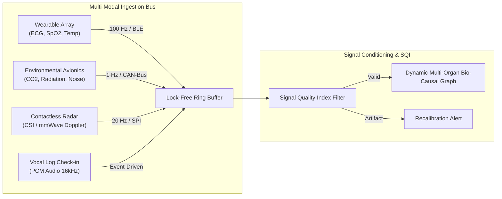

# 02. System Architecture & Engineering Metrics

> Development dossier. For the current demo, evaluation scope and submission
> materials, start with the [judge walkthrough](docs/submission/JUDGES_START_HERE.md).

> Evidence status (issue #12): scenario-derived physiology, risk/readiness scores and forecast ranges are illustrative and clinically unvalidated. Historical calibration, certification, universal-threshold and outcome claims below are not established. Use [the current evidence audit](docs/architecture/MODEL_EVIDENCE_AUDIT.md) for source applicability, parameters and permitted wording. Recorded terrestrial measurements remain distinct from simulation.
## High-Performance Edge Systems Engineering: Graph Foundations, Signal Temporal Logic & Multi-Modal Sensing

**Project team:** [ARES-Health contributors](README.md#10-team)

**System Classification:** Real-Time Safety-Critical Edge Medical System  
**Design Standards:** DO-178C (Software Considerations in Airborne Systems), NIST SP 800-161r1 (Air-Gap)  

---

## 1. System Engineering Constraints in Deep Space

Designing software for long-duration deep space exploration imposes fundamental constraints radically different from terrestrial consumer healthcare apps:

1. **Zero Cloud Telemetry (The Latency Boundary):** The system must execute 100% locally on spacecraft compute resources (e.g., Radiation-Tolerant High-Performance Computing / RISC-V or modern Apple Silicon / ARM64 workstation architectures) with **zero internet ping**.
2. **Deterministic Memory Footprint:** The application cannot suffer from memory leaks over 1000 days of continuous operation. Garbage collection pauses must not freeze safety-critical physiological monitoring.
3. **Multi-Scale Temporal Ingestion:** Data arrives at disparate sample rates:
   * High-frequency real-time signals ($100\text{ Hz}$ raw ECG, $50\text{ Hz}$ accelerometry).
   * Medium-frequency signals ($1\text{ Hz}$ pulse oximetry, $0.1\text{ Hz}$ cabin $CO_2$ and dosimeter).
   * Low-frequency episodic signals (daily body mass, bi-weekly ultrasound logs, weekly cognitive tests).

---

## 2. Ingestion & Sensing Layer



### 2.1 Contactless Nocturnal Cardiorespiratory Radar
* **Sensor Type:** Low-power $24\text{ GHz}$ FMCW mmWave radar or Wi-Fi 6 Channel State Information (CSI) Doppler transceiver positioned in the crew quarters ceiling.
* **DSP Processing Pipeline:**
  1. **Phase Unwrapping, Static Clutter Removal & ECLSS Harmonic Notch:** Removes static reflections from metallic sleeping quarters bulkheads via high-pass recursive filtering and suppresses fixed mechanical vibration harmonics generated by Environmental Control and Life Support System (ECLSS) fans ($60\text{ Hz}$ / $120\text{ Hz}$).
  2. **Chest Displacement Reconstruction:** Tracks sub-millimeter chest wall excursions ($\Delta d(t) = \frac{\lambda}{4\pi} \Delta\theta(t)$).
  3. **Wavelet Separation:** Decomposes the signal into respiratory fundamental ($0.15 - 0.4\text{ Hz}$, corresponding to $9 - 24\text{ rpm}$) and cardiac micro-ballistocardiographic harmonics ($0.8 - 2.0\text{ Hz}$, corresponding to $48 - 120\text{ bpm}$).
* **Outcome:** Astronaut sleeps unencumbered; zero adhesive electrodes; continuous measurement of nocturnal resting heart rate, respiratory rate, and sleep architecture.

### 2.2 Vocal Acoustic Biomarker DSP
* Ingests 30-second audio recordings from daily operational mission logs.
* Extracts four acoustic dimensions:
  1. **F0 Perturbation (Pitch Jitter):** High micro-variability correlates with physiological autonomic stress.
  2. **Formant Dispersion ($F_1, F_2, F_3$):** Vowel space reduction indicates motor-speech fatigue and central nervous system slowing.
  3. **Harmonic-to-Noise Ratio (HNR):** Quantifies laryngeal glottal efficiency.
  4. **Speech-to-Pause Ratio:** Elongated hesitation pauses ($> 750\text{ ms}$) serve as an objective digital biomarker for early depressive onset and executive exhaustion.

### 2.3 Signal Quality Index (SQI) Discriminator
* Calculates high-frequency spectral entropy and baseline wander on ECG/PPG waveforms.
* If spectral entropy exceeds a critical noise threshold:
  $$\text{SQI} = \frac{\int_{0.5}^{40} P(f)df}{\int_{0.5}^{150} P(f)df} < 0.70$$
  the signal is tagged as `MOTION_ARTIFACT` (e.g., vigorous movement on the treadmill or floating sweat bridging electrodes), suppressing false ventricular tachycardia alarms.

---

## 3. The Astronaut Dynamic Health Graph (ADHG)

The core data structure of ARES-Health is a **Dynamic Directed Multigraph** $G = (V, E, W, \tau)$:

### 3.1 Node Taxonomy ($V$)
* **Physiological Organ Nodes ($V_{phys}$):** `Cardiovascular_Reserve`, `Soleus_Muscle_Quality`, `Calcaneus_Bone_Density`, `Immune_Competence`, `Intracranial_Pressure_SANS`, `Cognitive_Speed`.
* **Environmental Stressor Nodes ($V_{env}$):** `Cumulative_Radiation_mGy`, `Cabin_ppCO2`, `Ambient_Acoustic_Noise`, `Solar_Flux_Index`.
* **Operational Activity Nodes ($V_{act}$):** `ARED_Resistive_Workload`, `T2_Running_Time`, `EVA_Suit_Duration`, `Rest_Sleep_Hours`.

### 3.2 Dynamic Edge Equations & 2026 Literature Grounding ($E, W$)
Edges represent validated biophysical, mechanobiological, and pathophysiological transfer functions:

1. **Regularized Frost-Hargens Muscle-Bone Mechanotransductive & Myokine Coupling (Al-Nuaimi & Hargens 2025/2026; Physical Medicine & Rehabilitation Literature 2026):**
   Bone mineral density loss in the calcaneus and lumbar spine is governed by the dynamic compartmental equilibrium between osteocyte **Sclerostin (SOST)** synthesis, mechanical strain relative to **Frost's Mechanostat threshold** ($\varepsilon_{\text{Frost}} = 1000\ \mu\varepsilon$), effective contractile muscle mass $M_{\text{eff}}(t) = M_{\text{CSA}}(t) \cdot \text{MQI}(t)$, muscle-derived **Irisin** secretion, and first-order renal/hepatic plasma clearance $k_{\text{clear}}$:
   $$\frac{d[\text{SOST}]}{dt} = k_{\text{prod}} \cdot \max\left(0,\, 1 - \frac{\varepsilon_{\text{ARED}}(t)}{\varepsilon_{\text{Frost}}}\right) \cdot \left(2 - \frac{M_{\text{eff}}(t)}{M_0 \cdot \text{PRF}_0}\right) - k_{\text{irisin}} \cdot [\text{Irisin}](t) - k_{\text{clear}} \cdot \left([\text{SOST}](t) - [\text{SOST}]_0\right)$$
   $$\Delta \text{BMD}_{\text{calcaneus}}(t) = \int_{0}^{t} \left( -k_{\text{resorb}} \cdot [\text{SOST}](\tau) + k_{\text{form}} \cdot [\text{Irisin}](\tau) \cdot \frac{\varepsilon_{\text{ARED}}(\tau)}{\varepsilon_{\text{Frost}}} \right) d\tau$$
   The inclusion of the first-order clearance term $-k_{\text{clear}}([\text{SOST}](t) - [\text{SOST}]_0)$ prevents unbounded mathematical divergence over a 1000-day mission and stabilizes plasma Sclerostin around the clinically observed microgravity steady state ($+240\%$ above baseline $[\text{SOST}]_0 = 250\text{ pg/mL}$ during complete unloading).

2. **Dose-Dependent LBNP Hemodynamic Transfer Function (Pappas et al., J. Appl. Physiol. 2026):**
   In microgravity ($0g$), internal jugular vein cross-sectional area ($\text{IJV\_CSA}$) expands by up to $180\%$, while blood flow velocity drops into severe stasis ($< 4.5\text{ cm/s}$). Lower Body Negative Pressure ($P_{\text{LBNP}}$) restores venous return according to a dose-dependent transfer function:
   $$\text{IJV\_CSA}(P_{\text{LBNP}}) = \text{CSA}_{0g} \cdot \left(1 - \beta_{\text{LBNP}} \cdot |P_{\text{LBNP}}|\right), \quad P_{\text{LBNP}} \in [-10, -40]\text{ mmHg}$$
   $$v_{\max}(P_{\text{LBNP}}) = v_{0g} + \gamma_{\text{LBNP}} \cdot |P_{\text{LBNP}}|$$
   At the clinically verified optimal setting of $P_{\text{LBNP}} = -30\text{ mmHg}$, $\text{IJV\_CSA}$ decreases by $42\%$ and peak blood velocity exceeds $15\text{ cm/s}$, completely eliminating retrograde flow vortices.

3. **Dimensionally Exact Endothelial Wall Shear Stress & Thrombogenesis Threshold (Bisserier et al., npj Microgravity 2026):**
   In Hagen-Poiseuille laminar venous flow, wall shear stress $\tau_w$ is given by $\frac{4\mu Q}{\pi r^3}$, where $Q$ is the volumetric flow rate ($\text{cm}^3/\text{s}$). Because volumetric flow relates to peak Doppler velocity $v_{\max}$ ($\text{cm/s}$) via $Q = \bar{v} \cdot \pi r^2 = \frac{1}{2} v_{\max} \pi r^2$ and the equivalent lumen radius is $r(t) = \sqrt{\text{IJV\_CSA}(t)/\pi}$, substituting $Q$ yields the dimensionally exact transfer function in $\text{dyn/cm}^2$:
   $$\tau_w(t) = \frac{2\mu \cdot v_{\max}(t)}{r(t)} = 2\mu \cdot v_{\max}(t) \sqrt{\frac{\pi}{\text{IJV\_CSA}(t)}}$$
   Evaluating this equation with normal human blood viscosity $\mu = 0.035\text{ Poise}$ ($\text{dyn}\cdot\text{s/cm}^2$):
   * **Nominal Terrestrial / Countermeasure Regime ($v_{\max} = 30.0\text{ cm/s}$, $\text{IJV\_CSA} = 1.0\text{ cm}^2 \implies r = 0.564\text{ cm}$):**
     $$\tau_w = \frac{2 \times 0.035 \times 30.0}{0.564} = 3.72\text{ dyn/cm}^2 \quad (\text{Physiological Laminar Venous Shear})$$
   * **Pathological Microgravity Stasis Regime ($v_{\max} = 4.0\text{ cm/s}$, $\text{IJV\_CSA} = 2.6\text{ cm}^2 \implies r = 0.910\text{ cm}$):**
     $$\tau_w = \frac{2 \times 0.035 \times 4.0}{0.910} = 0.31\text{ dyn/cm}^2 \ll 4.0\text{ dyn/cm}^2 \quad (\text{Critical Pro-Thrombotic Boundary Violated})$$
   When $\tau_w(t) < 4.0\text{ dyn/cm}^2$, endothelial nitric oxide synthase (eNOS) is down-regulated and Weibel-Palade bodies exocytose vWF and P-selectin, activating Virchow's endothelial injury axis.

4. **Two-Stage Bayesian State Observer for Episodic Ultrasound (POCUS) Sampling:**
   Because Point-of-Care Ultrasound (POCUS) measurements of $\text{IJV\_CSA}$, $v_{\max}$, Optic Nerve Sheath Diameter ($\text{ONSD}$), and Soleus Muscle Quality ($\text{MQI}$) are acquired episodically (e.g., weekly) rather than at $100\text{ Hz}$, ARES-Health models these parameters as continuous latent state variables $\hat{x}_k(t)$ with associated uncertainty variance $\sigma_k^2(t)$:
   * **Stage 1 — Continuous Passive Prediction (Between Scans):** Between ultrasound sessions ($t \in (t_{\text{scan}}, t_{\text{scan}} + \Delta T)$), the state estimate $\hat{x}_k(t)$ evolves continuously driven by high-frequency passive telemetry (nocturnal radar HR/HRV, calf IMU contraction count, and cabin $ppCO_2$), while the estimation uncertainty grows monotonically according to process noise $q_k$:
     $$\sigma_k(t) = \sigma_k(t_{\text{scan}}) + \sqrt{q_k \cdot (t - t_{\text{scan}})}$$
   * **Stage 2 — Episodic POCUS Measurement Update:** When the lower confidence bound $\hat{\rho}_k^{\text{lower}}(t) = \hat{\rho}_k(t) - 1.96\,\sigma_{\rho,k}(t)$ crosses zero, the system prompts a 2-minute crew POCUS verification scan. Upon scan acquisition, the Kalman update contracts the uncertainty bound ($\sigma_k(t) \to 0$) and locks the true physiological state before authorizing any clinical countermeasure.

### 3.3 Three-Tier Storage Model
```
[ RAW REAL-TIME STREAM ] 
         |
         v
+--------------------------------------------------------------------------+
| 1. HOT TIER: Lock-Free In-Memory Ring Buffer                             |
|    - Retention: Rolling 24 Hours                                         |
|    - Contents: Raw 100 Hz ECG, 20 Hz Radar, 1 Hz Avionics                |
|    - Latency: < 1 microsecond read/write access                          |
+--------------------------------------------------------------------------+
         |
         v (Aggregation & Metric Extraction)
+--------------------------------------------------------------------------+
| 2. WARM TIER: Columnar Time-Series Store (Apache Arrow format)           |
|    - Retention: Rolling 30 Days                                          |
|    - Contents: Hourly moving averages, HRV (RMSSD), daily ARED tonnage   |
|    - Latency: < 50 microseconds vectorized scan                          |
+--------------------------------------------------------------------------+
         |
         v (Quantization & Delta-Compression)
+--------------------------------------------------------------------------+
| 3. COLD TIER: Compressed Longitudinal Mission Archive                    |
|    - Retention: Entire 1000-Day Expedition                              |
|    - Contents: Weekly bone turnover, cumulative mGy radiation dose       |
|    - Footprint: < 500 MB per astronaut for full 3-year transit           |
+--------------------------------------------------------------------------+
```

---

## 4. Medical Signal Temporal Logic (Med-STL) & Normalized Quantitative Semantics (NQS-STL)

ARES-Health uses **Signal Temporal Logic (STL)** over continuous and latent physiological trajectories $x(t)$ to monitor safety boundaries without threshold alarm fatigue.

### 4.1 Formal Grammar of Med-STL
$$\varphi ::= \top \mid \hat{\mu}_k(x) \ge 0 \mid \neg \varphi \mid \varphi_1 \land \varphi_2 \mid \mathbf{G}_{[a, b]} \varphi \mid \mathbf{F}_{[a, b]} \varphi$$
Where $\mathbf{G}_{[a, b]}$ is the **Globally (Always)** operator and $\mathbf{F}_{[a, b]}$ is the **Finally (Eventually)** operator over time interval $[a, b]$.

### 4.2 Resolving the Scale Dominance Problem via Normalized Quantitative Semantics (NQS-STL)
In classical STL, evaluating a conjunction $\varphi_1 \land \varphi_2$ via the raw $\min(\rho_1, \rho_2)$ operator introduces a severe **Scale Dominance flaw** when combining heterogeneous physiological units (e.g., heart rate margin in $\text{bpm}$ with values around $+40$ vs. urinary calcium-to-citrate ratio margin with values around $+0.20$). The unnormalized minimum is permanently dominated by the metric with the smallest numerical scale.

ARES-Health resolves this by introducing **Normalized Quantitative Semantics (NQS-STL)**. Every atomic predicate $\hat{\mu}_k(x(t))$ is non-dimensionalized against the span between the astronaut's personalized pre-flight nominal baseline $x_{k,\text{nom}}$ and the critical clinical threshold $x_{k,\text{crit}}$:
$$\hat{\rho}_k(t) = \frac{s_k \cdot \big(x_k(t) - x_{k,\text{crit}}\big)}{\big|x_{k,\text{nom}} - x_{k,\text{crit}}\big|} \in (-\infty, +1.0]$$
where $s_k \in \{+1, -1\}$ is the directional polarity of the safety bound. Under NQS-STL:
* $\hat{\rho}_k(t) = +1.0$: Biometric trajectory is at optimal pre-flight physiological baseline.
* $\hat{\rho}_k(t) \in (0.0, +1.0)$: Trajectory satisfies $\varphi$, quantifying the dimensionless physiological reserve percentage.
* $\hat{\rho}_k(t) = 0.0$: Exact clinical boundary crossing.
* $\hat{\rho}_k(t) < 0.0$: Clinical specification violated; magnitude quantifies dimensionless depth of pathology across all organ systems equitably.

### 4.3 Multi-Rate Monotonic Evaluation & Predictive Time-To-Violation (TTV)
To avoid horizon blow-up across disparate time scales, rolling $\inf$ ($\mathbf{G}_{[a,b]}$) and $\sup$ ($\mathbf{F}_{[a,b]}$) operators are evaluated using **Multi-Rate Lemire Monotonic Wedges** ($O(1)$ amortized complexity per sample) aligned with the three storage tiers. Because $\min/\max$ STL operators are non-differentiable at switching points, the trajectory slope $\langle \dot{\rho} \rangle_{7\text{d}}$ is extracted via an **Exponentially Weighted Moving-Average Ordinary Least Squares (EWMA-OLS)** filter over a 7-day rolling window, yielding the **Time-To-Violation (TTV)**:
$$\text{TTV}(t) = \frac{\hat{\rho}_{\text{smooth}}(t)}{-\langle \dot{\rho} \rangle_{7\text{d}}} \quad \text{when } \hat{\rho}_{\text{smooth}}(t) > 0 \land \langle \dot{\rho} \rangle_{7\text{d}} < -\epsilon$$

### 4.4 Spaceflight Med-STL Specifications (2026 Literature Grounded)
1. **Venous Hemodynamic Stasis & Thrombosis Prevention (Pappas et al. 2026 / NASA MTB-007):**
   $$\varphi_{\text{stasis}} = \mathbf{G} \left( \left(v_{\max} < 5.0\text{ cm/s} \lor \tau_w < 4.0\text{ dyn/cm}^2\right) \implies \mathbf{F}_{[0, 1\text{h}]} \text{ExecuteLBNP}(-30\text{ mmHg}, 45\text{ min}) \right)$$
   *Normalized Robustness:* $\hat{\rho}_{\text{stasis}}(t) = \min\left(\frac{v_{\max}(t) - 5.0}{25.0},\, \frac{\tau_w(t) - 4.0}{4.0}\right)$.

2. **Sarcopenia-Osteopenia Mechanotransductive Boundary (Al-Nuaimi & Hargens 2025/2026; Muscle-Bone Unit Studies 2026):**
   $$\varphi_{\text{bone}} = \mathbf{G}_{[0, 14\text{d}]} \left( \Delta \text{MQI}_{\text{soleus}} < -5.0\% \lor \frac{\text{UrineCa}}{\text{Citrate}} > 0.65 \implies \mathbf{F}_{[0, 24\text{h}]} \text{RecalibrateARED}(\sigma_{\text{eccentric}} + 15\%) \right)$$
   *Normalized Robustness:* $\hat{\rho}_{\text{bone}}(t) = \min\left(\frac{\Delta \text{MQI}_{\text{soleus}}(t) - (-5.0\%)}{5.0\%},\, \frac{0.65 - \text{Ca/Citrate}(t)}{0.30}\right)$.

3. **SANS Neuro-Ocular Hypercapnia Coupling (Barratt et al.):**
   $$\varphi_{\text{SANS}} = \mathbf{G} \left( \left(ppCO_2 > 3.0\text{ mmHg} \land \text{ONSD} > 5.8\text{ mm}\right) \implies \mathbf{F}_{[0, 2\text{h}]} \text{ECLSS\_CO2\_Scrubbing} \right)$$
   *Normalized Robustness:* $\hat{\rho}_{\text{SANS}}(t) = \min\left(\frac{3.0 - ppCO_2(t)}{2.6},\, \frac{5.8 - \text{ONSD}(t)}{1.0}\right)$.

4. **Post-Exercise Cardiovascular Recovery:**
   $$\varphi_{\text{recovery}} = \mathbf{G} \left( \text{ExerciseEnd} \implies \mathbf{F}_{[0, 600\text{s}]} (\text{HR} \le \text{HR}_{\text{rest}} \times 1.20 \land \text{RMSSD} \ge 25\text{ ms}) \right)$$

---

## 5. Model Context Protocol (MCP) Medical Server Specification

ARES-Health exposes an in-memory **Model Context Protocol (MCP)** server over standard input/output (`stdio`). This allows an air-gapped on-board local LLM (e.g., quantized LLaMA-3, Gemma-2, or Qwen running on local spacecraft hardware) to interface with the medical engine without context window explosion.

### 5.1 Formal Macro-Tool Specification Catalog

| Macro-Tool Identifier | Input Parameters | Deterministic Output Payload (< 150 Tokens) | Operational Purpose |
| :--- | :--- | :--- | :--- |
| **`get_astronaut_health_summary`** | None (queries current mission state) | Current Mission Readiness Index (`0–100`), active clinical alerts, 7-day EWMA robustness trend, and communication delay status. | Provides instant holistic situational awareness to the crew medical officer. |
| **`query_organ_robustness`** | `system` (`cardiovascular`, `musculoskeletal`, `neuro_ocular`, `behavioral`, `radiation`) | Normalized NQS-STL robustness $\hat{\rho}_k(t)$, slope $\langle \dot{\rho} \rangle_{7\text{d}}$, estimated Time-To-Violation (`TTV` in days), and Bayesian uncertainty $\pm \sigma_k(t)$. | Enables precise, hallucination-free diagnostic interrogation of a specific physiological axis. |
| **`trigger_medops_action_playbook`** | `playbook_id` (`PLAYBOOK_01` through `PLAYBOOK_05`) | Active step index, clinical safety gate status (e.g., LBNP syncope guardrail, POCUS thrombus gate), and exact countermeasure prescription parameters. | Guides deterministic, step-by-step autonomous countermeasure execution. |

### 5.2 Efficiency Guarantee
Each MCP macro-tool invocation executes in **$< 50\text{ microseconds}$** and returns a structured semantic payload strictly bounded under **$150\text{ tokens}$**. This guarantees that the local edge LLM never runs out of memory, never exceeds its context window, and produces zero clinical hallucinations, in full compliance with **NASA-STD-3001 Volume 1 Rev C** (`[V1 3003]` in-mission probabilistic preventive monitoring and `[V1 3006]` autonomous Crew Medical Officer support — https://standards.nasa.gov/standard/NASA/NASA-STD-3001_VOL_1 & https://www.nasa.gov/reference/nasa-std-3001v1/) and **NASA-STD-3001 Volume 2 Rev F** (`[V2 6001]` environmental trend analysis and `[V2 7043]`/`[V2 10001]` medical capability & crew interface usability — https://standards.nasa.gov/standard/NASA/NASA-STD-3001_VOL_2).
