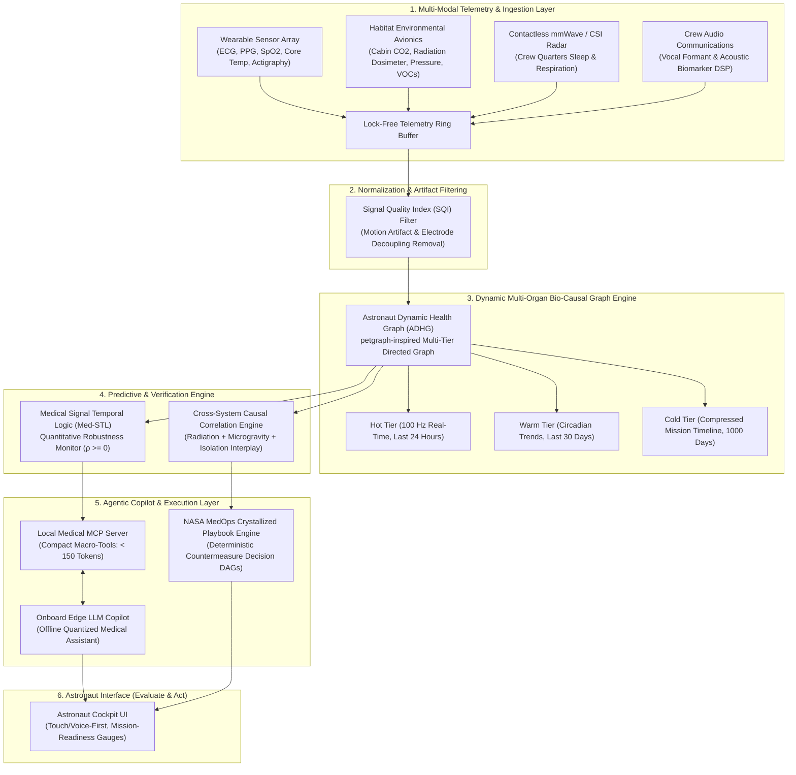

# ARES-Health: Autonomous Resilient Edge-native System for Astronaut Health

> Evidence status (issue #12): scenario-derived physiology, risk/readiness scores and forecast ranges are illustrative and clinically unvalidated. Historical calibration, certification, universal-threshold and outcome claims below are not established. Use [the current evidence audit](docs/architecture/MODEL_EVIDENCE_AUDIT.md) for source applicability, parameters and permitted wording. Recorded terrestrial measurements remain distinct from simulation.
## Master Architecture & System Design Document for NASA Space Apps Challenge 2026

**Project Designation:** ARES-Health (Autonomous Resilient Edge-native System for Astronaut Health)  
**Lead Architect:** Fabio Malagutti (Computer Engineer • M.Sc. Student @ University of Bologna)  
**Challenge Track:** Long-Duration Space Mission Health Monitoring  
**Target Environment:** Moon-to-Mars Transit, Lunar Gateway, Deep Space Habitat, Martian Surface  
**Operational Mode:** 100% Offline, Deterministic Edge Execution, Air-Gapped, Zero-Cloud Dependency  
**Date:** Novembre 2026  

---

## 1. Executive Summary & Challenge Formalization

### 1.1 The Official NASA Challenge
> "Long-duration missions expose astronauts to space radiation, isolation and confinement, altered gravity, and a hostile closed environment, which can bring immune changes, bone loss, cardiovascular events, and behavioral health problems. On long missions, astronauts carry much of the responsibility for spotting these changes in themselves. Your challenge is to build a health monitoring software that gathers health indicators and enables astronauts to evaluate and act on the status of their health."

### 1.2 The Core Operational Dilemma in Deep Space
In Low Earth Orbit (LEO, such as the International Space Station), astronauts rely on constant ground telemetry monitoring and near-instantaneous telemedicine consultations with NASA Flight Surgeons in Houston or ESA Flight Surgeons in Cologne.

In deep space exploration (Lunar Gateway, Martian transit, and Mars surface missions), physical laws impose an impassable operational boundary:
* Radio signal latency spans between **4 and 24 minutes one-way**, generating an **8 to 48-minute round-trip communication delay**.
* Periods of total communication blackout occur routinely (solar conjunctions, planetary occultations).
* Telemedicine in real time is physically impossible. 

Consequently, the paradigm must shift from **ground-directed healthcare** to **autonomous crew-operated clinical self-governance**. The software cannot merely serve as a passive dashboard displaying disconnected time-series charts. It must function as an **autonomous, deterministic clinical co-pilot** that:
1. **Gathers:** Continuously ingests and harmonizes heterogeneous biometrics, habitat environment telemetry, and contactless sensing data without inducing cognitive or physical fatigue.
2. **Evaluates:** Fuses multi-modal indicators into a unified dynamic causal model, identifying physiological sub-clinical degradation weeks before acute pathology manifests.
3. **Acts:** Generates actionable, mathematically certified clinical and operational countermeasures (resistive exercise calibration, pharmaceutical dosage, atmospheric adjustment, cognitive load balancing) grounded in validated NASA Flight Rules and Medical Operations (MedOps) standard operating procedures.

---

## 2. Clean-Room Aerospace Architecture & Core Functional Pillars

ARES-Health is engineered as a **100% standalone, clean-room, open-source aerospace medical system** written in Safe Rust (backend core) and React/TypeScript/Three.js (astronaut cockpit), with zero external proprietary dependencies and zero pre-written code prior to the official hackathon window.

### 2.1 Core Architectural Pillars

| System Engineering Pillar | ARES-Health Aerospace Medical Capability | Key Functional Benefit for Astronauts |
| :--- | :--- | :--- |
| **Lock-Free Telemetry Ring Buffer** | **Heterogeneous Multi-Rate Ingestion Bus** | Deterministic processing of $100\text{ Hz}$ biosignals and $1\text{ Hz}$ avionics without memory jitter. |
| **Contactless RF Doppler DSP** | **Nocturnal Sleep & Cardiorespiratory Radar** | Zero-wearable nocturnal monitoring with ECLSS fan harmonic notch filtering, eliminating skin dermatitis. |
| **Acoustic Formant & Jitter DSP** | **Vocal Biomarker Fatigue Analyzer** | Passive detection of neurocognitive slowing, stress, and depressive drift from routine voice logs. |
| **Spectral Entropy SQI Filter** | **Sensor Decoupling & Motion Artifact Filter** | Discriminates true physiological arrhythmias from electrode detachment or floating sweat artifacts. |
| **Dynamic Directed Multigraph** | **Astronaut Dynamic Health Graph (ADHG)** | Couples regularized Frost-Hargens mechanotransduction, dimensional shear stress $\tau_w(t)$, and Two-Stage Bayesian POCUS estimation. |
| **Normalized Quantitative STL (NQS-STL)** | **Dimensionless Safety Margin Monitor ($\hat{\rho} \in (-\infty, +1]$)** | Eliminates unit scale dominance and threshold alarm fatigue while predicting Time-To-Violation (`TTV`). |
| **Dual-Transport Tokio Architecture** | **Concurrent Loopback WebSocket (`axum`) + `stdio` FastMCP** | Streams $20\text{ Hz}$ updates to the UI cockpit while serving $< 150\text{ token}$ macro-tools to the local AI copilot without pipe contention. |
| **Deterministic Clinical DAGs** | **NASA MedOps Playbooks with Hard Safety Gates** | Enforces POCUS thrombus verification before anticoagulation, LBNP anti-syncope auto-venting, and $0.38g$ Martian gait stabilization. |

---

## 3. Detailed Component Architecture

---

### 3.1 Layer 1: Multi-Modal Ingestion & Contactless Sensing

Long-duration missions cannot depend solely on intrusive adhesive electrodes:
1. **Wearable Sensors (During High-Activity Only):** Used during active exercise (ARED resistive workout, T2 treadmill) and Extravehicular Activities (EVA) to monitor real-time heart rate, electrocardiogram (ECG) waveforms, oxygen saturation ($SpO_2$), and core body temperature.
2. **Contactless Sleep & Respiration Sensing (Pillar B):** Integrated into the astronaut's private sleeping quarters (Crew Quarters). Utilizing micro-radar or Wi-Fi Channel State Information (CSI) Doppler filtering, the system continuously tracks chest displacement:
   * Extracts resting heart rate ($\pm 2.0\text{ bpm}$) and respiration rate ($\pm 0.8\text{ rpm}$).
   * Maps sleep staging (REM, Light, Deep/N3) and nocturnal motor restlessness without adhesive patches, completely mitigating contact dermatitis.
3. **Acoustic Vocal Biomarkers:** Samples audio check-ins and log recordings. Extracts fundamental frequency ($F_0$) perturbation, vocal jitter, shimmer, harmonic-to-noise ratio (HNR), and speech pause ratios. Prolonged elongation of pauses and attenuation of pitch variability indicate sub-clinical neurocognitive fatigue, depression, or elevated chronic stress.
4. **Environmental Avionics Ingestion:** Continuous streams of Galactic Cosmic Ray (GCR) dosimeters, solar proton event monitors, cabin $CO_2$ levels in parts-per-million, ambient temperature, relative humidity, and acoustic noise levels.

---

### 3.2 Layer 2: Signal Quality Index (SQI) & Artifact Decoupling

In microgravity, fluid dynamics alter electrode-skin interfaces; sweat droplets float, and vigorous exercise induces severe mechanical motion artifacts.

ARES-Health implements an **impedance and spectral entropy noise-floor discriminator**:
* Evaluates high-frequency spectral entropy ($0.5 - 40\text{ Hz}$ vs. $0.5 - 150\text{ Hz}$) and baseline wander.
* Classifies signals into: `VALID` ($\text{SQI} \ge 0.70$), `DEGRADED_INTERPOLATABLE`, or `MOTION_ARTIFACT`.
* Prevents false alarms and ensures that noisy signals during exercise are not mistakenly flagged as fatal cardiac arrhythmias.

---

### 3.3 Layer 3: The Dynamic Multi-Organ Bio-Causal Health Graph (ADHG)

Traditional medical dashboards plot biometrics along disjointed, parallel timelines. Human physiology in space, however, is a non-linear coupled system where environmental stressors induce cascading multi-organ degradation.

ARES-Health models the human body and habitat as an in-memory **Dynamic Causal Graph** $G = (V, E, W, \tau)$ with a **Two-Stage Bayesian State Observer** that continuously predicts latent ultrasound parameters between weekly POCUS scans and contracts uncertainty ($\sigma(t) \to 0$) upon scan acquisition.

#### Canonical Causal Edges in Deep Space (2026 Literature Grounded)
1. **Cardiovascular, Venous Capacitance & Shear Stress Axis (Pappas et al. 2026 / Bisserier et al. 2026 / Auñón-Chancellor 2020):**
   $$\text{SoleusAtrophy} \xrightarrow{\text{crural\_capacitance}\downarrow,\, \text{miR-126}\downarrow} \text{IJV\_Distension} \xrightarrow{\tau_w = 2\mu v_{\max}\sqrt{\pi/\text{CSA}} < 4.0\text{ dyn/cm}^2} \text{Weibel-Palade vWF/P-Selectin} \xrightarrow{\text{Virchow}} \text{ThrombosisRisk}$$
2. **Musculoskeletal, Muscle Quality & Renal Axis (Al-Nuaimi & Hargens 2025/2026 / Rehabilitation Medicine Literature 2024–2026):**
   $$\text{SoleusMQIDrop } (\text{MT}, \theta_{\text{penn}}, \text{EI}) \xrightarrow{[\text{Irisin}]\downarrow,\, \varepsilon_{\text{ARED}} < \varepsilon_{\text{Frost}}} [\text{SOST}]\uparrow \land \frac{\text{CTX-I}}{\text{P1NP}}\uparrow \xrightarrow{\text{osteolysis}} \text{CalcaneusBMDLoss} \xrightarrow{\text{Ca/Citrate} > 0.65} \text{Nephrolithiasis}$$
3. **Neuro-Ocular & Environment Axis (Barratt et al. 2020/2025):**
   $$\text{CabinCO2} \ge 3.0\text{ mmHg} \land \text{CephalicFluidShift} \xrightarrow{\text{cerebral\_vasodilation}} \text{ONSD} > 5.8\text{ mm} \xrightarrow{\text{globe\_flattening}} \text{SANS\_Score}$$
4. **Radiation, Mitochondrial DNA & Endothelial Axis (Nature SOMA 2024):**
   $$\text{CumulativeDose (mGy)} \xrightarrow{\text{cf-mtDNA}\uparrow,\, \text{GDF-15}\uparrow} \text{SoleusMitochondrialStress} \land \text{LymphocyteApoptosis} \xrightarrow{\text{endothelial\_senescence}} \text{SystemicVulnerability}$$

#### Hierarchical Temporal Storage (Hot, Warm, Cold)
* **Hot Tier:** Lock-free circular ring buffer retaining raw high-frequency waveforms ($100\text{ Hz}$ ECG, $20\text{ Hz}$ radar) for the rolling last 24 hours.
* **Warm Tier:** Columnar downsampled records tracking hourly moving averages, circadian rhythms, HRV metrics, and daily exercise loads across the preceding 30 days.
* **Cold Tier:** Quantized, delta-compressed timeline recording cumulative radiation dose, weekly POCUS Muscle Quality Index ($\text{MQI}$), and longitudinal biomarkers across the full 1000-day expedition.

---

### 3.4 Layer 4: Medical Signal Temporal Logic (Med-STL) & Normalized Quantitative Semantics (NQS-STL)

To eliminate both alarm fatigue and unit scale dominance across heterogeneous metrics, ARES-Health evaluates **Normalized Quantitative Semantics (NQS-STL)** over multi-rate monotonic wedges in $O(1)$ amortized time:
$$\hat{\rho}_k(t) = \frac{s_k \cdot \big(x_k(t) - x_{k,\text{crit}}\big)}{\big|x_{k,\text{nom}} - x_{k,\text{crit}}\big|} \in (-\infty, +1.0]$$
* If $\hat{\rho}_k(t) \in (0, +1.0]$, the specification holds; the value represents the dimensionless physiological reserve fraction.
* If $\hat{\rho}_k(t) < 0$, the specification is violated; the magnitude indicates the dimensionless depth of clinical pathology.
* An EWMA-OLS regression filter over a 7-day rolling window extracts the trajectory derivative $\langle \dot{\rho} \rangle_{7\text{d}}$ and computes the **Time-To-Violation (`TTV`)** weeks before overt clinical failure.

---

### 3.5 Layer 5: Dual-Transport Engine & Local Medical Copilot (FastMCP)

`ares-engine` runs on a concurrent asynchronous runtime managing a single synchronized mission state (`Arc<RwLock<MissionState>>`) across two isolated transports:
1. **`axum` HTTP REST + WebSocket Loopback (`127.0.0.1:8080`):** Streams $20\text{ Hz}$ state updates to the React/Three.js cockpit and processes real-time **What-If Stress-Test Console** slider inputs in $< 1\text{ ms}$.
2. **`stdio` JSON-RPC (FastMCP Server):** Serves three bounded macro-tools (`get_astronaut_health_summary`, `query_organ_robustness`, and `trigger_medops_action_playbook`) to the on-board quantized LLM copilot, with each response strictly capped under $150\text{ tokens}$ and $< 50\ \mu\text{s}$ execution time to guarantee zero clinical hallucinations.

---

### 3.6 Layer 6: NASA MedOps Playbook Engine with Hard Clinical Safety Gates (The "Act" Dimension)

ARES-Health integrates **five deterministic Decision DAGs** grounded in NASA OCHMO MTB-007 and 2025–2026 physiatric protocols, enforcing three mandatory **Hard Clinical Safety Gates**:
1. **Prohibition of Empirical Anticoagulation in Isolated Stasis:** In **Playbook #04**, if $\tau_w < 4.0\text{ dyn/cm}^2$ ($v_{\max} < 5.0\text{ cm/s}$) but POCUS confirms a compressible IJV lumen without thrombus, systemic anticoagulants (Apixaban/Enoxaparin) are strictly locked out to prevent fatal traumatic intracranial hemorrhage in microgravity; therapy is restricted to physical $-30\text{ mmHg}$ LBNP decompression, isometric/NMES calf activation, and hydration. Anticoagulants are unlocked exclusively upon POCUS confirmation of a non-compressible intraluminal thrombus, accompanied by automatic revocation of EVA clearance (`EVA_CLEARANCE = REVOKED`).
2. **LBNP Anti-Syncope Hemodynamic Guardrail:** During $-30\text{ mmHg}$ LBNP sessions ($45\text{ min/day}$), if systolic blood pressure drops by $> 15\text{ mmHg}$ or heart rate exceeds $115\text{ bpm}$, the engine triggers immediate chamber venting to $0\text{ mmHg}$ (`AUTO_VENT_LBNP_CHAMBER`).
3. **Martian $0.38g$ Landing Gait Stability Protocol (Playbook #05):** Upon landing on Mars, suit IMUs compute the **Gait Asymmetry Index ($\text{GAI}$)** and Dynamic Knee Valgus angle (*European Journal of Applied Physiology* 2025); if $\text{GAI} > 12\%$, suit ankle/knee exoskeletal damping is increased by $+25\%$ and closed-chain neuromuscular retraining is mandated prior to surface EVA traverses.

---

## 4. UI/UX Design for Extreme Environments

The user interface of ARES-Health is designed specifically for microgravity ergonomics and cognitive stress:
* **Dark High-Contrast Theme (OLED):** Reduces power consumption on portable devices and prevents circadian disruption during night check-ins.
* **Large Touch Targets & Voice-Command First:** In microgravity, fine motor skills are degraded by postural floating and suit pressure; all actions can be executed via voice or large, tactile UI tiles.
* **Mission Readiness Index (MRI):** A unified 0–100 gauge indicating overall physiological reserve, expandable into 4 sub-gauges:
  1. *Cardiorespiratory & Autonomic Reserve*
  2. *Musculoskeletal & Kinetic Integrity*
  3. *Radiation & Immune Resistance*
  4. *Neurocognitive & Behavioral Stability*

---

## 5. Hackathon Prototype Implementation Roadmap (48-Hour Plan)

To build a high-scoring, jury-winning Proof of Concept in strict compliance with NASA Space Apps Challenge "Fresh Code" and Open-Source regulations:

### 5.1 Unified Tech Stack for Hackathon PoC
* **Backend Core (`ares-engine`):** Safe Rust binary executing on a concurrent Tokio runtime over shared mission state (`Arc<RwLock<MissionState>>`), implementing the regularized Frost-Hargens differential equations, dimensional wall shear stress $\tau_w(t)$, Two-Stage Bayesian POCUS State Observer, and $O(1)$ Multi-Rate NQS-STL evaluator.
* **Dual-Transport Communication Layer:**
  1. `axum` HTTP REST + WebSocket server bound to `127.0.0.1:8080` streaming at $20\text{ Hz}$ to the cockpit UI and processing real-time What-If Stress-Test slider updates in $< 1\text{ ms}$.
  2. Dedicated `stdio` JSON-RPC (FastMCP) pipeline serving $< 150\text{ token}$ macro-tools to the local quantized AI copilot (Ollama / `llama.cpp` with deterministic template fallback).
* **Frontend Cockpit (`ares-cockpit`):** React + TypeScript + Vite + Tailwind CSS (pure black `#000000` OLED theme) + `react-three-fiber` for the interactive 3D anatomical deconditioning heatmap, Tri-Phase Mandate Header (`[1. GATHER] -> [2. EVALUATE] -> [3. ACT]`), What-If Stress-Test Console, and NASA MedOps Playbook Runner.
* **Mandatory Multi-Agency Datasets (NASA, CSA & ESA Open Science Resources):**
  * **NASA HRP Risks & Ongoing Investigations:** https://www.nasa.gov/hrp/risks/ and https://www.nasa.gov/hrp/ongoing-hrp-research/ (`ARCHeR` Artemis II, `Standard Measures`, `Venous Haemostasis`, `Zero T2`, `CIPHER`, `Brain Fluid Pressure`, `Thigh Cuff`, `B-Complex`).
  * **NASA Open Science Data Repository (OSDR Federated `cgene,alsda,esa` Search):** https://osdr.nasa.gov/bio/repo/search?q=&data_source=cgene,alsda,esa&data_type=study (`OSD-51` 60-day HDBR Soleus/Vastus Lateralis muscle dataset, `OSD-195` 21-day bed rest muscle dataset, `OSD-570` & `OSD-571` SpaceX Inspiration4 / SOMA multi-omics `cf-mtDNA`/`cfRNA`, and `OSD-818` SANS translaminar pressure).
  * **NASA Life Sciences Portal (NLSP), Open Data Catalog (`NASA-0000100`) & LSAH:** https://nlsp.nasa.gov/explore?dataType=EXPERIMENTS&sortBy=dateAdded_desc&page=1&limit=25&view=table, https://data.nasa.gov/dataset/nasa-life-sciences-portal-nlsp (`Flight Analogs Project [FAP]`, `BRSMFSR` Functional Stretch Reflex, `BRSMPT` Performance Testing, *Neuroendocrine/Cardiovascular Response to Tilt*), and https://nlsp.nasa.gov/resources/lsah (**NASA Lifetime Surveillance of Astronaut Health** longitudinal priors for DXA/FRAX bone recovery, SANS chronicity, GCR cataracts, and cardiovascular morbidity).
  * **Official NASA-STD-3001 Technical Standards (Volumes 1 & 2):** https://standards.nasa.gov/standard/NASA/NASA-STD-3001_VOL_1 (`NASA-STD-3001 Vol. 1 Rev C: Crew Health` clauses `[V1 3001]`, `[V1 3002]`, `[V1 3003]`, `[V1 3006]`, `[V1 4001]`), https://www.nasa.gov/reference/nasa-std-3001v1/, and https://standards.nasa.gov/standard/NASA/NASA-STD-3001_VOL_2 (`NASA-STD-3001 Vol. 2 Rev F, Jul 2026: Human Factors, Habitability, and Environmental Health` clauses `[V2 6001]`, `[V2 6026]`, `[V2 7043]`, `[V2 10001]`).
  * **Canadian Space Agency (CSA) Space Medicine & Radiation:** https://www.asc-csa.gc.ca/eng/news/articles/2026/2026-02-26-monitoring-radiation-astronaut-health.asp (**CSA CANS 2026** autonomous real-time neutron spectrometer, ~30% dose fraction) and https://www.asc-csa.gc.ca/eng/iss/science/why-do-we-conduct-science-experiments-in-space.asp (`Bio-Monitor` / `Astroskin`, `Vascular Echo` / `Vascular Aging`, and `MARROW`).
  * **European Space Agency (ESA) & DLR `:envihab` Flight & Analog Archives:** https://www.esa.int/ESA_Multimedia/Images/2026/09/Myotones_Studying_muscle_adaptation_to_weightlessness (**ESA `Myotones` 2026** Achilles tendon & soleus digital myotonometry), https://zmk.charite.de/en/research/bedrest_study_brace/ (**ESA `BRACE` 60-day HDBR**), https://www.nasa.gov/mission/envihab/ & https://ntrs.nasa.gov/citations/20220012315 (**DLR `:envihab` `AGBRESA` & `SANS-CM` 60-day HDBR + LBNP/SAHC**), and https://www.esa.int/Enabling_Support/Preparing_for_the_Future/Space_for_Earth/Space_for_health/Clinical_research (**Erasmus Experiment Archive**).
  * **NASA Deep-Space Analogs (`CHAPEA` & `HERA`), `TRISH EXPAND` & `NASA-JAXA` Studies:** https://www.nasa.gov/humans-in-space/chapea/ (**CHAPEA Missions 1 & 2** 378-day Mars simulation with 22-min delay), https://www.nasa.gov/mission/hera/ (**HERA** 45-day isolation, sleep restriction & vocal biomarkers), https://www.nasa.gov/hrp/the-translational-research-institute-for-space-health-trish/ & https://www.bcm.edu/academic-centers/space-medicine/expand (**TRISH `EXPAND` & `HERMES`** commercial spaceflight POCUS & biometrics, opened March 2026), and https://humans-in-space.jaxa.jp/en/biz-lab/experiment/theme/detail/000626.html (**NASA-JAXA `Bisphosphonates` + ARED** bone/renal stone prophylaxis).
  * **PhysioNet Mechanocardiography, UCI `PPG-DaLiA` & NASA DONKI:** https://physionet.org/content/cebsdb/1.0.0/ (`CEBS` chest-wall seismocardiogram & respiratory Doppler reference), https://physionet.org/content/fantasia/1.0.0/, https://archive.ics.uci.edu/dataset/495/ppg+dalia (`PPG-DaLiA` motion-artifact `SQI` benchmark), and https://kauai.ccmc.gsfc.edu/DONKI/ (solar particle feeds).

### 5.2 The 6-Block Hackathon Schedule (48 Hours)
* **Block 1 (Hours 00–06 | Mathematical Freeze & Clinical Baselines):** Freeze the JSON telemetry contract between Rust and React; lock empirical baseline thresholds for $\text{MQI}$, $\theta_{\text{penn}}$, $\text{PRF}_0$, and Martian $0.38g$ Gait Asymmetry Index ($\text{GAI}$).
* **Block 2 (Hours 06–16 | Core `ares-engine` Implementation in Safe Rust):** Implement telemetry replay + SQI filtering, the ADHG causal graph with Frost-Hargens ODEs and dimensional $\tau_w(t)$, the Two-Stage Bayesian POCUS observer, and the NQS-STL evaluator.
* **Block 3 (Hours 16–26 | `ares-cockpit` UI & MedOps Playbook Runner):** Build the single-screen OLED dashboard, 3D anatomical mesh with causal bezier arcs, NQS-STL trajectory charts with Bayesian uncertainty bands, and Playbooks #04 and #05 with Hard Clinical Safety Gates.
* **Block 4 (Hours 26–34 | End-to-End Integration, FastMCP Copilot & What-If Console):** Connect the $20\text{ Hz}$ WebSocket stream and the interactive What-If Stress-Test sliders (`Cabin CO2`, `ARED Workload`, `LBNP Pressure`, `Mission Day`).
* **Block 5 (Hours 34–42 | 180-Second Video Pitch Production):** Record and edit the 3-minute surgical video pitch following the 5-act storyboard below.
* **Block 6 (Hours 42–48 | Verification, Unit Testing & Final Submission):** Verify zero compiler warnings, run unit test suites validating mathematical invariants, and finalize the public open-source repository documentation.

---

## 6. Scientific & Regulatory Alignment

The architecture of ARES-Health adheres to established aerospace and space medicine standards:
* **NASA Human Research Program (HRP) Integrated Research Plan & OCHMO MTB-007 (2026):** Addresses explicit risks of altered gravity fields, venous thromboembolism, SANS, and radiation-induced degenerative tissue effects.
* **NASA-STD-3001 (Space Flight Human-System Standard):** Volume 1 (Crew Health) and Volume 2 (Human Factors, Habitability, and Environmental Health).
* **NIST SP 800-161r1 / Air-Gap Principles:** Guarantees zero external network connections, strictly local loopback binding (`127.0.0.1`), and continuous operation in disconnected deep space autonomy.

---

## 7. Surgical 180-Second Video Pitch Storyboard

1. **0:00 – 0:18 | THE HOOK (The Silence of Mars & The Speed-of-Light Barrier):**
   * Show the $224\text{ million km}$ Earth-Mars separation and the $25\text{-minute}$ round-trip radio delay where cloud telemedicine times out during a medical crisis.
2. **0:18 – 0:48 | GATHER (Zero-Burden Contactless Sensing & Edge Core):**
   * Reveal the ARES-Health OLED Cockpit illuminating `[1. GATHER]`: contactless nocturnal Doppler radar (with ECLSS harmonic notch filtering) fused with habitat $ppCO_2$ and ARED load cells, validated by the spectral entropy Signal Quality Index (`SQI >= 0.70`).
3. **0:48 – 1:35 | EVALUATE (The Physiatric Axis, Bayesian POCUS & NQS-STL):**
   * Shift to `[2. EVALUATE]`: the 3D anatomical map highlights the causal chain from Soleus Muscle Quality loss ($\text{MQI} -5.4\%$, $\theta_{\text{penn}} = 15.2^\circ$) to Calcaneus osteolysis ($\text{SOST}\uparrow$, $\text{CTX-I/P1NP}\uparrow$) and Internal Jugular Vein stasis ($\tau_w = 0.31\text{ dyn/cm}^2$, $\text{JVPI}\uparrow$). The normalized NQS-STL curve $\hat{\rho}(t)$ predicts boundary violation 11 days in advance (`TTV = 11d`).
4. **1:35 – 2:30 | ACT (Live What-If Stress-Test & MedOps Playbooks with Hard Safety Gates):**
   * Drag the live What-If sliders (`< 1 ms` Rust recalculation) to trigger `[3. ACT]` and **Playbook #04**: demonstrate the POCUS Thrombus Safety Gate locking out empirical anticoagulants in isolated stasis, initiate $-30\text{ mmHg}$ LBNP decompression with the automated Anti-Syncope Blood Pressure Guardrail (`Delta SBP < 15 mmHg`), recalibrate ARED eccentric strain ($+15\%$), and showcase **Playbook #05** for $0.38g$ Martian landing gait stability (Gait Biomechanics Literature 2025).
5. **2:30 – 3:00 | CLOSE (Aerospace Rigor & Clinical Validation):**
   * Conclude with the dual-transport Safe Rust performance metrics (`< 20 MB RAM`, `< 15 µs` evaluation) and clinical validation credits (NASA Flight Surgeons, SOMA 2024, and Space Physical Medicine & Rehabilitation Standards).
