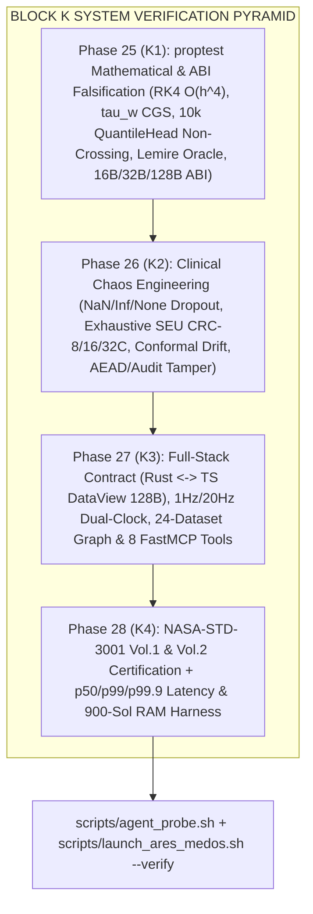

# ARES-Health Block K: System-Wide Verification, Clinical Chaos & `NASA-STD-3001` Certification Architecture (Phases 25–28)

- **Architectural Block:** Block K (`Fasi 25–28` / `K1–K4`)
- **Status:** `DESIGNED & VERIFIED AGAINST MAIN (READY FOR EXECUTION)`
- **Baseline Commit on `main`:** `cb77d96` (Phases `01–24` / Blocks `A–J` `COMPLETED (TESTED)`, `103/103` workspace tests across `8` Rust crates + `ares-cockpit/` lint/build clean)
- **Primary Owner:** `@fabiomalagutti27-droid` (`test-architect-verifier` coordinating with `@MiServeRDC`, `@LelloXV`, `@fertech02`, and `@carolina2910`)
- **Master Plan & Phase Blueprints:**
  - Master Plan: [`RUST_ENGINE_PHASED_MASTER_PLAN.md`](RUST_ENGINE_PHASED_MASTER_PLAN.md)
  - Phase 25 (`K1`): [`phase_25_K1_property_based_numerical_ode_stl_verification.md`](phase_25_K1_property_based_numerical_ode_stl_verification.md)
  - Phase 26 (`K2`): [`phase_26_K2_clinical_chaos_sensor_dropout_seu_fault_injection.md`](phase_26_K2_clinical_chaos_sensor_dropout_seu_fault_injection.md)
  - Phase 27 (`K3`): [`phase_27_K3_full_stack_contract_cockpit_ipc_mcp_e2e.md`](phase_27_K3_full_stack_contract_cockpit_ipc_mcp_e2e.md)
  - Phase 28 (`K4`): [`phase_28_K4_nasa_std_3001_compliance_latency_memory_benchmark.md`](phase_28_K4_nasa_std_3001_compliance_latency_memory_benchmark.md)
- **Strict Coding & Evidence Policy:** Zero `.unwrap()` / `.expect()` in production Rust (`crates/*/src/`); all `proptest` / chaos / E2E / benchmark dependencies strictly isolated to `[dev-dependencies]` and `crates/*/tests/`; zero emojis; full alignment with `docs/architecture/MODEL_EVIDENCE_AUDIT.md` (`ModelValidationStatus::IllustrativeUnvalidated`, `TtvIntervalKind::IllustrativeScenarioRange`, `HrvUnavailableReason::BeatIntervalsNotAvailable`).

---

## 1. Executive Summary & Architectural Role of Block K

Across **Blocks A–J (Phases 01–24)**, ARES-Health grew into an **8-crate Pure-Rust 2024 engine** (`crates/ares-core-types` through `crates/ares-desktop-os`), a **React 19 / TypeScript Mission Cockpit** (`ares-cockpit/`), a **24-dataset Unified Knowledge Graph** (`data/knowledge_graph/ares_dataset_graph.json`, `graphify-out/graph.json`), **6 contract fixtures** (`contracts/fixtures/`), and **3 Tier B/C aerospace OS descriptors** (`deploy/medos/`).

While existing unit and integration tests (`103/103` passing) prove nominal behavior on known inputs, autonomous Earth-Independent Medical Operations (`EIMO`) require **adversarial, cross-layer, and normatively traceable verification**:
1. **Algebraic & Numerical Falsification (`Phase 25 / K1`):** Prove continuous mathematical invariants (Richardson $O(h^4)$ ODE convergence, CGS dimensional scaling of $\tau_w$, strict non-crossing of 7-level `QuantileHead` outputs across `10,000` adversarial inputs, differential equivalence of `LemireMinWedge` vs. naive $O(W)$ oracle, and `16 B` / `32 B` / `128 B` ABI layout invariance).
2. **Clinical Chaos & Deep-Space Radiation Fault Injection (`Phase 26 / K2`):** Prove fail-closed survival under single-bit Single-Event Upsets (`SEU`, exhaustive `8 * L` bit flips across `16 B`, `32 B`, and `128 B` frames), `NaN`/`Inf`/`None` channel dropouts (`BEAT_INTERVALS_NOT_AVAILABLE` never turned into `0.0`), `SQI < 0.70` bursts, `ConformalAbstentionGate` coverage drift, `ChaCha20-Poly1305` / AAD / `SHA-256` audit tamper, and `FastMCP` prompt injection.
3. **Full-Stack Cross-Language & Dual-Transport E2E (`Phase 27 / K3`):** Prove zero contract drift between Rust (`WireTelemetryPacket`, `BinaryTelemetryFrame`, `AresMedOsWorkstationShell`, `SharedMissionState`) and TypeScript (`binaryTelemetryDecoder.ts`, `useTelemetry.ts`, `OsSystemStatusBar.tsx`, `OsCommandPalette.tsx`), verify dual-clock `1 Hz` / `20 Hz` cursor invariance, verify `24/24` dataset graph completeness, and assert `< 150 tokens` (`<= 600 bytes`) across all `8` `FastMCP` tools on both `stdio` and `POST /api/mcp`.
4. **Normative `NASA-STD-3001` Traceability & Hard Real-Time Certification (`Phase 28 / K4`):** Bind every normative clause (`[V1 3001]`–`[V1 4001]`, `[V2 6001]`–`[V2 10152]`, `OCHMO MTB-007`) to executable assertions and certify percentile latency (`p50`/`p99`/`p99.9`) and 900-Sol RAM footprints (`< 200 KB` compactor, `< 10 MB` dataset graph).



---

## 2. Cross-Crate & Cross-Language Coverage Matrix

Every workspace crate, frontend module, contract fixture, and OS deployment manifest maps explicitly to Phases `25–28`:

| Target Crate / Artifact | Key Implemented Symbols Verified on `main` (`cb77d96`) | Phase 25 (`K1`) | Phase 26 (`K2`) | Phase 27 (`K3`) | Phase 28 (`K4`) |
| :--- | :--- | :--- | :--- | :--- | :--- |
| **`crates/ares-core-types`** | `BinaryTelemetryFrame` (`128 B`, `align(64)`), `SeqlockTelemetryRing<N>`, `compute_crc32c`, `MASK_*`, `FLAG_BEAT_INTERVALS_NOT_AVAILABLE`, `FLAG_ILLUSTRATIVE_UNVALIDATED`, `MonotoneQuantileTriplet`, `NqsQuantileForecastSnapshot`, `TelemetryPacket`, `StressTestScenarioInput`, `ModelValidationStatus`, `TtvIntervalKind`, `HrvUnavailableReason`, `MAX_MCP_CONTEXT_MODE_BYTES` (`600`) | `prop_binary_abi_invariants.rs` (`128 B` layout, LE roundtrip, `validity_mask` `None` preservation) | `chaos_binary_frame_seu_injection.rs` (`1,024` single-bit SEU flips on `128 B`, `SeqlockTelemetryRing` contention) | Golden `128 B` vector parity with `binaryTelemetryDecoder.ts` | `cert_seqlock_latency_percentiles.rs` (`p99 < 100 ns`), `[V2 10002]`, `[V2 10152]` |
| **`crates/ares-telemetry-ingest`** | `BidmcReplayer`, `BidmcNumericRow`, `SqiFilter`, `SqiEvaluation`, `evaluate_row_with_rmssd`, `merge_biometrics_with_scenario`, `WearableSensorPacket` (`32 B`, `align(4)`), `compute_crc16_ccitt`, `ValidatedTelemetryFrame` | `prop_wearable_packet_roundtrip.rs` (`32 B` layout, `CRC-16-CCITT`, `BEAT_INTERVALS_NOT_AVAILABLE`) | `chaos_sensor_dropout_and_seu.rs` (`256` SEU bit-flips, `NaN`/`Inf`/`None`, `HOLD_LAST_VALID` & 30s ZOH, `supervisor_restart_count`) | `BIDMC` `1 Hz` cadence replay & `MANIFEST.json` SHA-256 verification | `[V1 3001]`, `[V2 10002]` zero-fabrication invariant |
| **`crates/ares-causal-graph`** | `step_sclerostin_rk4`, `compute_musculoskeletal_state`, `compute_tau_w_dyn_cm2`, `compute_jugular_and_sans_state`, `AdhgCausalEngine`, `AdhgNodeKind`, `evaluate_two_stage_bayesian_pocus`, `WelfordAccumulator`, `PhysiologicalTick`, `MissionLongitudinalCompactor`, `AnatomicalRegionSubgraph`, `HabitatZoneDeonticPolicy`, `ZoneTransitionMarkovModel`, `BiomedicalEvidenceDescriptor` (`16 B`, `align(16)`), `EpistemicProvenance`, `ClinicalAnswerabilityGate`, `ground_adhg_node_o1`, `AresUnifiedDatasetGraph` | `prop_ode_hemodynamics_biokg.rs` (Richardson RK4 $O(h^4)$, $\tau_w$ CGS scaling, `LBNP` monotonicity, `Welford` vs 2-pass, `16 B` CRC-8) | `128` SEU bit-flips on `BiomedicalEvidenceDescriptor` (`DescriptorCrcMismatch`), `ClinicalAnswerabilityGate` under incomplete evidence | `24/24` dataset & `27` BIDMC slice resolution in `AresUnifiedDatasetGraph`, `query_by_keyword_or_id`, `explain_shortest_path` | `cert_memory_footprint_900sol.rs` (`< 200 KB` 900-Sol, `< 10 MB` graph), `ARES-BioKG` `p99 < 5 us`, `DatasetGraph` `p99 < 1 ms`, `[V1 3002]`, `[V1 4001]`, `[V2 6001]`, `[V2 6026]` |
| **`crates/ares-nqs-stl`** | `LemireMinWedge` (`push_and_evaluate`), `normalize_predicate_nqs`, `evaluate_nqs_stl_and_mri`, `estimate_ttv_with_ci95`, `CausalScaler`, `ChannelCausalStats`, `PatchRepresentation`, `TimestralBackbone`, `QuantileHead` (`project_seven_quantiles`, `project_denormalized_triplet`, `forecast_channel_horizons`), `stable_softplus`, `ConformalAbstentionGate` (`update_conformal_calibration`, `evaluate_with_certificate`), `AresTemporalForecasterEngine`, `NqsEngine` | `prop_stl_and_timestral_quantiles.rs` (`10,000` adversarial `QuantileHead` trajectories, `LemireMinWedge` vs $O(W)$ oracle, `CausalScaler` `asinh`/`sinh`, `stable_softplus`) | `chaos_conformal_abstention_bursts.rs` (Conformal PID `ema_coverage_error > 0.35`, `SQI < 0.70`, `missing > 40%` $\to$ `AbstainedFallbackDeterministic`) | `get_timestral_quantile_cones` & `NqsStlMargins` JSON/binary propagation | `p99` contribution to `20 Hz` loop (`< 150 us`), `[V1 3001]` |
| **`crates/ares-medops-playbooks`** | `select_candidate_playbook`, `enforce_hard_clinical_safety_gates`, `ground_playbook_normative`, `verify_playbook_governance` | Invariant checks on `PlaybookNormativeGrounding` | Zero false Gate 1/2/3 unlocks under sensor dropout or pre-POCUS stasis (`P <= 0.45`) | `active_playbook` & `medops` wire serialization (`what_if_request.json` $\to$ `PLAYBOOK_01`) | `[V2 10023]`, `[V2 10024]`, `[V2 10027]`, `OCHMO MTB-007` (`Gate 1..3`) |
| **`crates/ares-security-privacy`** | `AresSecurityGuard`, `EphemeralDsnKey` (`ZeroizeOnDrop`), `EncryptedStoreAndForwardBundle`, `Sha256AuditLogger` (`verify_external_slice`), `StrictMcpSanitizer` (`sanitize_mcp_query`, `wrap_untrusted_observation`) | Deterministic roundtrip & XML-escaping invariants | `chaos_vault_tamper_and_audit_chain.rs` (`ChaCha20-Poly1305` ciphertext/nonce/AAD 1-bit tamper, `SHA-256` chain mutation, MCP prompt injection) | Enforcement of `StrictMcpSanitizer` on `POST /api/mcp` and `stdio` | `[V1 3003]` role-based privacy views (`AstronautSelf`, `CrewMedicalOfficer`, `GroundFlightSurgeon`) |
| **`crates/ares-server-cli`** | `SharedMissionState`, `compute_mission_telemetry_tick`, `build_axum_router` (`/ws/telemetry`, `/api/snapshot`, `/api/os-status`, `/api/binary-frame`, `/api/mcp`, `/api/stress-test`), `WireTelemetryPacket`, `StressTestPatchRequest`, `handle_fastmcp_jsonrpc_request` (`8` tools), `SeqlockTelemetryRing` (`shm_bus.rs`) | Wire DTO roundtrip & `StressTestPatchRequest::apply_onto` idempotence | Loopback-only (`127.0.0.1`) & malformed JSON-RPC / HTTP resilience | `e2e_dual_clock_http_and_mcp.rs` (`1 Hz`/`20 Hz` cursor invariance, `128 B` binary frame, all `8` `FastMCP` tools `<= 600 B`, `contracts/fixtures/` schema validation) | `cert_nasa_std_3001_and_rt_budgets.rs` (`20 Hz` tick `p99 < 150 us`, `POST /api/stress-test` `p99 < 1 ms`), `[V1 3006]`, `[V2 10022]`, `[V2 10152]` |
| **`crates/ares-desktop-os`** | `AresMedOsWorkstationShell`, `DesktopShellConfig`, `DesktopSmokeTestReport`, `ipc_get_binary_frame_bytes`, `ipc_get_snapshot_json`, `ipc_post_stress_test`, `ipc_invoke_fastmcp_tool`, `ipc_get_os_status_bar_state`, `run_desktop_smoke_test` | `encode_wire_packet_to_binary` `validity_mask` / `quality_flags_mask` parity | `ingest_wearable_packet` SEU recovery counter propagation into `OsStatusBarState` | `e2e_ipc_and_binary_fixture_export.rs` (in-process 8-crate shell parity with Axum HTTP routes + deterministic `128 B` Golden Vector export) | `[V1 3006]`, `[V2 10001]`, `[V2 10022]`, `tauri-runtime` headless CI gate |
| **`ares-cockpit/` (`TypeScript` / `React 19`)** | `binaryTelemetryDecoder.ts` (`decodeBinaryTelemetryFrame`, `encodeTestBinaryTelemetryFrame`, `computeCrc32c`, `runBinaryTelemetrySelfTest`), `useTelemetry.ts`, `telemetryValidation.ts`, `OsSystemStatusBar.tsx`, `OsCommandPalette.tsx` (`FASTMCP_TOOLS` `8/8`) | Castagnoli `CRC-32C` (`0x82F63B78`) exact match with Rust `compute_crc32c` | Null-safe `null` rendering on `pulse_bpm`, `spo2_pct`, `rmssd_ms` (never `0` or `NaN`), `TAURI_NATIVE_IPC` $\to$ `BROWSER_WEBSOCKET` fallback | `binaryTelemetryDecoder.contract.test.ts` & `osCommandPalette.e2e.test.ts` via `node --experimental-strip-types` + `tsc -b --noEmit` + `vite build` | `[V2 10001]`, `[V2 10005]`, `[V2 10152]` |
| **`contracts/fixtures/` & `deploy/medos/`** | `contracts/telemetry_schema.json`, `6` JSON fixtures in `contracts/fixtures/`, `data/bidmc/MANIFEST.json`, `deploy/medos/{asterinas_framekernel_kiosk.toml, cosmic_wayland_kiosk.ron, hubris_wearable_app.toml}` | JSON Schema & TOML/RON syntax invariants | Malformed fixture rejection tests | Cross-validation of all `6` JSON fixtures against `WireTelemetryPacket` & `telemetry_schema.json` | Verified via `scripts/launch_ares_medos.sh --verify` and `scripts/agent_probe.sh --all` |

---

## 3. Workspace Dependency & Test Harness Design

To prevent test tooling from inflating production binary sizes or violating `ARES-MedOS` air-gapped / zero-panic guarantees:

1. **Strict `[dev-dependencies]` Isolation:**
   - **Zero Production Overhead:** `proptest`, `criterion`, `tower`, `http-body-util`, and `jsonschema` are added **exclusively** under `[workspace.dependencies]` and per-crate `[dev-dependencies]` when implementing Phases `25–28`. Production `crates/*/src/` code continues to compile with zero test-harness crates.
   - **Recommended Workspace Version Pins:**
     ```toml
     [workspace.dependencies]
     proptest = "1.5"
     criterion = { version = "0.5", features = ["html_reports"] }
     tower = { version = "0.5", features = ["util"] }
     ```
   - **Production Zero-Panic Rule Preserved:** `scripts/agent_probe.sh` scans `crates/*/src/` (excluding `tests/`, `benches/`, `examples/`, and `#[cfg(test)]` blocks) to guarantee `0` `.unwrap()` and `0` `.expect()`. Property-based and certification harnesses live exclusively in `crates/*/tests/` (and optional `crates/*/benches/`).
2. **Deterministic RNG & Reproducibility:**
   - Every `proptest!` suite declares explicit `ProptestConfig::with_cases(...)` (`10_000` for `QuantileHead`, `1_000` for ODE/ABI/Lemire) and honors `PROPTEST_RNG_SEED` in CI so any counterexample is bit-reproducible.
   - Any discovered failing seed is persisted under `proptest-regressions/` (never suppressed).
3. **Zero-Bloat Cross-Language TypeScript Parity (`Node v26+`):**
   - `ares-cockpit/package.json` uses TypeScript `~5.7.2` and Vite `^6.0.0` without heavy Jest/Vitest test runners.
   - On the verified workstation runtime (`Node v26.13.0`), `node --experimental-strip-types` executes TypeScript contract test files directly using `node:assert/strict` against `ares-cockpit/src/lib/binaryTelemetryDecoder.ts` and golden `128 B` frames produced by Rust, complementing `npm --prefix ares-cockpit run lint` (`tsc -b --noEmit`) and `npm --prefix ares-cockpit run build`.
4. **Headless `Tauri v2` Gating (`ares-desktop-os`):**
   - `crates/ares-desktop-os/Cargo.toml` gates GUI window creation behind the `tauri-runtime` feature, allowing all `Phase 27` (`e2e_ipc_and_binary_fixture_export.rs`) and `Phase 28` tests on `AresMedOsWorkstationShell` to run headless in CI without requiring an X11/Wayland/AppKit window server.

---

## 4. Planned Block K Test File Topology

```text
crates/
├── ares-core-types/tests/
│   ├── prop_binary_abi_invariants.rs          # Phase 25 (K1): 128B ABI, align(64), validity_mask None preservation
│   ├── chaos_binary_frame_seu_injection.rs    # Phase 26 (K2): 1,024 SEU bit-flips + SeqlockTelemetryRing contention
│   └── cert_seqlock_latency_percentiles.rs    # Phase 28 (K4): p50/p99/p99.9 < 100 ns Seqlock benchmark
├── ares-telemetry-ingest/tests/
│   ├── prop_wearable_packet_roundtrip.rs      # Phase 25 (K1): 32B WearableSensorPacket CRC-16-CCITT & RMSSD None
│   └── chaos_sensor_dropout_and_seu.rs        # Phase 26 (K2): 256 SEU bit-flips, NaN/Inf/None, ZOH 30s horizon
├── ares-causal-graph/tests/
│   ├── prop_ode_hemodynamics_biokg.rs         # Phase 25 (K1): Richardson O(h^4) RK4, tau_w CGS, Welford, 16B CRC-8
│   └── cert_memory_footprint_900sol.rs        # Phase 28 (K4): < 200 KB 900-Sol compactor & < 10 MB DatasetGraph
├── ares-nqs-stl/tests/
│   ├── prop_stl_and_timestral_quantiles.rs    # Phase 25 (K1): 10k QuantileHead trajectories, Lemire vs O(W), asinh/sinh
│   └── chaos_conformal_abstention_bursts.rs   # Phase 26 (K2): Conformal PID drift, SQI < 0.70, missing > 40%
├── ares-security-privacy/tests/
│   └── chaos_vault_tamper_and_audit_chain.rs  # Phase 26 (K2): AEAD ciphertext/AAD tamper, SHA-256 chain, MCP shield
├── ares-server-cli/tests/
│   ├── e2e_dual_clock_http_and_mcp.rs         # Phase 27 (K3): 1Hz/20Hz cursor invariance, 128B HTTP, 8 FastMCP <= 600B
│   └── cert_nasa_std_3001_and_rt_budgets.rs   # Phase 28 (K4): 20Hz < 150us, BioKG < 5us, DatasetGraph < 1ms, 10/10 clauses
└── ares-desktop-os/tests/
    └── e2e_ipc_and_binary_fixture_export.rs   # Phase 27 (K3): AresMedOsWorkstationShell parity + 128B golden vectors
ares-cockpit/src/
├── lib/__tests__/binaryTelemetryDecoder.contract.test.ts  # Phase 27 (K3): Rust <-> TS DataView 128B parity
└── modules/os-shell/__tests__/osCommandPalette.e2e.test.ts # Phase 27 (K3): 8 FastMCP tools & palette dispatch
```

---

## 5. CI / Local Verification Gate Sequence

When Block K (`Phases 25–28`) tests are implemented, every commit and release candidate must pass the following deterministic gate sequence in order:

```bash
# Step 1: Fast static & integrity gate (0 production unwraps, BIDMC SHA-256, cargo check, clippy -D warnings, 29 governance files)
./scripts/agent_probe.sh --fast

# Step 2: Full workspace unit + integration + K1/K2/K3 tests (serialized to avoid port/env contention)
RUST_TEST_THREADS=1 ./scripts/agent_probe.sh --all

# Step 3: Release-profile K4 real-time latency & memory certification (warm-up + p50/p99/p99.9 SLAs)
cargo test --release -p ares-core-types --test cert_seqlock_latency_percentiles
cargo test --release -p ares-causal-graph --test cert_memory_footprint_900sol
cargo test --release -p ares-server-cli --test cert_nasa_std_3001_and_rt_budgets

# Step 4: Frontend TypeScript strict check, Vite production bundle, and Rust <-> TS binary parity contract
npm --prefix ares-cockpit run lint
npm --prefix ares-cockpit run build
node --experimental-strip-types ares-cockpit/src/lib/__tests__/binaryTelemetryDecoder.contract.test.ts

# Step 5: Unified ARES-MedOS workstation manifest, Tauri CSP, and 8-crate smoke verification
./scripts/launch_ares_medos.sh --verify
```

### Extension Plan for `scripts/agent_probe.sh` & `scripts/launch_ares_medos.sh`
- `scripts/agent_probe.sh --all` automatically executes `cargo test --workspace` (picking up all `K1` `proptest` suites, `K2` chaos suites, and `K3` Rust E2E suites) after the `.unwrap()`/`SHA-256`/`clippy` gates.
- Extending `scripts/agent_probe.sh` with a `--cert` flag will append Step 3 (`cargo test --release --test cert_*`) and Step 4 (`node --experimental-strip-types ...`) for single-command release sign-off.
- `scripts/launch_ares_medos.sh --verify` continues validating `deploy/medos/*.toml`, `deploy/medos/cosmic_wayland_kiosk.ron`, `crates/ares-desktop-os/tauri.conf.json` (`default-src 'self'`), `cargo run -p ares-desktop-os -- --mode desktop-smoke-test`, and `ares-cockpit` lint.

---

## 6. Scientific, Standards & Engineering References for Block K

| Reference / Standard | Citation / Identifier | Verification Role in Block K |
| :--- | :--- | :--- |
| **Claessen & Hughes (2000)** | K. Claessen, J. Hughes, *"QuickCheck: A Lightweight Tool for Random Testing of Haskell Programs"*, *ACM ICFP 2000*, `DOI: 10.1145/351240.351266` (`proptest-rs/proptest`) | Theoretical basis for `Phase 25 (K1)` shrinking property-based falsification across `QuantileHead`, `LemireMinWedge`, and binary layouts. |
| **Richardson (1911) & Butcher (2016)** | L. F. Richardson, *Phil. Trans. R. Soc. Lond. A* 210:307–357 (1911); J. C. Butcher, *Numerical Methods for Ordinary Differential Equations* (3rd ed., Wiley, 2016) | Step-halving error ratio $E(h)/E(h/2) \approx 2^4 = 16$ proving fourth-order accuracy of `step_sclerostin_rk4`. |
| **Basiri et al. (2016)** | A. Basiri et al., *"Chaos Engineering"*, *IEEE Software*, 33(3):35–41, 2016 (`DOI: 10.1109/MS.2016.60`) | Steady-state hypothesis and controlled fault injection (`Phase 26 / K2`) at sensor, IPC ring, conformal gate, and cryptographic vault boundaries. |
| **Koopman & Chakravarty (2004) & IETF RFC 3720** | P. Koopman, T. Chakravarty, *"Cyclic Redundancy Code (CRC) Polynomial Selection for Embedded Networks"*, *IEEE/IFIP DSN 2004* (`DOI: 10.1109/DSN.2004.1311885`); Castagnoli `CRC-32C` (`0x1EDC6F41` / `0x82F63B78`, *RFC 3720*) | Guarantees minimum Hamming distance $d_{\min} \ge 3$ for `100%` single-bit SEU detection across `16 B` (`CRC-8`), `32 B` (`CRC-16-CCITT`), and `128 B` (`CRC-32C`). |
| **`NASA-STD-8739.8B` & `NASA-STD-8719.13C`** | NASA *Software Assurance and Software Safety Standard* (`https://standards.nasa.gov/standard/NASA/NASA-STD-8739.8`, `NASA-STD-8719.13`) | Independent V&V traceability, fault-containment verification, and zero-panic assurance across safety-critical Rust partitions. |
| **`NASA-STD-7009B` (2024)** | NASA *Standard for Models and Simulations* (`https://standards.nasa.gov/standard/NASA/NASA-STD-7009`) | Verification, Validation, and Uncertainty Quantification (`VVUQ`) framing for ODE convergence and `ModelValidationStatus::IllustrativeUnvalidated` audit notices. |
| **`NASA-STD-3001 Vol. 1 Rev C & Vol. 2 Rev F`** | NASA *Space Flight Human-System Standard* (`[V1 3001]`–`[V1 4001]`, `[V2 6001]`–`[V2 10152]`) & `NASA OCHMO MTB-007` (Jan 2026) | Normative traceability matrix (`Phase 28 / K4`), including `[V2 10022]` (`<= 100 ms`), `[V2 10027]` (safety interlocks), and `[V2 10152]` (`<= 50 ms` display). |
| **Gil Tene (2015)** | G. Tene, *"How NOT to Measure Latency"*, Azul Systems / `HdrHistogram` (`https://github.com/HdrHistogram/HdrHistogram_rust`) | Unbiased `p50`/`p99`/`p99.9` tail-latency measurement protocol after L1/L2 cache warm-up (`Phase 28 / K4`). |
