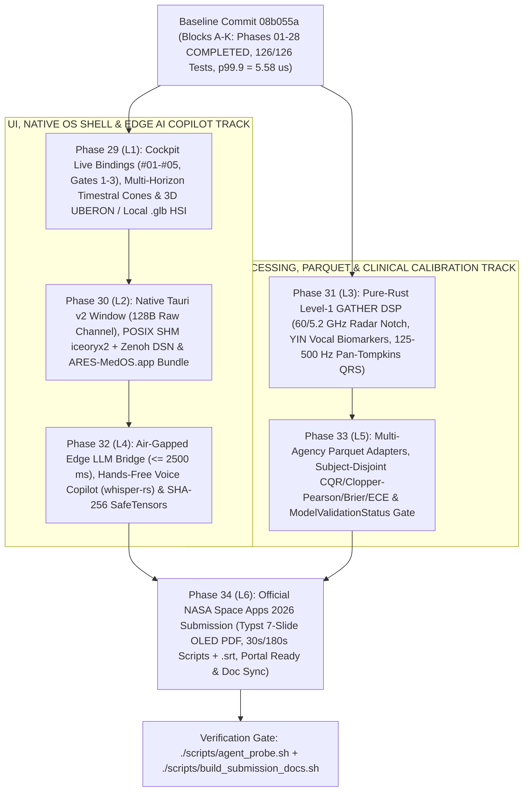

# ARES-Health Block L: Gap Closure, Operational Deployment, Edge AI Copilot, Clinical Calibration & NASA Space Apps 2026 Submission Architecture (Phases 29–34)

- **Architectural Block:** Block L (`Phases 29–34` / `L1–L6`: Gap Closure, Operational Deployment, Edge AI Copilot, Clinical Calibration & NASA Space Apps 2026 Submission)
- **Status:** `COMPLETED (TESTED)` (`158/158` default workspace tests across `24` active suites & `8` crates, plus feature-gated `tauri-runtime` `5/5`, `shm-ipc` `4/4`, `candle-safetensors` `4/4`, `parquet-ingest` `6/6`, `15/15` Node cockpit tests across `7` suites, `ares-cockpit` `npm run lint` + `vite build`, `ares-calibrate --verify-only`, `./scripts/launch_ares_medos.sh --verify`, `./scripts/build_submission_docs.sh` `6/6` L6 gates, `0` Clippy warnings, `0` production `.unwrap()`/`.expect()`, `0` Unicode emojis)
- **Baseline Commit on `main`:** `08b055a` (Blocks `A–K` Phases `01–28` `COMPLETED (TESTED)`, `126/126` workspace tests across `28` suites & `8` crates, `0` clippy warnings, `0` production `.unwrap()`/`.expect()`)
- **Primary Owner:** `ARES-Health Team` coordinating with `ARES-Health Team`, `ARES-Health Team`, `ARES-Health Team`, and `@MiServeRDC`
- **Master Plan, Evidence Audit & Phase Blueprints:**
  - Master Plan: [`RUST_ENGINE_PHASED_MASTER_PLAN.md`](RUST_ENGINE_PHASED_MASTER_PLAN.md)
  - Block K Certification Baseline: [`BLOCK_K_SYSTEM_TESTING_ARCHITECTURE.md`](BLOCK_K_SYSTEM_TESTING_ARCHITECTURE.md)
  - Model Evidence Audit (`Issue #12`): [`../architecture/MODEL_EVIDENCE_AUDIT.md`](../architecture/MODEL_EVIDENCE_AUDIT.md)
  - HRV Validity Contract (`Issue #11`): [`ISSUE_11_HRV_VALIDITY_PLAN.md`](ISSUE_11_HRV_VALIDITY_PLAN.md)
  - Model Evidence Plan (`Issue #12`): [`ISSUE_12_MODEL_EVIDENCE_PLAN.md`](ISSUE_12_MODEL_EVIDENCE_PLAN.md)
  - Phase 29 (`L1`): [`phase_29_L1_cockpit_live_bindings_3d_cones.md`](phase_29_L1_cockpit_live_bindings_3d_cones.md)
  - Phase 30 (`L2`): [`phase_30_L2_tauri_native_window_iceoryx2_ipc.md`](phase_30_L2_tauri_native_window_iceoryx2_ipc.md)
  - Phase 31 (`L3`): [`phase_31_L3_gather_radar_vocal_waveform_dsp.md`](phase_31_L3_gather_radar_vocal_waveform_dsp.md)
  - Phase 32 (`L4`): [`phase_32_L4_edge_llm_voice_copilot_safetensors.md`](phase_32_L4_edge_llm_voice_copilot_safetensors.md)
  - Phase 33 (`L5`): [`phase_33_L5_clinical_calibration_24dataset_parquet.md`](phase_33_L5_clinical_calibration_24dataset_parquet.md)
  - Phase 34 (`L6`): [`phase_34_L6_nasa_submission_pitch_slides_pdf.md`](phase_34_L6_nasa_submission_pitch_slides_pdf.md)
- **Strict Coding & Evidence Policy:** Zero `.unwrap()` / `.expect()` in production Rust (`crates/*/src/`, including `crates/ares-server-cli/src/bin/ares_calibrate.rs`); zero external network calls (`default-src 'self'`, `connect-src 'self' http://127.0.0.1:8080 ws://127.0.0.1:8080 ipc: http://ipc.localhost`); zero emojis anywhere; strict enforcement of **Issue `#11`** (`BEAT_INTERVALS_NOT_AVAILABLE` / `HrvUnavailableReason::BeatIntervalsNotAvailable`, `rmssd_ms = None` on `1 Hz` numeric `BIDMC` streams—never coerced to `0.0`) and **Issue `#12`** ([`../architecture/MODEL_EVIDENCE_AUDIT.md`](../architecture/MODEL_EVIDENCE_AUDIT.md): `ModelValidationStatus::IllustrativeUnvalidated`, `TtvIntervalKind::IllustrativeScenarioRange`, `HEURISTIC_GATE_ACCEPTED` / `ConformalGateStatus::HeuristicGateAccepted`).

---

## 1. Executive Summary & Architectural Role of Block L

Across **Blocks A–K (Phases 01–28, commit `08b055a`)**, ARES-Health established a verified **8-crate Safe Rust 2024 engine** (`126/126` workspace tests across `28` test suites, `--release` 1-tick pipeline `p50 = 2.12 us` / `p99.9 = 5.58 us`, `SeqlockTelemetryRing<64>` `p50 = 42.0 ns` / `p99.9 = 84.0 ns`, `900-Sol` Welford longitudinal compactor at `167,352 B < 200 KB`, and `AresUnifiedDatasetGraph` linking `24` agency datasets across `110` nodes and `326` Biolink edges) paired with the **React 19 / TypeScript `#000000` OLED Mission Cockpit** (`ares-cockpit/`).

**Block L (`Phases 29–34` / `L1–L6`)** closes the six remaining operational, sensory, conversational, clinical-calibration, and competition-delivery gaps required to transition from a certified workspace baseline to a flight-workstation-grade, epistemically auditable **NASA Space Apps Challenge 2026** submission—without adding a single nanosecond of blocking latency to the `20 Hz` deterministic physiological tick:

1. **Authoritative Cockpit Live-Engine Wiring, Multi-Horizon `Timestral` Cones & Air-Gapped 3D `UBERON:` / `.glb` HSI (`Phase 29 / L1`):** Eliminates client-side mock state in `ares-cockpit/` by binding `PlaybookRunner.tsx` directly to all `5` Type-1 Playbooks (`PLAYBOOK_01`..`PLAYBOOK_05`) and all `3` Hard Clinical Safety Gates (`Gate 1` POCUS anticoagulant lock, `Gate 2` LBNP anti-syncope auto-vent, `Gate 3` Martian `0.38g` EVA suit ankle damping), binding `MriAndStl.tsx` to `NqsQuantileForecastSnapshot` (`+15m / +1h / +6h / +24h` non-crossing monotone cones + `AbstentionCertificate`), and driving `BodyHeatmap.tsx` / `AnatomicalLayers.tsx` from `AnatomicalRegionSubgraph` (`5` `UBERON:` cells + `6` max-product causal arcs + local `NasaGlbAssetLayer.tsx` validating glTF v2 binary magic `0x46546C67` with instant procedural fallback).
2. **Native `Tauri v2` Workstation Window, Real POSIX SHM `iceoryx2` + `Zenoh` DSN Adapter & Native Bundles (`Phase 30 / L2`):** Introduces 3-tier Cargo feature gating (`default` headless CI, `tauri-runtime` headless IPC contract harness, `tauri-native` `WKWebView`/Metal & `WebKitGTK`/Vulkan frameless `1440x900` `#000000` OLED windowing on Thread 0), streams raw `128 B` frames over `tauri::ipc::Channel<tauri::ipc::Response>` (`InvokeResponseBody::Raw`, `p99 < 50 us`), adds daemonless POSIX shared-memory `Iox2PosixShmPublisher`/`Subscriber` (`ZeroCopySend`, `p50 < 100 ns`) and air-gapped `ZenohDsnAdapter` (`OwltMarsCommState` `852.0 s` + `MAX_DSN_OUTBOX_ALERTS = 256` store-and-forward blackout queue) behind `ARINC 653` wait-free `NonBlockingShmDsnDispatcher::try_dispatch` (`< 150 ns`), and packages `ARES-MedOS.app` / Linux `AppImage`.
3. **Pure-Rust Level-1 `GATHER` Signal Processing (`Phase 31 / L3`):** Implements three zero-heap, stack-allocated DSP modules in `crates/ares-telemetry-ingest`: `RadarCsiProcessor` (`60 GHz` mmWave / `5.2 GHz` Wi-Fi CSI Doppler phase demodulation $\Delta\phi(t) = 4\pi d(t)/\lambda$ with Jury-verified DF2T `BiquadSos` `60/120 Hz` ECLSS fan notch filters and `SQI >= 0.70` gate), `VocalAcousticAnalyzer` (`16/48 kHz` `YIN` $F_0$, jitter, shimmer, `HNR`, spectral tilt, and `pause_ratio` emitting `None` on silent/unvoiced frames), and `WaveformRrExtractor` (`125–500 Hz` `Pan-Tompkins` QRS detector + Malik $\pm 20\%$ ectopic filter computing real `RMSSD`/`SDNN`/`pNN50` while keeping `1 Hz` `BidmcReplayer` strictly locked to `rmssd_ms = None`).
4. **Air-Gapped Conversational Edge LLM, Microgravity Voice Copilot & `SafeTensors` Checkpoint Loader (`Phase 32 / L4`):** Bridges read-only `FastMCP` (`8` tools `<= 600 B` / `< 150 tokens`) to local `Ollama` / `llama.cpp` daemons (`validate_airgapped_socket_addr` loopback or explicit `RFC1918` habitat enclave `MACMINI_LLM_URL`, `<= 2500 ms` deadline, XML `<untrusted_telemetry_observation>` spotlighting, post-generation `verify_copilot_clinical_invariants`, and `< 400 us` `OfflineTemplateCopilot`), adds hands-free / Push-To-Talk `OsVoiceCopilot.tsx` + `voiceIntentRouter.ts` + optional `whisper-rs` (`--features offline-voice`) enforcing `[V2 10027]` voice interlocks, and loads `SHA-256`-verified `Timestral` `SafeTensors` (`F64`/`F32`/`BF16` $\to$ `f64`) with automatic `DeterministicStub` fallback.
5. **Subject-Disjoint Clinical Calibration, Conformal Coverage Audit & Multi-Agency `Parquet` Adapters (`Phase 33 / L5` — Issue `#12` Closure):** Adds optional pure-Rust Apache Arrow/Parquet ingestion (`--features parquet-ingest` across `BIDMC`, `PhysioNet CEBS/Fantasia/PPG-DaLiA`, `NASA OSDR`, and `DLR :envihab` with `AdapterStatus::ExternalDatasetNotBundled` zero-synthetic discipline), builds `calibration_harness.rs` + `ares-calibrate` CLI enforcing `4` anti-leakage invariants, Split-Conformal `CQR` vs. `Persistence` and `RollingMedianIqr`, exact Clopper-Pearson binomial intervals, Winkler/Pinball, Brier/`ECE` (`(0.45, 0.92)` POCUS gap audit), `Rk4HorizonPolicy::AdaptiveUnbounded` (`SOST` beyond the `60 d` legacy cap), and the fail-closed `Copy`-preserving `ModelValidationStatus` state machine.
6. **Official NASA Space Apps 2026 Submission Package, Deterministic `Typst` 7-Slide Deck & Dual Video Choreography (`Phase 34 / L6`):** Compiles reproducible offline PDFs via `Typst 0.15.1` (`SOURCE_DATE_EPOCH=1794670800`)—the English widescreen `16:9` `#000000` OLED `NASA_2026_7_SLIDE_DECK.pdf` (dual-oracle verified to `N_pages == 7`) and regenerated `PANORAMICA_GENERALE_PROGETTO.pdf`—alongside frame-accurate `<= 30.0 s` Pitch and `<= 180.0 s` Walkthrough scripts with validated `.srt` subtitles, `NASA_SUBMISSION_PORTAL_READY.md` (`24-dataset` evidence-role matrix, AI & OSI audits), and `scripts/build_submission_docs.sh`.



---

## 2. Cross-Crate & Cross-Language Coverage Matrix across Phases 29–34 (`L1–L6`)

Every workspace crate, frontend module, model/calibration manifest, OS deployment descriptor, submission artifact, and verification script maps explicitly to Phases `29–34`:

| Target Crate / Artifact | Baseline Verified Symbols (`08b055a`) | Phase 29 (`L1`) | Phase 30 (`L2`) | Phase 31 (`L3`) | Phase 32 (`L4`) | Phase 33 (`L5`) | Phase 34 (`L6`) |
| :--- | :--- | :--- | :--- | :--- | :--- | :--- | :--- |
| **`crates/ares-core-types`** | `BinaryTelemetryFrame` (`128 B`, `align(64)`), `SeqlockTelemetryRing<N>`, `MASK_RMSSD_MS`, `FLAG_BEAT_INTERVALS_NOT_AVAILABLE`, `FLAG_ILLUSTRATIVE_UNVALIDATED`, `ModelValidationStatus`, `TtvIntervalKind`, `HrvUnavailableReason`, `NqsQuantileForecastSnapshot`, `MAX_MCP_CONTEXT_MODE_BYTES` (`600`) | Contract authority for `MonotoneQuantileTriplet`, `ChannelQuantileCone`, `AbstentionCertificate`, `SafetyGates`, `CountermeasureAction`, `FLAG_GATE1..3`, `FLAG_CONFORMAL_ABSTAINED` | `ARES_BINARY_FRAME_BYTES` (`128`) & `BinaryTelemetryFrame::{to_le_bytes, from_le_bytes}` shared across `Channel<Response>`, `Iox2TelemetryFrame`, and `Zenoh` | `SQI_MIN_VALID_THRESHOLD` (`0.70`), `Biometrics` (`vocal_f0_hz`, `vocal_jitter_pct`, `rmssd_ms`, `sdnn_ms`, `pnn50_pct`, `hrv_unavailable_reason`) | `CrewRole`, `McpInputSanitizer`, `MedOpsAuditLogger`, `AresCoreError::SecurityViolation` | `src/telemetry.rs` (`ModelValidationStatus` `Copy` state machine: `IllustrativeUnvalidated`, `InternallyBenchmarkedTerrestrial`, `ClinicallyCalibratedSubjectToReview`, `TerrestrialBenchmarkScope`, `Sha256DigestHex`, `ValidationManifest`), `src/binary_ipc.rs` (`FLAG_TERRESTRIAL_BENCHMARKED_ONLY` bit `11`) | Normative constants & epistemic status tokens reflected verbatim in `NASA_2026_7_SLIDE_DECK.typ` & `NASA_SUBMISSION_PORTAL_READY.md` |
| **`crates/ares-telemetry-ingest`** | `BidmcReplayer`, `BidmcNumericRow`, `SqiFilter`, `evaluate_row_with_rmssd`, `merge_biometrics_with_scenario`, `WearableSensorPacket` (`32 B`, `CRC-16-CCITT`) | `NONE_PURE_REPLAY` vs. `DERIVED_AND_SIMULATED` replay semantics mirrored in `ares-cockpit/` | `ingest_wearable_packet` hooked to `NonBlockingShmDsnDispatcher::try_dispatch`; `data/bidmc/*` bundled in `tauri.conf.json` | `src/radar_csi_dsp.rs` (`DspError`, `RadarCarrierBand`, `BiquadSos`, `RadarCsiConfig`, `RadarVitalEstimate`, `RadarCsiProcessor`), `src/vocal_acoustic_dsp.rs` (`VocalAnalyzerConfig`, `VocalBiomarkerFrame`, `VocalAcousticAnalyzer`), `src/waveform_rr_extractor.rs` (`PanTompkinsConfig`, `DetectedQrsBeat`, `TimeDomainHrvMetrics`, `WaveformRrExtractor`), `src/bidmc_replayer.rs` (`IngestError::Dsp`), `src/scenario_overlay.rs` (`GatherDspOverlay`, `merge_biometrics_with_gather_dsp`) | `BeatIntervalsNotAvailable` guard enforced by `verify_copilot_clinical_invariants` | `SqiFilter::evaluate_row_with_rmssd` unlocked exclusively by verified real R-R streams (`>= 30` `NN` intervals in `Fantasia`) | `bidmc_01..03` `1 Hz` null honesty (`13` missing `PULSE`/`SpO2` rows) demonstrated in Slide 2 & `WALKTHROUGH_180S_DEMO_SCRIPT.md` |
| **`crates/ares-causal-graph`** | `step_sclerostin_rk4`, `compute_musculoskeletal_state`, `compute_tau_w_dyn_cm2`, `AdhgCausalEngine`, `evaluate_two_stage_bayesian_pocus`, `AnatomicalRegionSubgraph`, `WelfordAccumulator`, `BiomedicalEvidenceDescriptor` (`16 B`, `CRC-8`), `AresUnifiedDatasetGraph` | `AnatomicalRegionSubgraph::compute_body_heatmap` (`5` `UBERON:` cells + `6` conduction arcs + `biokg_clause` + `habitat_zone`) wired to `uberonSpatialMapping.ts` & `BodyHeatmap.tsx` | `Arc<AresUnifiedDatasetGraph>` shared across `SharedMissionState` and `AresMedOsWorkstationShell` | Consumes `Biometrics` enriched via `GatherDspOverlay` with zero change to `ADHG` ODE equations | Read-only `FastMCP` graph queries (`query_dataset_graph`, `explain_biomarker_path`, `get_hypergraph_spatial_status`) consumed by `EdgeLlmBridge` & `OfflineTemplateCopilot` | `src/parquet_adapters.rs` (`--features parquet-ingest`: `AdapterStatus`, `AdapterExecutionOutcome`, `verify_file_sha256`, `BidmcParquetAdapter`, `PhysioNetWaveformAdapter`, `NasaOsdrOmicsAdapter`, `DlrHdbAdapter`, `compute_verified_time_domain_hrv`), `src/dataset_graph.rs` (`TimeWindowSlice::extra_channels`, `beat_intervals_present`, `upsert_node`, `link_nodes`), `src/mechanotransduction.rs` (`Rk4HorizonPolicy`, `compute_musculoskeletal_state_with_policy`, `integrate_sclerostin_schedule`), `src/bayesian_pocus.rs` (`audit_bayesian_pocus_structural_bounds`), `src/error.rs` | Slide 3 (`ADHG`, CGS $\tau_w$, RK4 `SOST`, `BioKG`) & Slide 7 (`24-Dataset` matrix with `Evidence Role` column) |
| **`crates/ares-nqs-stl`** | `LemireMinWedge`, `normalize_predicate_nqs`, `TimestralBackbone`, `QuantileHead`, `ConformalAbstentionGate`, `AresTemporalForecasterEngine`, `estimate_ttv_with_ci95` | `NqsQuantileForecastSnapshot` (`+15m`, `+1h`, `+6h`, `+24h` `channel_cones` + `AbstentionCertificate`) rendered live in `MriAndStl.tsx` | `run_1hz_timestral_step` background worker spawned via `tokio::task::spawn_blocking` in `ares-desktop-os/src/main.rs` | Preserves `rmssd_ms_cone = None`, `rho_global_cone = None`, `ttv_hours_cone = None` whenever `BeatIntervalsNotAvailable` | `src/timestral_safetensors.rs` (`safetensors-loader` default, optional `candle-safetensors`: `CheckpointLoaderBackend`, `CheckpointOrigin`, `ModelsManifest`, `LoadedTimestralBundle`, `decode_tensor_view_to_f64`, `load_verified_timestral_checkpoint`, `load_timestral_or_deterministic_fallback`), `from_loaded_weights` in `timestral_backbone.rs` & `timestral_quantiles.rs`, `new_with_optional_checkpoint` in `timestral_bridge.rs`, `NqsStlError::Checkpoint*` in `error.rs` | `src/calibration_harness.rs` (`SplitRole`, `MissingnessBin`, `LeakageViolationError`, `ClopperPearsonBounds`, `HorizonCellMetrics`, `HorizonEvaluationStatus`, `ProbabilisticCalibrationAudit`, `SostRk4SensitivityAudit`, `CalibrationAuditReport`, `verify_anti_leakage_invariants`, `clopper_pearson_exact_95`, `compute_brier_and_ece_10_bins`, `resolve_validation_status_fail_closed`) | Slide 4 (`LemireMinWedge` $O(1)$, `QuantileHead` `stable_softplus`, `HEURISTIC_GATE_ACCEPTED`, `ILLUSTRATIVE_SCENARIO_RANGE`) |
| **`crates/ares-medops-playbooks`** | `select_candidate_playbook`, `enforce_hard_clinical_safety_gates`, `ground_playbook_normative`, `verify_playbook_governance` | `1:1` behavioral parity between `playbooks.rs`/`safety_gates.rs` (`PLAYBOOK_01`..`PLAYBOOK_05`, Gates `1..3`) and `playbookCatalog.ts` + `PlaybookRunner.tsx` | `active_playbook_id` (`0..5`) & `SafetyGates` serialized in `Iox2TelemetryFrame` and `DsnMedOpsAlertEnvelope` | Prevents false playbook triggers on unvoiced frames or `radar_sqi < 0.70` | Authoritative `anticoagulant_lock_active` (`Gate 1`) enforced by `verify_copilot_clinical_invariants` & `[V2 10027]` voice interlock | Policy $\Delta\hat{\rho}/\text{h}$ values audited as provisional scenario constants per [`../architecture/MODEL_EVIDENCE_AUDIT.md`](../architecture/MODEL_EVIDENCE_AUDIT.md) | Slide 5 & Act III (`WALKTHROUGH_180S_DEMO_SCRIPT.md`) showcasing Type-1 DAG playbooks & Gates `1/2/3` |
| **`crates/ares-security-privacy`** | `AresSecurityGuard`, `EphemeralDsnKey`, `EncryptedStoreAndForwardBundle`, `Sha256AuditLogger`, `StrictMcpSanitizer` | Zero-CDN air-gap compliance in `NasaGlbAssetLayer.tsx` (`connect-src 'self'`) | `sanitize_astronaut_id_for_keyexpr` wildcard prevention + `capabilities/default.json` `Tauri v2` ACL | Crew raw PCM audio never written to shared logs (`NASA-STD-3001 Vol. 1 Ch. 7`); only scalar vocal features pass `AresSecurityGuard` | `StrictMcpSanitizer::{sanitize_mcp_query, wrap_untrusted_observation}` (`<untrusted_telemetry_observation>` XML spotlighting) + `Sha256AuditLogger::append_audit_event` on Copilot turns | `sha2::Sha256` digest verification across `MANIFEST.json`, external datasets, and `validation_manifest.json` | Dual-layer AI Transparency & Cyber-Safety disclosure in `NASA_SUBMISSION_PORTAL_READY.md` |
| **`crates/ares-server-cli`** | `SharedMissionState`, `build_axum_router`, `WireTelemetryPacket`, `StressTestPatchRequest`, `handle_fastmcp_jsonrpc_request` (`8` tools) | Emits `WireActivePlaybook`, `timestral_quantiles`, and `hypergraph_spatial` over `/ws/telemetry`, `/api/snapshot`, and `POST /api/stress-test` | `src/shm_bus.rs` (`--features shm-ipc`: `ShmBusError`, `Iox2TelemetryFrame`, `Iox2PosixShmPublisher`, `Iox2PosixShmSubscriber`, `DsnMedOpsAlertEnvelope`, `ZenohDsnAdapter`, `NonBlockingShmDsnDispatcher`), `shm_dispatcher` in `src/ws_server.rs` | Integrates `GatherDspOverlay` & `merge_biometrics_with_gather_dsp` in ingest path | `src/edge_llm_bridge.rs` (`EdgeLlmConfig`, `EdgeCopilotError`, `CopilotAskRequest`, `CopilotAskResponse`, `validate_airgapped_socket_addr`, `verify_copilot_clinical_invariants`, `OfflineTemplateCopilot`, `execute_edge_copilot_turn`), `POST /api/copilot/ask` & `POST /api/copilot/stream` (SSE) in `src/ws_server.rs` | `src/bin/ares_calibrate.rs` (`[[bin]] name = "ares-calibrate"` offline empirical audit & CQR CLI) | CLI modes (`--mode ws-and-mcp`, `--mode live` alias, `ares-calibrate --verify-only`) documented in `WALKTHROUGH_180S_DEMO_SCRIPT.md` |
| **`crates/ares-desktop-os`** | `AresMedOsWorkstationShell`, `DesktopShellConfig`, `ipc_get_binary_frame_bytes`, `ipc_post_stress_test`, `ipc_invoke_fastmcp_tool`, `run_desktop_smoke_test`, `tauri.conf.json` | Delivers `128 B` binary frames & full JSON snapshots to `ares-cockpit/` live modules | `Cargo.toml` (`tauri-runtime`, `tauri-native`, `shm-ipc`), `build.rs`, `capabilities/default.json`, `icons/*`, `tauri.conf.json` (`bundle`), `src/ipc_bridge.rs` (`RawBinaryFrameSink`, `HeadlessTauriBridge`, `tauri_commands::subscribe_binary_telemetry`), `resolve_medos_data_dir` in `src/lib.rs`, `DesktopMode::NativeWindow` & `tauri::async_runtime::set` in `src/main.rs` | Supports in-process `WearableSensorPacket` + Level-1 `GATHER` structs | `src/voice_whisper.rs` (`--features offline-voice`: `OfflineVoiceTranscript`, `transcribe_pcm16_16khz_offline`), `ipc_ask_edge_copilot` & `ipc_transcribe_pcm16_offline` in `src/lib.rs` | Propagates `ModelValidationStatus` & `FLAG_TERRESTRIAL_BENCHMARKED_ONLY` over native IPC | Native `ARES-MedOS` `1440x900` `#000000` OLED window captured in `PITCH_30S` & `WALKTHROUGH_180S` |
| **`ares-cockpit/` (`TypeScript` / `React 19`)** | `binaryTelemetryDecoder.ts`, `useTelemetry.ts`, `telemetryValidation.ts`, `OsSystemStatusBar.tsx`, `OsCommandPalette.tsx`, `PlaybookRunner.tsx`, `MriAndStl.tsx`, `BodyHeatmap.tsx` | `src/types/telemetry.ts`, `src/lib/playbookCatalog.ts`, `src/lib/telemetryValidation.ts` (`parseMonotoneQuantileTriplet`, `normalizeConformalGateStatus`), `src/lib/binaryTelemetryDecoder.ts`, `src/lib/scenario.ts`, `PlaybookRunner.tsx` (`#01`..`#05`, Gates `1..3`, `>= 44x44 pt`), `MriAndStl.tsx` (`+15m..+24h` cones), `uberonSpatialMapping.ts`, `NasaGlbAssetLayer.tsx` (`GLTF_BINARY_MAGIC_LE = 0x46546c67`), `AnatomicalLayers.tsx`, `BodyHeatmap.tsx`, `App.tsx`, `public/models/{manifest.json, README.md}` | Consumes `128 B` `ArrayBuffer` over `TAURI_NATIVE_IPC` (`< 50 us`) + `medos-default-capability` window controls | Renders live `vocal_f0_hz`, `vocal_jitter_pct`, and `UNAVAILABLE (BEAT_INTERVALS_NOT_AVAILABLE)` when `rmssd_ms === null` | `src/lib/voiceIntentRouter.ts` (`classifyVoiceTranscript`, `[V2 10027]` voice interlock), `src/modules/os-shell/OsVoiceCopilot.tsx` (PTT `Alt+V`/`Space`, wake-word `"ARES"`, `>= 44x44 pt`), `OsCommandPalette.tsx` (`COPILOT ASK` tab) | Renders `ModelValidationStatus::mandatory_ui_banner` (`ILLUSTRATIVE_UNVALIDATED` / `TERRESTRIAL BENCHMARK ONLY`) | Live cockpit choreography in `PITCH_30S_STORYBOARD.md` & `WALKTHROUGH_180S_DEMO_SCRIPT.md` |
| **`assets/models/`, `deploy/medos/`, `docs/submission/` & `scripts/`** | `contracts/telemetry_schema.json`, `data/bidmc/MANIFEST.json`, `deploy/medos/*.{toml,ron}`, `scripts/agent_probe.sh`, `scripts/launch_ares_medos.sh`, `scripts/run_block_k_suite.sh` | `ares-cockpit/public/models/manifest.json` (offline `nasa/NASA-3D-Resources` `.glb` staging) | `scripts/launch_ares_medos.sh` (`--native`, `--bundle-macos`, `--bundle-linux`, `--shm`, `--verify`); `deploy/medos/*` verified | Verified against `data/bidmc/MANIFEST.json` SHA-256 | `assets/models/MANIFEST.json` (`timestral.safetensors` & `ggml-tiny.en-q5_1.bin` SHA-256 registry) | Optional `data/calibration/validation_manifest.json` & `data/calibration/{calibration_audit_report.json, CALIBRATION_AUDIT_REPORT.md}` | `docs/submission/{NASA_2026_7_SLIDE_DECK.typ, NASA_2026_7_SLIDE_DECK.pdf, PITCH_30S_*, WALKTHROUGH_180S_*, NASA_SUBMISSION_PORTAL_READY.md, PANORAMICA_GENERALE_PROGETTO.typ}`, `PANORAMICA_GENERALE_PROGETTO.{md,pdf}`, `scripts/build_submission_docs.sh`, [`../scientific_references.md`](../scientific_references.md) Sec. 11 |

---

## 3. Cross-Cutting Issue `#11` & Issue `#12` Invariants, Air-Gap & Safety Partitioning Architecture

Block L enforces six end-to-end architectural invariants across Rust, IPC, WebGL, Edge AI, statistical calibration, and submission artifacts:

### 3.1 `1 Hz` Numeric vs. `125–500 Hz` Waveform HRV Boundary (`Phase 31 / L3` & Issue `#11`)
- **Compile- & Config-Time Frequency Guard:** `PanTompkinsConfig::for_sample_rate(sample_rate_hz)` rejects any sample rate outside `[125.0, 500.0] Hz` with `Err(DspError::UnsupportedWaveformSampleRate { sample_rate_hz })`, making it structurally impossible to feed `1 Hz` monitor numerics (`BidmcReplayer`) or `20 Hz` UI ticks into `WaveformRrExtractor`.
- **Zero-Imputation Lock on `1 Hz` `BIDMC` Replay:** `BidmcReplayer` (`bidmc_01..03_Numerics.csv`) never instantiates `WaveformRrExtractor`. When `merge_biometrics_with_gather_dsp` is called with `GatherDspOverlay { waveform_hrv: None, .. }`, `SqiFilter::evaluate_row_with_rmssd` receives `None` and strictly preserves `rmssd_ms: None`, `sdnn_ms: None`, `pnn50_pct: None`, `lf_hf_ratio: None`, and `hrv_unavailable_reason: Some(HrvUnavailableReason::BeatIntervalsNotAvailable)` (`FLAG_BEAT_INTERVALS_NOT_AVAILABLE`, `MASK_RMSSD_MS = 0`, and `f32::NAN` at bytes `48..52` of `BinaryTelemetryFrame`).
- **Contiguous `NN` Beat Validation & Silent/Low-SNR Null Honesty:** `WaveformRrExtractor` (`125–500 Hz` `Pan-Tompkins` + Malik $\pm 20\%$ ectopic rejection) resets `prev_beat_was_valid_nn = false` whenever an ectopic beat is rejected so consecutive differences $\Delta\text{NN}$ are never computed across a gap, emitting `Some(rmssd_ms)` only when `valid_nn_count >= 8` and `consecutive_pair_count >= 6` (and `>= 30` validated `NN` intervals in `PhysioNetWaveformAdapter` for `Fantasia` cohort calibration). Analogously, `VocalAcousticAnalyzer` emits `None` for `vocal_f0_hz`, jitter, shimmer, and `HNR` when `voiced == false`, and `RadarCsiProcessor` emits `None` for vitals when `radar_sqi < 0.70`—never substituting `0.0`.

### 3.2 `UBERON:` `observed=false` Semantics, Monotone Cones & `MIL-STD-1472H` `>= 44x44 pt` OLED HSI (`Phase 29 / L1`)
- **Ontological `observed=false` Distinction in 3D WebGL:** `uberonSpatialMapping.ts` applies the invertible affine map $\Phi(\mathbf{c}_i)$ onto the `5` canonical `UBERON:` regions (`UBERON:0000970`, `UBERON:0001586`—never `UBERON:0001585`, `UBERON:0000948`, `UBERON:0001389` with calcaneal anchor `UBERON:0001450`, and `UBERON:0000955`) and `6` directed max-product arcs $F_{j \to i} = \operatorname{clamp}(w_{ji}\cdot L_j, 0, 1)$. Whenever `cell.observed === false` (canonical case: `HeartCardioAutonomic` / `UBERON:0000948` under `BEAT_INTERVALS_NOT_AVAILABLE`), the node is tagged `UNOBSERVED_NO_RR` (`#6b7280` with `#facc15` dashed ring) or `PROPAGATED_ONLY` rather than nominal cyan `#22d3ee` (`NASA-STD-3001 [V2 10002]`).
- **Multi-Horizon Non-Crossing Cones & Epistemic Badges:** `parseMonotoneQuantileTriplet` rejects any crossed triplet ($q_{0.05} > q_{0.50} + \varepsilon$ or $q_{0.50} > q_{0.95} + \varepsilon$). In pure `BIDMC` replay, `MriAndStl.tsx` allows inspecting real `+15m / +1h / +6h / +24h` `Timestral` cones on observed channels (`heart_rate_bpm`, `resp_rate_brpm`) while displaying `UNAVAILABLE: BEAT_INTERVALS_NOT_AVAILABLE` on `rmssd_ms` and `rho_global`. Every forecast view normalizes legacy `'CALIBRATED_QUANTILE_CONE'` to `'HEURISTIC_GATE_ACCEPTED'` and displays `ILLUSTRATIVE_UNVALIDATED` and `ILLUSTRATIVE_SCENARIO_RANGE` (forbidding `"95% CI"` or `"calibrated"`).
- **Air-Gapped `.glb` Magic Guard & `>= 44x44 pt` Ergonomics:** `NasaGlbAssetLayer.tsx` verifies `GLTF_BINARY_MAGIC_LE = 0x46546c67` (`version == 2`) on same-origin `/models/*.glb` buffers before invoking `GLTFLoader.parse`, preventing Vite SPA HTML fallback parse crashes with zero external Draco CDN calls. All interactive controls in `PlaybookRunner.tsx`, `MriAndStl.tsx`, `BodyHeatmap.tsx`, and `OsVoiceCopilot.tsx` enforce `min-h-[44px] min-w-[44px]` (`>= 44x44 pt` per `MIL-STD-1472H` §5.4 / `NASA-STD-3001 [V2 10001]`) on pure `#000000` OLED.

### 3.3 `ARINC 653` Wait-Free `try_dispatch`, Thread-0 Windowing & `Tauri v2` CSP (`Phase 30 / L2`)
- **Temporal & Spatial Partitioning (`ARINC 653P1-5`):** `SharedMissionState::advance_tick` publishes to `SeqlockTelemetryRing<64>` (`< 85 ns`) and—when `--features shm-ipc` is enabled—invokes `NonBlockingShmDsnDispatcher::try_dispatch` using strictly bounded non-blocking `try_send` (`< 150 ns`). `Iox2PosixShmPublisher` configures `.enable_safe_overflow(true)` on `ares/medos/telemetry/binary_frame_v1`, while `ZenohDsnAdapter` uses `CongestionControl::Drop` on `ares/crew/{id}/vitals/frame` and bounds `outbox_blackout_queue` to `MAX_DSN_OUTBOX_ALERTS = 256` on `ares/crew/{id}/alerts/medops` under `OwltMarsCommState` (`852.0 s` nominal OWLT). Slow, paused, or crashed external consumers can never stall or backpressure the `20 Hz` loop.
- **Air-Gap & Least-Privilege Capabilities:** `ZenohDsnAdapter::open_air_gapped` disables external UDP multicast (`scouting/multicast/enabled = false`) and binds solely to loopback + POSIX SHM; `sanitize_astronaut_id_for_keyexpr` rejects wildcard injection (`*`, `$`, `/`). In `crates/ares-desktop-os`, `capabilities/default.json` restricts IPC and frameless window permissions to `medos-primary`, while `tauri.conf.json` enforces `default-src 'self'; connect-src 'self' http://127.0.0.1:8080 ws://127.0.0.1:8080 ipc: http://ipc.localhost`.

### 3.4 `DO-178C` `DAL-E` Advisory Barrier, `StrictMcpSanitizer` & `SafeTensors` `SHA-256` Fallback (`Phase 32 / L4`)
- **Read-Only `DAL-E` Isolation (`RTCA DO-178C` & `NASA-STD-3001 [V2 10164]`):** `edge_llm_bridge.rs` receives only an immutable `FastMcpRuntimeContext` snapshot and exposes only the `8` read-only `FastMCP` tools (`ALLOWED_FASTMCP_TOOLS`, each `<= 600 B`). `validate_airgapped_socket_addr` statically parses literal IP addresses (mapping only `"localhost"` to `127.0.0.1`), rejecting DNS resolution, `https://`, link-local SSRF (`169.254.169.254`), and public IPs before `connect()`.
- **XML Spotlighting, Post-Generation Gate 1/Issue `#11` Verifier & Voice Interlock:** Every tool response is escaped inside `<untrusted_telemetry_observation>` via `StrictMcpSanitizer::wrap_untrusted_observation`. Any LLM reply exceeding `HARD_MAX_EDGE_LLM_TIMEOUT_MS` (`2500 ms`), mentioning systemic anticoagulants (`enoxaparin`, `apixaban`, `heparin`, `warfarin`, `dalteparin`) without stating lockout while `anticoagulant_lock_active == true`, or fabricating numeric `RMSSD` in `ms` while `BeatIntervalsNotAvailable` is rejected by `verify_copilot_clinical_invariants`, logged to `Sha256AuditLogger`, and replaced in `< 400 us` by `OfflineTemplateCopilot`. In `voiceIntentRouter.ts`, spoken attempts to confirm POCUS thrombus or unlock Gate 1 are blocked (`SAFETY_INTERLOCK_BLOCKED`, `[V2 10027]`).
- **Pre-Parse `SHA-256` `SafeTensors` Verification:** `timestral_safetensors.rs` validates `Sha256::digest` against `assets/models/MANIFEST.json` prior to `SafeTensors::deserialize` (or `candle-core`), checks finiteness across `F64`/`F32`/`BF16` weights and `spread_scale_gamma >= 1e-4`, falls back without panic to `CheckpointOrigin::DeterministicStub` on any mismatch or missing file, and preserves `ModelValidationStatus::IllustrativeUnvalidated`.

### 3.5 Subject-Disjoint Anti-Leakage (`L1–L4`) & `ModelValidationStatus` State Machine (`Phase 33 / L5`)
- **Four Blocking Anti-Leakage Guards (`verify_anti_leakage_invariants`):**
  1. `L1` Strict subject disjunction ($\mathcal{S}_{\text{train}} \cap \mathcal{S}_{\text{cal}} = \varnothing$, $\mathcal{S}_{\text{train}} \cap \mathcal{S}_{\text{test}} = \varnothing$, $\mathcal{S}_{\text{cal}} \cap \mathcal{S}_{\text{test}} = \varnothing$; e.g., `bidmc_02` Train / `bidmc_01` Cal / `bidmc_03` HeldOutTest);
  2. `L2` Zero warm-up padded or duplicate `(subject_id, origin_time_s, horizon_s)` rows;
  3. `L3` Non-overlapping horizon stride ($\Delta t_{\text{stride}} \ge h$) for independent Clopper-Pearson binomial trials;
  4. `L4` Exact future horizon alignment $|(t_{\text{obs}} - t_0) - h| \le \Delta t_{\text{tol}}(h)$, blocking next-tick $t_0 + 1\text{ s}$ leakage on `+15m..+24h` DHF horizons and emitting `HorizonEvaluationStatus::InsufficientRecordingDuration` on `480 s` `BIDMC` files.
- **Zero-Synthetic Discipline & Fail-Closed `ModelValidationStatus`:** Absent external/DUA cohorts (`OSDR`, `DLR :envihab`) return `AdapterStatus::ExternalDatasetNotBundled` (`nodes_added == 0`). `ModelValidationStatus` (`#[default] IllustrativeUnvalidated`, `InternallyBenchmarkedTerrestrial`, `ClinicallyCalibratedSubjectToReview`) preserves `Copy` via `Sha256DigestHex([u8; 32])`, rejects any `BiometricsSource::SimulatedScenarioInput` in calibration (`SyntheticDataForbiddenInCalibration`), and requires cryptographic verification of all `5` [`../architecture/MODEL_EVIDENCE_AUDIT.md`](../architecture/MODEL_EVIDENCE_AUDIT.md) gates (`data/calibration/validation_manifest.json`) to exit unvalidated/terrestrial-only states.

### 3.6 Deterministic `Typst` Dual-Oracle Compilation, `.srt` Bounds & Semantic Audit (`Phase 34 / L6`)
- `scripts/build_submission_docs.sh` compiles `NASA_2026_7_SLIDE_DECK.typ` and `PANORAMICA_GENERALE_PROGETTO.typ` 100% offline (`SOURCE_DATE_EPOCH=1794670800`, zero `@preview/*` network imports), asserts `N_pages == 7` via dual independent oracles (`typst query <deck-meta>` and `count_pdf_pages_stdlib` `zlib` `FlateDecode` `/Type /Page` tree inspection), validates SubRip monotonicity and hard ceilings (`PITCH_30S <= 30,000 ms`, `WALKTHROUGH_180S <= 180,000 ms`), enforces `0` Unicode emojis, checks all internal links (forbidding local `file://` URIs in `NASA_SUBMISSION_PORTAL_READY.md`), and blocks unqualified clinical/statistical claims (`FORBIDDEN_UNQUALIFIED_RE`).

---

## 4. End-to-End Latency, RAM & Storage Budget Matrix for Block L

Every Block L subsystem is engineered to preserve the certified Block K `20 Hz` deterministic tick (`p99.9 = 5.58 us << 150 us` SLA) with **`0 ns` blocking impact** on the default `CausalOdeStl` hot path (and `< 150 ns` bounded wait-free `try_send` when `--features shm-ipc` is explicitly enabled):

| Phase / Subsystem | Execution Context / Thread | Latency Budget / Measured Baseline | RAM Footprint Budget | Disk / Wire Storage Budget | Impact on `20 Hz` Deterministic Tick (`p99.9 = 5.58 us`) |
| :--- | :--- | :---: | :---: | :---: | :---: |
| **Baseline (`K4` Certified Hot-Path)** | `20 Hz` Tokio RT (`compute_mission_telemetry_tick` + `SeqlockTelemetryRing<64>`) | Tick: `p50 = 2.12 us`, `p99 = 2.25 us`, `p99.9 = 5.58 us` (`< 150 us`); Seqlock read: `p50 = 42.0 ns`, `p99.9 = 84.0 ns` | `167.4 KB` (`900-Sol` Welford `< 200 KB`); `196.3 KB` (`DatasetGraph` `< 10 MB`); `8 KB` (`Seqlock<64>`) | `128 B` (`BinaryTelemetryFrame`); `158.7 KB` (`ares_dataset_graph.json`) | **Baseline (`5.58 us` `p99.9`)** |
| **Phase 29 (`L1` — Cockpit Live UI, Cones & 3D `UBERON:` / `.glb`)** | WebView UI / WebGL GPU + Loopback / Tauri IPC | `60 FPS` `< 16.6 ms` frame (`[V2 10152]` `<= 50 ms`); What-If / POCUS patch `< 1.0 ms` HTTP, `< 0.20 ms` IPC (`[V2 10022]` `<= 100 ms`) | Bounded React/Three.js scene graph (procedural fallback `0` extra mesh MB) | Local `/models/manifest.json` (`< 4 KB`) + optional staged `.glb` | **`0 ns`** (runs in decoupled frontend / GPU process) |
| **Phase 30 (`L2` — `Tauri v2` Raw `128 B` Channel)** | `tauri::async_runtime` reader task -> `WKWebView` / `WebKitGTK` | `p50 < 25 us`, `p99 < 50 us` (`[V2 10152]` `> 1,000x` margin; `apply_what_if_patch` `p99 < 200 us`) | `ARES-MedOS.app` native shell `~32–55 MB` RSS (`<= 60 MB` idle) | `128 B` raw `InvokeResponseBody::Raw` (`0` JSON overhead); bundled `data/bidmc/*` (`~68 KB`) | **`0 ns`** (lock-free `SeqlockTelemetryRing` reader) |
| **Phase 30 (`L2` — `iceoryx2` SHM & `Zenoh` DSN, `--features shm-ipc`)** | Dedicated `ares-iox2-pub` OS thread + async `Zenoh` worker | `iceoryx2` `loan_uninit` + `send`: `p50 < 100 ns`, `p99.9 < 250 ns`; `try_dispatch`: `< 150 ns` $O(1)$ wait-free | `64`-slot `SyncSender` (`8 KB`) + `MAX_DSN_OUTBOX_ALERTS = 256` (`< 128 KB`) | `128 B` `Iox2TelemetryFrame` (`align(64)`) + JSON `DsnMedOpsAlertEnvelope` | **`0 ns` default** (`< 150 ns` wait-free `try_send` if `--features shm-ipc` enabled; total `< 5.75 us`) |
| **Phase 31 (`L3` — `RadarCsiProcessor`, `VocalAcousticAnalyzer`, `WaveformRrExtractor`)** | Upstream sensor-ingest stream (`250 Hz` I/Q, `16/48 kHz` PCM, `125–500 Hz` ECG) | Radar: `< 0.15 us`/sample (`< 8.0 us` autocorr); Vocal `YIN`: `< 13.5 us`/frame (`< 1.5 us`/tick amortized); QRS: `< 0.10 us`/sample (`< 2.0 us` HRV); all `< 15 us` | `< 28 KB` total static stack/fixed structs per astronaut (`0` heap allocs in hot path) | `0 B` external C/FFI libraries (`100%` Pure Rust) | **`0 ns`** on `CausalOdeStl` evaluation (`O(1)` scalar `GatherDspOverlay` merge) |
| **Phase 32 (`L4` — `EdgeLlmBridge` & `OfflineTemplateCopilot`)** | Async `tokio::net::TcpStream` / Axum / Tauri IPC | Local LLM loop (`<= 2` rounds): hard deadline `<= 2,500 ms` (default `2,200 ms`); Type-1 `OfflineTemplateCopilot`: `p99 < 400 us` (`0.40 ms`) | `< 64 KB` HTTP buffer (`< 16 KB` Type-1 fallback), excluding external `Ollama`/`llama.cpp` process | Each `FastMCP` tool `<= 600 B` (`< 150 tokens`); prompt context `<= 1,200 tokens` | **`0 ns`** (reads immutable `fastmcp_context()` snapshot outside `20 Hz` loop) |
| **Phase 32 (`L4` — Voice Copilot & `Timestral` `SafeTensors`)** | UI `voiceIntentRouter.ts` + `spawn_blocking` `whisper-rs` + Engine init | Type-1 voice router: `< 1.0 ms`; `whisper-rs` (`3.0 s` clip): `< 350 ms`; `SafeTensors` cold load (`50,177` params): `< 5.0 ms` one-shot | Voice ring `<= 256 KB` (`8 s` PCM16) + `~31 MB` (`tiny.en-q5_1`) / `~57 MB` (`base.en-q5_1`); `Timestral` `~392.0 KB` (`f64` default) / `~54.0 KB` (compact) | `~196.0 KB` (`F32`) / `~98.0 KB` (`BF16`) `timestral.safetensors` + `MANIFEST.json` | **`0 ns`** (startup-only weight load; `whisper-rs` isolated in `spawn_blocking`) |
| **Phase 33 (`L5` — `ares-calibrate` CLI & `Parquet` Adapters)** | Standalone offline CLI binary `ares-calibrate` & graph builder | `< 250 ms` (`--release` on `bidmc_01..03`); full `L5` test suite `< 2.5 s` | `32 B` stack `Copy` `Sha256DigestHex` in `ModelValidationStatus`; streaming `RecordBatch` | Audit JSON + Markdown reports (`< 64 KB`) + `validation_manifest.json` | **`0 ns`** (offline calibration audit & compile/init status resolution) |
| **Phase 34 (`L6` — `Typst` 7-Slide Deck, PDF Sync & `.srt` Verifier)** | Offline CI / build script (`scripts/build_submission_docs.sh`) | Full build + `6` verification gates (`L6-01`..`L6-06`): `< 2.5 s` offline | Transient `typst 0.15.1` + `python3` stdlib verifier (`< 40 MB`) | `NASA_2026_7_SLIDE_DECK.pdf` (`7` pages exact), `PANORAMICA_GENERALE_PROGETTO.pdf`, `.srt` (`< 16 KB`) | **`0 ns`** (build-time documentation & submission pipeline) |

---

## 5. Planned Block L File Topology

```text
NASA_Space_Apps_2026/
├── crates/
│   ├── ares-core-types/src/
│   │   ├── telemetry.rs                                         # L5: Copy ModelValidationStatus state machine, Sha256DigestHex, ValidationManifest
│   │   └── binary_ipc.rs                                        # L5: FLAG_TERRESTRIAL_BENCHMARKED_ONLY (bit 11), 128B parity preserved
│   ├── ares-telemetry-ingest/src/
│   │   ├── radar_csi_dsp.rs                                     # L3 (NEW): 60 GHz / 5.2 GHz Doppler phase, DF2T 60/120 Hz notch, Jury check, SQI >= 0.70
│   │   ├── vocal_acoustic_dsp.rs                                # L3 (NEW): 16/48 kHz YIN F0, jitter, shimmer, HNR, spectral tilt, VAD pause_ratio
│   │   ├── waveform_rr_extractor.rs                             # L3 (NEW): 125-500 Hz Pan-Tompkins QRS, Malik +/-20% filter, RMSSD/SDNN/pNN50
│   │   ├── bidmc_replayer.rs                                    # L3: IngestError::Dsp(#[from] DspError); 1 Hz numeric stream locked to rmssd_ms=None
│   │   ├── scenario_overlay.rs                                  # L3: GatherDspOverlay & merge_biometrics_with_gather_dsp
│   │   └── lib.rs                                               # L3: Public exports for Level-1 GATHER DSP modules
│   ├── ares-causal-graph/
│   │   ├── Cargo.toml                                           # L5: Optional --features parquet-ingest (arrow-array, arrow-schema, parquet) + sha2
│   │   ├── src/
│   │   │   ├── parquet_adapters.rs                              # L5 (NEW): BidmcParquet, PhysioNetWaveform, NasaOsdrOmics & DlrHdb adapters + SHA-256
│   │   │   ├── dataset_graph.rs                                 # L5: TimeWindowSlice::{extra_channels, beat_intervals_present}, upsert_node, link_nodes
│   │   │   ├── mechanotransduction.rs                           # L5: Rk4HorizonPolicy::AdaptiveUnbounded & integrate_sclerostin_schedule (900-Sol)
│   │   │   ├── bayesian_pocus.rs                                # L5: audit_bayesian_pocus_structural_bounds over empty (0.45, 0.92) band
│   │   │   └── error.rs                                         # L5: ManifestChecksumMismatch, ParquetFeatureDisabled, ColumnarParse
│   │   └── tests/
│   │       └── phase_33_l5_parquet_adapters.rs                  # L5 (NEW): Multi-agency ingestion, Fantasia R-R >= 30 NN & ExternalDatasetNotBundled
│   ├── ares-nqs-stl/
│   │   ├── Cargo.toml                                           # L4: safetensors-loader (default) & optional candle-safetensors
│   │   ├── src/
│   │   │   ├── timestral_safetensors.rs                         # L4 (NEW): Pre-parse SHA-256 SafeTensors/Candle F64/F32/BF16 loader & DeterministicStub
│   │   │   ├── calibration_harness.rs                           # L5 (NEW): SubjectDisjointSplit, L1-L4 anti-leakage, CQR, Clopper-Pearson, Brier/ECE
│   │   │   ├── timestral_backbone.rs                            # L4: Validated from_loaded_weights constructors
│   │   │   ├── timestral_quantiles.rs                           # L4: QuantileHead::from_loaded_weights (spread_scale_gamma >= 1e-4)
│   │   │   ├── timestral_bridge.rs                              # L4: CheckpointOrigin & new_with_optional_checkpoint
│   │   │   ├── error.rs                                         # L4: NqsStlError::Checkpoint* variants
│   │   │   └── lib.rs                                           # L4/L5: Public exports for SafeTensors loader & calibration harness
│   │   └── tests/
│   │       ├── phase_32_l4_safetensors_loader.rs                # L4 (NEW): F32/BF16 roundtrip, 1-bit SHA-256 tamper & NaN fallback tests
│   │       └── phase_33_l5_calibration_and_anti_leakage.rs      # L5 (NEW): Anti-leakage L1-L4, Clopper-Pearson, Brier/ECE & synthetic lockout tests
│   ├── ares-server-cli/
│   │   ├── Cargo.toml                                           # L2/L5: Optional --features shm-ipc (iceoryx2, zenoh) + [[bin]] ares-calibrate
│   │   ├── src/
│   │   │   ├── shm_bus.rs                                       # L2 (NEW): Iox2TelemetryFrame, Iox2PosixShm*, ZenohDsnAdapter, NonBlockingShmDsnDispatcher
│   │   │   ├── edge_llm_bridge.rs                               # L4 (NEW): AirGapEndpointPolicy, 8-tool FastMCP loop,Gate 1 verifier, OfflineTemplateCopilot
│   │   │   ├── ws_server.rs                                     # L2/L4: try_dispatch hook + POST /api/copilot/{ask,stream}
│   │   │   ├── lib.rs                                           # L2/L4: Module exports (shm_bus under #[cfg(feature = "shm-ipc")], edge_llm_bridge)
│   │   │   └── bin/ares_calibrate.rs                            # L5 (NEW): Deterministic offline calibration & validation_manifest verifier CLI
│   │   └── tests/
│   │       ├── phase_30_l2_shm_zenoh_ipc.rs                     # L2 (NEW): iceoryx2 0-copy, Zenoh OWLT 852s blackout queue & ARINC 653 saturation
│   │       └── phase_32_l4_edge_llm_copilot.rs                  # L4 (NEW): Mock Ollama/llama.cpp, SSRF air-gap block, prompt injection & Gate 1 block
│   └── ares-desktop-os/
│       ├── Cargo.toml                                           # L2/L4: Features tauri-runtime, tauri-native, shm-ipc, offline-voice (whisper-rs)
│       ├── build.rs                                             # L2 (NEW): Conditional tauri_build::build() under #[cfg(feature = "tauri-native")]
│       ├── tauri.conf.json                                      # L2: ARES-MedOS.app / AppImage bundle + data/bidmc/* resources + air-gap CSP
│       ├── capabilities/default.json                            # L2 (NEW): Least-privilege ACL for medos-primary window & IPC commands
│       ├── icons/                                               # L2 (NEW): Deterministic 32x32, 128x128, @2x, icon.icns & icon.ico assets
│       ├── src/
│       │   ├── ipc_bridge.rs                                    # L2 (NEW): RawBinaryFrameSink, HeadlessTauriBridge & Channel<Response> 128B commands
│       │   ├── voice_whisper.rs                                 # L4 (NEW): Optional whisper-rs 16 kHz PCM16 offline ASR with GGML SHA-256 check
│       │   ├── lib.rs                                           # L2/L4: resolve_medos_data_dir, ipc_ask_edge_copilot, ipc_transcribe_pcm16_offline
│       │   └── main.rs                                          # L2: Explicit Tokio pool + Thread-0 AppKit/WKWebView NativeWindow launcher
│       └── tests/
│           └── phase_30_l2_tauri_bridge.rs                      # L2 (NEW): Headless 128B raw channel, 5 IPC commands & .app resource resolution
├── ares-cockpit/
│   ├── public/models/
│   │   ├── manifest.json                                        # L1 (NEW): Local SHA-256 manifest for air-gapped nasa/NASA-3D-Resources .glb meshes
│   │   └── README.md                                            # L1 (NEW): Offline .glb staging guide compliant with connect-src 'self'
│   ├── src/
│   │   ├── types/telemetry.ts                                   # L1: Full TS parity for ActivePlaybook, ChannelQuantileCone, HeatmapCellWire, Issue #11/#12
│   │   ├── lib/
│   │   │   ├── playbookCatalog.ts                               # L1 (NEW): Deterministic #01-#05 catalog & offline SafetyGates fallback
│   │   │   ├── telemetryValidation.ts                           # L1: parseMonotoneQuantileTriplet, normalizeConformalGateStatus & Issue #11 null guard
│   │   │   ├── binaryTelemetryDecoder.ts                        # L1: Incremental 128B merge for active_playbook_id 0..5 & Gate 1/2/3 flags
│   │   │   ├── scenario.ts                                      # L1: Enriched LOCAL_SIMULATION fallback for playbooks & UBERON spatial cells
│   │   │   └── voiceIntentRouter.ts                             # L4 (NEW): Type-1 < 1 ms voice command classifier & [V2 10027] Gate 1 interlock
│   │   ├── modules/
│   │   │   ├── playbook-runner/
│   │   │   │   ├── PlaybookRunner.tsx                           # L1: Live #01-#05 runner, Gate 1/2/3 locks, POCUS tri-state & >= 44x44 pt targets
│   │   │   │   └── __tests__/PlaybookRunner.live.test.tsx       # L1 (NEW): Live playbook switching, Gate 1-3 & 44pt ergonomic assertions
│   │   │   ├── mri-and-stl/
│   │   │   │   ├── MriAndStl.tsx                                # L1: Log-horizon +15m/+1h/+6h/+24h Timestral cones, Conformal badge & Issue #11/#12
│   │   │   │   └── __tests__/MriAndStl.timestral.test.tsx       # L1 (NEW): Non-crossing SVG geometry, rmssd_ms=null guard & forbidden-label check
│   │   │   ├── body-3d-heatmap/
│   │   │   │   ├── uberonSpatialMapping.ts                      # L1 (NEW): Affine rig map Phi, observed=false palette & 6 max-product arcs
│   │   │   │   ├── NasaGlbAssetLayer.tsx                        # L1 (NEW): 0x46546C67 glTF v2 magic verifier, GLTFLoader.parse & ErrorBoundary
│   │   │   │   ├── AnatomicalLayers.tsx                         # L1: Quantitative UBERON nodes & 6 QuadraticBezierLine conduction arcs
│   │   │   │   ├── BodyHeatmap.tsx                              # L1: Live hypergraph_spatial HUD, biokg_clause inspector & .glb toggle (>= 44pt)
│   │   │   │   └── __tests__/uberonSpatialAndGlb.test.ts        # L1 (NEW): UBERON CURIEs, UNOBSERVED_NO_RR tag & glTF magic header tests
│   │   │   └── os-shell/
│   │   │       ├── OsVoiceCopilot.tsx                           # L4 (NEW): Hands-free "ARES" wake-word & Space/Alt+V PTT bar (>= 44x44 pt OLED)
│   │   │       └── OsCommandPalette.tsx                         # L4: Integrated COPILOT ASK conversational tab alongside 8 FastMCP tools
│   │   └── App.tsx                                              # L1/L4: Unified ACT Gate 1-3 panel, live packet wiring & OsVoiceCopilot mount
│   └── e2e/phase29_cockpit_live.spec.ts                         # L1 (NEW): Playwright E2E (< 100 ms POCUS -> PB_02, 0 external URLs, >= 44pt audit)
├── assets/models/
│   └── MANIFEST.json                                            # L4 (NEW): Immutable SHA-256 registry for timestral.safetensors & ggml-*.bin
├── docs/
│   ├── scientific_references.md                                 # L4/L5/L6: Updated Section 11 (Block L scientific, aerospace & OSS citations)
│   └── submission/
│       ├── NASA_2026_7_SLIDE_DECK.typ                           # L6 (NEW): Zero-network Typst 0.15.1 16:9 #000000 OLED 7-slide source (<deck-meta>)
│       ├── NASA_2026_7_SLIDE_DECK.pdf                           # L6 (GENERATED): Dual-oracle verified exact 7-page competition deck (Option B)
│       ├── PITCH_30S_STORYBOARD.md                              # L6 (NEW): Frame-accurate 60 fps storyboard (<= 30.0 s, Option A)
│       ├── PITCH_30S_SUBTITLES_EN.srt                           # L6 (NEW): English SubRip captions verified <= 00:00:30,000
│       ├── WALKTHROUGH_180S_DEMO_SCRIPT.md                      # L6 (NEW): Reproducible 5-act terminal + ARES-MedOS demo choreography (<= 180.0 s)
│       ├── WALKTHROUGH_180S_SUBTITLES_EN.srt                    # L6 (NEW): English SubRip captions verified <= 00:03:00,000
│       ├── NASA_SUBMISSION_PORTAL_READY.md                      # L6 (NEW): Issue #12-compliant portal copy-paste fields, AI/OSI audits & 24-source matrix
│       └── PANORAMICA_GENERALE_PROGETTO.typ                     # L6 (NEW): A4 Typst source synced to 8 crates, Blocks A-L & MODEL_EVIDENCE_AUDIT.md
├── PANORAMICA_GENERALE_PROGETTO.md                              # L6 (SYNC): Updated from legacy monolith description to 8-crate Blocks A-L topology
├── PANORAMICA_GENERALE_PROGETTO.pdf                             # L6 (REGENERATED): Replaces pre-Issue #12 historical PDF export in repository root
└── scripts/
    ├── agent_probe.sh                                           # L1-L6: Fast/All pre-commit probe (0 unwraps in crates/*/src/, SHA-256, clippy, tests)
    ├── launch_ares_medos.sh                                     # L2: Extended with --native, --bundle-macos, --bundle-linux, --shm & --verify
    └── build_submission_docs.sh                                 # L6 (NEW): Deterministic Typst compiler + 6-gate submission verifier (L6-01..L6-06)
```

---

## 6. CI / Local Verification Gate Sequence

Every Block L commit and final NASA Space Apps 2026 release candidate must pass the following deterministic offline gate sequence in order:

```bash
# Step 1: Fast static, zero-unwrap (including src/bin/ares_calibrate.rs), BIDMC SHA-256 & clippy gate
./scripts/agent_probe.sh --fast

# Step 2: Full default workspace unit + integration + Block K + Block L (L3 DSP, L4 Copilot/SafeTensors, L5 Anti-Leakage)
RUST_TEST_THREADS=1 ./scripts/agent_probe.sh --all

# Step 3: Block L optional Cargo feature-matrix verification (headless IPC, POSIX SHM/Zenoh, Candle, Parquet, Offline Voice)
cargo test -p ares-desktop-os --features tauri-runtime --test phase_30_l2_tauri_bridge -- --nocapture
cargo clippy -p ares-server-cli --features shm-ipc --all-targets -- -D warnings
cargo test -p ares-server-cli --features shm-ipc --test phase_30_l2_shm_zenoh_ipc -- --nocapture
cargo test -p ares-nqs-stl --features candle-safetensors --test phase_32_l4_safetensors_loader -- --nocapture
cargo test -p ares-causal-graph --features parquet-ingest --test phase_33_l5_parquet_adapters -- --nocapture
cargo check -p ares-desktop-os --features offline-voice
cargo clippy -p ares-desktop-os --features "tauri-native,shm-ipc" --all-targets -- -D warnings

# Step 4: Phase 33 (L5) deterministic subject-disjoint calibration & anti-leakage CLI verification
cargo run --release -p ares-server-cli --bin ares-calibrate -- --verify-only

# Step 5: Phase 29 (L1) & Phase 32 (L4) Cockpit TypeScript strict check, Vite bundle, unit & Playwright E2E gates
npm --prefix ares-cockpit run lint
npm --prefix ares-cockpit run build
npm --prefix ares-cockpit test -- --run
npx --prefix ares-cockpit playwright test e2e/phase29_cockpit_live.spec.ts

# Step 6: Phase 30 (L2) unified ARES-MedOS manifests, capabilities/default.json, Tauri CSP & 8-crate smoke test
./scripts/launch_ares_medos.sh --verify

# Step 7: Phase 34 (L6) deterministic Typst PDF compilation & 6-gate submission audit (L6-01..L6-06)
./scripts/build_submission_docs.sh
```

### Block L Gate Acceptance Matrix

| Gate ID | Phase | Target Suite / Script | Normative & Technical Invariant Verified | Pass Criterion |
| :--- | :---: | :--- | :--- | :--- |
| **`L1-GATE`** | `29 (L1)` | `npm --prefix ares-cockpit run lint && build` + `PlaybookRunner.live` / `MriAndStl.timestral` / `uberonSpatialAndGlb` + `phase29_cockpit_live.spec.ts` | Live `#01`–`#05` playbooks & Gates `1..3`, non-crossing `+15m..+24h` `Timestral` cones, `UBERON:` `observed=false` (`UNOBSERVED_NO_RR`), `.glb` magic `0x46546C67`, `0` external URLs, `>= 44x44 pt` targets | `0` TS/Vite errors; `100%` Vitest & Playwright specs green; POCUS -> `PLAYBOOK_02` `< 100 ms` |
| **`L2-GATE`** | `30 (L2)` | `phase_30_l2_tauri_bridge` (`--features tauri-runtime`) + `phase_30_l2_shm_zenoh_ipc` (`--features shm-ipc`) + `./scripts/launch_ares_medos.sh --verify` | `128 B` `Channel<Response>` parity, `iceoryx2` `ZeroCopySend` (`128 B`, `align(64)`), `Zenoh` air-gapped `852.0 s` OWLT & `256`-alert blackout queue, `ARINC 653` wait-free saturation, `capabilities/default.json` | `100%` tests green; `0` deadlocks under queue saturation; tick `< 150 us` |
| **`L3-GATE`** | `31 (L3)` | `cargo test -p ares-telemetry-ingest` (`radar_csi_dsp`, `vocal_acoustic_dsp`, `waveform_rr_extractor`, `scenario_overlay`) | Jury pole stability ($|p_{1,2}| < 1$), `> 35 dB` `60/120 Hz` ECLSS notch, `YIN` $|\hat{F}_0 - F_0| < 0.5\text{ Hz}$ (`None` on silence), `125–500 Hz` `Pan-Tompkins` + Malik $\pm 20\%$, `1 Hz` `BIDMC` locked to `rmssd_ms == None` | `100%` tests green; `< 15 us` hot-path budget; `0` heap allocations; `0` `NaN` propagation |
| **`L4-GATE`** | `32 (L4)` | `phase_32_l4_edge_llm_copilot` + `phase_32_l4_safetensors_loader` (`default` & `--features candle-safetensors`) + `voiceIntentRouter` tests | Loopback/RFC1918 `AirGapEndpointPolicy` (SSRF/cloud blocked), `<= 2500 ms` timeout -> `< 400 us` `OfflineTemplateCopilot`, `<untrusted_telemetry_observation>` spotlighting, Gate 1 & `RMSSD` hallucination rejection, `[V2 10027]` voice interlock, pre-parse `SHA-256` `SafeTensors` | `100%` tests green; `1,000` monotone `SafeTensors` inferences; 1-bit tamper -> `DeterministicStub` |
| **`L5-GATE`** | `33 (L5)` | `phase_33_l5_parquet_adapters` (`default` & `--features parquet-ingest`) + `phase_33_l5_calibration_and_anti_leakage` + `ares-calibrate --verify-only` | `MANIFEST.json` `SHA-256`, Arrow null-bitmap -> `Option::None`, `Fantasia` `>= 30` `NN` HRV unlock, `ExternalDatasetNotBundled` (`0` synthetic nodes), `L1–L4` anti-leakage, Clopper-Pearson (`1e-3`), Brier/`ECE`, `900-Sol` `SOST` RK4, synthetic upgrade lockout | `100%` tests green; `ares-calibrate` exit `0` (`< 250 ms`); default status `ILLUSTRATIVE_UNVALIDATED` |
| **`L6-GATE`** | `34 (L6)` | `./scripts/build_submission_docs.sh` (`L6-01`..`L6-06`) + `./scripts/agent_probe.sh --all` | Offline `Typst 0.15.1` build (`SOURCE_DATE_EPOCH=1794670800`), dual-oracle `N_pages == 7` on `NASA_2026_7_SLIDE_DECK.pdf`, `.srt <= 30,000 ms` & `<= 180,000 ms`, `0` emojis, `Issue #12` semantic guard, `0` broken links (`0` `file://` in portal bundle) | `6/6` L6 gates `[PASSED]`; `126+` workspace tests green; `0` production `.unwrap()`/`.expect()` |

---

## 7. Consolidated Scientific, Aerospace & Open-Source References Summary for Block L

Full bibliographic records, DOIs, and software license audits for Block L are consolidated in **Section 11** of [`../scientific_references.md`](../scientific_references.md):

| Block L Phase | Reference / Standard / Open-Source Repository | Citation / Identifier & License | Architectural Role in Block L |
| :---: | :--- | :--- | :--- |
| **`L1`** | **`UBERON` Ontology, `nasa/NASA-3D-Resources` & `three.js` (`GLTFLoader`)** | C. J. Mungall et al., *Genome Biology* 13:R5, 2012 (`DOI: 10.1186/gb-2012-13-1-r5`); `https://github.com/nasa/NASA-3D-Resources` (NASA Public Domain); `https://github.com/mrdoob/three.js` (`MIT`) | Canonical anatomical CURIE grounding (`UBERON:0000970`, `0001586`, `0000948`, `0001389`, `0000955`) and air-gapped local binary `.glb` (`0x46546C67`) loading on `#000000` OLED. |
| **`L1` / `L4`** | **`NASA-STD-3001 Vol. 2 Rev F`, `OCHMO MTB-007` & `MIL-STD-1472H`** | NASA Clauses `[V2 10001]`, `[V2 10002]`, `[V2 10005]`, `[V2 10022]` (`<= 100 ms`), `[V2 10023]`, `[V2 10027]`, `[V2 10152]` (`<= 50 ms`), `[V2 10164]`; `MIL-STD-1472H` §5.4 | High-contrast OLED readability, null-channel error prevention, `>= 44x44 pt` IVA/microgravity touch targets, Gate `1..3` & voice safety interlocks, and human-automation authority allocation. |
| **`L2`** | **`tauri-apps/tauri` (`v2`), `eclipse-iceoryx/iceoryx2` & `eclipse-zenoh/zenoh`** | `https://github.com/tauri-apps/tauri` (`Apache-2.0 OR MIT`); `https://github.com/eclipse-iceoryx/iceoryx2` (`Apache-2.0 OR MIT`); `https://github.com/eclipse-zenoh/zenoh` (`EPL-2.0 OR Apache-2.0`) | Native Metal/Vulkan workstation shell with `< 50 us` `128 B` `Channel<Response>`, `< 100 ns` daemonless POSIX SHM `ZeroCopySend`, and air-gapped Mars OWLT Store-and-Forward pub/sub. |
| **`L2`** | **`ARINC 653P1-5` & `NASA-STD-3001 Vol. 1 Rev C` `[V1 3006]`** | *Avionics Application Software Standard Interface*; V. Cheptsov & A. Khoroshilov (*ISP RAS* 2018, `DOI: 10.1109/ispras.2018.00009`); NASA `[V1 3006]` (*EIMO*) | Wait-free temporal partitioning (`NonBlockingShmDsnDispatcher::try_dispatch`) and autonomous operation across `4–24 min` Mars OWLT (`852.0 s` nominal) and `14-day` conjunction blackouts. |
| **`L3`** | **Contactless Doppler Radar, Biquad Notch, `YIN` Pitch & `Pan-Tompkins` QRS** | A. D. Droitcour et al., *IEEE TMTT* 2004 (`DOI: 10.1109/TMTT.2004.823552`); A. de Cheveigne & H. Kawahara, *JASA* 111(4):1917–1930, 2002 (`DOI: 10.1121/1.1458024`); J. Pan & W. J. Tompkins, *IEEE TBME* 32(3):230–236, 1985 (`DOI: 10.1109/TBME.1985.325532`); Task Force ESC/NASPE (*Circulation* 1996); M. Malik et al. (1989) | Physical phase law $\Delta\phi = 4\pi d/\lambda$ with `[V2 6001]` `60/120 Hz` ECLSS notch suppression, sub-sample `YIN` vocal perturbation analysis (`CHAPEA`/`HERA`), and `125–500 Hz` QRS/NN extraction preserving Issue `#11`. |
| **`L4`** | **`safetensors`, `candle`, `llama.cpp`, `ollama`, `whisper-rs` & Spotlighting (`AISec` 2023)** | `https://github.com/huggingface/safetensors` (`Apache-2.0`); `https://github.com/huggingface/candle` (`MIT OR Apache-2.0`); `https://github.com/ggml-org/llama.cpp` (`MIT`); A. Radford et al., *ICML* 2023 (`arXiv:2212.04356`, `tazz4843/whisper-rs`); K. Greshake et al., *ACM AISec* 2023 (`DOI: 10.1145/3605764.3623985`); `RTCA DO-178C` | Zero-pickle `SHA-256`-verified `Timestral` checkpoint loading, offline `16 kHz` GGML ASR, XML `<untrusted_telemetry_observation>` prompt-injection defense, and `DAL-E` read-only Copilot isolation. |
| **`L5`** | **Conformalized Quantile Regression (`CQR`), Clopper-Pearson, Brier/`ECE`, `arrow-rs` & Cohort Benchmarks** | Y. Romano, E. Patterson & E. J. Candes, *NeurIPS* 2019 (`arXiv:1905.03222`); C. J. Clopper & E. S. Pearson, *Biometrika* 26(4):404–413, 1934 (`DOI: 10.1093/biomet/26.4.404`); T. Gneiting & A. E. Raftery, *JASA* 2007 (`DOI: 10.1198/016214506000001437`); G. W. Brier (1950); M. P. Naeini et al., *AAAI* 2015; `https://github.com/apache/arrow-rs` (`MIT OR Apache-2.0`); S. S. Laurie et al., *JAMA Ophthalmol.* 2019 & *J. Physiol.* 2021; [`../architecture/MODEL_EVIDENCE_AUDIT.md`](../architecture/MODEL_EVIDENCE_AUDIT.md) | Distribution-free split-conformal calibration on subject-disjoint cohorts, exact binomial coverage intervals, proper interval/probabilistic scoring, pure-Rust Parquet null-bitmap ingestion (`Fantasia`, `CEBS`, `PPG-DaLiA`, `OSDR`, `DLR :envihab`), and fail-closed closure of Issue `#12`. |
| **`L6`** | **`typst/typst` (`v0.15.1`), `ISO 32000-2:2020`, `WCAG 2.2` SubRip `.srt` & NASA Space Apps 2026 Rules** | L. Madje & M. Haug (*TU Berlin* 2022, `https://github.com/typst/typst`, `Apache-2.0`); `SOURCE_DATE_EPOCH` Spec (`reproducible-builds.org`); `ISO 32000-2:2020` (PDF 2.0); W3C `WCAG 2.2` `SC 1.2.2` & Matroska `S_TEXT/UTF8`; `https://www.spaceappschallenge.org/2026/challenges/health-monitoring-software/` | Bit-reproducible air-gapped compilation of the `7`-slide OLED deck and project blueprint PDF, dual-oracle page-tree verification, millisecond-verified `30 s` / `180 s` English subtitles, and OSI (`MIT OR Apache-2.0`) + AI transparency compliance. |
