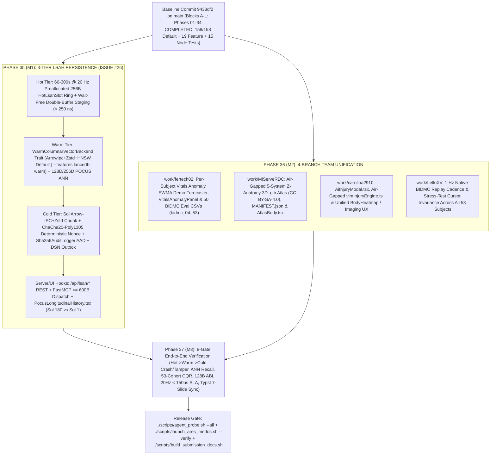
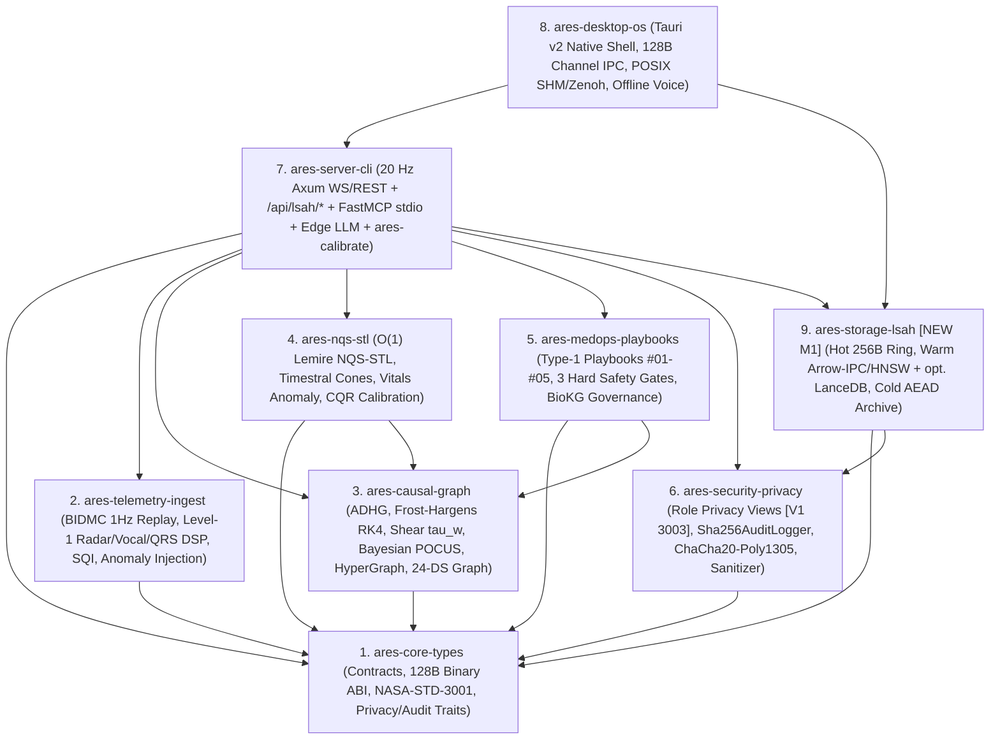

# ARES-Health Block M: 3-Tier LSAH Persistence (Issue #26), Multi-Branch Team Unification & End-to-End Flight-Readiness Verification Architecture (Phases 35–37)

- **Architectural Block:** Block M (`Phases 35–37` / `M1–M3`: 3-Tier LSAH Persistence Engine, Multi-Branch Team Unification & End-to-End Flight-Readiness Verification)
- **Status:** `PLANNED (ARCHITECTED & ACADEMICALLY VERIFIED)`
- **Baseline Commit on `main`:** `9438df2` (Blocks `A–L` Phases `01–34` `COMPLETED (TESTED)`, `158/158` default workspace tests across `24` active suites & `8` crates + `19` feature-gated tests + `15/15` Node cockpit tests, `0` Clippy warnings, `0` production `.unwrap()`/`.expect()`, `0` Unicode emojis)
- **Primary Owners:** `@fabiomalagutti27-droid` & `@MiServeRDC` coordinating across the 5-person team with `@fertech02`, `@carolina2910`, and `@LelloXV`
- **Master Plan, Evidence Audit & Phase Blueprints:**
  - Master Plan: [`RUST_ENGINE_PHASED_MASTER_PLAN.md`](RUST_ENGINE_PHASED_MASTER_PLAN.md)
  - Block K Certification Baseline: [`BLOCK_K_SYSTEM_TESTING_ARCHITECTURE.md`](BLOCK_K_SYSTEM_TESTING_ARCHITECTURE.md)
  - Block L Operational Baseline: [`BLOCK_L_GAP_CLOSURE_ARCHITECTURE.md`](BLOCK_L_GAP_CLOSURE_ARCHITECTURE.md)
  - Model Evidence Audit (`Issue #12`): [`../architecture/MODEL_EVIDENCE_AUDIT.md`](../architecture/MODEL_EVIDENCE_AUDIT.md)
  - HRV Validity Contract (`Issue #11`): [`ISSUE_11_HRV_VALIDITY_PLAN.md`](ISSUE_11_HRV_VALIDITY_PLAN.md)
  - Multi-Branch Merge Evaluation & Patch Plan (`M2`): [`BLOCK_M_MULTI_BRANCH_MERGE_EVALUATION_AND_PATCH_PLAN.md`](BLOCK_M_MULTI_BRANCH_MERGE_EVALUATION_AND_PATCH_PLAN.md)
  - Phase 35 (`M1` — GitHub Issue `#26` LSAH 3-Tier Storage): [`phase_35_M1_lsah_3tier_persistence_issue26.md`](phase_35_M1_lsah_3tier_persistence_issue26.md)
  - Phase 36 (`M2` — 4-Branch Unification Merge): [`phase_36_M2_branch_unification_merge.md`](phase_36_M2_branch_unification_merge.md)
  - Phase 37 (`M3` — End-to-End DB + Cockpit + Certification Gate): [`phase_37_M3_end_to_end_db_cockpit_verification.md`](phase_37_M3_end_to_end_db_cockpit_verification.md)
- **Strict Coding & Evidence Policy:** Zero `.unwrap()` / `.expect()` in production Rust (`crates/*/src/`, including `crates/ares-storage-lsah/src/`); zero external network calls (`default-src 'self'`, `connect-src 'self' http://127.0.0.1:8080 ws://127.0.0.1:8080 ipc: http://ipc.localhost`); zero Unicode emojis anywhere; strict enforcement of **Issue `#11`** (`BEAT_INTERVALS_NOT_AVAILABLE` / `HrvUnavailableReason::BeatIntervalsNotAvailable`, `rmssd_ms = None` on `1 Hz` numeric `BIDMC` streams—preserved as Arrow null bitmaps, never coerced to `0.0`) and **Issue `#12`** ([`../architecture/MODEL_EVIDENCE_AUDIT.md`](../architecture/MODEL_EVIDENCE_AUDIT.md): `ModelValidationStatus::IllustrativeUnvalidated`, `TtvIntervalKind::IllustrativeScenarioRange`, `PocusEmbeddingOrigin::ProceduralBModeSimulation`, and strict lockout forbidding ANN vector similarity from automatically unlocking Hard Clinical Safety Gate 1).

---

## 1. Executive Summary & Architectural Role of Block M

Across **Blocks A–L (Phases 01–34, commit `9438df2`)**, ARES-Health established a verified **8-crate Safe Rust 2024 engine** (`158/158` default tests + `19` feature-gated tests, `--release` 1-tick pipeline `p50 = 2.12 us` / `p99.9 = 5.58 us`, `SeqlockTelemetryRing<64>` `p50 = 42.0 ns`, `900-Sol` Welford longitudinal compactor at `167,352 B < 200 KB`, Level-1 `GATHER` DSP, air-gapped Edge LLM + Voice Copilot, `SubjectDisjointSplit` `CQR` calibration harness, and deterministic `Typst 0.15.1` 7-slide submission bundle) paired with the **React 19 / TypeScript `#000000` OLED Mission Cockpit** (`ares-cockpit/`).

**Block M (`Phases 35–37` / `M1–M3`)** resolves the final two architectural and collaborative milestones remaining across the repository and team branches, followed by a full-stack regression and flight-readiness certification sweep:

1. **3-Tier LSAH Persistence Engine (`Phase 35 / M1` — GitHub Issue `#26` by `@MiServeRDC`, New 9th Crate `crates/ares-storage-lsah`):**
   - While `SeqlockTelemetryRing<64>` (`3.2 s @ 20 Hz`) serves zero-copy IPC and `MissionLongitudinalCompactor` (`167 KB`) holds coarse 1-Sol Welford moments in volatile RAM, deep-space **Earth-Independent Medical Operations (`EIMO`, `NASA-STD-3001 [V1 3006]`)** and **NASA Exploration Medical Capability (`ExMC Gap Med 07` Medical Data Architecture / NASA `LSAH`)** require durable, flash-conserving, crash-consistent multi-tier storage across spacecraft power cycles and `14-day` solar conjunction blackouts.
   - Phase 35 introduces `crates/ares-storage-lsah` implementing a decoupled **Hot $\to$ Warm $\to$ Cold** persistence pipeline:
     - **Hot Tier (In-Memory Fixed-Slot Ring Buffer):** Configurable `60–300 s @ 20 Hz` (`1,200..=6,000` frames) stored in preallocated `256 B` cache-line-aligned `HotLsahSlot` structs (`#[repr(C, align(64))]`, `Copy`, `0` post-init heap allocations, `< 250 ns` insertion) paired with a wait-free double-buffered staging ring (`WarmStagingSwapBuffer`) so slow SSD flushes never block the `20 Hz` deterministic loop.
     - **Warm Tier (Modular Columnar + Vector Store on Local SSD `./data/ares_storage`):** Backed by a clean `WarmColumnarVectorBackend` trait supporting **(a) Default Offline-Native `ArrowIpcZstdHnswBackend`** (`arrow-array` / `arrow-schema` / `arrow-ipc` `58.4.0` + `zstd 0.13.3` + `memmap2 0.9.11` + pure-Rust deterministic `HnswVectorIndex` implementing Malkov & Yashunin *IEEE TPAMI* 2018; `62`-crate closure, `0` network crates, `100%` cached offline) and **(b) Optional `--features lancedb-warm` `LanceDbEmbeddedWarmBackend`** (`lancedb 0.40.0` / `lance 13.0.0` / `arrow 58.4.0` with strict local-path air-gap guard). Persists batched `100–200` frame (`5–10 s`) telemetry `RecordBatch` segments alongside episodic `D = 128` (or `D = 256`) `Float32` POCUS ultrasound feature signatures (`lsah_pocus_signatures`) for $O(\log N)$ ANN similarity retrieval comparing current mission scans (e.g., `Sol 180`) against baseline scans (`Sol 1`).
     - **Cold Tier (Tamper-Evident AEAD DSN Archive):** Periodically compacts Warm Sol segments into Zstandard-compressed Apache Arrow IPC chunks (`.lsah.cold.aead`, avoiding uncached `parquet` crate dependencies while achieving `5x–9x` columnar compression) sealed with **`ChaCha20-Poly1305` (`RFC 8439`)** using a deterministic monotonic `96-bit` nonce `(key_epoch_id: u16, mission_sol: u16, chunk_seq: u64)` and **bidirectional Associated Authenticated Data (`AAD`) binding to `Sha256AuditLogger` (`ares-security-privacy`)**, queued into a priority-ordered `DsnDownlinkOutbox`.
2. **Multi-Branch Team Unification onto `main` (`Phase 36 / M2` — Evaluated in [`BLOCK_M_MULTI_BRANCH_MERGE_EVALUATION_AND_PATCH_PLAN.md`](BLOCK_M_MULTI_BRANCH_MERGE_EVALUATION_AND_PATCH_PLAN.md) & [`phase_36_M2_branch_unification_merge.md`](phase_36_M2_branch_unification_merge.md)):**
   - Reconciles and merges the four unmerged team development branches onto `main` without breaking any Block J, K, or L architectural invariant:
     - **`origin/work/fertech02` (`dce5b33`, `118100c`):** Per-subject vitals anomaly detector (`vitals_anomaly.rs`, `anomaly.rs`, `anomaly_injection.rs`, `anomaly_eval.rs`, `ewma_forecaster.rs`, `VitalsAnomalyPanel.tsx`) and `50` additional PhysioNet BIDMC numeric recordings (`data/bidmc_eval/bidmc_04..53_Numerics.csv` + `MANIFEST.json`, expanding total bundled terrestrial recordings to all `53` BIDMC ICU subjects), patched to preserve Issue `#11` (`rmssd_ms == None`), Issue `#12` (`ILLUSTRATIVE_UNVALIDATED`), and zero `.unwrap()`/`.expect()` in `crates/*/src/`.
     - **`origin/work/MiServeRDC` (`05e142d`, `6abbabf`):** Local air-gapped `CC-BY-SA-4.0` Z-Anatomy 5-system 3D `.glb` meshes (`ares-cockpit/public/anatomy/{CardioVascular41,MuscularSystem100,NervousSystem100,SkeletalSystem100,VisceralSystem100}.glb` + `MANIFEST.json` + `ATTRIBUTION.md` + `AtlasBody.tsx` + `injury.ts`) unified with Phase 29 `L1` `NasaGlbAssetLayer.tsx` (`0x46546C67` glTF v2 magic header check) and `uberonSpatialMapping.ts` (`UBERON:` `observed=false` distinction).
     - **`origin/work/carolina2910` (`08dd941`, `ab252dc`):** Interactive injury inspection UX (`AiInjuryModal.tsx`, `vlmInjuryEngine.ts`, `Imaging.tsx`, `BodyHeatmap.tsx`) reconciled with live `PlaybookRunner.tsx` (`#01..#05` + Gates `1..3`), `MriAndStl.tsx` (`Timestral` cones), `OsVoiceCopilot.tsx`, air-gap CSP (`0` external API calls), and `ILLUSTRATIVE_UNVALIDATED` labeling.
     - **`origin/work/LelloXV` (`3cf8741`):** Native `1 Hz` BIDMC replay cadence and `POST /api/stress-test` cursor invariance verified across both `data/bidmc/` and `data/bidmc_eval/`.
3. **End-to-End LSAH DB, Unified Multi-Branch Cockpit & Certification Verification (`Phase 37 / M3` — [`phase_37_M3_end_to_end_db_cockpit_verification.md`](phase_37_M3_end_to_end_db_cockpit_verification.md)):**
   - Executes an 8-gate adversarial and cross-language verification battery (`M3-G01`..`M3-G08`) across all **9 Rust crates**, **53 PhysioNet BIDMC subjects**, **5 Z-Anatomy `.glb` layers**, **3 LSAH storage tiers**, **8 canonical `FastMCP` macro-tools + LSAH query extensions**, **`ARES-MedOS` `128 B` binary IPC**, and regenerated **`Typst 0.15.1` submission PDFs**.



---

## 2. 9-Crate Acyclic Dependency Topology & Cross-Crate Coverage Matrix (`M1–M3`)

### 2.1 9-Crate Workspace Dependency DAG

Adding `crates/ares-storage-lsah` as the **9th workspace crate** preserves a strictly acyclic, zero-conflict Cargo workspace graph where core physiological math (`ares-causal-graph`, `ares-nqs-stl`, `ares-medops-playbooks`) remains 100% decoupled from disk I/O and Arrow/LanceDB dependencies:



### 2.2 Cross-Crate & Cross-Language Coverage Matrix across Phases 35–37 (`M1–M3`)

| Target Crate / Artifact | Baseline Verified Symbols (`9438df2`) | Phase 35 (`M1` — LSAH 3-Tier DB, Issue `#26`) | Phase 36 (`M2` — 4-Branch Team Unification) | Phase 37 (`M3` — End-to-End Verification) |
| :--- | :--- | :--- | :--- | :--- |
| **`crates/ares-core-types`** | `TelemetryPacket`, `BinaryTelemetryFrame` (`128 B`), `SeqlockTelemetryRing<64>`, `ModelValidationStatus`, `HrvUnavailableReason`, `CrewRole`, `AuditChainRecord` | Shared contract types (`PocusEmbeddingOrigin`, `LsahTierSummary` wire metadata, `FLAG_BEAT_INTERVALS_NOT_AVAILABLE` & `FLAG_ILLUSTRATIVE_UNVALIDATED` preserved across Hot/Warm/Cold) | `src/anomaly.rs` (`VitalsAnomalySummary`, `ChannelAnomalyState`, non-silent evidence invariants from `work/fertech02`) reconciled with `ModelValidationStatus` | `128 B` ABI layout invariance (`size_of == 128`, `align_of == 64`), null-mask roundtrip across all 9 crates |
| **`crates/ares-telemetry-ingest`** | `BidmcReplayer`, `SqiFilter`, `RadarCsiProcessor`, `VocalAcousticAnalyzer`, `WaveformRrExtractor`, `WearableSensorPacket` | Supplies `1 Hz` recorded & `20 Hz` interpolated frames + `WearableSensorPacket` SEU counters into `HotLsahSlot` without heap cloning | `src/anomaly_injection.rs` (`work/fertech02`) + `1 Hz` cadence cursor invariance (`work/LelloXV`) verified across `bidmc_01..53` | `53`-file `MANIFEST.json` SHA-256 verification (`bidmc_01..03` + `bidmc_04..53`), `0` fabricated `RMSSD` values |
| **`crates/ares-causal-graph`** | `compute_tau_w_dyn_cm2`, `step_sclerostin_rk4`, `evaluate_two_stage_bayesian_pocus`, `MissionLongitudinalCompactor`, `AnatomicalRegionSubgraph`, `AresUnifiedDatasetGraph` | `tau_w_dyn_cm2`, `ijv_csa_mm2`, `ijv_vmax_cm_s`, `mqi_index`, `sclerostin_pmol_l`, and `PocusPosteriorEstimate` persisted in Warm Arrow columns & POCUS signature metadata | Preserves `UBERON:0001586` (IJV) & `observed=false` semantics alongside Z-Anatomy `.glb` layers | Differential check between volatile `MissionLongitudinalCompactor` Welford means and Warm/Cold Arrow `RecordBatch` roll-ups |
| **`crates/ares-nqs-stl`** | `LemireMinWedge`, `TimestralBackbone`, `QuantileHead`, `ConformalAbstentionGate`, `calibration_harness.rs` | `NqsStlMargins` (`rho_tau_w`, `rho_ared`, `rho_sost`, `rho_rmssd`, `rho_sans`, `rho_global`, `ttv_hours`, `mri_pct`) persisted with exact nullable Arrow bitmaps | `src/vitals_anomaly.rs` & `src/ewma_forecaster.rs` (`work/fertech02`, labeled `ILLUSTRATIVE_UNVALIDATED`, zero `.unwrap()`) | `53`-subject `SubjectDisjointSplit` (`L1–L4` anti-leakage) + `LemireMinWedge` window warm-start from `HotTelemetryRingBuffer` |
| **`crates/ares-medops-playbooks`** | `select_candidate_playbook`, `enforce_hard_clinical_safety_gates` (`Gates 1..3`), `verify_playbook_governance` | Hard Gate 1 invariant enforced: POCUS ANN vector similarity hits are advisory/diagnostic context only and **never** set `pocus_thrombus_confirmed = true` automatically | Anomaly-triggered guidance in `playbooks.rs` (`work/fertech02`) audited against Gates `1..3` | Adversarial test proving `cosine_similarity == 0.999` against a historical thrombus vector still leaves `anticoagulant_lock_active == true` until CMO confirmation |
| **`crates/ares-security-privacy`** | `AresSecurityGuard`, `EphemeralDsnKey` (`ZeroizeOnDrop`), `Sha256AuditLogger`, `StrictMcpSanitizer` | Role-scoped filtering (`CrewPrivacyFilter` `[V1 3003]`) on Warm/Cold reads + bidirectional `Sha256AuditLogger` hash-tip binding in Cold AEAD `AAD` | Preserves XML `<untrusted_telemetry_observation>` spotlighting across anomaly & injury notes | 1-bit tamper injection across Cold `.lsah.cold.aead` ciphertext, 96-bit nonce, `AAD`, and `Sha256AuditLogger` chain |
| **`crates/ares-storage-lsah` (`NEW — 9th Crate`)** | *New in Phase 35 (`M1`)* | `HotLsahSlot` (`256 B`), `HotTelemetryRingBuffer`, `WarmStagingSwapBuffer`, `lsah_telemetry_arrow_schema`, `lsah_pocus_signature_arrow_schema`, `HnswVectorIndex`, `WarmColumnarVectorBackend` (`ArrowIpcZstdHnswBackend` + `--features lancedb-warm`), `ColdTierArchiver`, `DsnDownlinkOutbox`, `LsahPersistenceEngine` | Stores `vitals_anomaly` flags (`M2`) in `quality_flags_mask` / metadata without schema breakage | Full `M1-T01..T12` + `M3-G02` crash-consistency, slow-SSD non-blocking, and `--release` throughput certification |
| **`crates/ares-server-cli`** | `SharedMissionState`, `build_axum_router`, `WireTelemetryPacket`, `handle_fastmcp_jsonrpc_request` (`8` tools), `edge_llm_bridge.rs`, `ares-calibrate` | Embeds `Arc<LsahPersistenceEngine>`; `< 250 ns` hot-ring hook in `advance_tick`; `/api/lsah/{status,hot-window,pocus-ingest,pocus-search,cold-seal}`; `FastMCP` `tools/call` `"get_lsah_storage_status"` & `"query_lsah_pocus_similarity"` (`<= 600 B`) | Merges `src/anomaly_eval.rs` (`work/fertech02`) & `vitals_anomaly` wire field in `wire_contract.rs` | Live HTTP/WS/FastMCP E2E asserting `tools/list == 8` compatibility + LSAH macro-calls `<= 600 B` + `20 Hz` tick `< 150 us` |
| **`crates/ares-desktop-os`** | `AresMedOsWorkstationShell`, `ipc_bridge.rs` (`128 B` `Channel<Response>`), `voice_whisper.rs`, `tauri.conf.json` | Exposes `ipc_get_lsah_status` & `ipc_query_pocus_similarity` in-process; resolves `./data/ares_storage` inside writable app-data dir when launched from read-only `.app` bundle | Bundles `ares-cockpit/public/anatomy/*.glb` & `MANIFEST.json` cleanly under air-gapped CSP | `launch_ares_medos.sh --verify` + headless `tauri-runtime` IPC contract parity |
| **`ares-cockpit/` (`TypeScript` / `React 19`)** | `PlaybookRunner.tsx`, `MriAndStl.tsx`, `BodyHeatmap.tsx`, `NasaGlbAssetLayer.tsx`, `Imaging.tsx`, `OsSystemStatusBar.tsx`, `OsCommandPalette.tsx`, `OsVoiceCopilot.tsx` | `src/modules/analysis-imaging/PocusLongitudinalHistory.tsx` (`Sol 180` vs `Sol 1` ANN similarity comparison, `tau_w` & `IJV_CSA` delta, `>= 44x44 pt` OLED, `ILLUSTRATIVE_UNVALIDATED` badge) | Unifies `VitalsAnomalyPanel.tsx` (`fertech02`), `AtlasBody.tsx` + `5` Z-Anatomy `.glb` (`MiServeRDC`), and `AiInjuryModal.tsx` + `vlmInjuryEngine.ts` (`carolina2910`) | `npm run lint`, `vite build`, Node TS unit suites, and Playwright E2E verifying `0` external URLs and `< 100 ms` UI feedback |
| **`data/`, `docs/submission/` & `scripts/`** | `data/bidmc/`, `docs/submission/NASA_2026_7_SLIDE_DECK.{typ,pdf}`, `PANORAMICA_GENERALE_PROGETTO.{md,pdf}`, `scripts/{agent_probe.sh,build_submission_docs.sh}` | Runtime `./data/ares_storage/{warm,cold,manifests}/` (gitignored for transient test runs; deterministic fixture verification in `tempdir`) | Adds `data/bidmc_eval/bidmc_04..53_Numerics.csv` + `MANIFEST.json` & `ares-cockpit/public/anatomy/*` (`CC-BY-SA-4.0`) | `agent_probe.sh --all` + `build_submission_docs.sh` (`6/6` Typst/SRT/emoji/Issue `#12` gates passing on 9-crate architecture) |

---

## 3. Non-Negotiable Architectural, Real-Time, Cryptographic & Epistemic Invariants of Block M

### 3.1 Wait-Free `20 Hz` Producer Isolation & NAND Flash Wear-Leveling (`Phase 35 / M1`)
- **Zero Dynamic Allocations & Bounded Wait-Free Hot Path (`LEFT-RS`, Chen et al. 2025):** `HotTelemetryRingBuffer` allocates `Box<[HotLsahSlot]>` (`1,200..=6,000` slots $\times$ `256 B` = `307.2 KB..1.536 MB`) **once** during `LsahPersistenceEngine::open()`. Every `20 Hz` tick copies scalars into a `Copy` `HotLsahSlot` (`4` CPU cache lines) and enqueues it into `WarmStagingSwapBuffer` in `< 250 ns` with `0` heap allocations (`String` / `Vec` fields are mapped to deterministic interned enum/ID codes and bitmasks).
- **Complete Isolation from SSD Latency Spikes:** On radiation-tolerant spacecraft SLC/pSLC NAND flash, garbage collection or NVMe controller resets can stall `fsync()` for `20–250 ms` (`> 1000x` the `150 us` tick budget). `AsyncWarmBatchFlusher` drains `100–200` frames (`5–10 s`) on a background `tokio::task::spawn_blocking` thread. If both staging buffers fill during an extreme SSD stall, the `20 Hz` producer **never blocks**: it folds displaced frames into an in-memory `WelfordAccumulator` overflow summary and increments `warm_coalesced_frames: AtomicU64`.
- **`200x` Write Amplification Reduction:** Batching `200` frames (`10.0 s @ 20 Hz`) into Zstandard-compressed Apache Arrow IPC segments reduces filesystem sync operations from `1,728,000/day` (`20 Hz` per-sample writes, $\text{WAF} \gg 20$) down to `8,640/day` sequential aligned appends, preserving spacecraft SSD endurance across a `900-Sol` Mars mission.

### 3.2 Honest Dual-Backend Warm Architecture (`ArrowIpcZstdHnswBackend` Default vs. `--features lancedb-warm`)
- Empirical inspection of the local Cargo cache (`~/.cargo/registry/cache`, `823` `.crate` archives on `rustc 1.99.1`) proves that while `lancedb 0.40.0` (`lance 13.0.0`) resolves cleanly against `arrow-58.4.0` (`arrow-* = "58.0.0"`) and `object_store-0.14.2`, enabling `lancedb` unconditionally inflates the dependency closure from **`62` crates (`0` missing offline) to `264` crates**, pulls in **`29` `datafusion 54.1.0` crates + `prost-build` (`protoc`)**, and transitively links **`lance-namespace-reqwest-client 0.13.0` (`reqwest`)** even with `default-features = false`.
- Consequently, `crates/ares-storage-lsah` defines `pub trait WarmColumnarVectorBackend: Send + Sync`:
  1. **Default (`ArrowIpcZstdHnswBackend`):** Pure-Rust, `100%` offline-cached (`62` crates, `0` HTTP/network dependencies), writing canonical Apache Arrow `RecordBatch` files (`arrow-ipc 58.4.0` + `zstd 0.13.3` + `memmap2 0.9.11`) paired with a deterministic pure-Rust `HnswVectorIndex` (`M = 16`, `ef_construction = 64`, `ef_search = 32`, seeded `SplitMix64` level assignment, `CRC-32C` persisted graph).
  2. **Feature-Gated (`--features lancedb-warm`, `LanceDbEmbeddedWarmBackend`):** Wraps real embedded `lancedb 0.40.0` on `./data/ares_storage/lancedb` using identical `arrow_schema::Schema` definitions, guarded prior to `lancedb::connect()` by `validate_airgapped_lsah_dir()` which rejects any remote URI scheme (`s3://`, `gs://`, `az://`, `http://`, `https://`, `db://`, `lance+rest://`).

### 3.3 RFC 8439 Monotonic AEAD Nonce Discipline & Bidirectional `Sha256AuditLogger` Sealing (`Cold Tier`)
- Because `parquet` is not present in the offline Cargo cache whereas `arrow-ipc 58.4.0` and `zstd 0.13.3` are verified in cache, Cold Tier snapshots serialize compacted Sol `RecordBatch` tables into `ArrowIpcFile + Zstd(level=6)` prior to `ChaCha20-Poly1305` encryption (`chacha20poly1305 0.10.1`).
- Following **IETF RFC 8439 Section 4** and **RFC 8103**, Cold Tier encryption **forbids ad-hoc or purely random 96-bit nonces**: every 12-byte nonce is constructed deterministically as `key_epoch_id.to_le_bytes() [0..2] || mission_sol.to_le_bytes() [2..4] || chunk_seq.to_le_bytes() [4..12]`, backed by an atomically persisted `highest_sealed_chunk_seq` watermark that refuses nonce reuse (`Err(LsahStorageError::NonceReuseDetected)`).
- Every Cold archive seal first records `LSAH_COLD_SEAL` (including `SHA-256` of the compressed Arrow payload) into `Sha256AuditLogger`, then binds the resulting `audit_seq` and `current_hash_hex` inside the `ChaCha20-Poly1305` **Associated Authenticated Data (`AAD`)**. Tampering with *either* the audit log *or* the Cold archive metadata/ciphertext deterministically fails Poly1305 authentication.

### 3.4 Issue `#11`, Issue `#12`, Hard Gate 1 & `[V1 3003]` Privacy Invariants Across `M1` & `M2`
- **Issue `#11` Null-Bitmap Fidelity:** Across all `53` `1 Hz` numeric BIDMC CSVs (`bidmc_01..03` + `bidmc_04..53`), `rmssd_ms` (`BEAT_INTERVALS_NOT_AVAILABLE`) and missing `PULSE`/`SpO2` cells are stored as true Apache Arrow validity-bitmap `null` bits (`validity_mask` bit `= 0`), never `0.0`.
- **Issue `#12` & Hard Gate 1 Non-Bypass:** Procedural B-mode POCUS embeddings (`PocusEmbeddingOrigin::ProceduralBModeSimulation`), `ewma_forecaster.rs`, `vitals_anomaly.rs`, and `vlmInjuryEngine.ts` carry explicit `ModelValidationStatus::IllustrativeUnvalidated` provenance. Nearest-neighbor POCUS similarity matches (`Sol 180` vs `Sol 1`) provide visual longitudinal decision support in `PocusLongitudinalHistory.tsx` and **can never auto-confirm a thrombus or unlock Hard Clinical Safety Gate 1 (`anticoagulant_lock_active`)**.
- **`NASA-STD-3001 Vol. 1 Ch. 7 [V1 3003]` Privacy at Rest & Downlink:** Queries against Warm/Cold tiers require an explicit `CrewRole` (`AstronautSelf`, `CrewMedicalOfficer`, `GroundFlightSurgeon`) and pass through `AresSecurityGuard`, masking `vocal_f0_hz` and `vocal_jitter_pct` unless astronaut consent is active or a life-safety threshold ($\hat{\rho}_k < 0$ or `CriticalEmergency`) is breached.

---

## 4. End-to-End Latency, RAM, IOPS & Storage Budget Matrix for Block M

| Phase / Subsystem | Execution Context / Thread | Latency Budget / Target | RAM Footprint Budget | Disk / Wire Storage Budget | Impact on `20 Hz` Deterministic Tick (`p99.9 = 5.58 us` Baseline) |
| :--- | :--- | :---: | :---: | :---: | :---: |
| **Baseline (`Block K/L` Certified Hot-Path)** | `20 Hz` Tokio RT (`compute_mission_telemetry_tick` + `SeqlockTelemetryRing<64>`) | `p50 = 2.12 us`, `p99.9 = 5.58 us` (`< 150 us` SLA) | `167.4 KB` (`900-Sol` Welford) + `196.3 KB` (`DatasetGraph`) + `8 KB` (`Seqlock`) | `128 B` (`BinaryTelemetryFrame`) | **Baseline (`5.58 us` `p99.9`)** |
| **Phase 35 (`M1` — Hot Ring + Staging Enqueue)** | Inline in `SharedMissionState::advance_tick` | `p50 < 90 ns`, `p99.9 < 250 ns` (`0` heap allocs post-init) | `307.2 KB` (`60 s @ 20 Hz`) to `1.536 MB` (`300 s @ 20 Hz`) + `2x 51.2 KB` double-buffer | `0 B` disk I/O in hot path | **`+ < 0.25 us` wait-free** (`total p99.9 < 6.0 us << 150 us`) |
| **Phase 35 (`M1` — Warm Batch Flusher, `100–200` frames / `5–10 s`)** | Background `tokio::task::spawn_blocking` worker | `< 3.5 ms` (`ArrowIpc+Zstd` default) / `< 12 ms` (`lancedb-warm`) per `10 s` batch | `< 512 KB` reusable Arrow column builders | `~8–18 KB` per `200`-frame `Zstd` batch (`200x` lower IOPS; `~75–150 MB` per Sol raw-20Hz Warm window before Cold roll-up) | **`0 ns`** (isolated via `WarmStagingSwapBuffer`) |
| **Phase 35 (`M1` — POCUS `128D`/`256D` HNSW Search)** | Axum `/api/lsah/pocus-search` / `FastMCP` read path | `p50 < 45 us`, `p99 < 150 us` over `1,000` longitudinal scans (`O(log N)`) | `< 1.8 MB` for `1,000` `256D` `Float32` vectors + `M=16` HNSW links | `~512 B` (`128D`) / `1,024 B` (`256D`) + metadata per POCUS scan (`< 5 MB` over `900` Sols) | **`0 ns`** (read-only snapshot / HNSW index) |
| **Phase 35 (`M1` — Cold Sol `ArrowIpc+Zstd+AEAD` Seal)** | Scheduled Sol roll-up / `POST /api/lsah/cold-seal` (`spawn_blocking`) | `< 15 ms` per compacted Sol chunk (`ChaCha20-Poly1305` `> 1 GB/s` on ARM64 NEON / x86 AVX2) | `< 2 MB` transient compression + ciphertext buffer (`EphemeralDsnKey` `ZeroizeOnDrop`) | `~1.5–2.0 MB/Sol` (`< 1.8 GB` total across `900` Martian Sols vs `~1.6 TB` naive) | **`0 ns`** (asynchronous background compaction) |
| **Phase 36 (`M2` — Per-Subject Vitals Anomaly + EWMA Demo)** | `1 Hz` / `20 Hz` scalar evaluation (`vitals_anomaly.rs`) | `< 1.8 us` scalar update (`O(1)` per channel, `0` heap allocs) | `< 16 KB` per-subject baseline state | `data/bidmc_eval/` `50` CSVs (`~1.15 MB` static dataset) | **`+ < 1.8 us` deterministic** (`total p99.9 < 8.0 us << 150 us`) |
| **Phase 36 (`M2` — 5-System Z-Anatomy `.glb` + `AiInjuryModal` + `PocusLongitudinalHistory`)** | WebGL GPU / React 19 UI thread (`ares-cockpit/`) | `60 FPS` `< 16.6 ms` frame; lazy per-layer `.glb` load with `0x46546C67` magic guard | GPU VBOs loaded on demand per anatomical layer toggle | `26.75 MB` local `public/anatomy/*.glb` (`0` external CDN requests) | **`0 ns`** (decoupled frontend / GPU process) |
| **Phase 37 (`M3` — 8-Gate E2E & Submission Suite)** | Offline CI / test harness (`cargo test`, `playwright`, `typst`) | Full `M3` verification sweep `< 45 s` offline (`ares-calibrate` `< 600 ms` on `53` subjects) | Transient test buffers (`[dev-dependencies]` isolated) | `NASA_2026_7_SLIDE_DECK.pdf` (`7` pages exact) + `PANORAMICA_GENERALE_PROGETTO.pdf` | **`0 ns`** (verification & build-time pipeline) |

---

## 5. Planned Block M File Topology

```text
NASA_Space_Apps_2026/
├── Cargo.toml                                                   # M1: Adds "crates/ares-storage-lsah" (9th workspace crate)
├── contracts/
│   └── telemetry_schema.json                                    # M1/M2: Optional lsah_storage_status & vitals_anomaly wire blocks (backward-compatible)
├── crates/
│   ├── ares-storage-lsah/                                       # M1 (NEW — 9th Crate: Issue #26 3-Tier LSAH Persistence)
│   │   ├── Cargo.toml                                           # M1: arrow-array/ipc/schema 58.4, zstd 0.13, parking_lot, memmap2, crc32fast + opt. lancedb-warm
│   │   ├── README.md                                            # M1: Crate architecture, invariants & NASA LSAH/MDA traceability
│   │   ├── src/
│   │   │   ├── lib.rs                                           # M1: Public API exports for Hot, Warm, Cold & LsahPersistenceEngine
│   │   │   ├── error.rs                                         # M1: Typed LsahStorageError (thiserror, 0 unwrap/expect)
│   │   │   ├── hot_ring.rs                                      # M1: 256B #[repr(C, align(64))] HotLsahSlot, HotTelemetryRingBuffer & WarmStagingSwapBuffer
│   │   │   ├── arrow_schema.rs                                  # M1: Canonical Arrow Schemas & null-preserving RecordBatch builders (Issue #11 compliant)
│   │   │   ├── hnsw_index.rs                                    # M1: Deterministic pure-Rust HNSW (Malkov & Yashunin 2018, Cosine/L2, CRC-32C snapshot)
│   │   │   ├── pocus_features.rs                                # M1: 128D/256D Float32 POCUS signature extractor & ILLUSTRATIVE_UNVALIDATED provenance
│   │   │   ├── warm_tier.rs                                     # M1: WarmColumnarVectorBackend trait, ArrowIpcZstdHnswBackend, LanceDbEmbeddedWarmBackend & Flusher
│   │   │   ├── cold_archive.rs                                  # M1: RFC 8439 monotonic nonce ChaCha20-Poly1305 sealer, Sha256AuditLogger AAD & DsnDownlinkOutbox
│   │   │   └── engine.rs                                        # M1: Unified LsahPersistenceEngine + [V1 3003] role-filtered queries
│   │   └── tests/
│   │       └── phase_35_m1_lsah_persistence.rs                  # M1: 12 unit/chaos/tamper/recall/offline-parity tests (M1-T01..M1-T12)
│   ├── ares-core-types/src/
│   │   └── anomaly.rs                                           # M2: Merged & Issue #12-audited vitals anomaly contracts (work/fertech02)
│   ├── ares-telemetry-ingest/src/
│   │   └── anomaly_injection.rs                                 # M2: Deterministic anomaly event injection harness (work/fertech02)
│   ├── ares-nqs-stl/src/
│   │   ├── vitals_anomaly.rs                                    # M2: Per-subject vitals anomaly detector (never silently holds/skips without current evidence)
│   │   └── ewma_forecaster.rs                                   # M2: EWMA baseline/demo comparator (explicitly tagged ILLUSTRATIVE_UNVALIDATED)
│   ├── ares-server-cli/
│   │   ├── Cargo.toml                                           # M1: Depends on ares-storage-lsah; optional feature passthrough lancedb-warm
│   │   ├── src/
│   │   │   ├── anomaly_eval.rs                                  # M2: 53-subject injected-event anomaly evaluation CLI/module
│   │   │   ├── ws_server.rs                                     # M1/M2: Embeds Arc<LsahPersistenceEngine>, <250ns hot-ring hook, /api/lsah/* & anomaly state
│   │   │   ├── fastmcp_router.rs                                # M1: <=600B tools/call "get_lsah_storage_status" & "query_lsah_pocus_similarity" (8-tool list kept)
│   │   │   └── wire_contract.rs                                 # M1/M2: Optional lsah_status & vitals_anomaly wire fields
│   │   └── tests/
│   │       ├── phase_37_m3_lsah_e2e.rs                          # M3 (NEW): Full Hot->Warm->Cold->DSN restart, bit-flip & [V1 3003] E2E
│   │       ├── phase_37_m3_multibranch_regression.rs            # M3 (NEW): 53-subject BIDMC anomaly + CQR anti-leakage + Issue #11/#12 regression
│   │       └── phase_37_m3_contract_ipc_mcp.rs                  # M3 (NEW): 9-crate HTTP/WS/FastMCP <=600B & 128B TS DataView parity
│   └── ares-desktop-os/
│       ├── Cargo.toml                                           # M1: Depends on ares-storage-lsah
│       ├── src/lib.rs                                           # M1: ipc_get_lsah_status, ipc_query_pocus_similarity & writable storage dir resolver
│       └── tests/
│           └── phase_37_m3_rt_storage_bench.rs                  # M3 (NEW): --release 2,000-tick latency (<150us SLA) under concurrent SSD Warm/Cold flush
├── ares-cockpit/
│   ├── public/anatomy/                                          # M2: 5 Z-Anatomy CC-BY-SA-4.0 .glb meshes + MANIFEST.json + ATTRIBUTION.md (work/MiServeRDC)
│   ├── src/
│   │   ├── types/{telemetry.ts, injury.ts}                      # M1/M2: TS contracts for LsahStorageStatus, PocusSimilarityHit, VitalsAnomaly & InjuryMarker
│   │   ├── lib/vlmInjuryEngine.ts                               # M2: Strictly local/procedural air-gapped injury assessment (0 network calls, Issue #12 badge)
│   │   └── modules/
│   │       ├── analysis-imaging/
│   │       │   ├── Imaging.tsx                                  # M1/M2: Integrates PocusLongitudinalHistory alongside PocusIjv, OcularOnsd & EcgStrip
│   │       │   └── PocusLongitudinalHistory.tsx                 # M1 (NEW): Sol 180 vs Sol 1 ANN vector similarity view (>=44pt OLED, Gate 1 lock notice)
│   │       ├── vitals-anomaly/VitalsAnomalyPanel.tsx            # M2: Per-subject vitals anomaly cockpit module (work/fertech02)
│   │       └── body-3d-heatmap/{BodyHeatmap.tsx, AtlasBody.tsx, AiInjuryModal.tsx} # M2: Unified UBERON + Z-Anatomy .glb + Injury markers
│   └── tests/
│       └── phase37_m3_unified_cockpit.test.ts                   # M3 (NEW): Unified cockpit validation, POCUS ANN Gate-1 non-bypass & air-gap URL assertions
├── data/
│   └── bidmc_eval/                                              # M2: bidmc_04..53_Numerics.csv + MANIFEST.json (50 subjects, SHA-256 verified)
├── docs/
│   ├── scientific_references.md                                 # M1-M3: Section 12 (Lance, HNSW, LEFT-RS, DATE 2017 ChaCha20, RFC 8103/8439, NASA LSAH/MDA)
│   ├── architecture/IMPLEMENTATION_STACK.md                     # M1-M3: Section J / Livello 6 summary
│   └── plans/
│       ├── BLOCK_M_GAP_CLOSURE_ARCHITECTURE.md                  # M1-M3: Master Block M Architecture (this file)
│       ├── BLOCK_M_MULTI_BRANCH_MERGE_EVALUATION_AND_PATCH_PLAN.md # M2: Sibling multi-branch merge evaluation & conflict resolution matrix
│       ├── phase_35_M1_lsah_3tier_persistence_issue26.md        # M1: Detailed Issue #26 evaluation & crates/ares-storage-lsah implementation blueprint
│       ├── phase_36_M2_branch_unification_merge.md              # M2: Step-by-step 4-branch unification plan
│       └── phase_37_M3_end_to_end_db_cockpit_verification.md    # M3: 8-gate E2E verification & regression certification plan
└── scripts/
    ├── agent_probe.sh                                           # M3: Extended to verify 9 crates, bidmc + bidmc_eval + anatomy MANIFEST.json SHA-256
    └── build_submission_docs.sh                                 # M3: Re-verifies 7-page OLED slide deck & updated 9-crate PANORAMICA PDF
```

---

## 6. CI / Local Verification Gate Sequence (`Block M`)

Every Block M implementation commit must pass the deterministic offline gate sequence below in order:

```bash
# Step 1: Fast static zero-unwrap (9 crates), JSON schema, BIDMC (53 CSVs) + Anatomy SHA-256 & Clippy gate
./scripts/agent_probe.sh --fast

# Step 2: Phase 35 (M1) dedicated 3-tier LSAH persistence unit, slow-SSD chaos, HNSW & AEAD tamper suite
cargo test -p ares-storage-lsah -- --nocapture
# Optional LanceDB embedded Warm backend equivalence gate (when protoc + cache present)
cargo test -p ares-storage-lsah --features lancedb-warm -- --nocapture

# Step 3: Full 9-crate workspace test suite (Blocks A-M: unit + integration + Block K + Block L + Block M)
RUST_TEST_THREADS=1 ./scripts/agent_probe.sh --all

# Step 4: Full Cargo feature-matrix verification across all optional subsystems
cargo test -p ares-desktop-os --features tauri-runtime --test phase_30_l2_tauri_bridge -- --nocapture
cargo test -p ares-server-cli --features shm-ipc --test phase_30_l2_shm_zenoh_ipc -- --nocapture
cargo test -p ares-nqs-stl --features candle-safetensors --test phase_32_l4_safetensors_loader -- --nocapture
cargo test -p ares-causal-graph --features parquet-ingest --test phase_33_l5_parquet_adapters -- --nocapture
cargo clippy --workspace --all-targets -- -D warnings

# Step 5: 53-subject BIDMC anti-leakage calibration & anomaly evaluation verification
cargo run --release -p ares-server-cli --bin ares-calibrate -- --verify-only

# Step 6: Unified Cockpit TypeScript strict check, Vite production bundle & Node/Playwright E2E suites
npm --prefix ares-cockpit run lint
npm --prefix ares-cockpit run build
npm --prefix ares-cockpit test -- --run

# Step 7: ARES-MedOS workstation smoke test & deterministic Typst 7-slide PDF submission gates
./scripts/launch_ares_medos.sh --verify
./scripts/build_submission_docs.sh
```

### Block M Gate Acceptance Matrix

| Gate ID | Phase | Target Suite / Script | Normative & Technical Invariant Verified | Pass Criterion |
| :--- | :---: | :--- | :--- | :--- |
| **`M1-GATE`** | `35 (M1)` | `cargo test -p ares-storage-lsah` (+ `--features lancedb-warm`) | `0` post-init allocs on `HotLsahSlot` (`< 250 ns`), `0` `20 Hz` stalls under slow SSD, Arrow null-bitmap fidelity (`Issue #11`), HNSW `Sol 180` vs `Sol 1` recall `>= 0.95` without Gate 1 auto-unlock (`Issue #12`), RFC 8439 monotonic nonce + `Sha256AuditLogger` `AAD` tamper rejection, `[V1 3003]` privacy masking | `12/12` `M1` tests green; `0` Clippy warnings; `0` `.unwrap()`/`.expect()` |
| **`M2-GATE`** | `36 (M2)` | Merged `ares-nqs-stl`, `ares-telemetry-ingest`, `ares-server-cli` & `ares-cockpit` suites | Clean integration of `fertech02` vitals anomaly + `50` `bidmc_eval` CSVs, `MiServeRDC` `5` Z-Anatomy `.glb` (`0x46546C67` + `CC-BY-SA-4.0`), `carolina2910` air-gapped `AiInjuryModal`, and `LelloXV` `1 Hz` cadence | `0` merge conflicts or regressions on Block K/L tests; `0` external URLs; `ILLUSTRATIVE_UNVALIDATED` preserved |
| **`M3-GATE`** | `37 (M3)` | `phase_37_m3_*` (`4` E2E/bench suites) + `phase37_m3_unified_cockpit.test.ts` + `agent_probe.sh --all` + `build_submission_docs.sh` | Hot->Warm->Cold crash recovery, `53`-subject `SubjectDisjointSplit` `L1–L4`, `FastMCP` `tools/list == 8` + LSAH `tools/call <= 600 B`, `128 B` TS `DataView` parity, `--release` tick `p99.9 < 150 us`, `Typst` `7`-page dual-oracle PDF | `100%` `M3-G01..G08` gates `[PASSED]`; `0` emojis repo-wide |

---

## 7. Consolidated Scientific, Aerospace & Open-Source References Summary for Block M

Full bibliographic records, DOIs, arXiv identifiers, IETF RFCs, and software license audits for Block M are documented in **Section 12** of [`../scientific_references.md`](../scientific_references.md):

| Block M Phase | Reference / Standard / Open-Source Repository | Citation / Identifier & License | Architectural Role in Block M |
| :---: | :--- | :--- | :--- |
| **`M1`** | **Lance Columnar Format & Adaptive Structural Encodings** | W. Pace, C. She, L. Xu, W. Jones, A. Lockett, J. Wang, R. Shah (2025), `arXiv:2504.15247v1`; `https://github.com/lancedb/lancedb` & `https://github.com/lance-format/lance` (`Apache-2.0`) | Grounds multimodal columnar + fixed-size vector storage (`--features lancedb-warm`) and null-bitmap structural encoding on NVMe SSDs. |
| **`M1`** | **Apache Arrow Columnar In-Memory & IPC File Format + Zstandard** | `https://github.com/apache/arrow-rs` (`arrow-array`, `arrow-schema`, `arrow-ipc` `58.4.0`, `MIT OR Apache-2.0`); Y. Collet & M. Kucherawy, *IETF RFC 8878* (`zstd 0.13.3`, `BSD-3-Clause`) | Powers the lean `62`-crate offline default `ArrowIpcZstdHnswBackend` and `5x–9x` compressed Cold Tier chunks without uncached `parquet` crates. |
| **`M1`** | **Hierarchical Navigable Small World (`HNSW`) Graphs** | Yu. A. Malkov & D. A. Yashunin, *IEEE Trans. Pattern Anal. Mach. Intell. (TPAMI)* 42(4):824–836, 2020 (`arXiv:1603.09320v4`, `DOI: 10.1109/TPAMI.2018.2889473`) | $O(\log N)$ approximate nearest-neighbor search in `hnsw_index.rs` for comparing `Sol 180` vs `Sol 1` POCUS ultrasound embeddings (`128D`/`256D` `Float32`). |
| **`M1`** | **Lock-Free & Wait-Free Multicore Real-Time Ring Protocols (`LEFT-RS`)** | N. Chen, X. Dai, T. Cheng et al. (2025), `arXiv:2512.21701v1`; I. Cibrario Bertolotti & G. Manduchi (CRC Press, 2017, `DOI: 10.1201/b11651-10`); H. Cho, B. Ravindran & E. D. Jensen (*DATE 2006*, `DOI: 10.1109/date.2006.243800`) | Grounds the preallocated `HotTelemetryRingBuffer` (`256 B` `HotLsahSlot`) and wait-free `WarmStagingSwapBuffer` isolating `20 Hz` ingestion from SSD stalls. |
| **`M1`** | **High-Speed Embedded `ChaCha20-Poly1305` AEAD & Nonce Discipline** | F. De Santis, A. Schauer & G. Sigl (*DATE 2017*, `DOI: 10.23919/date.2017.7927078`); R. Housley, *IETF RFC 8103* (`DOI: 10.17487/rfc8103`); Y. Nir & A. Langley, *IETF RFC 8439* (`DOI: 10.17487/rfc8439`) | Grounds Cold Tier `ChaCha20-Poly1305` encryption, deterministic 96-bit counter nonces `(key_epoch_id, mission_sol, chunk_seq)`, and `Sha256AuditLogger` `AAD` binding. |
| **`M1` / `M3`** | **NASA `LSAH`, NASA `ExMC Gap Med 07` (`MDA`) & `NASA-STD-3001`** | NASA Lifetime Surveillance of Astronaut Health (`https://lsda.jsc.nasa.gov/lsah_home`); NASA ExMC *Medical Data Architecture*; A. Assad & O. L. de Weck (*Acta Astronautica* 2015, `DOI: 10.1016/j.actaastro.2014.10.009`); `NASA-STD-3001` `[V1 3003]`, `[V1 3006]` | Defines spacecraft longitudinal health surveillance tiers, Earth-Independent Medical Operations (`EIMO`) Store-and-Forward governance, and crew medical privacy tiers. |
| **`M2` / `M3`** | **PhysioNet `BIDMC v1.0.0` (`53` Subjects) & Z-Anatomy 3D Atlas** | M. A. F. Pimentel et al., *IEEE TBME* 2017 (`DOI: 10.1109/TBME.2016.2613124`, `ODC-By-1.0`); Z-Anatomy / BodyParts3D (`CC-BY-SA-4.0`, `ares-cockpit/public/anatomy/ATTRIBUTION.md`) | Grounds the `53`-recording out-of-sample terrestrial benchmark (`data/bidmc` + `data/bidmc_eval`) and air-gapped 5-system 3D anatomical `.glb` rendering. |
