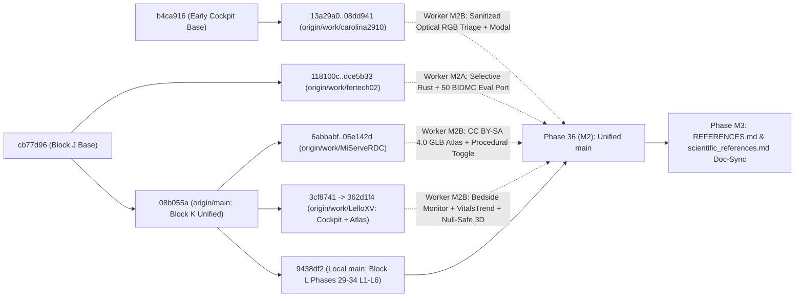
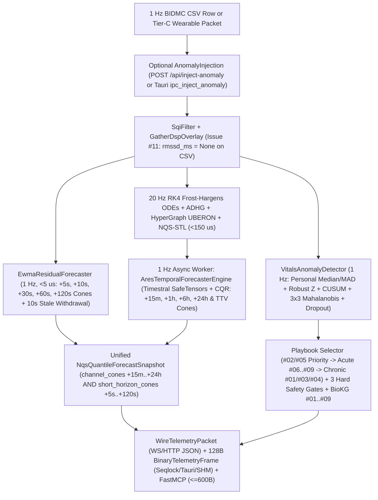
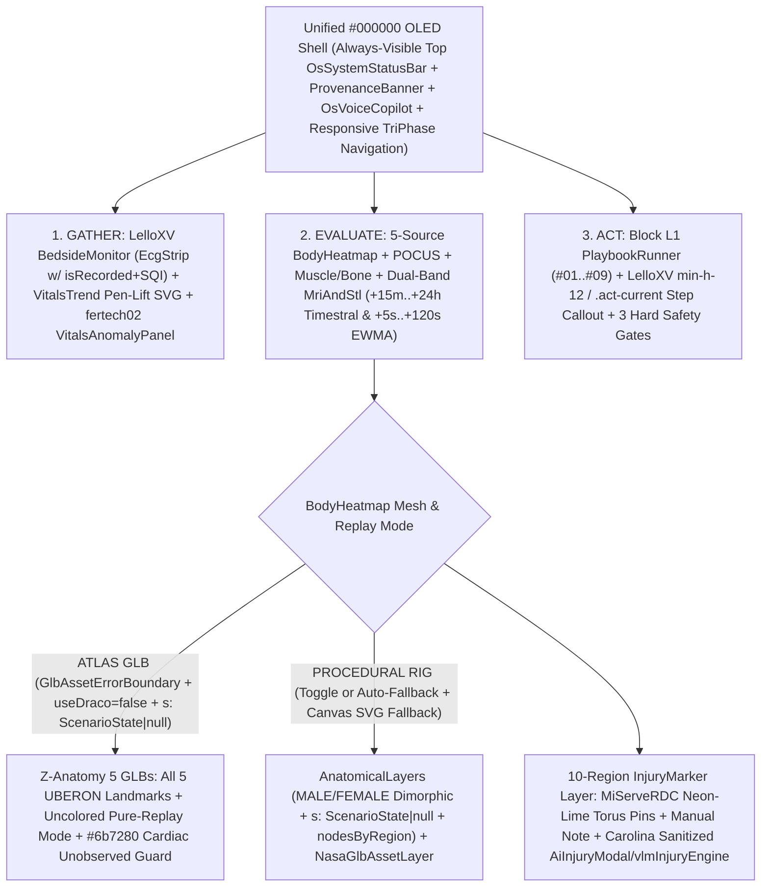

# Block M: Forensic Multi-Branch Evaluation and Conflict-Free Unification Patch Plan

* **Document ID:** `ARES-PLAN-BLOCK-M-01` (Rev 2 — Updated for `origin/work/LelloXV` `362d1f4`)
* **Target Baseline:** Local `main` (`9438df2`, Blocks A-L complete: 158 default Rust tests + feature-gated suites, 15 Node TypeScript tests, 6/6 submission docs & Typst PDFs)
* **Evaluated Branches:**
  1. `main` (`9438df2`, `@fabiomalagutti27-droid`)
  2. `origin/work/fertech02` (`dce5b33` & `118100c`, merge-base `cb77d96`)
  3. `origin/work/MiServeRDC` (`05e142d` & `6abbabf`, merge-base `08b055a`)
  4. `origin/work/carolina2910` (`08dd941` & `ab252dc` since `13a29a0`, merge-base `b4ca916`)
  5. `origin/work/LelloXV` (`362d1f4` on parent `3cf8741`, merge-base `08b055a`, `20` files changed, `+1413/-439`)
* **Execution Strategy:** Selective file checkout + surgical multi-way semantic unification (`Phase 36 / M2` across `Worker M2A` Rust + `Worker M2B` Cockpit, followed by `M3` Doc-Sync), NEVER blind `git merge -X theirs` or wholesale file overwrites.

---

## 1. Executive Summary & Git Topology Audit

A line-by-line forensic inspection of the repository commit graph and working trees establishes that **all four teammate branches (`fertech02`, `MiServeRDC`, `carolina2910`, and `LelloXV` at `362d1f4`) contain high-value, complementary capabilities**. However, because `fertech02` branched from Block J (`cb77d96`, pre-Block K/L), both `MiServeRDC` (`05e142d`) and `LelloXV` (`362d1f4`) branched from Block K (`08b055a` / `3cf8741`, pre-Block L `9438df2`), and `carolina2910` branched from an early pre-unification cockpit (`b4ca916`), a naive `git merge` of any branch onto `main` (`9438df2`) would cause severe regressions across Rust runtime orchestration, Tauri native `128 B` binary IPC, `#000000` OLED compliance, Block L `OsVoiceCopilot` / `OsSystemStatusBar`, Block L1 `UBERON:` 3D spatial grounding, live `PlaybookRunner` safety gates, Issue #11 nullability, Issue #12 epistemic honesty, and air-gapped CSP compliance.

### Summary Branch Disposition Table

| Branch / Head SHA | Author | Merge-Base vs `main` | Changed Files vs Merge-Base | Net Verdict | Integration Strategy |
| :--- | :--- | :--- | :--- | :--- | :--- |
| `main` (`9438df2`) | `@fabiomalagutti27-droid` | `9438df2` (Target) | Baseline (Blocks A-L, Phases 1-34) | **AUTHORITATIVE BASELINE** | Preserve 100% of Block A-L crates, dual-transport IPC, DSP, Edge/Voice Copilot, CQR harness, `#000000` OLED, UBERON 3D, live `PlaybookRunner`, and submission docs. |
| `origin/work/fertech02` (`dce5b33`) | `@fertech02` | `cb77d96` (Block J) | 77 files (`50` BIDMC CSVs + `27` code/schema/doc files) | **SELECTIVE PORT + COEXISTENCE UNIFICATION** | Port `anomaly.rs`, `vitals_anomaly.rs`, `ewma_forecaster.rs` (extended to `5-120 s`), `anomaly_injection.rs`, `anomaly_eval.rs`, Playbooks `#06-#09`, `data/bidmc_eval/`, and `VitalsAnomalyPanel.tsx` **without** deleting `Timestral` 1 Hz, `SafeTensors`, CQR, or `ares-desktop-os` loops. |
| `origin/work/MiServeRDC` (`05e142d`) | `@MiServeRDC` | `08b055a` (Block K) | 14 files (`5` `.glb` meshes + `3` license/manifest files + `6` TS/doc files) | **SELECTIVE PORT + 3D HSI UNIFICATION** | Port `public/anatomy/*` (`26.8 MB` CC BY-SA 4.0 Z-Anatomy `.glb`s), `AtlasBody.tsx` (hardened with `useDraco=false`, `GlbAssetErrorBoundary`, all 5 `UBERON:` anchors, `observed=false` guard), `ATLAS` vs `PROCEDURAL` rig switch, `<InjuryPoint>`, and defer `docs/REFERENCES.md` entries to `M3`. |
| `origin/work/carolina2910` (`08dd941`) | `@carolina2910` | `b4ca916` (`13a29a0` incremental) | 6 files vs `13a29a0` (`vlmInjuryEngine.ts`, `AiInjuryModal.tsx`, `injury.ts`, `BodyHeatmap.tsx`, `useTelemetry.ts`, `validateTelemetry.ts`) | **CHERRY-PORT 2 MODULES + REJECT 2 LEGACY FILES** | Port `vlmInjuryEngine.ts` and `AiInjuryModal.tsx` after fixing `U+2715` dingbat, blob URL leaks, and Issue #12 fake VLM claims; unify 10-region `injury.ts`; **STRICTLY REJECT** `validateTelemetry.ts` and `useTelemetry.ts`. |
| `origin/work/LelloXV` (`362d1f4`) | `@LelloXV` | `08b055a` (`3cf8741`) | 20 files (`+1413/-439`: `8` identical anatomy files from `6abbabf` + `10` cockpit UI/CSS/README files + `2` `memory-bank` files) | **SELECTIVE UX/3D PORT + RE-THEME TO `#000000` OLED** | Port `VitalsTrend` pen-lift SVG sparkline, `BedsideMonitor` layout, `s: ScenarioState \| null` pure-replay 3D null-safety (`AnatomicalLayers` + `AtlasBody` + `BodyHeatmap`), SVG non-WebGL fallback, `min-h-12` (`48px`) controls, and `.act-current` step card; **FIX** `#0b111c` non-OLED override in `index.css` and **RESTORE** all dropped Block L components (`OsVoiceCopilot`, top-level `OsSystemStatusBar`/`ProvenanceBanner`, `PlaybookRunner`, `EcgStrip` `isRecorded`/SQI, `UBERON:` HUD). |

---

## 2. Deep Forensic Evaluation Matrix of All 5 Contributors

### 2.1 `@fabiomalagutti27-droid` — Local `main` (`9438df2`, Blocks A-L)
* **Scope & Architectural Quality:** Production-grade 8-crate Safe Rust 2024 workspace (`ares-core-types`, `ares-telemetry-ingest`, `ares-causal-graph`, `ares-nqs-stl`, `ares-medops-playbooks`, `ares-security-privacy`, `ares-server-cli`, `ares-desktop-os`) plus React 19 + Three.js cockpit (`ares-cockpit`) and reproducible submission pipeline (`scripts/build_submission_docs.sh`).
* **Key Block L (`08b055a..9438df2`) Capabilities That Must Never Be Regressed:**
  1. **L1 (`phase_29_L1`):** `telemetryValidation.ts` (`1156` lines) + `uberonSpatialMapping.ts` (`5` canonical `UBERON:` regions, rejecting `UBERON:0001585` typo in favor of `UBERON:0001586` IJV, enforcing neutral gray `#6b7280` for `UNOBSERVED_NO_RR`) + `NasaGlbAssetLayer.tsx` (`GlbAssetErrorBoundary` + `0x46546c67` magic-byte header guard) + `MriAndStl.tsx` logarithmic `+15m/+1h/+6h/+24h` Timestral quantile cones + `505`-line `PlaybookRunner.tsx` live/offline catalog (`>= 44x44 pt` touch targets, all 3 Hard Safety Gates).
  2. **L2 (`phase_30_L2`):** `ares-desktop-os` Tauri v2 native IPC (`TAURI_IPC_COMMAND_NAMES`, `RawBinaryFrameSink`, `128 B` `BinaryTelemetryFrame` with Castagnoli CRC-32C) + optional `shm-ipc` (`iceoryx2` + `zenoh` DSN bridge).
  3. **L3 (`phase_31_L3`):** Real `GATHER` DSP modules (`rr_hrv_dsp.rs`, `vocal_biomarkers_dsp.rs`, `radar_csi_dsp.rs`) + `GatherDspOverlay` preserving `BEAT_INTERVALS_NOT_AVAILABLE` on `1 Hz` numeric CSVs.
  4. **L4 (`phase_32_L4`):** `timestral_safetensors.rs` (`new_with_optional_checkpoint` SHA-256 verified SafeTensors loader with deterministic fallback) + `edge_llm_bridge.rs` (`/api/copilot/ask`, `/api/copilot/stream`, strict loopback air-gap guard, `< 400 us` deterministic Type-1 clinical fallback, clinical gate verification) + `voice_whisper.rs` + `OsVoiceCopilot.tsx` (refusing vocal POCUS/Gate 1 unlock per `NASA-STD-3001 [V2 10027]`).
  5. **L5 (`phase_33_L5`):** `calibration_harness.rs` + `ares-calibrate` binary (subject-disjoint splits, `L1..L4` anti-leakage guards, `SyntheticDataForbiddenInCalibration`, Clopper-Pearson 95% exact binomial bounds, Winkler/pinball baselines, 900-Sol adaptive RK4 sclerostin audit) + Arrow/Parquet NASA OSDR/NLSP adapters (`parquet_adapters.rs`).
  6. **L6 (`phase_34_L6`):** `docs/submission/*` + Typst PDF compilation + `scripts/build_submission_docs.sh` (enforcing zero emojis, zero overclaim strings, and live artifact regeneration).

---

### 2.2 `@fertech02` — `origin/work/fertech02` (`118100c` + `dce5b33`, merge-base `cb77d96`)
* **Strengths & Scientific Rigor:**
  1. **Real Multi-Subject BIDMC Evaluation Cohort (`data/bidmc_eval/`):** Adds `50` authentic PhysioNet BIDMC v1.0.0 `1 Hz` CSV recordings (`bidmc_04..53_Numerics.csv`, `ODC-By-1.0`) with SHA-256 `MANIFEST.json`, strictly isolated from runtime startup (`SharedMissionState::from_data_dir` still loads `data/bidmc/bidmc_01..03`). Evaluates subject-calibrated anomaly detection on a locked held-out split (`12` dev records `01,02,04..13`; `41` held-out test records `03,14..53`), achieving `98%` held-out perturbation recall vs `25%` for fixed textbook ICU thresholds (`docs/evaluation/ANOMALY_DETECTOR_EVAL.md`).
  2. **Per-Subject Online Vital-Signs Anomaly Detector (`crates/ares-nqs-stl/src/vitals_anomaly.rs`):** Clean O(1)-per-tick detector combining causal per-channel median/MAD (`CausalScaler`, independent per-channel baseline learning so early `NaN`s on one channel never starve others), sustained `5 s` robust z-score, tabular CUSUM slow-drift detector, regularized 3x3 Mahalanobis $D^2$ on `(HR, SpO2, RESP)` (with one-sided low-only `SpO2` deviation so normal `99-100%` saturation never inflates $D^2$), and explicit sensor-dropout/stale-gap reset (wiping pre-gap CUSUM/z counters so missing samples never emit false physiological alarms or `NaN` strings).
  3. **Adaptive EWMA Empirical Residual Forecaster (`crates/ares-nqs-stl/src/ewma_forecaster.rs`):** Lightweight short-horizon vital-signs forecaster tracking causal EWMA level/trend and rolling multi-step empirical residual quantiles (`q05 <= q50 <= q95`) with online miss-rate width scaling `exp(gamma * (miss_rate - 0.10))` and automatic cone withdrawal after `> 10 s` channel dropout.
  4. **Acute Vital-Sign Playbooks (`#06-#09`) & Controlled Fault Injection (`anomaly_injection.rs`):** Adds `PLAYBOOK_06_HYPOXEMIA_DESATURATION`, `PLAYBOOK_07_HEART_RATE_ANOMALY`, `PLAYBOOK_08_SENSOR_SIGNAL_LOSS`, `PLAYBOOK_09_MULTIPARAMETER_DETERIORATION` (with physiological deterioration outranking parallel sensor dropout) plus `POST /api/inject-anomaly` (`8` profiles, preserving recorded `None`s, detaching `SpO2`+`PULSE` together on finger-probe detach, and tagging `BiometricsSource::SimulatedScenarioInput`).
* **Forensic Bugs, Regressions & Conflicts Caught vs `main` (`9438df2`):**
  1. **[CRITICAL REGRESSION] Wholesale Deletion of Timestral 1 Hz Forecaster & `ares-desktop-os` Worker:** In `ws_server.rs`, `ares-server-cli/src/main.rs`, `ares-desktop-os/src/lib.rs`, and `ares-desktop-os/src/main.rs`, `@fertech02` deleted `forecaster_engine: AresTemporalForecasterEngine`, deleted `SharedMissionState::run_1hz_timestral_step()`, deleted the `1 Hz` `spawn_blocking` Timestral worker loops, renamed `PartitionId::TimestralForecaster.label()` from `"TIMESTRAL"` to `"FORECAST_EWMA"`, and deleted `async_forecaster_and_compactor_preserve_missing_hrv`. Merging this directly would destroy Block H (`Timestral` DHF `+15m/+1h/+6h/+24h` `channel_cones` and `ttv_hours_cone`), Block K (`phase_27_k3` / `phase_28_k4`), and Block L (`phase_29_L1` `MriAndStl.tsx`, `phase_32_L4` SafeTensors checkpoint loader, `phase_33_L5` CQR calibration).
  2. **[CRITICAL INVARIANT CONFLICT] Overwriting Global `abstention_certificate.abstained` When `rmssd_ms` Is `None`:** In `fertech02`, `ewma_forecaster` overwrote `NqsQuantileForecastSnapshot.abstention_certificate` with `abstained = false` as soon as `10` samples of `HR/PULSE/RESP/SpO2` were observed, even though `rmssd_ms` and `rho_global` were `None` (`BEAT_INTERVALS_NOT_AVAILABLE`). On `main`, both `ws_server.rs:1548` (`assert!(snapshot.abstention_certificate.abstained)`) and `fastmcp_router.rs:526` (`assert_eq!(t_json["abstained"], true)`) require the top-level `NqsQuantileForecastSnapshot.abstention_certificate` to remain `abstained: true` whenever `rmssd_ms` / `rho_global` is unavailable.
  3. **[SHORT-HORIZON COVERAGE GAP] `10/30/60 s` Only vs `5-120 s` Architectural Requirement:** `fertech02` hardcoded `[10, 30, 60]` seconds in `ShortHorizonCone` and overwrote `NqsQuantileForecastSnapshot.short_horizon_s` from `900` (`15 min` Timestral bridge) to `60`. Extending `ShortHorizonCone` to `[5, 10, 30, 60, 120]` seconds (`horizon_5s`, `horizon_10s`, `horizon_30s`, `horizon_60s`, `horizon_120s`) while keeping `short_horizon_s: 900` and adding `ewma_short_horizon_max_s: 120` satisfies both the `5-120 s` short-horizon requirement and backward compatibility with all Block H-L tests.
  4. **[BINARY ABI & BIOKG GROUNDING GAP] Playbooks `#06..#09` Unmapped in `128 B` Binary IPC & `ARES-BioKG`:** `fertech02` did not update `playbook_id_to_u16` in `crates/ares-core-types/src/binary_ipc.rs:209` (which returned `0` for `PLAYBOOK_06..09`), nor `PLAYBOOK_ID_BY_CODE` / `BINARY_PLAYBOOK_DEFAULTS` in `binaryTelemetryDecoder.ts`, nor `playbookCatalog.ts` / `PlaybookRunner.tsx` (instead creating a separate inline `EnginePlaybookCard` in `App.tsx` that bypassed Block L1's unified `PlaybookRunner`), nor `ground_playbook_normative` in `crates/ares-medops-playbooks/src/grounding.rs:47` (which returned `Err(PlaybookError::UnknownPlaybookId)` for `#06..#09`).
  5. **[TAURI IPC PARITY GAP] `POST /api/inject-anomaly` Missing from `HeadlessTauriBridge`:** `VitalsAnomalyPanel.tsx` only called `fetch('/api/inject-anomaly')`. Adding `ipc_inject_anomaly` to `AresMedOsWorkstationShell` and `HeadlessTauriBridge` (with automatic HTTP fallback in `useTelemetry.ts`) ensures full `TAURI_NATIVE_IPC` parity.

---

### 2.3 `@MiServeRDC` — `origin/work/MiServeRDC` (`6abbabf` + `05e142d`, merge-base `08b055a`)
* **Strengths & Asset Value:**
  1. **Authentic Multi-System 3D Anatomy Assets (`ares-cockpit/public/anatomy/`):** Contributes 5 real binary glTF v2 `.glb` anatomical system meshes derived from Z-Anatomy / BodyParts3D (`SkeletalSystem100.glb` `5.67 MB`, `MuscularSystem100.glb` `5.24 MB`, `CardioVascular41.glb` `5.23 MB`, `VisceralSystem100.glb` `4.45 MB`, `NervousSystem100.glb` `6.16 MB`; `26.8 MB` total), all verified to begin with valid `0x46546c67` (`glTF` v2) headers, accompanied by SHA-256 `MANIFEST.json`, `ATTRIBUTION.md`, and full `LICENSE-CC-BY-SA-4.0.txt`.
  2. **Exact Landmark Node Hierarchy:** Forensic binary inspection of the JSON chunks inside the 5 `.glb` files confirms exact named anatomical nodes for **all 5 canonical `UBERON:` regions** in `hypergraph_spatial.rs`:
     - `EyeOcularSans` (`UBERON:0000970`): `'Optic tract.r'` (`NervousSystem100.glb`)
     - `BrainVestibularCns` (`UBERON:0000955`): `'Brain.g'` / `'Cerebrum.g'` (`NervousSystem100.glb`)
     - `InternalJugularVein` (`UBERON:0001586`): `'Internal jugular vein.r'` / `'Internal jugular vein.l'` (`CardioVascular41.glb`)
     - `HeartCardioAutonomic` (`UBERON:0000948`): `'Heart.g'` (`CardioVascular41.glb`)
     - `SoleusCalcaneus` (`UBERON:0001389`): `'Soleus muscle.r'` (`MuscularSystem100.glb`) + `'Calcaneus.r'` (`SkeletalSystem100.glb`)
  3. **Shared 10-Region `INJURY_REGIONS` Schema & Distinct `<InjuryPoint>` Marker (`injury.ts` + `BodyHeatmap.tsx`):** Defines the 10-region `InjuryRegionId` (`HEAD_FOREHEAD`, `LEFT_SHOULDER`, `RIGHT_SHOULDER`, `LEFT_FOREARM`, `RIGHT_FOREARM`, `CHEST_RIBS`, `LEFT_KNEE`, `RIGHT_KNEE`, `LEFT_ANKLE`, `RIGHT_ANKLE`) shared identically across `MiServeRDC`, `carolina2910`, and `LelloXV`, plus `DETAILED ATLAS` vs `ORIGINAL MODEL` mode switching and high-contrast neon-lime (`#a3e635`) torus+sphere 3D trauma pins.
* **Forensic Bugs, Regressions & Security/CSP Hazards Caught:**
  1. **[CRITICAL AIR-GAP & TAURI CSP HAZARD] `useGLTF(URLS)` Default Draco CDN + `EXT_meshopt_compression` WASM CSP Block:**
     - Binary header inspection of all 5 `.glb` files proved every file declares `extensionsRequired: ["EXT_meshopt_compression", "KHR_mesh_quantization"]`.
     - In `@react-three/drei/core/Gltf.js`, calling `useGLTF(URLS)` with default arguments sets `useDraco = true`, instantiating `DRACOLoader` with `decoderPath = 'https://www.gstatic.com/draco/versioned/decoders/1.5.5/'` (an external Google CDN URL!). Passing `useGLTF(URLS, false, true)` disables `DRACOLoader` completely and uses `three-stdlib/libs/MeshoptDecoder.js` (`100%` bundled local inline WASM bytes, zero network requests).
     - Furthermore, `MeshoptDecoder.js` executes `WebAssembly.instantiate` on its inline `Uint8Array`. Under `crates/ares-desktop-os/tauri.conf.json` (`script-src 'self';`), WebKit/Chromium block `WebAssembly.instantiate` unless `'wasm-unsafe-eval'` is included (`script-src 'self' 'wasm-unsafe-eval';`). Updating `script-src` to `'self' 'wasm-unsafe-eval'` preserves `connect-src 'self' http://127.0.0.1:8080 ws://127.0.0.1:8080 ipc: http://ipc.localhost` (`!csp.contains("https://")` in `test_tauri_conf_csp_blocks_external_cloud_origins` stays green) while enabling offline `.glb` decoding in `ARES-MedOS`.
  2. **[UNCAUGHT RENDER CRASH RISK] `AtlasBody.tsx` Throws Without `ErrorBoundary`:** `AtlasBody.tsx` calls `useGLTF` and throws `new Error('Missing atlas landmark: ...')` inside `<Suspense>` with no `ErrorBoundary`. Wrapping `<AtlasBody>` inside Block L1's `GlbAssetErrorBoundary` guarantees non-crashing automatic fallback to the procedural rig if WebGL memory or WASM decoding fails on constrained hardware.
  3. **[PRE-BLOCK L1 REGRESSION] `BodyHeatmap.tsx` Lacks UBERON Hypergraph & Issue #11 Guard:** `MiServeRDC` branched from `08b055a` before Block L1 (`9438df2`), so its `BodyHeatmap.tsx` lacks `packet.hypergraph_spatial`, lacks `Heart.g` `observed=false` neutral gray `#6b7280` rendering, and hardcodes `sex="MALE"` even when switching back to the procedural rig.
  4. **[LICENSING ISOLATION] `CC BY-SA 4.0` Static Assets vs `MIT OR Apache-2.0` Source Code:** Z-Anatomy `.glb` files are `CC BY-SA 4.0`. They must remain strictly isolated as unmodified runtime-fetched static files in `ares-cockpit/public/anatomy/` with `ATTRIBUTION.md` and `LICENSE-CC-BY-SA-4.0.txt` intact, never compiled into Rust/TS source code (`MIT OR Apache-2.0`).

---

### 2.4 `@carolina2910` — `origin/work/carolina2910` (`ab252dc` + `08dd941` since `13a29a0`)
* **Strengths & Clinical UX Value:**
  1. **100% Client-Side Offline Optical Skin Heuristic (`ares-cockpit/src/lib/vlmInjuryEngine.ts`):** Uses HTML5 `<canvas>` pixel-buffer inspection (`64x64` center-weighted crop computing normalized erythema `(R - 0.5*(G+B))/255`, local luminance contrast, and dark-pixel ratio) with zero network requests, paired with spaceflight-relevant countermeasure checklists (microgravity zero-droplet fluid containment dome for lacerations, Gate 1 neuro-trauma anticoagulation hold reminder for head contusions, and Martian `0.38g` GAI ankle-damping sleeve reminder for ankle/knee injuries).
  2. **Interactive HUD Portal Modal (`ares-cockpit/src/modules/body-3d-heatmap/AiInjuryModal.tsx`):** Clean `createPortal(..., document.body)` modal workflow allowing crew members to upload a local skin/trauma photo, preview it, inspect structured optical triage steps, and pin a spatial 3D marker onto any of the 10 `InjuryRegionId` locations.
* **5 Concrete Bugs, Safety Violations & Regressions Caught:**
  1. **[CRITICAL REGRESSION — MUST REJECT] Legacy `validateTelemetry.ts` & `useTelemetry.ts`:** Carolina's branch resurrects the deleted pre-Block-K `validateTelemetry.ts` (which hardcodes `active_playbook: null` and drops `timestral_quantiles`, `hypergraph_spatial`, `vitals_anomaly`, `quality_flags`, `model_validation_status`, and `ttv_interval_kind`) and an older `useTelemetry.ts` (missing `TAURI_NATIVE_IPC`, `128 B` `decodeBinaryTelemetryFrame`, dual-transport `apply_what_if_patch`, and `RecordedHistoryPoint`). **Both files MUST BE REJECTED; `main`'s `telemetryValidation.ts` and `useTelemetry.ts` remain authoritative.**
  2. **[HARD FORMATTING INVARIANT VIOLATION] Prohibited Unicode Dingbat (`U+2715`):** `AiInjuryModal.tsx` line 122 contains `\u2715 CLOSE` (`U+2715`, inside `\U00002600-\U000027BF` checked by `EMOJI_RE` in `scripts/build_submission_docs.sh`). Must be replaced with ASCII `CLOSE`.
  3. **[ISSUE #12 EPISTEMIC HONESTY VIOLATION] Unvalidated RGB Heuristic Claiming `'ARES-VLM-Edge v2.6'` & Fabricated `88-99%` Confidence:** `vlmInjuryEngine.ts`, `injury.ts`, and `AiInjuryModal.tsx` claim `modelVersion: 'ARES-VLM-Edge v2.6'`, `'1. EDGE-VLM CLINICAL DIAGNOSIS'`, and fabricate `confidencePct = Math.min(99, Math.max(88, Math.round(92 + erythema * 5)))`. Per `docs/architecture/MODEL_EVIDENCE_AUDIT.md` (Issue #12), deterministic RGB pixel heuristics are **not** a Vision-Language Model and have **zero** clinical sensitivity/specificity calibration. Must remove fabricated `confidencePct` and label honestly as `OPTICAL_RGB_HEURISTIC_V1` (`validationStatus: 'ILLUSTRATIVE_UNVALIDATED'`, UI header `'OPTICAL RGB SKIN TRIAGE (ILLUSTRATIVE_UNVALIDATED — NON-DIAGNOSTIC)'`, reporting raw `erythemaIndex`, `contrastIndex`, `darkPixelRatio`).
  4. **[MEMORY LEAK] Unrevoked `URL.createObjectURL` Blobs:** `vlmInjuryEngine.ts` (`extractImageMetrics` line 55) creates an object URL on `img.src` without calling `URL.revokeObjectURL` in `onload`/`onerror`, and `AiInjuryModal.tsx` creates a new preview `blob:` URL on each file selection without revoking discarded/cancelled URLs. Both leaks must be fixed and integrated with `App.tsx`'s `injuryPhotoUrls` tracking set.
  5. **[BROKEN PLAYBOOK ROUTING & `< 44px` TOUCH TARGETS]:** `BodyHeatmap.tsx` wired `onOpenPlaybook` to `onOpenTab?.("POCUS")` instead of navigating to `'ACT'` (`PlaybookRunner`) with the recommended `CrystallizedPlaybookId`, and modal buttons lacked `min-h-[44px]` (`MIL-STD-1472H`).

---

### 2.5 `@LelloXV` — `origin/work/LelloXV` (`362d1f4` on parent `3cf8741`, merge-base `08b055a`)
* **Forensic Delta Scope (`3cf8741..362d1f4`, `20` files changed, `+1413/-439`):**
  - Prior to `362d1f4`, `@LelloXV`'s foundational replay/cadence commits (`043b5fe`, `e3d4398`, `8219535`) were already merged into `08b055a` (`3cf8741^{tree} == 08b055a^{tree}`). Commit `362d1f4` (`2026-11-14 17:58:24 +0100`, `feat(cockpit): refine health views and integrate anatomy atlas`) introduces `8` anatomy files byte-identical to `origin/work/MiServeRDC:6abbabf` (`public/anatomy/*`), `injury.ts` byte-identical to `6abbabf`/`08dd941`, plus substantial cockpit UI/UX and null-safety refinements across `10` frontend files (`App.tsx`, `index.css`, `Imaging.tsx`, `AnatomicalLayers.tsx`, `AtlasBody.tsx`, `BodyHeatmap.tsx`, `TriPhaseHeader.tsx`, `PlaybookRunner.tsx`, `README.md`).
* **Strengths & UX / Accessibility Refinements to Port:**
  1. **`VitalsTrend` Pen-Lift SVG Recorded Sparkline (`App.tsx:146-213`):** Replaces the compact 8-pill text strip with an interactive 4-signal (`hr | spo2 | resp | pulse`) SVG trend plot over immutable `recordedHistory: RecordedHistoryPoint[]`. Crucially, lines `158-165` implement an **Issue #11 pen-lift (`if (value === null) { penDown = false; return ''; }`)**, so missing recorded BIDMC samples create honest visual breaks in the polyline rather than interpolating across gaps or dropping to `0`.
  2. **`BedsideMonitor` Primary Vital Hierarchy (`App.tsx` + `index.css`):** Groups live ECG canvas + tabular-numeral Heart Rate (`bpm`), Blood Oxygen (`%`), Breathing Rate (`br/min`), and Pulse (`bpm`) into a clear clinical bedside monitor (`bedside-monitor`, `monitor-cardiac`, `monitor-secondary`, `font-variant-numeric: tabular-nums`), blanking HR (`status.isStale ? null : b.heart_rate_bpm`) when telemetry is stale and separating current vitals from historical trends (inspired by WHOOP Home / Oura Vitals hierarchy, zero external code/assets copied).
  3. **Null-Safe `s: ScenarioState | null` 3D Viewing During Pure BIDMC Replay (`AnatomicalLayers.tsx`, `AtlasBody.tsx`, `BodyHeatmap.tsx`):** Upgrades `SkeletonLayer`, `VascularNeuroLayer`, `MusclesLayer`, `AtlasBody` (`+10/-8` over `6abbabf`), and `BodyHeatmap` to accept `s: ScenarioState | null`. When `isPureReplay` is active (`!hasHemodynamics && !hasMusculoskeletal`), instead of hiding the entire 3D viewport behind `UnavailableSubsystemPanel`, the crew can still inspect the 3D anatomical atlas and attach manual/optical trauma markers while all physiological regions render uncolored (`margin === null`) and explicitly state `"Data unavailable — BIDMC replay does not measure this region"`. Also adds `<Canvas fallback={<svg ...>}>` 2D silhouette fallback when WebGL is unavailable and `<AtlasLoading />` progress feedback.
  4. **Touch Ergonomics (`48px` `min-h-12`), ARIA Semantics & Progressive Disclosure:** Adds `48px` (`>= 44px` `MIL-STD-1472H`) touch heights, `:focus-visible` focus rings, `aria-current="page"` / `aria-current="step"`, `.act-current` active-step callout card, `injuryPhotoUrls` `URL.revokeObjectURL` tracking set, and `
` progressive disclosure for What-If simulation controls.
* **6 Concrete Regressions & Invariant Violations Caught vs `main` (`9438df2`):**
  1. **`[HARD INVARIANT VIOLATION]` `#000000` OLED Palette Overwritten in `ares-cockpit/src/index.css`:** Lines `29-55` of `362d1f4` add a second `@theme` block overriding `--color-panel` (`#0a0a0a` -> `#141c2a`), `--color-line` (`#1f2937` -> `#2a3547`), `--color-nominal` (`#22d3ee` -> `#a6baf1`), `.health-shell` (`background: #0b111c`), `.health-shell > header` (`#101725`), and `.bedside-monitor` (`#080e13`). This directly violates `AGENTS.md` Section 2/3 and `NASA-STD-3001 Vol. 2 [V2 10001]` (`#000000` pure black OLED theme). **Must strip the second `@theme` override and keep all layout classes strictly on `#000000` background / `#0a0a0a` panels / `#22d3ee` nominal cyan.**
  2. **`[CRITICAL BLOCK L REGRESSION]` `App.tsx` Drops `OsVoiceCopilot`, Hides `OsSystemStatusBar` & `ProvenanceBanner`, and Reverts Block L1 Props:** Because `362d1f4` branched from `3cf8741` (`08b055a`, pre-Block L), its `App.tsx` omits `OsVoiceCopilot` + `handleVoiceIntent` (`phase_32_L4`), buries `OsSystemStatusBar` and `ProvenanceBanner` inside a collapsed `
` at the bottom of `<aside>` (violating always-visible connection/provenance/partition status), drops `timestralQuantiles` / `hrvUnavailableReason` / `modelValidationStatus` on `<StlChart />`, reverts `<PlaybookRunner />` to the pre-Block-L 2-prop signature, and hides `MriGauge` readiness on `GATHER` and `BODY_3D`.
  3. **`[CRITICAL BLOCK L1 REGRESSION]` `PlaybookRunner.tsx` Reverts 505-Line Live Catalog Runner to Old 87-Line Stub:** `362d1f4` edited the pre-Block-L `PlaybookRunner.tsx` where `#05` was hardcoded as Thrombus (on `main`, `#02` is `PLAYBOOK_02_CONFIRMED_IJV_THROMBUS` and `#05` is `PLAYBOOK_05_SPE_RADIATION_SHELTER_CANS` per `phase29_l1.test.ts:98-137`!) and lacked live `activePlaybook` engine binding, `requestedPlaybook` voice jump, and Gate 1/2/3 action filtering. **Keep `main`'s 505-line `PlaybookRunner.tsx` (extended to `#01..#09`) and port `@LelloXV`'s `min-h-12`, `.act-current` callout, and `aria-current="step"` UX refinements into it.**
  4. **`[CRITICAL BLOCK L1 REGRESSION]` `BodyHeatmap.tsx` & `AnatomicalLayers.tsx` Drop `UBERON:` Hypergraph, Procedural Toggle & Trauma Torus Pins:** `362d1f4` removed `uberonSpatialMapping.ts` (`5` canonical `UBERON:` CURIEs, `6` Bezier conduction arcs, `HabitatZone` deontic policy badge, `BioKG` normative clause, `GlbAssetErrorBoundary`, `NasaGlbAssetLayer`, `nodesByRegion` cardiac `#6b7280` guard), deleted the `PROCEDURAL RIG` mode switch (`useAtlas` removed so `FEMALE` anatomical rig cannot be rendered), and rendered trauma pins as `<Node rho={null} />` instead of `@MiServeRDC`'s high-contrast neon-lime `#a3e635` `<InjuryPoint>` torus markers.
  5. **`[ISSUE #11 / #12 PROVENANCE REGRESSION]` `Imaging.tsx` (`EcgStrip`) Removes `isRecorded`, SQI Gate Header & `'SYNTHETIC VISUALIZER (RECORDED HR)'` Tag:** `362d1f4` deleted the `isRecorded?: boolean` prop, the `SQI < 0.60` rejection status text, the flat yellow baseline on missing HR, and the bottom-right `'SYNTHETIC VISUALIZER (RECORDED HR)'` / `'SIMULATED'` watermark. **Restore `main`'s `isRecorded` + SQI + missing-HR + provenance watermark logic while retaining `@LelloXV`'s `role="img"` `aria-label` and `.monitor-trace` sizing.**
  6. **`[PHASE TOKEN & MEMORY-BANK HYGIENE]` `TriPhaseHeader.tsx` & `memory-bank/*`:** Keep explicit `1. GATHER`, `2. EVALUATE`, `3. ACT` button labels (matching `AGENTS.md` and `OsVoiceCopilot`), keep `CRITICAL` `animate-pulse` and explicit `DATA_DEGRADED_MISSING_CHANNELS` visibility (`LIMITED DATA · MISSING CHANNELS` with `title={level}`) while adopting `@LelloXV`'s `aria-current="page"` and `min-h-12` nav ergonomics; do **not** check out `362d1f4`'s partial `memory-bank/*` edits during M2B.

---

## 3. Coexistence & Semantic Unification Architecture

### 3.1 Dual-Horizon Forecasting & Vitals Anomaly Coexistence (`Timestral` 1 Hz + `CQR` + `EWMA` 5-120 s + `VitalsAnomalyDetector` + `ares-desktop-os`)

To ensure **zero regressions** against Blocks H, I, J, K, and L while gaining 100% of `@fertech02`'s per-subject anomaly detection and short-horizon forecasting, both engines run side-by-side in `MissionRuntimeInner`:

1. **Coexistence in `NqsQuantileForecastSnapshot` (`crates/ares-core-types`):**
   - Keep existing fields untouched: `model_validation_status`, `source_recording_time_s`, `confidence_state`, `abstention_certificate` (governed strictly by the 12-channel Timestral/NQS-STL gate so `abstention_certificate.abstained == true` whenever `rmssd_ms` or `rho_global` is `None`, preserving `ws_server.rs:1548` and `fastmcp_router.rs:526`), `short_horizon_s: 900`, `heart_rate_bpm_cone`, `resp_rate_brpm_cone`, `rmssd_ms_cone`, `rho_global_cone`, `ttv_hours_cone`, `channel_cones` (`+15m, +1h, +6h, +24h`), `pessimistic_ttv_q05_hours`, `inference_latency_us`.
   - Append `#[serde(default)]` additive fields for `@fertech02`'s short-horizon engine:
     - `pub forecast_method: ForecastMethod` (`DeterministicColdStart`, `TimestralGreyBox1Hz`, `EwmaEmpiricalResidualQuantiles`, `HybridTimestralAndEwmaShortHorizon`)
     - `pub ewma_short_horizon_max_s: u32` (`120`)
     - `pub short_horizon_cones: Vec<ShortHorizonCone>` where each `ShortHorizonCone` carries `channel_name`, `horizon_5s`, `horizon_10s`, `horizon_30s`, `horizon_60s`, `horizon_120s` (`MonotoneQuantileTriplet` for observed `heart_rate_bpm`, `pulse_rate_bpm`, `resp_rate_brpm`, `spo2_pct` only; withdrawn when channel gap `> 10 s` or `< 10` fresh post-gap samples)
     - `pub short_horizon_abstention: Option<AbstentionCertificate>` (EWMA's 4-channel short-horizon coverage/stale-gap certificate, kept distinct from global `abstention_certificate`).
2. **Coexistence in `MissionRuntimeInner` & Background Loops (`ws_server.rs`, `ares-server-cli/src/main.rs`, `ares-desktop-os`):**
   - Keep `PartitionId::TimestralForecaster.label() == "TIMESTRAL"`, keep `forecaster_engine: AresTemporalForecasterEngine` (`new_with_optional_checkpoint` supporting verified SafeTensors), and keep `run_1hz_timestral_step()` + its `1 Hz` `spawn_blocking` loop in both `ares-server-cli/src/main.rs` and `ares-desktop-os/src/main.rs` + `ares-desktop-os/src/lib.rs` (`run_desktop_smoke_test`).
   - Add `anomaly_detector: VitalsAnomalyDetector`, `latest_vitals_anomaly: VitalsAnomalyReport`, `anomaly_injection: Option<AnomalyInjection>`, `ewma_forecaster: EwmaResidualForecaster`, `latest_short_horizon_cones: Vec<ShortHorizonCone>`, `latest_short_horizon_abstention: Option<AbstentionCertificate>`, and `current_replay_row: BidmcNumericRow` to `MissionRuntimeInner`.
   - On each `1 Hz` sample transition (`current_second != previous_second` in `advance_tick`, and on `apply_anomaly_injection`), apply `anomaly_injection` (if active), run `anomaly_detector.observe_1hz(...)` and `ewma_forecaster.ingest_short_horizon_1hz(...)` (`< 10 us` combined), cache `latest_short_horizon_cones` + `latest_short_horizon_abstention`, and attach them onto `latest_quantile_snapshot` both on `1 Hz` EWMA updates and whenever `run_1hz_timestral_inference()` publishes a new Timestral snapshot.
   - Replay wrap (`sample_index == 0` when `current_second > 0`) resets `sqi_filter`, `anomaly_detector`, and `ewma_forecaster` cleanly so `480 s -> 0 s` wrap-around never leaks state or triggers false dropout alarms.
3. **Playbooks `#01..#09`, Binary `128 B` Frame, BioKG Grounding, CQR & FastMCP Budget:**
   - **Playbook Priority & Safety Gates:** `PLAYBOOK_02` (POCUS-confirmed thrombus) and `PLAYBOOK_05` (`> 1.5 mSv/d` SPE radiation) outrank all candidates; otherwise if `vitals_anomaly.status != Normal`, `select_vitals_anomaly_playbook` selects `#06..#09` (physiology `#06/#07/#09` outranking `#08` sensor dropout); otherwise `select_candidate_playbook` selects `#01/#03/#04`. `enforce_hard_clinical_safety_gates` ALWAYS executes afterward.
   - **Binary `128 B` Frame (`binary_ipc.rs` & `binaryTelemetryDecoder.ts`):** Extend `playbook_id_to_u16` to map `PLAYBOOK_01..PLAYBOOK_09` -> `1..=9` (0 bytes ABI change; `active_playbook_id` is already `u16` at byte offset `96`). Mirror codes `6..9` in `PLAYBOOK_ID_BY_CODE`, `BINARY_PLAYBOOK_DEFAULTS`, and `playbookCatalog.ts`.
   - **Normative `ARES-BioKG` Grounding (`grounding.rs` & `ws_server.rs`):** Extend `ground_playbook_normative` and `primary_adhg_node_for_playbook` for `PLAYBOOK_06..09` (`playbook_number: 6..=9`, `AdhgNodeKind::AutonomicVagalRmssd`) so `verify_playbook_governance` and `get_hypergraph_spatial_status` work O(1) across all 9 playbooks.
   - **FastMCP `<= 600 B` Context-Mode Cap (`fastmcp_router.rs`):** Keep all 8 existing tool names unchanged (`tools.len() == 8`). Enrich `get_crew_health_summary` with compact `"vitals_anom": ctx.vitals_anomaly.status` (~28 B) and `get_timestral_quantile_cones` with `"method": snap.forecast_method` + `"ewma_max_s": snap.ewma_short_horizon_max_s` (~48 B, total ~295 B `<< 600 B`), keeping `abstained` bound to `snap.abstention_certificate.abstained`.
   - **CQR Calibration Anti-Leakage Compatibility (`calibration_harness.rs`):** `AnomalyInjection` sets `BiometricsSource::SimulatedScenarioInput`, which `verify_anti_leakage_invariants` already rejects via `LeakageViolationError::SyntheticDataForbiddenInCalibration`.

---

### 3.2 Five-Source Cockpit, `#000000` OLED Layout & 3D HSI Unification (`Block L 9438df2` + `fertech02` + `MiServeRDC` + `carolina2910` + `LelloXV 362d1f4`)

1. **`#000000` OLED Shell + Always-Visible Workstation Telemetry (`index.css`, `TriPhaseHeader.tsx`, `App.tsx`):**
   - Port `@LelloXV`'s clean `.bedside-monitor`, `.monitor-cardiac`, `.monitor-secondary`, `.health-trend`, `.act-current`, `.anatomy-layers`, `48px` (`min-h-12`) button/select sizing, and `:focus-visible` accessibility rules in `index.css`, **strictly re-themed to `--color-oled: #000000`, `--color-panel: #0a0a0a`, `--color-line: #1f2937`, `--color-nominal: #22d3ee`** (dropping `362d1f4`'s second `@theme` `#0b111c`/`#141c2a`/`#a6baf1` override).
   - Keep `OsSystemStatusBar`, `ProvenanceBanner`, and `OsVoiceCopilot` permanently visible at the top of the workstation (never hidden inside a collapsed `
`), keep `MriGauge` readiness visible across phases, and adopt `
` progressive disclosure on What-If controls so pure BIDMC replay starts uncluttered and auto-expands when What-If overlay engages.
   - In `GATHER`, combine `@LelloXV`'s `BedsideMonitor` (using `main`'s `EcgStrip` with `isRecorded={isRecordedBiometrics}`, `SQI` status text, `'SYNTHETIC VISUALIZER (RECORDED HR)'` watermark, plus `role="img"` `aria-label`) + `@LelloXV`'s `VitalsTrend` pen-lift SVG sparkline + `@fertech02`'s `VitalsAnomalyPanel` (`+5s..+120s` short-horizon cones & dual-transport fault injection).
2. **Air-Gapped Meshopt Decoding, Pure-Replay Null-Safety & 5-Node `UBERON:` Alignment (`AtlasBody.tsx`, `AnatomicalLayers.tsx`, `BodyHeatmap.tsx`):**
   - Call `useGLTF(URLS, false, true)` inside `AtlasBody.tsx` (`useDraco = false`, `useMeshopt = true`) and update `tauri.conf.json` `script-src 'self' 'wasm-unsafe-eval'`.
   - Combine `@LelloXV`'s `s: ScenarioState | null` null-safety with Block L1's `nodesByRegion?: Record<AnatomicalRegionWireId, ProjectedAnatomicalNode>` across `AnatomicalLayers.tsx`, `AtlasBody.tsx`, and `BodyHeatmap.tsx`: during pure BIDMC replay (`isPureReplay ? null : s`), the 3D reference rig/atlas remains interactive with neutral uncolored physiological meshes and explicit `"Data unavailable in pure BIDMC replay"` labeling, while under hybrid/simulated scenarios all 5 `UBERON:` nodes (`Brain.g`, `Optic tract.r`, `Internal jugular vein.r`, `Heart.g` with `#6b7280` `observed === false` guard, and `Soleus muscle.r`/`Calcaneus.r`) and 6 Bezier arcs anchor directly onto the Z-Anatomy landmarks.
   - Keep both `ATLAS 3D GLB` (wrapped in `GlbAssetErrorBoundary` + `<Suspense fallback={<AtlasLoading />}>`) and `PROCEDURAL RIG` (`MALE`/`FEMALE` dimorphic rig + `NasaGlbAssetLayer`) selectable, plus `@LelloXV`'s `<Canvas fallback={<svg ...>}>` 2D silhouette when WebGL is unavailable.
3. **Unified 10-Region Injury State & Epistemically Honest Optical Triage (`injury.ts`, `vlmInjuryEngine.ts`, `AiInjuryModal.tsx`):**
   - Preserve the exact 10 `InjuryRegionId` keys (`HEAD_FOREHEAD`, `LEFT_SHOULDER`, `RIGHT_SHOULDER`, `LEFT_FOREARM`, `RIGHT_FOREARM`, `CHEST_RIBS`, `LEFT_KNEE`, `RIGHT_KNEE`, `LEFT_ANKLE`, `RIGHT_ANKLE`) and `INJURY_REGIONS` metadata shared identically across `MiServeRDC`, `carolina2910`, and `LelloXV` so `AtlasBody`'s `anchors.injuries` works with zero region-key mismatches.
   - Remove fabricated `confidencePct` from `InjuryMarker`, replacing it with `validationStatus: 'ILLUSTRATIVE_UNVALIDATED' | 'MANUAL_CREW_NOTE'`, optional `opticalAssessment?: OpticalTriageAssessment` (`methodId: 'OPTICAL_RGB_HEURISTIC_V1'`, `metrics: { erythemaIndex, contrastIndex, darkPixelRatio }`), and `recommendedPlaybookId?: CrystallizedPlaybookId` routing directly to `'ACT'` (`PlaybookRunner`).
   - Fix `URL.createObjectURL` leaks in `vlmInjuryEngine.ts` and `AiInjuryModal.tsx`, purge `U+2715` (`\u2715` -> `CLOSE`), and retain `@LelloXV`/`@MiServeRDC`'s `injuryPhotoUrls` `Set<string>` cleanup in `App.tsx`.

---

## 4. Complete File-by-File Conflict Resolution & Selective-Port Recipe

### 4.1 Legend of Resolution Actions
* **`[KEEP MAIN]`** — Retain `main` (`9438df2`) verbatim; reject branch version to prevent regressions.
* **`[DIRECT PORT: <branch>]`** — Safe to check out directly from `<branch>` (`git checkout <branch> -- <path>`).
* **`[PORT + SANITIZE: <branch>]`** — Port new file from `<branch>` and apply mandatory safety/epistemic/OLED/CSP fixes before staging.
* **`[MULTI-WAY UNIFY]`** — Manually synthesize `main` (`9438df2`) with the specified branch delta(s); **never** overwrite `main` with `git checkout`.
* **`[DEFER TO M3 DOC-SYNC]`** — Do not touch during `M2A`/`M2B`; queued for final `M3` documentation synchronization to avoid colliding with sibling tasks.

### 4.2 Rust Workspace, Contracts & Evaluation Datasets (Worker M2A Scope)

| File Path | Touched By | Action | Exact Resolution & Integration Specification |
| :--- | :--- | :--- | :--- |
| `data/bidmc_eval/bidmc_04_Numerics.csv` .. `bidmc_53_Numerics.csv` (50 files) | `fertech02` | `[DIRECT PORT: fertech02]` | `git checkout origin/work/fertech02 -- data/bidmc_eval/` — 50 PhysioNet BIDMC v1.0.0 `1 Hz` CSVs (`ODC-By-1.0`). Evaluation-only; never loaded on default server boot. |
| `data/bidmc_eval/MANIFEST.json`, `data/bidmc_eval/README.md` | `fertech02` | `[DIRECT PORT: fertech02]` | Included in `data/bidmc_eval/` checkout; preserves SHA-256 digests and locked dev (`12`) vs held-out (`41`) split documentation. |
| `docs/evaluation/ANOMALY_DETECTOR_EVAL.md` | `fertech02` | `[DIRECT PORT: fertech02]` | `git checkout origin/work/fertech02 -- docs/evaluation/ANOMALY_DETECTOR_EVAL.md` (verify zero emojis and add concise note clarifying `5-120 s` EWMA coexistence with `Timestral` `+15m..+24h`). |
| `crates/ares-core-types/src/anomaly.rs` | `fertech02` | `[PORT + SANITIZE: fertech02]` | Port `AnomalyStatus`, `AnomalyDetectorKind`, `ChannelAnomalyState`, `VitalsAnomalyReport`, `ForecastMethod` (add `TimestralGreyBox1Hz` and `HybridTimestralAndEwmaShortHorizon`), and `ShortHorizonCone` (extend with `horizon_5s`, `horizon_10s`, `horizon_30s`, `horizon_60s`, `horizon_120s` + `assert_monotone()` checking all 5 horizons). Zero `.unwrap()`. |
| `crates/ares-core-types/src/lib.rs` | `main`, `fertech02` | `[MULTI-WAY UNIFY]` | Keep `main` (`9438df2`) `NqsQuantileForecastSnapshot` (`short_horizon_s: 900`, `abstention_certificate`, `channel_cones`, `ttv_hours_cone`) and append `pub mod anomaly;` + `#[serde(default)] pub forecast_method: ForecastMethod`, `#[serde(default)] pub ewma_short_horizon_max_s: u32`, `#[serde(default)] pub short_horizon_cones: Vec<ShortHorizonCone>`, `#[serde(default)] pub short_horizon_abstention: Option<AbstentionCertificate>`. Validate `short_horizon_cones` in `assert_monotone()`. |
| `crates/ares-core-types/src/binary_ipc.rs` | `main` | `[MULTI-WAY UNIFY]` | Preserve `128 B` `BinaryTelemetryFrame` ABI (`offset_of!` assertions unchanged). Extend `playbook_id_to_u16` (`L209-223`) so `PLAYBOOK_06..PLAYBOOK_09` encode to `6..=9`. |
| `crates/ares-telemetry-ingest/src/anomaly_injection.rs` | `fertech02` | `[DIRECT PORT: fertech02]` | `git checkout origin/work/fertech02 -- crates/ares-telemetry-ingest/src/anomaly_injection.rs` (`InjectedAnomalyKind`, `InjectionProfile`, `AnomalyInjection`; preserves `None` channels and detaches `SpO2`+`PULSE` together). |
| `crates/ares-telemetry-ingest/src/lib.rs` | `main`, `fertech02` | `[MULTI-WAY UNIFY]` | Keep `main`'s Block L3 exports (`rr_hrv_dsp`, `vocal_biomarkers_dsp`, `radar_csi_dsp`, `GatherDspOverlay`) and add `pub mod anomaly_injection;` + re-exports. |
| `crates/ares-nqs-stl/src/vitals_anomaly.rs` | `fertech02` | `[DIRECT PORT: fertech02]` | `git checkout origin/work/fertech02 -- crates/ares-nqs-stl/src/vitals_anomaly.rs` (`VitalsAnomalyConfig`, `VitalsAnomalyDetector`; independent per-channel baseline learning, sustained robust z, CUSUM, shrunk 3x3 Mahalanobis, dropout & gap alert reset). |
| `crates/ares-nqs-stl/src/ewma_forecaster.rs` | `fertech02` | `[PORT + SANITIZE: fertech02]` | Port `EwmaForecasterConfig` & `EwmaResidualForecaster`; extend tracked horizons from `[10, 30, 60]` (`3`) to `EWMA_SHORT_HORIZONS_SECONDS = [5, 10, 30, 60, 120]` (`5` horizons: `+5s, +10s, +30s, +60s, +120s`), producing `(Vec<ShortHorizonCone>, AbstentionCertificate)` via `ingest_short_horizon_1hz(&mut self, sample: &AresMultivariateSample)` without overwriting Timestral's 12-channel snapshot. |
| `crates/ares-nqs-stl/src/timestral_bridge.rs` | `main` | `[MULTI-WAY UNIFY]` | Keep `100%` of Block H + Block L4 (`new_with_optional_checkpoint`, `SafeTensors`, `AresTemporalForecasterEngine`). Initialize the new `#[serde(default)]` `NqsQuantileForecastSnapshot` fields (`ForecastMethod::TimestralGreyBox1Hz`, `ewma_short_horizon_max_s: 120`, `short_horizon_cones: Vec::new()`, `short_horizon_abstention: None`). |
| `crates/ares-nqs-stl/src/lib.rs` | `main`, `fertech02` | `[MULTI-WAY UNIFY]` | Keep all `main` modules (`calibration_harness`, `timestral_safetensors`, etc.) and add `pub mod ewma_forecaster; pub mod vitals_anomaly;` + re-exports. |
| `crates/ares-medops-playbooks/src/playbooks.rs` | `main`, `fertech02` | `[MULTI-WAY UNIFY]` | Keep `select_candidate_playbook` (`#01..#05`) and append `fertech02`'s `select_vitals_anomaly_playbook` (`PLAYBOOK_06..09`) + unit tests. |
| `crates/ares-medops-playbooks/src/grounding.rs` | `main` | `[MULTI-WAY UNIFY]` | Extend `ground_playbook_normative` (`L47-68`) to ground `PLAYBOOK_06..09` (`playbook_number: 6..=9`, `playbook_id: Cow::Borrowed(...)`, `AdhgNodeKind::AutonomicVagalRmssd`) while returning `Err(PlaybookError::UnknownPlaybookId)` for unknown IDs. |
| `crates/ares-server-cli/src/anomaly_eval.rs` | `fertech02` | `[DIRECT PORT: fertech02]` | `git checkout origin/work/fertech02 -- crates/ares-server-cli/src/anomaly_eval.rs` (multi-subject BIDMC cohort evaluator & perturbation benchmark). |
| `crates/ares-server-cli/src/wire_contract.rs` | `main`, `fertech02` | `[MULTI-WAY UNIFY]` | Keep `main` (`9438df2`) `WireTelemetryPacket` and add `pub vitals_anomaly: VitalsAnomalyReport` to `WireTelemetryPacket` & `WirePacketContext`; preserve `SimulatedScenarioInput` on synthetic injection and append `"SYNTHETIC_ANOMALY_INJECTED"` to `quality_flags`; format `bidmc_NN` -> `"BIDMC-SUBJECT-NN"` in `schema_astronaut_id`. |
| `crates/ares-server-cli/src/ws_server.rs` | `main`, `fertech02` | `[MULTI-WAY UNIFY]` | **CRITICAL:** Start from `main` (`9438df2`) so `forecaster_engine`, `run_1hz_timestral_step`, `PartitionId::TimestralForecaster` (`"TIMESTRAL"`), `edge_llm_config`, `/api/copilot/*`, `shm_dispatcher`, and all tests stay intact. Layer in `VitalsContext`, `anomaly_detector`, `ewma_forecaster`, `anomaly_injection`, `current_replay_row`, `apply_anomaly_injection`, and `POST /api/inject-anomaly`. Merge `latest_short_horizon_cones` + `latest_short_horizon_abstention` (`ForecastMethod::HybridTimestralAndEwmaShortHorizon`) onto `latest_quantile_snapshot` without clearing Timestral's `channel_cones` or `abstention_certificate.abstained`. |
| `crates/ares-server-cli/src/fastmcp_router.rs` | `main`, `fertech02` | `[MULTI-WAY UNIFY]` | Keep all 8 tools and `<= 600 B` cap. Add `vitals_anomaly: VitalsAnomalyReport` to `FastMcpRuntimeContext`; add `"vitals_anom"` to `get_crew_health_summary` and `"method"` + `"ewma_max_s"` to `get_timestral_quantile_cones` (keeping `"abstained": snap.abstention_certificate.abstained`). |
| `crates/ares-server-cli/src/mcp_stdio.rs` | `main`, `fertech02` | `[MULTI-WAY UNIFY]` | Populate `vitals_anomaly: VitalsAnomalyReport::default()` in fallback `FastMcpRuntimeContext`. |
| `crates/ares-server-cli/src/lib.rs`, `crates/ares-server-cli/src/main.rs` | `main`, `fertech02` | `[MULTI-WAY UNIFY]` | Export `pub mod anomaly_eval;` in `lib.rs`. In `main.rs`, **KEEP** `run_1hz_timestral_step` worker task (`L184-195`) and add `ServerMode::EvalAnomaly` + `--eval-dir` (`default = "data/bidmc_eval"`). |
| `crates/ares-desktop-os/src/lib.rs`, `crates/ares-desktop-os/src/ipc_bridge.rs`, `crates/ares-desktop-os/src/main.rs` | `main` (`fertech02` regressed) | `[KEEP MAIN + EXTEND IPC]` | **REJECT `fertech02`'s deletions** in `ares-desktop-os/src/main.rs` & `lib.rs` (keep `run_1hz_timestral_step` in `spawn_workstation_loops` and `run_desktop_smoke_test`). Add `ipc_inject_anomaly(&self, req: AnomalyInjectionRequest)` to `AresMedOsWorkstationShell` and `HeadlessTauriBridge` (`TAURI_IPC_COMMAND_NAMES` `7 -> 8` commands). |
| `crates/ares-desktop-os/tauri.conf.json` | `main` | `[MULTI-WAY UNIFY]` | Update `script-src 'self';` -> `script-src 'self' 'wasm-unsafe-eval';` so bundled offline `MeshoptDecoder` WASM can decode the 5 `.glb` files inside Tauri WebView while keeping `connect-src 'self' http://127.0.0.1:8080 ws://127.0.0.1:8080 ipc: http://ipc.localhost` 100% air-gapped. |
| `contracts/telemetry_schema.json` | `main`, `fertech02` | `[MULTI-WAY UNIFY]` | Add `"BIDMC-SUBJECT-04"`..`"BIDMC-SUBJECT-53"` (or regex pattern) to `astronaut_id` and add the optional `"vitals_anomaly"` schema definition & property from `fertech02` while preserving all Block L schema fields. |

---

### 4.3 Frontend Cockpit & Static 3D Assets (Worker M2B Scope)

| File Path | Touched By | Action | Exact Resolution & Integration Specification |
| :--- | :--- | :--- | :--- |
| `ares-cockpit/public/anatomy/*` (`5` `.glb` files, `MANIFEST.json`, `ATTRIBUTION.md`, `LICENSE-CC-BY-SA-4.0.txt`) | `MiServeRDC`, `LelloXV` (byte-identical) | `[DIRECT PORT: MiServeRDC]` | `git checkout origin/work/MiServeRDC -- ares-cockpit/public/anatomy/` — 5 valid glTF v2 (`0x46546c67`) Z-Anatomy meshes + CC BY-SA 4.0 attribution & SHA-256 manifest. Isolated as static public assets. |
| `docs/plans/ANATOMY_ATLAS_BRANCH_INTEGRATION.md` | `MiServeRDC` | `[DIRECT PORT: MiServeRDC]` | `git checkout origin/work/MiServeRDC -- docs/plans/ANATOMY_ATLAS_BRANCH_INTEGRATION.md` (historical design note for the 5-system GLB asset pipeline). |
| `ares-cockpit/src/lib/validateTelemetry.ts` | `carolina2910` | **`[REJECT — DO NOT PORT]`** | Deleted legacy validator that strips `active_playbook`, `timestral_quantiles`, `hypergraph_spatial`, and `vitals_anomaly`. Must **NOT** exist in `ares-cockpit/src/lib/`. |
| `ares-cockpit/src/lib/useTelemetry.ts` | `main` (`carolina2910` stale) | `[KEEP MAIN + EXTEND]` | **REJECT `carolina2910`'s version.** Keep `main`'s dual-transport (`TAURI_NATIVE_IPC` + `BROWSER_WEBSOCKET`) hook and add `injectAnomaly(req: AnomalyInjectionWireRequest)` calling Tauri `ipc_inject_anomaly` first with fallback to `POST ${ENGINE_HTTP_URL}/api/inject-anomaly`. |
| `ares-cockpit/src/index.css` | `main`, `LelloXV` (`362d1f4`) | `[MULTI-WAY UNIFY]` | **KEEP `main`'s `#000000` OLED `@theme` (`--color-oled: #000000`, `--color-panel: #0a0a0a`, `--color-line: #1f2937`, `--color-nominal: #22d3ee`)** — **REJECT `362d1f4`'s second `@theme` `#0b111c`/`#141c2a`/`#a6baf1` override!** Port `@LelloXV`'s `.bedside-monitor`, `.monitor-cardiac`, `.monitor-secondary`, `.monitor-trace`, `.monitor-vital`, `.health-trend`, `.health-choice`, `.act-current`, `.anatomy-layers`, `48px` touch heights, and `:focus-visible` rules re-themed to `#000000` / `#0a0a0a` / `#1f2937` / `#22d3ee`. |
| `ares-cockpit/src/modules/header-triphase/TriPhaseHeader.tsx` | `main`, `LelloXV` (`362d1f4`) | `[MULTI-WAY UNIFY]` | Keep `main`'s `#000000` OLED header bar, explicit `1. GATHER`, `2. EVALUATE`, `3. ACT` labels, `CRITICAL` `animate-pulse`, and `DATA_DEGRADED_MISSING_CHANNELS` clarity (`title={level}` + `data-alarm-level={level}`); adopt `@LelloXV`'s `aria-current="page"` and `min-h-[44px]`/`min-h-12` button/select ergonomics. |
| `ares-cockpit/src/modules/analysis-imaging/Imaging.tsx` | `main`, `LelloXV` (`362d1f4`) | `[MULTI-WAY UNIFY]` | **KEEP `main`'s `isRecorded?: boolean` prop, `SQI < 0.60` rejection status text, flat yellow baseline on `missingHr`, and `'SYNTHETIC VISUALIZER (RECORDED HR)'` / `'SIMULATED'` watermark**; adopt `@LelloXV`'s `role="img" aria-label="Synthetic ECG illustration driven by heart rate"` and centered `'Heart rate unavailable'` overlay when `hr === null`. |
| `ares-cockpit/src/types/telemetry.ts` | `main`, `fertech02` | `[MULTI-WAY UNIFY]` | Keep `main` (`9438df2`) types; extend `CrystallizedPlaybookId` with `PLAYBOOK_06..09`; add `AnomalyStatus`, `AnomalyDetectorKind`, `ChannelAnomalyState`, `VitalsAnomalyReport`, `ShortHorizonCone` (`horizon_5s..horizon_120s`), `ForecastMethod`, `short_horizon_cones`, `short_horizon_abstention`, and `vitals_anomaly?: VitalsAnomalyReport | null` on `TelemetryPacket`. |
| `ares-cockpit/src/lib/telemetryValidation.ts` | `main`, `fertech02` | `[MULTI-WAY UNIFY]` | Keep `main` (`9438df2`) validator; accept `BIDMC-SUBJECT-01..53` via `^BIDMC-SUBJECT-(0[1-9]\|[1-4][0-9]\|5[0-3])$` alongside `ASTRO-01..04` and `ARES-CDR-01..04`; validate and normalize `vitals_anomaly`, `short_horizon_cones` (`5/10/30/60/120 s` monotone triplets, suppressing `rmssd_ms` when `hrvUnavailable`), and `short_horizon_abstention`. |
| `ares-cockpit/src/lib/binaryTelemetryDecoder.ts` | `main` | `[MULTI-WAY UNIFY]` | Add codes `6..9` (`PLAYBOOK_06..PLAYBOOK_09`) to `PLAYBOOK_ID_BY_CODE` and `BINARY_PLAYBOOK_DEFAULTS` so `128 B` binary Tauri/WS frames decode acute vitals playbooks losslessly. |
| `ares-cockpit/src/lib/playbookCatalog.ts` | `main` | `[MULTI-WAY UNIFY]` | Extend `PlaybookShortCode` (`'#01'..'#09'`) and `CRYSTALLIZED_PLAYBOOK_CATALOG` with `#06`..`#09`, keeping `delta_rho_per_hour: 0.0` and all 3 Hard Safety Gates intact. |
| `ares-cockpit/src/lib/scenario.ts` | `main`, `fertech02` | `[MULTI-WAY UNIFY]` | Keep `main`'s `buildPacket` and attach default `vitals_anomaly` (`NORMAL`, `warmup_complete: false`) and `short_horizon_cones: []` for local simulation parity. |
| `ares-cockpit/src/modules/vitals-anomaly/VitalsAnomalyPanel.tsx` | `fertech02` | `[PORT + SANITIZE: fertech02]` | Port `VitalsAnomalyPanel.tsx`; wire injection buttons through `onInjectAnomaly` prop (Tauri IPC + HTTP `/api/inject-anomaly`), enforce `min-h-[44px]` touch targets, `#000000` OLED surface, and display `+5s/+10s/+30s/+60s/+120s` short-horizon EWMA cones cleanly. |
| `ares-cockpit/src/modules/mri-and-stl/MriAndStl.tsx` | `main` | `[MULTI-WAY UNIFY]` | Keep Block L1's `+15m/+1h/+6h/+24h` Timestral grey-box quantile fan and add a horizon-band toggle (`LONG HORIZON (+15m..+24h TIMESTRAL)` vs `SHORT HORIZON (+5s..+120s EWMA RESIDUAL)`) rendering `packet.timestral_quantiles.short_horizon_cones` while preserving `BEAT_INTERVALS_NOT_AVAILABLE` and `ILLUSTRATIVE_UNVALIDATED` banners. |
| `ares-cockpit/src/types/injury.ts` | `MiServeRDC`, `carolina2910`, `LelloXV` | `[MULTI-WAY UNIFY]` | Keep the shared 10 `InjuryRegionId` keys (`HEAD_FOREHEAD`..`RIGHT_ANKLE`), `InjurySeverity` (`'LOW' \| 'MODERATE' \| 'HIGH'`), and `INJURY_REGIONS` metadata; replace fabricated `confidencePct` on `InjuryMarker` with `validationStatus: 'ILLUSTRATIVE_UNVALIDATED' \| 'MANUAL_CREW_NOTE'`, optional `opticalAssessment?: OpticalTriageAssessment` (`methodId: 'OPTICAL_RGB_HEURISTIC_V1'`, `metrics`), and `recommendedPlaybookId?: CrystallizedPlaybookId`. |
| `ares-cockpit/src/lib/vlmInjuryEngine.ts` | `carolina2910` | `[PORT + SANITIZE: carolina2910]` | Port offline `<canvas>` RGB analyzer; fix `URL.createObjectURL` leak in `onload`/`onerror`; remove `'ARES-VLM-Edge v2.6'` and fabricated `88-99%` confidence; emit `OpticalTriageAssessment` with raw `erythemaIndex`, `contrastIndex`, `darkPixelRatio`, `ILLUSTRATIVE_UNVALIDATED` tag, microgravity containment/Gate-1/Mars-GAI checklists, and canonical `CrystallizedPlaybookId`. |
| `ares-cockpit/src/modules/body-3d-heatmap/AiInjuryModal.tsx` | `carolina2910` | `[PORT + SANITIZE: carolina2910]` | Port portal modal; replace `U+2715` (`\u2715`) with ASCII `CLOSE`; revoke unsaved preview `blob:` URLs on re-upload/cancel; enforce `min-h-[44px]` touch targets; replace `'EDGE-VLM CLINICAL DIAGNOSIS'` with `'OPTICAL RGB HEURISTIC TRIAGE (ILLUSTRATIVE_UNVALIDATED — NON-DIAGNOSTIC)'`; wire `onOpenPlaybook(playbookId)` cleanly. |
| `ares-cockpit/src/modules/body-3d-heatmap/AnatomicalLayers.tsx` | `main`, `LelloXV` (`362d1f4`) | `[MULTI-WAY UNIFY]` | Combine `main` (`9438df2`) Block L1 `nodesByRegion` UBERON coloring (`HeartCardioAutonomic` `#6b7280` `observed === false` guard) with `@LelloXV`'s `s: ScenarioState \| null` null-safety across `SkeletonLayer`, `VascularNeuroLayer`, and `MusclesLayer`. |
| `ares-cockpit/src/modules/body-3d-heatmap/AtlasBody.tsx` | `MiServeRDC`, `LelloXV` (`362d1f4`) | `[PORT + SANITIZE]` | Port `LelloXV` `362d1f4`'s null-safe (`s: ScenarioState \| null`) 5-layer Z-Anatomy loader; call `useGLTF(URLS, false, true)` (`useDraco = false`, `useMeshopt = true`); never `throw` on missing landmark (fallback to `uberonSpatialMapping.ts` centroids); expose all 5 canonical `UBERON:` anchors (`Brain.g`, `Optic tract.r`, `Internal jugular vein.r`, `Heart.g`, `Soleus muscle.r`/`Calcaneus.r`) + all 10 `InjuryRegionId` anchors; color `Heart.g` neutral gray `#6b7280` when `observed === false`. |
| `ares-cockpit/src/modules/body-3d-heatmap/BodyHeatmap.tsx` | `main`, `MiServeRDC`, `carolina2910`, `LelloXV` (`362d1f4`) | `[MULTI-WAY UNIFY]` | 5-source unification: Block L1 `UBERON:` 5-node + 6-arc hypergraph HUD & `GlbAssetErrorBoundary` + `@LelloXV`'s `s: ScenarioState \| null` pure-replay neutral 3D mode (`"Data unavailable in pure BIDMC replay"`), `<Canvas fallback={<svg ...>}>` 2D silhouette, `<AtlasLoading />` + `@MiServeRDC`'s `ATLAS GLB` vs `PROCEDURAL RIG` switch, `MALE`/`FEMALE` rig profile, and neon-lime `#a3e635` `<InjuryPoint>` pins + `@carolina2910`'s `+ SCAN PHOTO (OPTICAL TRIAGE)` (`AiInjuryModal`) + quick manual marker note. |
| `ares-cockpit/src/modules/playbook-runner/PlaybookRunner.tsx` | `main`, `LelloXV` (`362d1f4`) | `[MULTI-WAY UNIFY]` | **Start from `main`'s 505-line Block L1 `PlaybookRunner`** (extended to `#01..#09` with live engine binding, `requestedPlaybook`, and all 3 Hard Safety Gates) and merge `@LelloXV`'s `min-h-12` (`48px`) buttons/selects, `.act-current` active-step callout card, and `aria-current="step"` list attribute. |
| `ares-cockpit/src/App.tsx` | `main`, `fertech02`, `MiServeRDC`, `LelloXV` (`362d1f4`) | `[MULTI-WAY UNIFY]` | **Start from `main` (`9438df2`)** so top-level `OsSystemStatusBar`, `ProvenanceBanner`, `OsVoiceCopilot` (`handleVoiceIntent`), `OsCommandPalette`, `MriGauge`, and Block L1 `PlaybookRunner` & `StlChart` props remain 100% intact. Integrate `@LelloXV`'s `BedsideMonitor` + `VitalsTrend` pen-lift SVG sparkline + `s={isPureReplay ? null : s}` on `BodyHeatmap` + `injuryPhotoUrls` `URL.revokeObjectURL` cleanup + `
` What-If disclosure, `@fertech02`'s `VitalsAnomalyPanel` in `GATHER`, and `onOpenPlaybook` routing to `'ACT'`. |
| `ares-cockpit/src/modules/os-shell/OsSystemStatusBar.tsx` | `main` (`fertech02` regressed) | `[KEEP MAIN]` | Keep `main`'s `TimestralForecaster` partition pill and top-bar telemetry strip. |
| `ares-cockpit/README.md` | `main`, `LelloXV` (`362d1f4`) | `[MULTI-WAY UNIFY]` | Append `LelloXV` `362d1f4`'s clean-room interface hierarchy note (`Vercel UI SDK` Apache-2.0, `WHOOP Home`, `Oura Vitals` — explicitly zero assets/code copied), `Z-Anatomy / BodyParts3D` `CC BY-SA 4.0` static asset isolation note, and offline optical triage / vitals anomaly documentation. |
| `docs/REFERENCES.md`, `docs/scientific_references.md` | `MiServeRDC` (`LelloXV` README) | **`[DEFER TO M3 DOC-SYNC]`** | **Do NOT edit in `M2A` or `M2B`** so there is zero collision with the sibling Carbon DB task; append the verified table in Section 4.4 during the final `M3` documentation sync. |
| `memory-bank/activeContext.md`, `memory-bank/progress.md` | `LelloXV` (`362d1f4`) | `[COORDINATOR M2-GATE]` | Do not check out `362d1f4`'s partial notes; Coordinator updates `memory-bank/*` once `M2A` + `M2B` pass verification. |

---

### 4.4 Verified Teammate Open-Source Assets, Datasets & Design References (Queued for Final `M3` Doc-Sync)

To avoid file-lock or merge collisions with sibling documentation/database tasks, `Worker M2A` and `Worker M2B` MUST NOT modify `docs/REFERENCES.md` or `docs/scientific_references.md`. Instead, the final **`M3` Doc-Sync Worker** will append the verified entries below cleanly to `docs/REFERENCES.md` and `docs/scientific_references.md`:

| Resource / Asset Name | Introduced By | Upstream URL & Pinned Revision / Citation | License / Terms | Exact Role & Clean-Room Boundary in ARES-Health |
| :--- | :--- | :--- | :--- | :--- |
| **Z-Anatomy / BodyParts3D (`atlas-proto` GLB derivatives)** | `@MiServeRDC` (`6abbabf`) & `@LelloXV` (`362d1f4`) | `https://github.com/Z-Anatomy/Models-of-human-anatomy`, `https://lifesciencedb.jp/bp3d/` (Mitsuhashi et al., *Nucleic Acids Res.* 37, D782-D785, 2009), `https://github.com/pernelluvsya/atlas-proto` commit `236f3a183108bcccc1f95fda1558be19d7486d00` (`MANIFEST.json` SHA-256 verified) | **CC BY-SA 4.0** (upstream BodyParts3D CC BY-SA 2.1 JP) | 5 unmodified static `.glb` anatomical meshes in `ares-cockpit/public/anatomy/` with `ATTRIBUTION.md` & `LICENSE-CC-BY-SA-4.0.txt`, strictly isolated from `MIT OR Apache-2.0` Rust/TS source code. |
| **PhysioNet BIDMC PPG and Respiration Dataset v1.0.0 (`50`-Subject Evaluation Cohort)** | `@fertech02` (`118100c`) | `https://physionet.org/content/bidmc/1.0.0/` (Pimentel et al., *IEEE TBME* 64(8):1914-1923, 2017; Goldberger et al., *Circulation* 101(23):e215-e220, 2000) | **ODC-By-1.0** (`data/bidmc_eval/MANIFEST.json` SHA-256 verified) | `bidmc_04..53_Numerics.csv` (`50` `1 Hz` recordings) used for locked dev (`12`) vs held-out (`41`) per-subject anomaly evaluation (`--mode eval-anomaly`). |
| **OpenScreen** | `@MiServeRDC` (`6abbabf`) | `https://github.com/getopenscreen/openscreen` (reviewed `README.md` blob `e0eb475b0b9ea6f31c8f90528a713c629db92847`) | **MIT** | Offline desktop screen-recording/walkthrough tool evaluated for pitch demo capture outside the medical runtime; optional external AI features unused. Zero runtime dependency. |
| **Vercel UI SDK (`vercel-labs/ui`)** | `@MiServeRDC` (`6abbabf`) & `@LelloXV` (`362d1f4`) | `https://github.com/vercel-labs/ui` (reviewed `README.md` blob `c10e8fdb524548c52a813b27ee57de0902ef416a`) | **Apache-2.0** (upstream beta notice) | Interaction/keyboard-focus/disclosure design reference only. Zero `@ui-sdk/*` packages, code, or cloud SDKs installed or imported (`100%` native React/HTML disclosures). |
| **WHOOP Home & Oura Vitals UI Hierarchy** | `@LelloXV` (`362d1f4`) | `https://www.whoop.com/us/en/thelocker/the-all-new-whoop-home-screen/` & `https://support.ouraring.com/hc/en-us/articles/360058599753-How-to-Use-the-Oura-App` | Public product UX documentation (clean-room visual hierarchy study) | Visual information-architecture reference for separating current headline vitals (`BedsideMonitor`) from recorded historical trend (`VitalsTrend`) and progressive detail. **Zero proprietary assets, icons, stylesheets, or code copied.** |

---

## 5. Non-Negotiable Invariants Verification Checklist

Every file merged or unified in Phase 36 (`M2`) MUST satisfy all 10 invariants below prior to commit:

1. **Zero Production Panics (`rust-pro`):** Zero `.unwrap()`, `.expect()`, `panic!()`, `todo!()`, or `unimplemented!()` across non-test code in all 8 Rust crates (`crates/ares-core-types` through `crates/ares-desktop-os`), enforced by `./scripts/agent_probe.sh`.
2. **Issue #11 Strict Nullability (`BEAT_INTERVALS_NOT_AVAILABLE`):**
   - `rmssd_ms`, `sdnn_ms`, `pnn50_pct`, `lf_hf_ratio`, `rho_rmssd`, `rho_global`, `mri_pct`, `ttv_hours`, `ttv_hours_cone`, `rmssd_ms_cone`, and `rho_global_cone` remain `None`/`null` on `1 Hz` numeric BIDMC CSV streams.
   - `NqsQuantileForecastSnapshot.abstention_certificate.abstained` remains `true` whenever `rmssd_ms` or `rho_global` is `None` (`ws_server.rs:1548`, `fastmcp_router.rs:526`); EWMA's 4-vital certificate lives separately in `short_horizon_abstention`.
   - `VitalsTrend` lifts the SVG polyline pen on `null` samples (never interpolating or zero-filling), `EcgStrip` retains `isRecorded` + `SQI` gating + missing-HR blanking, pure BIDMC replay (`s === null`) leaves 3D physiological meshes uncolored (`Data unavailable`), and unobserved `UBERON:0000948` (`HeartCardioAutonomic`) renders neutral gray `#6b7280` (`UNOBSERVED_NO_RR`).
3. **Issue #12 Epistemic Honesty (`MODEL_EVIDENCE_AUDIT.md`):**
   - `ModelValidationStatus::IllustrativeUnvalidated` remains default on runtime telemetry packets.
   - Zero claims of `'ARES-VLM-Edge'`, `'CLINICAL DIAGNOSIS'`, or fabricated `88-99%` AI `confidencePct` in `injury.ts`, `vlmInjuryEngine.ts`, or `AiInjuryModal.tsx`; labeled `OPTICAL_RGB_HEURISTIC_V1` / `ILLUSTRATIVE_UNVALIDATED`.
   - `AnomalyInjection` sets `BiometricsSource::SimulatedScenarioInput`, ensuring `ares-calibrate` rejects synthetic-injected streams (`SyntheticDataForbiddenInCalibration`).
4. **Hard Clinical Safety Gates (`NASA-STD-3001` & `OCHMO MTB-007`):**
   - **Gate 1:** Systemic anticoagulants remain locked (`anticoagulant_lock_active = true`) unless `pocus_thrombus_confirmed == true` (never unlocked by slow venous flow, voice intent, or acute vitals playbooks `#06-#09`).
   - **Gate 2:** LBNP auto-vents immediately to `0 mmHg` if `systolic_bp_drop_mmhg > 15.0` or `HR > 115 bpm`.
   - **Gate 3:** Martian `0.38g` EVA suit ankle damping (`+25%`) engages automatically when `GAI > 12.0%`.
5. **100% Air-Gapped Execution & Tauri v2 CSP:**
   - Zero outbound HTTP/WS URLs to cloud APIs or external CDNs (`useGLTF(URLS, false, true)` eliminates `https://www.gstatic.com/draco/...`).
   - `tauri.conf.json` CSP maintains `default-src 'self'; connect-src 'self' http://127.0.0.1:8080 ws://127.0.0.1:8080 ipc: http://ipc.localhost; ... script-src 'self' 'wasm-unsafe-eval';` (`!csp.contains("https://")` and `!csp.contains("http://0.0.0.0")`).
6. **128-Byte Binary IPC ABI & Tauri Parity:**
   - `size_of::<BinaryTelemetryFrame>() == 128`, `align_of::<BinaryTelemetryFrame>() == 64`, Castagnoli CRC-32C intact, `playbook_id_to_u16` maps `#01..#09` -> `1..=9`, and `HeadlessTauriBridge` exposes `ipc_inject_anomaly`.
7. **FastMCP Context-Mode Budget (`<= 600` Bytes / `< 150` Tokens):**
   - All 8 FastMCP tools serialize to valid JSON `<= 600` bytes (`MAX_MCP_CONTEXT_MODE_BYTES`), verified by unit tests and `ares-desktop-os --mode desktop-smoke-test`.
8. **Microgravity `#000000` OLED & Touch Ergonomics (`NASA-STD-3001 [V2 10001]` / `MIL-STD-1472H`):**
   - `#000000` pure black OLED background (`--color-oled: #000000`, `--color-panel: #0a0a0a`, `--color-nominal: #22d3ee` preserved in `index.css` — `#0b111c` override rejected) and `>= 44x44 px` (`min-h-[44px]` / `min-h-12`) interactive controls across `BedsideMonitor`, `VitalsTrend`, `VitalsAnomalyPanel`, `BodyHeatmap`, `AiInjuryModal`, `MriAndStl`, and `PlaybookRunner`.
9. **Clean Licensing & Sibling-Task Separation:**
   - All Rust/TypeScript source code remains dual-licensed `MIT OR Apache-2.0`; `ares-cockpit/public/anatomy/*.glb` stays isolated as static runtime assets under `CC BY-SA 4.0` (`ATTRIBUTION.md` + `LICENSE-CC-BY-SA-4.0.txt`); `data/bidmc_eval/*.csv` stays isolated under `ODC-By-1.0` (`MANIFEST.json`); `docs/REFERENCES.md` & `docs/scientific_references.md` updates are deferred cleanly to `M3`.
10. **Zero Unicode Emojis & Full Block L Gate Preservation:**
    - Zero Unicode emojis (`U+1F300..U+1FAFF`, `U+2600..U+27BF`, `U+FE0F`) anywhere in code, docs, or commit messages (`U+2715` in `AiInjuryModal.tsx` eliminated), keeping `./scripts/agent_probe.sh --all`, feature-gated Rust tests (`shm-ipc`, `tauri-runtime`, `tauri-native`, `offline-voice`), `ares-calibrate --verify-only`, `ares-server-cli --mode eval-anomaly`, `./scripts/launch_ares_medos.sh --verify`, and `./scripts/build_submission_docs.sh` 100% green.
