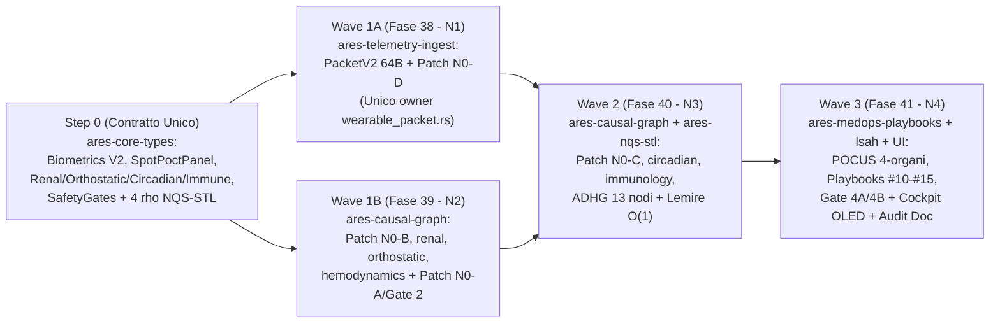

Command exited with code 0.

Command output:
# Parere Formale di Revisione Architetturale e Clinica — Blocco N (`Fasi 38–41`)

**Ruolo:** Principal Aerospace Biomedical Architect & Clinical Medical Advisor — Progetto **ARES-Health** (`MiServeRDC/nasa-space-apps-2026`)  
**Oggetto:** Valutazione e Approvazione Formale dei Piani Implementativi `N1–N4` ([phase_38](file:///Users/fabiomalagutti/Desktop/NASA_Space_Apps_2026/docs/plans/phase_38_N1_wearable_suite_v2_poct_ingest.md), [phase_39](file:///Users/fabiomalagutti/Desktop/NASA_Space_Apps_2026/docs/plans/phase_39_N2_renal_stone_rsr_plasma_volume_hemodynamics.md), [phase_40](file:///Users/fabiomalagutti/Desktop/NASA_Space_Apps_2026/docs/plans/phase_40_N3_mars_sol_circadian_cognitive_immune_viral.md), [phase_41](file:///Users/fabiomalagutti/Desktop/NASA_Space_Apps_2026/docs/plans/phase_41_N4_multiorgan_pocus_playbooks10_15_gate4.md)) rispetto a [BLOCK_N_CLINICAL_MEDICINE_ARCHITECTURE.md](file:///Users/fabiomalagutti/Desktop/NASA_Space_Apps_2026/docs/plans/BLOCK_N_CLINICAL_MEDICINE_ARCHITECTURE.md) e allo stato reale dei crate Rust.

---

## 1. Verdetto Esecutivo e Approvazione Formale

> **VERDETTO: APPROVATO CON CONDIZIONI TECNICO-CLINICHE PRE-CODICE (*GO FOR IMPLEMENTATION — CONDITIONAL ON 10 HARMONIZATION FIXES*)**

I quattro piani redatti dallo swarm recepiscono con eccellente fedeltà l'impianto medico-spaziale del Blocco N, chiudendo **tutti e 4 i domini patologici nominati nel mandato NASA Space Apps 2026** (*immune changes, bone loss, cardiovascular events, behavioral health problems*) e tutte le **4 Patch Chirurgiche `N0-A .. N0-D`**.

Tuttavia, l'ispezione incrociata riga-per-riga tra gli skeleton dei 4 piani e il codice sorgente attuale ([telemetry.rs](file:///Users/fabiomalagutti/Desktop/NASA_Space_Apps_2026/crates/ares-core-types/src/telemetry.rs), [wearable_packet.rs](file:///Users/fabiomalagutti/Desktop/NASA_Space_Apps_2026/crates/ares-telemetry-ingest/src/wearable_packet.rs), [safety_gates.rs](file:///Users/fabiomalagutti/Desktop/NASA_Space_Apps_2026/crates/ares-medops-playbooks/src/safety_gates.rs), [playbooks.rs](file:///Users/fabiomalagutti/Desktop/NASA_Space_Apps_2026/crates/ares-medops-playbooks/src/playbooks.rs), [adhg_graph.rs](file:///Users/fabiomalagutti/Desktop/NASA_Space_Apps_2026/crates/ares-causal-graph/src/adhg_graph.rs), [hemodynamics.rs](file:///Users/fabiomalagutti/Desktop/NASA_Space_Apps_2026/crates/ares-causal-graph/src/hemodynamics.rs)) ha individuato **10 criticità puntuali** (tra cui un falso blocco letale nel pneumotorace iperteso su `Gate 4A`, un collasso artificiale `RMSSD = 0.0 ms` a `20 Hz`, due collisioni dirette di file tra worker `N1/N3` e `N2/N4` e un errore di compilazione su `AlertSeverity`). Risolte queste 10 condizioni prima dell'apertura dei branch, **lo swarm è formalmente autorizzato a procedere con la scrittura del codice.**

### Scorecard Proiettata (Pre-Blocco N $\to$ Post-Blocco N)

| Pilastro di Valutazione NASA / HRP | Pre-Blocco N | Post-Blocco N (Atteso) | Impatto Principale |
| :--- | :---: | :---: | :--- |
| **Systems Engineering & Avionics Rigor** | `98 / 100` | **`99 / 100`** | Framing duale `32B/64B` CRC-16, Lemire $O(1)$, `< 150 µs` hot-path, Air-Gap totale. |
| **Epistemic & Regulatory Integrity (`#11/#12`)** | `96 / 100` | **`98 / 100`** | Disaccoppiamento stream `20 Hz` vs `SpotPoctPanel` con `TTL`, zero valori inventati su `BIDMC`. |
| **Clinical Depth on Modeled Syndromes** | `88 / 100` | **`96 / 100`** | Fix chirurgico `Gate 1`, accoppiamento $ppCO_2 \to \text{SANS/Citrate}$, RK4 su `1000 Sol`, `Gate 4`. |
| **Multisystem HRP Coverage (`RIDGE`)** | `68 / 100` | **`95 / 100`** | Copertura completa di nefrolitiasi `RSR`, $\Delta PV\%$/`MARROW`, Sol `24.66h`, `VZV/EBV` ed `eFAST`. |
| **Spaceflight Sensor Suite Realism** | `70 / 100` | **`94 / 100`** | `Astroskin/CNAP` (`SBP/DBP/PTT`), `ARCHeR` (`EDI lux`, sonno, $T_{\text{core}}$), `CPAD`, `i-STAT/MF-BIA`. |

---

## 2. Valutazione di Coerenza Scientifica, Robustezza Ingegneristica e Conformità Normativa

### 2.1 Coerenza Biomedica e Aderenza `NASA-STD-3001` / `HRP RIDGE`
- **Fase 38 (`N1` — [phase_38_N1_wearable_suite_v2_poct_ingest.md](file:///Users/fabiomalagutti/Desktop/NASA_Space_Apps_2026/docs/plans/phase_38_N1_wearable_suite_v2_poct_ingest.md)):** Eccellente la separazione architetturale tra telemetria indossabile continua (`ExplorationWearablePacketV2`, `64 B`) e diagnostica di laboratorio episodica (`SpotPoctPanel`), conforme a `NASA-STD-3001 [V1 3003]` e `[V1 4001]`. La codifica della radiazione personale tramite dose assorbita e fattore di qualità $Q(\text{LET})$ rispecchia fedelmente la fisica dei dosimetri attivi `CPAD` / `ESA EAD`.
- **Fase 39 (`N2` — [phase_39_N2_renal_stone_rsr_plasma_volume_hemodynamics.md](file:///Users/fabiomalagutti/Desktop/NASA_Space_Apps_2026/docs/plans/phase_39_N2_renal_stone_rsr_plasma_volume_hemodynamics.md)):** Molto solida l'integrazione tra indice di sovrassaturazione di Tiselius ($\text{RSR}$ calibrato a `1.00` in condizioni basali), ipocitraturia da acidosi tubulare ipercapnica (`NaDC1`, `[V2 6004]` / `[V2 6026]`), riflesso di Gauer-Henry, equazione di Dill & Costill, emolisi spaziale `MARROW (+54%)` e reologia non-newtoniana $\mu(\text{Hct})$.
- **Fase 40 (`N3` — [phase_40_N3_mars_sol_circadian_cognitive_immune_viral.md](file:///Users/fabiomalagutti/Desktop/NASA_Space_Apps_2026/docs/plans/phase_40_N3_mars_sol_circadian_cognitive_immune_viral.md)):** Rigorosa la formulazione del modello a due processi di Borbély ($S(t) + C(t)$) sul giorno solare marziano (`88,775.2 s = 24.6597 h`) con curva di risposta di fase $\Gamma(\phi)$ guidata da luce melanopica a `480 nm` (`[V2 6012]`), così come la fusione dei biomarcatori DSP esistenti (`vocal_jitter_pct`, divergenza $D_{\text{KL}}$ spaziale e `PVT-B > 355 ms`, `[V2 5001–5007]`) e della triade neuro-immuno-radiologica per la riattivazione di `VZV/EBV/CMV`.
- **Fase 41 (`N4` — [phase_41_N4_multiorgan_pocus_playbooks10_15_gate4.md](file:///Users/fabiomalagutti/Desktop/NASA_Space_Apps_2026/docs/plans/phase_41_N4_multiorgan_pocus_playbooks10_15_gate4.md)):** Pienamente centrata sul paradigma `ExMC Levels IV–V` (`[V1 3006]`, `[V2 7043]`, `[V2 10164]`). L'indicizzazione multi-organo `UBERON:` in `ares-storage-lsah` con blocco esplicito `gate_lock_enforced = true` garantisce che nessuna similarità coseno su immagini simulate o d'archivio possa mai sbloccare autonomamente procedure ad alto rischio iatrogeno.

### 2.2 Robustezza Ingegneristica (`Safe Rust 2024`, Zero Panics, `< 150 µs`, Air-Gap)
- **Layout Deterministico & Integrità SEU:** Le asserzioni a compile-time `size_of == 64`, `align_of == 8` e `offset_of!` su [phase_38](file:///Users/fabiomalagutti/Desktop/NASA_Space_Apps_2026/docs/plans/phase_38_N1_wearable_suite_v2_poct_ingest.md#L123-L137) eliminano qualsiasi padding implicito tra `aarch64` e `x86_64`.
- **Budget Temporale (`SLA < 150 µs`):** La somma dei budget parziali (`< 0.35 µs` ingest V2 + `< 6.5 µs` RK4 `AdaptiveUnbounded` + `< 25 µs` causale `N2/N3` + `< 10 µs` Lemire $O(1)$ + `< 25 µs` DAG 15 Playbook & 4 Gate $\approx 67\ \mu\text{s}$) mantiene oltre il `55%` di margine sotto il tetto di `150 µs` a `20 Hz`, purché si eliminino le allocazioni heap superflue segnalate nella Sezione 3.B.
- **Air-Gap & Compressione Context-Mode:** L'indice `HNSW` in puro Rust e il tetto $\le 600\text{ byte}$ (`< 150` token) sui tool `FastMCP` rispettano integralmente i requisiti di autonomia `OWLT 4–24 min`.

---

## 3. Osservazioni Critiche e 10 Condizioni Vincolanti Pre-Codice

Prima di avviare l'implementazione, il team **deve integrare le seguenti 10 correzioni** per prevenire bug clinici, regressioni dei test esistenti e conflitti di merge.

### A. Correzioni Salvavita di Medicina Clinica e Operativa

1. **`[CRITICO - CLINICO]` Falso Blocco Letale di `Gate 4A` nel Pneumotorace Iperteso Completo ([phase_41](file:///Users/fabiomalagutti/Desktop/NASA_Space_Apps_2026/docs/plans/phase_41_N4_multiorgan_pocus_playbooks10_15_gate4.md#L285-L289)):**
   - **Problema:** Lo skeleton di `Gate 4A` richiede `e.lung_sliding_absent && e.m_mode_barcode_sign_confirmed && e.lung_point_confirmed`. In medicina d'urgenza ecografica (protocollo *BLUE* di Lichtenstein; Kirkpatrick et al. 2007), **quando il polmone è collassato al 100% — esattamente nel pneumotorace iperteso massivo che uccide l'astronauta in pochi minuti — la pleura viscerale non tocca più la parete toracica e il *lung point* SCOMPARE fisiologicamente (`lung_point_confirmed == false`)!** Richiederlo con `&&` bloccherebbe la toracostomia decompressiva proprio nel paziente più critico.
   - **Correzione Obbligatoria:** Sbloccare `Gate 4A` se:
     `e.lung_sliding_absent && e.m_mode_barcode_sign_confirmed && (e.lung_point_confirmed || si_elevated)`
     (specificità 100% con *lung point* nei PTX parziali, oppure salvavita immediato con *barcode sign* + instabilità emodinamica `ShockIndex >= 0.90` nel collasso totale).

2. **`[ALTO - CLINICO]` Baseline `SBP` Individuale in `Gate 2` vs Costante Fissa `120.0 mmHg` ([phase_39](file:///Users/fabiomalagutti/Desktop/NASA_Space_Apps_2026/docs/plans/phase_39_N2_renal_stone_rsr_plasma_volume_hemodynamics.md#L179-L185)):**
   - **Problema:** Calcolare `(120.0 - sbp).max(0.0)` hardcodando `120.0 mmHg` fa scattare erroneamente lo sfiato d'emergenza `LBNP` (`> 15 mmHg`) su qualunque astronauta sano (in particolare donne o atleti endurance) la cui pressione sistolica basale fisiologica sia `100–104 mmHg`.
   - **Correzione Obbligatoria:** Calcolare il drop rispetto a `baseline_sbp_mmhg: f64` (default `120.0`, ma aggiornabile dalla baseline individuale pre-LBNP dell'astronauta).

3. **`[ALTO - FARMACOLOGIA]` Interazione `Ketorolac` in `Playbook #10` e Stewardship `Valacyclovir` in `Playbook #13` ([phase_41](file:///Users/fabiomalagutti/Desktop/NASA_Space_Apps_2026/docs/plans/phase_41_N4_multiorgan_pocus_playbooks10_15_gate4.md#L182-L210)):**
   - **`Playbook #10` (`Ketorolac`):** Il Ketorolac (FANS parenterale) è **controindicato** se l'astronauta è già scoagulato per trombo giugulare (`pocus_thrombus_confirmed == true`), se vi è emoperitoneo `eFAST` o se `creatinine_mg_dl > 1.5` in `SpotPoctPanel`. Filtrare o sostituire con `Acetaminophen` in presenza di anticoagulazione attiva o insufficienza renale.
   - **`Playbook #13` (`Valacyclovir`):** Non prescrivere automaticamente cicli completi di `Valacyclovir 1000 mg TID x 7d` solo su `ImmuneRisk > 0.65` (indice di stress illustrativo `Issue #12`): su `ImmuneRisk > 0.65` isolato attivare sorveglianza dermatomerica e igiene ambientale, abilitando l'antivirale sistemico solo se `viral_reactivation_copies_ml > 100` o lesione/prodromo clinico confermato (preservando la scorta finita di bordo).

4. **`[MEDIO - FISIOLOGIA ECLSS]` Maschera $O_2$ a Circuito Isolato (`PBA`) in `Playbook #14` ([phase_41](file:///Users/fabiomalagutti/Desktop/NASA_Space_Apps_2026/docs/plans/phase_41_N4_multiorgan_pocus_playbooks10_15_gate4.md#L220)):**
   - Specificare nell'azione `ACT_OXYGEN_ENRICHMENT_PROTOCOL` l'uso di **circuito respiratorio isolato privo di $CO_2$ (`Portable Breathing Apparatus / PBA` o loop tuta)** quando $ppCO_2 > 4.5\text{ mmHg}$: erogare solo $O_2$ miscelato all'aria stagnante di cabina non elimina l'ipercapnia alveolare (e per effetto Haldane può persino ridurre la capacità tampone dell'emoglobina).

---

### B. Correzioni DSP, Epistemiche (`Issue #11/#12`) e Hot-Path Zero-Alloc

5. **`[CRITICO - DSP]` Campionamento a `20 Hz` di `rr_interval_ms_x10`, Anti-Deadlock Malik e Dose Ambientale `CANS` ([phase_38](file:///Users/fabiomalagutti/Desktop/NASA_Space_Apps_2026/docs/plans/phase_38_N1_wearable_suite_v2_poct_ingest.md#L167-L218), [phase_38](file:///Users/fabiomalagutti/Desktop/NASA_Space_Apps_2026/docs/plans/phase_38_N1_wearable_suite_v2_poct_ingest.md#L504-L545)):**
   - **Bug `RMSSD = 0.0 ms` a `20 Hz`:** Il bus telemetrico gira a `20 Hz` (`50 ms`), mentre i battiti cardiaci avvengono a `~1 Hz`. Se `push_interval_ms_x10` viene invocato su ogni pacchetto da `50 ms` riportante lo stesso ultimo intervallo `R-R`, il buffer `[u16; 64]` si riempirà di `16–20` valori identici consecutivi ($\Delta RR = 0$), producendo un **falso `RMSSD ≈ 0.0 ms`** e innescando falsi allarmi di collasso vagale in `space_immunology.rs`!  
     *Fix:* Definire che `WMASK_RR_INTERVAL` (o un flag dedicato `WFLAG_NEW_RR_BEAT`) sia asserito **solo sul frame corrispondente a un nuovo picco R**, e invocare `rr_accumulator.push_interval_ms_x10(...)` solo su tale fronte.
   - **Anti-Deadlock del Filtro di Malik ($\pm 20\%$):** Se dopo un breve dropout radio la FC sale fisiologicamente da `60 bpm` (`1000 ms`) a `100 bpm` (`600 ms`, salto `-40%`), il confronto rigido `0.80..=1.20` contro `last_ms` in [phase_38](file:///Users/fabiomalagutti/Desktop/NASA_Space_Apps_2026/docs/plans/phase_38_N1_wearable_suite_v2_poct_ingest.md#L178) rigetterà tutti i battiti sinusali successivi all'infinito! Aggiungere un contatore `consecutive_rejects: u8`: dopo `>= 5` battiti consecutivi fisiologici (`300..=2000 ms`) rigettati, riancorare il riferimento al nuovo ritmo.
   - **Non Azzerare la Radiazione Ambientale `CANS` + Scala `SPE`:** In [phase_38](file:///Users/fabiomalagutti/Desktop/NASA_Space_Apps_2026/docs/plans/phase_38_N1_wearable_suite_v2_poct_ingest.md#L544), `personal_dose_rate_msv_d.unwrap_or(0.0)` sovrascrive a `0.0` la radiazione d'habitat `CSA CANS` per i nodi privi di sensore `CPAD` (es. anello `ARCHeR`), accecando `Playbook #05`! Passare `ambient_radiation_msv_d: f64` come fallback: `personal_dose_rate_msv_d.unwrap_or(ambient_radiation_msv_d)`. Inoltre, codificare `personal_dose_rate_ugy_h` in `1 uGy/h` intero (range `0..65,535 uGy/h` = `65.5 mGy/h`) invece di `uGy/h * 10` (che saturerebbe `u16` già a `6.55 mGy/h` durante un evento solare `SPE` severo).
   - **Zero-Alloc Reale in `to_biometrics()`:** Evitare `missing_channels.push("...".to_string())` ripetuto a `20 Hz` pre-allocando o popolando `missing_channels` solo quando necessario, in coerenza con l'invariante `0` allocazioni sull'hot-path.

6. **`[ALTO - EPISTEMICA]` Applicazione Effettiva di `SpotPoctPanel::is_stale()` in `N2` e `N3` ([phase_39](file:///Users/fabiomalagutti/Desktop/NASA_Space_Apps_2026/docs/plans/phase_39_N2_renal_stone_rsr_plasma_volume_hemodynamics.md#L331-L456)):**
   - **Problema:** Fase 38 definisce correttamente `SpotPoctPanel::is_stale(current_mission_s)` ([phase_38](file:///Users/fabiomalagutti/Desktop/NASA_Space_Apps_2026/docs/plans/phase_38_N1_wearable_suite_v2_poct_ingest.md#L274-L277)), ma gli skeleton Rust di `compute_renal_nephrolithiasis_state` e `compute_orthostatic_hemodynamics_state` in Fase 39 **non controllano mai `is_stale()`** (né ricevono `current_mission_s`)! Un pannello `i-STAT` vecchio di 20 giorni continuerebbe a sovrascrivere il modello per tutta la missione.
   - **Correzione Obbligatoria:** Filtrare a monte `let valid_poct = spot_poct.filter(|p| !p.is_stale(current_mission_s));` prima di passarlo a `renal_nephrolithiasis`, `orthostatic_fluid` e `space_immunology`.

7. **`[MEDIO - ISSUE #11]` Neutralità di `VagalSuppression` su Replay `BIDMC` quando `RMSSD == None` ([phase_40](file:///Users/fabiomalagutti/Desktop/NASA_Space_Apps_2026/docs/plans/phase_40_N3_mars_sol_circadian_cognitive_immune_viral.md#L131-L134)):**
   - **Problema:** Impostare `VagalSuppression = 0.50` quando `RMSSD` è `None` inietta un bias patologico artificiale fisso (`+0.10` su `ImmuneRisk`) su tutti i `53` record terrestri `PhysioNet BIDMC` a `1 Hz` (dove `RMSSD` è legittimamente `None`).
   - **Correzione Obbligatoria:** Quando `RMSSD` è `None`, porre il contributo non misurato a `0.0` (o rinormalizzare i pesi sui soli canali osservati) preservando la neutralità `Issue #11`.

---

### C. Armonizzazione Cross-Worker e Contratti dei Tipi Rust

8. **`[CRITICO - COLLISIONE SWARM]` Deduplica Ownership su `wearable_packet.rs` (`N1` vs `N3`) e `safety_gates.rs` (`N2` vs `N4`):**
   - **Conflitto 1 (`Patch N0-D`):** `WearableRrWindowAccumulator` è ridefinito sia in [phase_38](file:///Users/fabiomalagutti/Desktop/NASA_Space_Apps_2026/docs/plans/phase_38_N1_wearable_suite_v2_poct_ingest.md#L144-L148) (`buffer: [u16; 64]`, `BeatIntervalsNotAvailable`) sia in [phase_40](file:///Users/fabiomalagutti/Desktop/NASA_Space_Apps_2026/docs/plans/phase_40_N3_mars_sol_circadian_cognitive_immune_viral.md#L185-L196) (`intervals_ms: [u16; 64]`, `BeatIntervalsWarmingUp`). **Assegnare `Patch N0-D` esclusivamente al worker di Fase 38 (`N1`)**, adottando la variante `HrvUnavailableReason::BeatIntervalsWarmingUp` (quando `1 <= count < 16`) proposta in Fase 40. Fase 40 consumerà `biometrics.rmssd_ms` in sola lettura senza toccare `wearable_packet.rs`.
   - **Conflitto 2 (`Gate 1` & `Gate 2`):** Fase 39 aggiorna `Gate 2` su `biometrics.sbp_mmhg` ([phase_39](file:///Users/fabiomalagutti/Desktop/NASA_Space_Apps_2026/docs/plans/phase_39_N2_renal_stone_rsr_plasma_volume_hemodynamics.md#L179-L189)), ma lo skeleton di Fase 41 per `enforce_hard_clinical_safety_gates` ([phase_41](file:///Users/fabiomalagutti/Desktop/NASA_Space_Apps_2026/docs/plans/phase_41_N4_multiorgan_pocus_playbooks10_15_gate4.md#L277-L280)) **sovrascrive e cancella** la modifica tornando al solo `scenario.systolic_bp_drop_mmhg`! Inoltre, in [playbooks.rs](file:///Users/fabiomalagutti/Desktop/NASA_Space_Apps_2026/crates/ares-medops-playbooks/src/playbooks.rs#L37) e nel test esistente di [safety_gates.rs](file:///Users/fabiomalagutti/Desktop/NASA_Space_Apps_2026/crates/ares-medops-playbooks/src/safety_gates.rs#L91), `ACT_ANTICOAG_ENOXAPARIN` usa `category: "PHARMACOLOGICAL_UNLOCKED"` e la riga [175](file:///Users/fabiomalagutti/Desktop/NASA_Space_Apps_2026/crates/ares-medops-playbooks/src/safety_gates.rs#L175) asserisce `!a.category.contains("PHARMACOLOGICAL")`: normalizzare `PLAYBOOK_02` a `"PHARMACOLOGICAL_ANTICOAGULANT"`, aggiornare il test legacy e far sì che Fase 41 estenda la versione di `safety_gates.rs` già patchata da Fase 39 senza regredire `Gate 2`.

9. **`[ALTO - COMPILAZIONE & GRAFO]` Allineamento Tipi Esistenti in `ares-core-types` e `ares-causal-graph`:**
   - **`AlertSeverity`:** In [phase_39](file:///Users/fabiomalagutti/Desktop/NASA_Space_Apps_2026/docs/plans/phase_39_N2_renal_stone_rsr_plasma_volume_hemodynamics.md#L383) sostituire `AlertSeverity::Critical` (inesistente) con `AlertSeverity::CriticalEmergency` come definito in [telemetry.rs](file:///Users/fabiomalagutti/Desktop/NASA_Space_Apps_2026/crates/ares-core-types/src/telemetry.rs#L30).
   - **`TelemetryPacket` vs `ValidatedTelemetryFrame`:** `ValidatedTelemetryFrame` risiede in [wearable_packet.rs](file:///Users/fabiomalagutti/Desktop/NASA_Space_Apps_2026/crates/ares-telemetry-ingest/src/wearable_packet.rs#L55), mentre il contratto globale a `20 Hz` in [telemetry.rs](file:///Users/fabiomalagutti/Desktop/NASA_Space_Apps_2026/crates/ares-core-types/src/telemetry.rs#L396) è `TelemetryPacket` (aggiungere i nuovi campi opzionali con `#[serde(default)]` su `TelemetryPacket`).
   - **Ordine di Pipeline per $\mu(\text{Hct}) \to \tau_w$:** In Fase 39 eseguire `compute_orthostatic_hemodynamics_state` **prima** di `compute_jugular_and_sans_state`, passando `apparent_blood_viscosity_poise` dentro il calcolo di `tau_w_dyn_cm2` in [hemodynamics.rs](file:///Users/fabiomalagutti/Desktop/NASA_Space_Apps_2026/crates/ares-causal-graph/src/hemodynamics.rs#L43) (altrimenti `compute_tau_w_dyn_cm2_with_viscosity` rimarrebbe codice morto).
   - **Conteggio Nodi `ADHG` (`13` nodi) e Margini `NQS-STL`:** In [phase_40](file:///Users/fabiomalagutti/Desktop/NASA_Space_Apps_2026/docs/plans/phase_40_N3_mars_sol_circadian_cognitive_immune_viral.md#L202-L255), `8` nodi esistenti + `5` nuovi (`CabinHypercapniaEnv`, `RenalSupersaturationRsr`, `PlasmaVolumeOrthostatic`, `MarsCircadianCognitiveFatigue`, `NeuroImmuneViralReactivation`) formano **`13` nodi totali** (`StableDiGraph::with_capacity(13, 18)`). In `NqsStlMargins` ([telemetry.rs](file:///Users/fabiomalagutti/Desktop/NASA_Space_Apps_2026/crates/ares-core-types/src/telemetry.rs#L338-L364)) esporre tutti e **4** i margini (`rho_renal`, `rho_orthostatic`, `rho_circadian`, `rho_immune`) aggiornando anche `has_known_violation()`.

10. **`[MEDIO - ARCHITETTURA MEDOPS]` Gerarchia Unificata Deterministica dei `15` Playbook ([playbooks.rs](file:///Users/fabiomalagutti/Desktop/NASA_Space_Apps_2026/crates/ares-medops-playbooks/src/playbooks.rs)):**
    - Definire un ordine di precedenza esplicito senza ambiguità tra `select_vitals_anomaly_playbook` e `select_candidate_playbook`:
      1. **Emergenza Traumatica / Shock Emorragico-Ostruttivo:** `#15` (`eFAST` / `ShockIndex >= 0.90` / barotrauma EVA)
      2. **Allarmi Vitali Cardiorespiratori Acuti:** `#06` (desaturazione), `#07` (aritmia/FC), `#09` (deterioramento multiparametrico)
      3. **Urgenze Organo-Specifiche e Ambientali Acute:** `#02` (trombo IJV confermato), `#05` (`SPE > 1.5 mSv/d`), `#14` ($ppCO_2 > 3.0\text{ mmHg}$), `#10` (colica renale / ritenzione `> 500 mL` / `RSR > 4.5`), `#08` (dropout sensore)
      4. **Protocolli Subacuti, Pre-Landing e Cronici:** `#11` (fluid loading `0.38g` / $\Delta PV\% < -10\%$), `#01` (stasi IJV), `#04` (`SANS`), `#13` (riattivazione virale), `#12` (desincronizzazione Sol marziano), `#03` (mantenimento `ARED`).

---

## 4. Sequenza di Integrazione Consigliata per lo Swarm (Zero Merge Conflicts)

1. **Step 0 (`ares-core-types`):** Congelare in un singolo commit atomico tutte le nuove struct/enum/costanti condivise in [telemetry.rs](file:///Users/fabiomalagutti/Desktop/NASA_Space_Apps_2026/crates/ares-core-types/src/telemetry.rs) e `constants.rs`.
2. **Wave 1 in Parallelo (`N1` || `N2`):** `N1` lavora in isolamento su `ares-telemetry-ingest` (inclusa `Patch N0-D`); `N2` lavora su `renal_nephrolithiasis.rs`, `orthostatic_fluid.rs`, `hemodynamics.rs` (`Patch N0-B`) e applica `Patch N0-A` + `Gate 2` in `safety_gates.rs`.
3. **Wave 2 (`N3`):** Applica `Patch N0-C` in [mechanotransduction.rs](file:///Users/fabiomalagutti/Desktop/NASA_Space_Apps_2026/crates/ares-causal-graph/src/mechanotransduction.rs), aggiunge `circadian_cognitive.rs` e `space_immunology.rs`, collega tutti i `13` nodi in [adhg_graph.rs](file:///Users/fabiomalagutti/Desktop/NASA_Space_Apps_2026/crates/ares-causal-graph/src/adhg_graph.rs) ed estende `ares-nqs-stl`.
4. **Wave 3 (`N4`):** Estende `ares-medops-playbooks` (`pocus_multiorgan.rs`, Playbook `#10–#15`, `Gate 4A/4B` preservando il `Gate 2` di `N2`), `ares-storage-lsah`, `ares-server-cli`, `ares-cockpit` e aggiorna contestualmente `docs/architecture/MODEL_EVIDENCE_AUDIT.md`, chiudendo con `./scripts/agent_probe.sh` e benchmark `p99.9 < 150 µs`.
