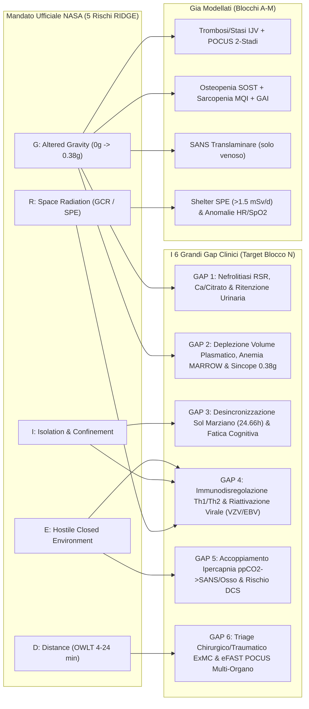
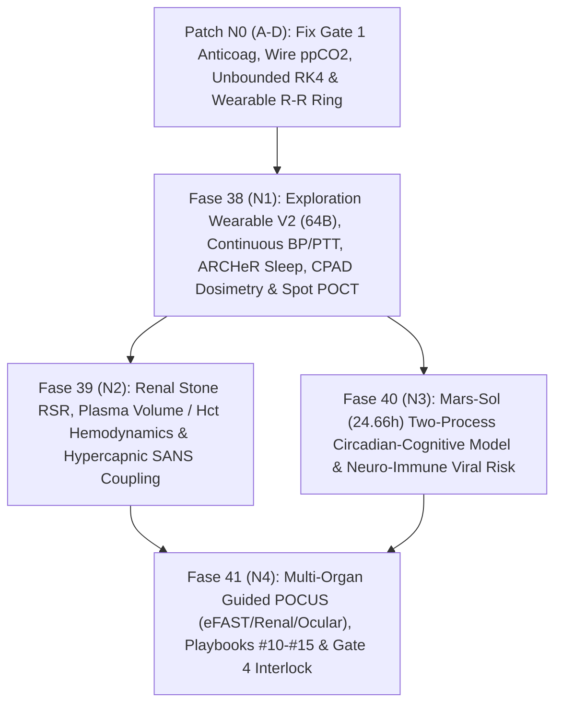

# Audit Biomedico, Clinico e Sistemistico di ARES-Health (NASA Space Apps Challenge 2026)

**Revisore:** Principal Aerospace Biomedical Architect & Clinical Medical Advisor  
**Target di Audit:** Repository `MiServeRDC/nasa-space-apps-2026` — Stato **Blocchi A–M (`Fasi 01–37`, `9` Crate Safe Rust + `ARES-MedOS` + `ares-cockpit`)**  
**Riferimenti Normativi:** Consegna Ufficiale NASA Space Apps 2026 (*Health Monitoring Software*), Framework NASA HRP `RIDGE` (17 Rischi Clinici), `NASA-STD-3001 Vol. 1 Rev C` (*Crew Health*) & `Vol. 2 Rev F` (*Human-System Integration*, Luglio 2026), `OCHMO MTB-007`, Exploration Medical Capability (`ExMC` Levels of Care I–V).

---

## 1. Valutazione di Allineamento alla Consegna NASA e Bilanciamento Ingegneria/Clinica

### 1.1 Ci siamo discostati troppo dalla consegna ufficiale?

**Verdetto Esecutivo: NO sul piano architetturale e operativo di missione; SÌ parzialmente sul bilanciamento tra profondità infra-sistema operativo e ampiezza clinica multisistemica.**

Rileggendo letteralmente le due frasi centrali del mandato NASA:

1. *"Long-duration missions expose astronauts to space radiation, isolation and confinement, altered gravity, and a hostile closed environment, which can bring **immune changes**, **bone loss**, **cardiovascular events**, and **behavioral health problems**."*
2. *"On long missions, astronauts carry much of the responsibility for spotting these changes in themselves. Your challenge is to build a health monitoring software that **gathers** health indicators and enables astronauts to **evaluate** and **act** on the status of their health."*

Dal punto di vista del **paradigma operativo EIMO (*Earth-Independent Medical Operations*, `NASA-STD-3001 [V1 3006]`)**, `ARES-Health` centra il cuore della sfida in modo nettamente superiore a una comune dashboard telemetrica:
- **Chiusura reale del ciclo autonomo `GATHER -> EVALUATE -> ACT`:** Il sistema non si limita a plottare curve vitali, ma trasforma segnali rumorosi/incompleti (`GATHER`) in inferenza causale multi-organo e margini temporali predittivi (`EVALUATE`), fino a prescrizioni operative passo-passo blindate da interlock deterministici senza LLM nel loop critico (`ACT`).
- **Centralità dell'astronauta (*Self-Spotting*) e Privacy Medica (`[V1 Ch. 7]`):** La partizione in 3 viste crittografiche ([privacy_views.rs](./crates/ares-security-privacy/src/privacy_views.rs): `AstronautSelf`, `CrewMedicalOfficer`, `GroundFlightSurgeon`) risolve un problema storico reale della medicina spaziale (l'occultamento dei sintomi da parte dell'equipaggio per timore di squalifica dalle EVA, noto fin dall'ammutinamento sanitario di *Skylab 4*).
- **Onestà Epistemica Rigorosa (`Issue #4`, `Issue #11`, `Issue #12`):** Il registro [MODEL_EVIDENCE_AUDIT.md](./docs/architecture/MODEL_EVIDENCE_AUDIT.md#L1-L74) e la macchina a stati `ModelValidationStatus::IllustrativeUnvalidated` in [telemetry.rs](./crates/ares-core-types/src/telemetry.rs#L171-L221) rappresentano un punto di forza decisivo davanti a una giuria medico-scientifica NASA/HRP/TRISH: non spacciate mai tracciati ICU terrestri (`BIDMC`) per telemetria di astronauti in volo, né fabbricate `RMSSD` da frequenze cardiache a `1 Hz`.

> [!IMPORTANT]
> **Diagnosi sul Bilanciamento Ingegneria Software vs Fedeltà Biomedica:**
> Nei Blocchi `J–M` avete raggiunto un'eccellenza ingegneristica da avionica di volo (`9` crate `#![forbid(unsafe_code)]` / zero `.unwrap()`, ring buffer `Seqlock` a `42 ns`, pipeline completa a `5.58 µs p99.9`, persistenza `LSAH` a 3 tier con `Arrow IPC + HNSW + ChaCha20-Poly1305`). Tuttavia, **un Flight Surgeon NASA che ispezioni il motore fisiologico rileverà un'asimmetria**: su **4 esiti patologici nominati testualmente nel prompt NASA** (*immune changes, bone loss, cardiovascular events, behavioral health problems*), oggi modelliamo in profondità **bone loss** e **stasi/trombosi venosa giugulare + SANS**, ma **non abbiamo alcun modello attivo per `immune changes`**, trattiamo **`behavioral health / circadian sleep`** solo a livello di feature DSP grezze scollegate da un modello del sonno marziano, e in ambito cardiovascolare/renale trascuriamo **ipovolemia plasmatica ($\Delta PV\%$), pressione arteriosa continua e nefrolitiasi acuta**.

### 1.2 Scorecard Sintetica dello Stato Attuale (Pre-Blocco N)

| Pilastro di Giudizio NASA Space Apps | Punteggio Attuale | Valutazione del Clinical & Systems Audit |
| :--- | :---: | :--- |
| **Systems Engineering & Avionics Rigor** | **98 / 100** | Safe Rust 2024, latenza `< 6 µs`, air-gap totale, integrità SEU `CRC-8/16/32C`, persistenza `LSAH` a 3 tier. |
| **Epistemic & Regulatory Integrity** | **96 / 100** | Separazione esemplare tra misura registrata (`BIDMC`), `null`-honesty (`Issue #11`) e modelli illustrativi (`Issue #12`). |
| **Clinical Depth on Modeled Syndromes** | **88 / 100** | Ottimi i modelli IJV/POCUS a 2 stadi, Frost-Hargens `SOST`, `SANS` e i 3 Safety Gates (con 3 bug chirurgici da correggere). |
| **Multisystem HRP Coverage (`RIDGE`)** | **68 / 100** | Assenti immunologia spaziale, dinamica circadiana Sol marziano (`24.66h`), sovrassaturazione renale `RSR`, `BP`/`ΔPV%` ed `eFAST` POCUS. |
| **Spaceflight Sensor Suite Realism** | **70 / 100** | Ottimo DSP radar/vocale/R-R, ma mancano `BP` continua (`PTT`/`CNAP`), `core_temp`, bioimpedenza `MF-BIA`, dosimetria personale `CPAD` e `POCT` ematico/urinario. |

---

## 2. Audit Sistematico dei Sensori: Cosa Abbiamo nel Codice vs Dispositivi Reali degli Astronauti

### 2.1 Verifica Puntuale sul Codice Sorgente: Cosa Ingestiamo *Davvero* Oggi (e 4 Discrepanze Rilevate)

L'ispezione diretta dei crate Rust ha evidenziato **quattro discrepanze critiche** tra ciò che si tende a dare per acquisito e ciò che è effettivamente cablato nel codice:

1. **Assenza totale del canale Pressione Arteriosa (`BP` / `SBP` / `DBP` / `MAP`):**
   - Sebbene nei riepiloghi si citi talvolta `BP` tra i canali `BIDMC`, i file `bidmc_*_Numerics.csv` di PhysioNet contengono solo `Time [s], HR, PULSE, RESP, SpO2`. Di conseguenza, né [bidmc_replayer.rs](./crates/ares-telemetry-ingest/src/bidmc_replayer.rs#L42-L50) (`BidmcNumericRow`), né [telemetry.rs](./crates/ares-core-types/src/telemetry.rs#L286-L302) (`Biometrics`), né [wearable_packet.rs](./crates/ares-telemetry-ingest/src/wearable_packet.rs#L27-L42) (`WearableSensorPacket`) possiedono campi per la pressione arteriosa! Il **Gate 2** anti-sincope LBNP in [safety_gates.rs](./crates/ares-medops-playbooks/src/safety_gates.rs#L22-L24) legge esclusivamente lo slider manuale `scenario.systolic_bp_drop_mmhg`.
2. **`core_temp_celsius` è cablato fisso a `None`:**
   - In [wire_contract.rs](./crates/ares-server-cli/src/wire_contract.rs#L430), `core_temp_celsius: None` è hardcoded; né `Biometrics` né `WearableSensorPacket` trasportano temperatura centrale o cutanea (indispensabile per febbre/sepsi e nadir circadiano).
3. **`cabin_ppco2_mmhg` è un campo "morto" (puramente cosmetico sul wire JSON):**
   - In [wire_contract.rs](./crates/ares-server-cli/src/wire_contract.rs#L132-L136) e [wire_contract.rs](./crates/ares-server-cli/src/wire_contract.rs#L490-L495), `StressTestPatchRequest` accetta `cabin_ppco2_mmhg` dalla console What-If e lo serializza in `WireEnvironment`, ma **non lo passa mai a `compute_jugular_and_sans_state` ([hemodynamics.rs](./crates/ares-causal-graph/src/hemodynamics.rs#L22-L83)) né ad alcun nodo di `AdhgCausalEngine`!** Muovere lo slider della $CO_2$ in cabina oggi produce **zero effetto** su `SANS`, respirazione, calciuria o prontezza cognitiva.
4. **`WMASK_RR_INTERVAL` nel pacchetto Wearable `32 B` non calcola `RMSSD`:**
   - In [wearable_packet.rs](./crates/ares-telemetry-ingest/src/wearable_packet.rs#L214-L228), anche quando `WMASK_RR_INTERVAL` è attivo e `rr_interval_ms_x10 > 0`, `to_biometrics()` imposta `rmssd_ms: None` (rimuovendo solo il motivo `BeatIntervalsNotAvailable`), perché manca un ring-buffer accumulatore dei battiti consecutivi `R-R` lato wearable node.

### 2.2 Matrice Comparativa Completa: Suite Medica Reale ISS / Artemis / Deep Space vs `ARES-Health`

La tabella seguente censisce sistematicamente **tutte le 10 classi di wearable e dispositivi medici** impiegati su ISS, programma lunare **Artemis (`Orion` / `Gateway`)** e architettura **NASA ExMC (*Exploration Medical Capability*)** per Marte:

| # | Classe Dispositivo / Hardware Reale (ISS, Artemis, ExMC) | Parametri Fisici e Clinici Acquisiti nello Spazio | Stato Attuale in `ARES-Health` | Gap Sensoriale da Colmare nel Blocco N |
| :-: | :--- | :--- | :--- | :--- |
| **1** | **Smart Garment Multiparametrico** *CSA Bio-Monitor (`Astroskin`) / Hexoskin* | ECG 3-lead (`256 Hz`), `RIP` toraco-addominale 2 bande (rate + tidal volume $V_T$), `SpO2` **frontale** (immune a vasocostrizione digitale $0g$), **cuffless `SBP` via `PTT`**, $T_{\text{skin}}$, IMU 3-assi (`64 Hz`). | **Parziale:** `HR`, `SpO2`, `RESP`, estrattore `R-R` Pan-Tompkins (`125–500 Hz`), `imu_rms_g` scalare (`32 B`). | Aggiungere `PTT` $\to$ `SBP/DBP/MAP`, $T_{\text{skin}}$, tidal volume `RIP` e accumulatore `R-R` da pacchetto wearable. |
| **2** | **Monitoraggio Emodinamico & Defibrillatore Clinico** *CNAP / Finapres Nova (CardioLab) & Tempus Pro* | Pressione arteriosa continua beat-to-beat (*volume-clamp* digitale), ECG diagnostico 12 derivazioni (`QTc`, aritmie), capnografia `EtCO2`, NIBP oscillometrico. | **Assente:** Nessun canale `BP`, `QTc` o `EtCO2` in `Biometrics`. | Integrare `sbp_mmhg`, `dbp_mmhg`, `map_mmhg`, `qtc_ms` (`Option<f64>`) per alimentare `ShockIndex` e **Gate 2** reale. |
| **3** | **Attigrafia, Anello Biometrico, Luce & Termometria Core** *NASA `ARCHeR` Smart Ring (Artemis II), Actiwatch Spectrum / ActiGraph LEAP, `ThermoLab` Zero-Heat-Flux, `NASA Cognition` (`PVT-B`)* | Epoche sonno/veglia, efficienza sonno, frazione `N3/REM`, esposizione luminosa **melanopica (`EDI lux` `480 nm`)**, temperatura centrale `Zero-Heat-Flux` (`ThermoLab`), *Psychomotor Vigilance Task* (`PVT` reaction time & lapses $>355\text{ ms}$). | **Quasi Assente:** Solo radar respiratorio notturno (`radar_csi_dsp.rs`) e voce (`vocal_acoustic_dsp.rs`); `core_temp_celsius` è `None`. | Integrare telemetria sonno/attigrafia `ARCHeR`, `melanopic_edi_lux`, `core_temp_celsius` e `pvt_lapses_count`. |
| **4** | **Dosimetria Attiva Personale vs Ambientale** *`CPAD` (Crew Personal Active Dosimeter) / `ESA EAD` / `NASA HERA` + `CSA CANS` (Neutron Spectrometer) & `TEPC`* | Distinzione tra **spettrometria ambientale d'habitat** (`CANS` neutroni secondari ad alto `LET` + `HERA`) e **dosimetro attivo personale indossato** (`CPAD` per EVA/spostamenti tra moduli), separando dose assorbita `mGy` (effetti deterministici `BFO`) da dose equivalente `mSv` ($Q(\text{LET})$). | **Parziale:** Singolo scalare ambientale `radiation_dose_rate_msv_d` in `Biometrics` senza accumulo personale per zona né distinzione `mGy` vs `mSv`. | Separare bus ambientale `CANS` da dosimetro personale `CPAD` integrato sulle 6 zone di `hypergraph_spatial.rs` + finestra mobile `BFO 30-day (250 mGy-Eq)`. |
| **5** | **Ecografia Point-of-Care Multi-Organo & Imaging Oculare** *`Butterfly iQ+` CM / `GE Vivid q` + `Heidelberg Spectralis OCT` + Tonometro `iCare`* | **Vascolare:** IJV B-mode/Doppler. **Oculare:** `ONSD`, spessore coroideale `OCT`, edema disco ottico, `IOP` (`mmHg`). **Renale/Vescicale:** idronefrosi, calcoli (*twinkling*), jet ureterali, volume vescicale post-minzionale. **Toraco-Addominale (`eFAST`):** pneumotorace (*lung sliding*), liquido libero, appendice/colecisti. | **Parziale:** Solo flag booleano `pocus_thrombus_confirmed` per IJV + firme vettoriali procedurali IJV in `ares-storage-lsah`. | Estendere lo schema POCUS a **4 distretti strutturati** (`IJV`, `Ocular+IOP`, `Renal/Bladder`, `eFAST Thoracic/Abdominal`). |
| **6** | **Bioimpedenza Spettroscopica Multifrequenza (`MF-BIA` / `BIS`)** *ISS Fluid Shifts / Cole-Cole Bioimpedance (`5 kHz–1 MHz`)* | Acqua corporea totale (`TBW`), rapporto extracellulare/intracellulare (`ECW/ICW`), **indice di shift cefalico** ($\text{ECW}_{\text{thorax}}/\text{ECW}_{\text{leg}}$) e stima non invasiva della **variazione del volume plasmatico ($\Delta PV\%$)**. | **Assente.** | Ingestione episodica/giornaliera `MF-BIA` per stimare $\Delta PV\%$ e stato di idratazione reale. |
| **7** | **Diagnostica Ematologica, Chimica, Immunologica & Urinaria `POCT`** *`Abbott i-STAT Alinity` (ISS), `rHEALTH ONE` (ExMC citometria microfluidica), `MinION Nanopore` / qPCR salivare, Strip Urinarie (`Chemstrip`)* | **Sangue capillare (`<100 µL`):** `Hct`, `Hb` (*space anemia*), `WBC` + `NLR` (neutrofili/linfociti), `Na+`, `K+`, `iCa2+`, `Creatinine`, `pH/HCO3-/Lactate`, `Troponin I`. **Urina:** `pH`, peso specifico `USG`, rapporto `Ca/Citrate`, microematuria. **Saliva:** cortisolo, carica virale `VZV/EBV`. | **Assente:** Tutti i biomarcatori umorali (`SOST`, `urinary_calcium_mg_d`) sono solo ODE simulate senza input di laboratorio. | Introdurre `SpotPoctPanel` episodico con `TTL` esplicito e filtro di aggiornamento Bayesiano dello stato interno. |
| **8** | **Ergometria Strumentata & Gas Metabolici** *`ARED` (ISS) / `E4D`–`MED-2` (Orion/Gateway) + Analizzatore Portatile $\dot{V}O_2/\dot{V}CO_2$ (`PFS` / `VO2 Master`)* | Forza eccentrica/concentrica per ripetizione, potenza ciclistica/vogatore (`MED-2`), consumo massimo di ossigeno $\dot{V}O_{2\max}$ (`[V1 4001]` POL per EVA) e quoziente respiratorio `RER`. | **Parziale:** Solo `ared_daily_load_kgf` statico giornaliero. | Supportare telemetria sessione `ARED/MED-2` + indice aerobico submassimale $\dot{V}O_{2\max}$ stimato. |
| **9** | **Sensori Ambientali Cabina `ECLSS` & Tossicologia Polveri** *`CDRA` ($ppCO_2$), `MCA` ($ppO_2/N_2$), Dosimetro Acustico (`OCHMO-TB-035`), Monitor Particolato Regolite/Perclorati* | $ppCO_2$ (`mmHg`, incluse sacche stagnanti notturne in $0g$), pressione cabina (`14.7 psi` vs *Exploration Atmosphere* `8.2 psi / 34% O2`), rumore continuo `dBA`, polveri ultrafini post-EVA ($<2.5\,\mu\text{m}$ silice lunare / $\text{ClO}_4^-$ marziano). | **Scollegato:** `cabin_ppco2_mmhg` è presente in `WireEnvironment` ma ignorato dai modelli causali; assenti acustica e polveri. | Accoppiare fisicamente $ppCO_2$, pressione cabina (`DCS`) e rumore notturno (`dBA`) ai modelli `SANS`, renale e sonno. |
| **10** | **Bus Biomedico Tuta `EVA` (`xEMU` / `AxEMU`)** *Suit Metabolic Rate, In-Helmet $ppCO_2$, Sublimator/LCVG Thermal Loop* | Dispendio metabolico reale in EVA (`W` / `kcal/h`), washout $CO_2$ nel casco, bilancio termico `LCVG` ($\Delta T$ acqua raffreddamento), pressione differenziale tuta (`4.3–8.2 psi`). | **Minimo:** Flag booleano `WFLAG_EVA_SUIT_NODE` in `WearableSensorPacket` e smorzamento caviglia **Gate 3**. | Aggiungere telemetria metabolica/termica EVA e interlock **Fitness-for-EVA**. |

---

## 3. Cosa Abbiamo Fatto Bene dal Punto di Vista Medico (Punti di Eccellenza da Preservare)

### 3.1 Disaccoppiamento Bayesiano a 2 Stadi Stasi Giugulare vs Trombo Occlusivo (`Gate 1`)
Il modello implementato in [bayesian_pocus.rs](./crates/ares-causal-graph/src/bayesian_pocus.rs#L21-L52) e blindato da [safety_gates.rs](./crates/ares-medops-playbooks/src/safety_gates.rs#L33-L38) riflette una comprensione clinica profonda del caso indice di trombosi della vena giugulare interna (IJV) avvenuto sulla ISS (Marshall-Goebel et al., *JAMA Netw. Open* 2019; Auñón-Chancellor et al., *NEJM* 2020):
- In microgravità, oltre metà dell'equipaggio presenta stasi o flusso bidirezionale/retrogrado nella IJV, ma **la stasi isolata NON equivale a trombosi**.
- In un habitat marziano privo di chirurgia vascolare, trasfusioni massive o antidoti illimitati (andexanet alfa / idarucizumab), **somministrare Enoxaparina o Apixaban empiricamente senza visualizzazione diretta di un trombo incomprimibile al POCUS B-mode esporrebbe l'astronauta a rischio di emorragia intracranica o retroperitoneale fatale**.
- Altrettanto corretta è l'azione `ACT_SUSPEND_VALSALVA_ARED` in `PLAYBOOK_02` ([playbooks.rs](./crates/ares-medops-playbooks/src/playbooks.rs#L40-L47)): uno squat pesante su ARED con manovra di Valsalva genera bruschi picchi di pressione intratoracica seguiti da rimbalzo venoso, capaci di distaccare un trombo giugulare fresco provocando embolia polmonare acuta.

> [!CAUTION]
> **Bug Chirurgico Scoperto in `Gate 1` ([safety_gates.rs](./crates/ares-medops-playbooks/src/safety_gates.rs#L34-L38)):**
> Alla riga `36` di `safety_gates.rs`, quando `pocus_thrombus_confirmed == false` (cioè per il **99.9% della durata della missione!**), il filtro esegue:
> `!a.action_id.contains("ANTICOAG") && !a.category.contains("PHARMACOLOGICAL")`.
> Questo predicato troppo ampio **cancella silenziosamente QUALSIASI farmaco** etichettato come `"PHARMACOLOGICAL"` in qualunque altro playbook (antibiotici, analgesici per colica renale, antivirali, antiemetici)! Deve essere circoscritto rigorosamente a `"PHARMACOLOGICAL_ANTICOAGULANT"` nella **Patch N0-A**.

### 3.2 Coerenza Dimensionale CGS dello Shear Stress Endoteliale ($\tau_w$) e Triade di Virchow Spaziale
In [hemodynamics.rs](./crates/ares-causal-graph/src/hemodynamics.rs#L13-L18), il calcolo di $\tau_w = 2\mu v_{\max}\sqrt{\pi/\text{CSA}_{\text{cm}^2}}$ converte correttamente l'area ecografica da $\text{mm}^2$ a $\text{cm}^2$ restituendo $\text{dyn/cm}^2$ esatti, e in [adhg_graph.rs](./crates/ares-causal-graph/src/adhg_graph.rs#L102-L165) ricompone l'intera **Triade di Virchow in spazio profondo**:
1. *Stasi emodinamica* (perdita del gradiente idrostatico $G_z$ + atrofia della pompa venosa del soleo);
2. *Danno endoteliale* (specie reattive dell'ossigeno da neutroni secondari `CSA CANS` sul glicocalice endoteliale);
3. *Ipercoagulabilità / deficit secretomico* (riduzione miochine endotelio-protettive da disuso).

### 3.3 Accoppiamento Meccanotrasduttivo Osso-Muscolo-Atterraggio (`SOST` + `MQI` + `GAI` a `0.38g` + `Gate 3`)
Il modulo [mechanotransduction.rs](./crates/ares-causal-graph/src/mechanotransduction.rs#L26-L128) unisce elegantemente la soglia meccanostatica di Frost ($\varepsilon_{\text{Frost}} = 1000\ \mu\varepsilon$) alla cinetica della Sclerostina (`SOST`), alla mio-steatosi ecografica del soleo (`MQI`) e all'asimmetria del passo allo sbarco marziano (`GAI > 12%` $\to$ **Gate 3** smorzamento tuta e blocco pliometria, coerente con la perdita di rigidezza del tendine d'Achille misurata da `ESA Myotones` sulla ISS).
- *Nota correttiva immediata (`Patch N0-C`):* In [mechanotransduction.rs](./crates/ares-causal-graph/src/mechanotransduction.rs#L61-L65), la funzione default `compute_musculoskeletal_state` usa ancora `Rk4HorizonPolicy::Bounded60DaysLegacy` (`12` passi con `dt <= 5.0 d`), congelando l'evoluzione di `SOST` dopo il giorno `60` anche a `flight_day = 600`! Passare ad `AdaptiveUnbounded` sblocca la vera dinamica longitudinale a `900 Sol`.

### 3.4 Guardrail Pre-Sincopale `LBNP` (`Gate 2`) e Gerarchia Acuto > Cronico (`Playbook #06–#09`)
- Il **Gate 2** (sfiato automatico della camera `LBNP` a `0 mmHg` se $\Delta\text{SBP} > 15\text{ mmHg}$ o $\text{HR} > 115\text{ bpm}$) previene il riflesso cardioinibitore di Bezold-Jarisch e la sincope da sequestro venoso eccessivo.
- Ottima anche l'architettura introdotta in [playbooks.rs](./crates/ares-medops-playbooks/src/playbooks.rs#L151-L273) (`select_vitals_anomaly_playbook`), in cui gli allarmi fisiologici acuti (`#06` desaturazione, `#07` anomalia HR, `#09` deterioramento multiparametrico) prevalgono sui playbook cronici (`#01–#05`) e distinguono esplicitamente il distacco del sensore (`#08` `SensorDropout`) dall'ipossiemia reale.

---

## 4. Cosa Ci Manca dal Punto di Vista Medico: I 6 Grandi Gap Clinici (`HRP` & `NASA-STD-3001`)

### Gap 1: Nefrolitiasi da Ipercalciuria, Ipocitraturia e Ritenzione Urinaria Acuta
- **Rischio HRP:** *Risk of Renal Stone Formation* & *Urinary Retention in Microgravity*.
- **Fisiopatologia:** Il riassorbimento osseo mobilizza calcio (`> 250–350 mg/d` nelle urine), mentre la riduzione della sete in $0g$ contrae il volume urinario (`< 1.5 L/d`) e l'acidosi lieve da dieta/ipercapnia abbassa pH e citrato urinario, facendo esplodere la **sovrassaturazione relativa (`RSR`) di ossalato di calcio e brushite** (pietra fosfatica particolarmente recidivante negli astronauti). Una colica renale ostruttiva complicata da urosepsi nello spazio profondo è potenzialmente mortale; parimenti, la **ritenzione urinaria acuta** (perdita della percezione gravitazionale di riempimento vescicale + uso di anticolinergici come la prometazina per lo *Space Motion Sickness*) è una delle urgenze urologiche più comuni in orbita.
- **Stato attuale:** `urinary_calcium_mg_d` è calcolato in `Musculoskeletal` ma **ignorato da `NQS-STL`**, scollegato dall'idratazione/pH/citrato e privo di protocollo POCUS renale/vescicale.

### Gap 2: Perdita di Volume Plasmatico ($\Delta PV\%$), Anemia Spaziale (`MARROW`) e Collasso Ortostatico Acuto
- **Rischio HRP:** *Risk of Cardiovascular Adaptations & Orthostatic Intolerance During Re-Exposure to Gravity*.
- **Fisiopatologia:** Lo shift cefalico di `~2 litri` attiva la diuresi/trasudazione di Gauer-Henry riducendo il volume plasmatico del **`10–17%` in 48–72 ore**, accompagnato da **emolisi eritrocitaria spaziale persistente (`+54%`, studio `CSA MARROW`)**, atrofia ventricolare sinistra fisiologica e attenuazione del riflesso barocettoriale carotideo. Allo sbarco a `0.38g` dopo `180–250 giorni` di transito, senza un protocollo mirato di *fluid-and-salt loading* calibrato sul deficit volemico individuale, il rischio di presincope/sincope dentro la tuta marziana supera il `60%`.
- **Stato attuale:** Nessun modello di $\Delta PV\%$, viscosità ematica fissa a `0.035 Poise` (indipendente dall'ematocrito `Hct`), nessun canale `SBP/DBP/MAP` e nessun playbook di *Pre-Landing Fluid Loading*.

### Gap 3: Desincronizzazione Circadiana sul Sol Marziano (`24h 39m 35s`) e Fatica Neurocognitiva
- **Rischio HRP (citato nel prompt NASA come *"behavioral health problems"*):** *Risk of Adverse Cognitive or Behavioral Conditions & Inadequate Sleep*.
- **Fisiopatologia:** Gli astronauti dormono in media `~6.0 h/notte` con frammentazione del sonno profondo `N3` (causata da assenza di carico posturale, rumore ventole ECLSS `> 58 dBA`, bolle di $CO_2$ e turni operativi). Su Marte, il giorno solare dura **`24.6597 ore` (`24h 39m 35s`)**: oltre il limite naturale di *entrainment* del nucleo soprachiasmatico umano senza una precisa terapia fotonica melanopica (`480 nm` al mattino, *blue-depletion* serale, studio `ARCHeR` / Barger et al.). Il debito omeostatico accumulato moltiplica i *lapses* attentivi (`PVT`) durante EVA o manovre robotiche.
- **Stato attuale:** Esistono il radar respiratorio e il DSP vocale, ma manca il **modello biomatematico a due processi (Omeostatico $S$ + Circadiano $C$)**, manca il punteggio di prontezza neurocognitiva in `NQS-STL` e manca il playbook circadiano/fatica.

### Gap 4: Immunodisregolazione Spaziale e Riattivazione di Virus Latenti (`VZV`, `EBV`, `CMV`, `HSV-1`)
- **Rischio HRP (citato testualmente nel prompt NASA come *"immune changes"*):** *Risk of Adverse Health Outcomes from Altered Immune Response*.
- **Fisiopatologia:** È l'unico dei quattro grandi effetti nominati esplicitamente nel testo della sfida ad avere **copertura zero** nel codice attuale! La combinazione di microgravità, cortisolo/catecolamine da confinamento, privazione di sonno e radiazione `GCR/SPE` induce linfopenia, inibizione della citotossicità delle cellule `NK` e `T CD8+`, shift citochinico `Th1 -> Th2` (rash allergici/eczemi ostinati sulla ISS) e **riattivazione di Herpesvirus latenti nel `50–65%` degli astronauti** (con rischio di Herpes Zoster oftalmico/nevralgico, cheratite erpetica o infezioni opportunistiche da patogeni con virulenza aumentata in microgravità).
- **Stato attuale:** Zero nodi in `ADHG`, zero biomarcatori (`WBC`, `NLR`, febbre `core_temp`, qPCR salivare virale) e zero playbook.

### Gap 5: Disconnessione Fisiologica dell'Ambiente Chiuso Ostile ($ppCO_2$, Atmosfera `8.2 psi` / `DCS` e Regolite)
- **Rischio HRP:** *Hostile Closed Environment — Hypercapnia (`[V2 6004]`), Decompression Sickness (`DCS`), Lunar/Martian Dust Toxicity*.
- **Fisiopatologia:** Come rilevato nell'audit di [wire_contract.rs](./crates/ares-server-cli/src/wire_contract.rs#L132-L136), `cabin_ppco2_mmhg` non è collegato ad alcuna equazione fisiologica! Nella realtà clinica (`Law et al. 2014`; `Laurie et al. SANS-CO2`):
  - Ogni incremento di `+1 mmHg` di $ppCO_2$ oltre `1.5–2.0 mmHg` induce **vasodilatazione cerebrale e coroideale (+3–6% flusso ematico cerebrale)**, peggiorando direttamente l'ingorgo venoso-coroideale della **SANS** e causando cefalea ipercapnica e rallentamento esecutivo oltre `3.5–4.0 mmHg`.
  - L'esposizione cronica a $CO_2$ elevata richiede compenso tampone bicarbonato/osseo, riducendo l'escrezione renale di citrato e favorendo i calcoli renali.

### Gap 6: Assenza di Triage Chirurgico/Traumatico Autonomo ed `eFAST` POCUS (`ExMC` Levels IV–V)
- **Rischio HRP:** *Risk of Unable to Adequately Treat an Ill or Injured Crew Member (`Distance from Earth`)*.
- **Fisiopatologia:** Con `OWLT` fino a `24 minuti` a tratta, un astronauta con **barotrauma polmonare / pneumotorace iperteso post-EVA**, **trauma chiuso a `0.38g` con emoperitoneo**, **appendicite/colecistite acuta** o **sepsi urolitiasica** deve essere inquadrato dal Crew Medical Officer non-medico in completa autonomia tramite **Shock Index ($\text{HR}/\text{SBP}$)**, **`qSOFA`** e scansione guidata **`eFAST` POCUS** (5 finestre toraco-addominali).

---

## 5. Mappa delle Patch Chirurgiche e Proposta del Nuovo Blocco Clinico (`Blocco N: Fasi 38–41`)

Per colmare integralmente i gap senza violare gli invarianti architetturali (`< 150 µs` hot-path, zero `.unwrap()`, `Option<f64>` null-honesty `Issue #11` ed etichettatura esplicita `ILLUSTRATIVE_UNVALIDATED` `Issue #12`), propongo **4 Patch Chirurgiche Preliminari (`N0`)** seguite dalle **4 Fasi strutturate del `Blocco N`** (*Advanced Astronaut Wearable Suite & Multisystem Exploration Medicine*).

> [!WARNING]
> **Vincolo Epistemico Innegoziabile per l'intero Blocco N (`Issue #11` & `Issue #12`):**
> 1. Nessun nuovo canale sensoriale (`sbp_mmhg`, `core_temp_celsius`, `sleep_efficiency_pct`, `SpotPoctPanel`, ecc.) deve **mai** ricevere valori sani fittizi durante il replay dei `53` CSV terrestri `PhysioNet BIDMC`: sui dati `BIDMC` puri tutti i nuovi canali non presenti nel CSV devono restare `Option::None` con propagazione trasparente di `missing_channels`.
> 2. Tutte le nuove equazioni di scenario (`RSR` renale, $\Delta PV\%$, modello circadiano $S+C$, indice immunologico `NLR/VZV`, reattività $ppCO_2$) devono esporre `ModelValidationStatus::IllustrativeUnvalidated` e venire registrate in `docs/architecture/MODEL_EVIDENCE_AUDIT.md`.

### 5.1 Le 4 Patch Chirurgiche Immediate (`Patch N0-A .. N0-D`)

| ID Patch | File & Linee Target | Problema Clinico/Tecnico Attuale | Correzione Chirurgica Esatta |
| :--- | :--- | :--- | :--- |
| **`N0-A`** | [safety_gates.rs](./crates/ares-medops-playbooks/src/safety_gates.rs#L34-L38) | `Gate 1` rimuove tutte le azioni con `category.contains("PHARMACOLOGICAL")` quando non c'è trombo IJV, bloccando qualunque farmaco non-anticoagulante. | Restringere il predicato a `!a.action_id.contains("ANTICOAG") && a.category != "PHARMACOLOGICAL_ANTICOAGULANT"`, lasciando intatti antibiotici, analgesici, antivirali e citrato. |
| **`N0-B`** | [wire_contract.rs](./crates/ares-server-cli/src/wire_contract.rs#L132-L136), [telemetry.rs](./crates/ares-core-types/src/telemetry.rs#L419-L428), [hemodynamics.rs](./crates/ares-causal-graph/src/hemodynamics.rs#L67-L80) | `cabin_ppco2_mmhg` è salvato solo nel DTO JSON senza alcun effetto fisiologico su `SANS` o sul grafo causale. | Promuovere `cabin_ppco2_mmhg` (default nominale `1.8 mmHg`) in `StressTestScenarioInput` e accoppiarlo alla congestione coroideale/translaminare `SANS` e al tampone citrato renale. |
| **`N0-C`** | [mechanotransduction.rs](./crates/ares-causal-graph/src/mechanotransduction.rs#L57-L66) | `compute_musculoskeletal_state` invoca `Bounded60DaysLegacy`, congelando l'integrazione RK4 di `SOST` dopo `Flight Day 60`. | Usare `Rk4HorizonPolicy::AdaptiveUnbounded { max_dt_days: 0.5 }` per traiettorie `1..1000 Sol` (`<= 2000` iterazioni scalari = `< 8 µs`, oppure step analitico esatto su carico costante). |
| **`N0-D`** | [wearable_packet.rs](./crates/ares-telemetry-ingest/src/wearable_packet.rs#L214-L237) | `WMASK_RR_INTERVAL` ignora il valore `rr_interval_ms_x10` lasciando `rmssd_ms: None`. | Aggiungere `WearableRrWindowAccumulator` zero-heap (`[u16; 64]`, filtro ectopici di Malik $\pm 20\%$) che emette `Some(rmssd_ms)` dopo $\ge 16$ intervalli `R-R` validi da nodo wearable reale. |

---

### 5.2 Specifica Esecutiva del `Blocco N` (`Fasi 38–41`: *Advanced Astronaut Wearable Suite & Multisystem Exploration Medicine*)

---

#### Fase 38 (`N1`): *Exploration Wearable Suite V2 (`64 B`), Continuous BP/PTT, `ARCHeR` Sleep/Circadian, Personal `CPAD` Dosimetry & Episodic `POCT` Ingest*
- **Crate Target:** `crates/ares-core-types`, `crates/ares-telemetry-ingest`
- **Razionale Clinico:** Allineare lo strato `1. GATHER` alla dotazione reale ISS/Artemis/ExMC distinguendo nettamente **telemetria continua indossabile** (`Astroskin`, `CNAP`, `ARCHeR` ring, `CPAD`) da **diagnostica episodica Point-of-Care** (`i-STAT`, `rHEALTH`, strip urinarie, `MF-BIA`, qPCR salivare) dotata di timestamp e decadimento di validità (`TTL`), evitando di trattare esami ematici sporadici come stream a `20 Hz`.
- **Standard `NASA-STD-3001`:** `[V1 3003]` (*In-Mission Monitoring*), `[V1 4001]` (*Fitness-for-Duty & Radiation PELs*), `[V2 6001]` (*Environmental Data Trend*), `[V2 6004]` (*$ppCO_2$ Limits*).
- **Input Sensoriali & Strutture Rust:**
  1. **`ExplorationWearablePacketV2` (`64 byte`, `#[repr(C, align(8))]`, `sync_word = 0xAA56`, `CRC-16-CCITT`):** retrocompatibile col frame `32 B` `0xAA55`, aggiunge con `channel_mask_ext: u16`:
     - `sbp_mmhg_x10: u16`, `dbp_mmhg_x10: u16`, `ptt_ms_x10: u16` (`CSA Bio-Monitor` / `CNAP`);
     - `core_temp_c_x100: u16`, `skin_temp_c_x100: u16` (`ThermoLab` / `ARCHeR` ring);
     - `sleep_stage_code: u8` (`Awake`, `N1_N2`, `N3_SlowWave`, `REM`), `melanopic_edi_lux: u16`;
     - `personal_dose_rate_ugy_h: u16`, `let_quality_factor_x100: u16` (`CPAD` / `EAD` personale);
     - `suit_metabolic_watts: u16`, `helmet_ppco2_mmhg_x100: u16` (nodo tuta `xEMU`/`AxEMU`).
  2. **`SpotPoctPanel` (Struct `Option<T>` con `measured_at_mission_s` e `staleness_hours`):**
     - *Ematologia/Chimica (`i-STAT` / `rHEALTH`):* `hematocrit_pct`, `hemoglobin_g_dl`, `wbc_k_ul`, `neutrophil_lymphocyte_ratio`, `ionized_calcium_mmol_l`, `creatinine_mg_dl`, `lactate_mmol_l`.
     - *Urina & `MF-BIA`:* `urine_output_l_d`, `urine_ph`, `urine_specific_gravity`, `urinary_citrate_mg_d`, `bia_plasma_vol_delta_pct`, `bia_thorax_leg_ecw_ratio`.
     - *Saliva & Cognizione:* `salivary_cortisol_nmol_l`, `viral_reactivation_copies_ml` (`VZV/EBV`), `pvt_lapses_count`, `vo2max_ml_kg_min`.
- **Criteri di Accettazione:**
  - `size_of::<ExplorationWearablePacketV2>() == 64` verificato a compile-time; `100%` rilevamento bit-flip singoli `SEU` via `proptest`.
  - Sui `53` file CSV `BIDMC`, `0` canali inventati (`sbp_mmhg == None`, `core_temp_celsius == None`, `spot_poct == None`).
  - Latenza decodifica + `WearableRrWindowAccumulator` `< 350 ns`.

---

#### Fase 39 (`N2`): *Renal Stone Supersaturation (`RSR`), Plasma Volume / Variable-Viscosity Hemodynamics & Hypercapnic `SANS` Coupling*
- **Crate Target:** `crates/ares-causal-graph` (`renal_nephrolithiasis.rs`, `orthostatic_fluid.rs`, `hemodynamics.rs`)
- **Razionale Clinico:** Chiudere i Gap Clinici **1**, **2** e **5** accoppiando bilancio calcico-idrico, acidosi lieve da $ppCO_2$, contrazione volemica/anemia spaziale (`MARROW`) e rischio sincopale allo sbarco marziano (`0.38g`).
- **Standard `NASA-STD-3001`:** `[V1 3003]`, `[V1 4001]`, `[V2 6004]` (*$ppCO_2 \le 3.0\text{ mmHg}$*), `[V2 6026]` (*Potable Water Hydration*).
- **Formulazione Algoritmica / Fisiopatologica (`IllustrativeUnvalidated`):**
  1. **Indice di Sovrassaturazione Relativa Litiasica (`RSR`, `renal_nephrolithiasis.rs`):**
     - Diuresi stimata $V_u(t) = \text{clamp}(I_{\text{fluid}}(t) - 0.85, \, 0.50, \, 4.0)\text{ L/d}$ (o valore misurato `urine_output_l_d` se presente in `SpotPoctPanel`).
     - Escrezione protettiva di citrato penalizzata dall'ipercapnia cronica (che aumenta il riassorbimento tubulare di citrato):
       $$\text{Cit}_{\text{mg/d}}(t) = \text{clamp}\!\Big(\text{Cit}_0 + \Delta\text{Cit}_{\text{KCit}} - 38.0 \cdot \max(0.0, ppCO_2 - 2.0), \; 120.0, \; 950.0\Big)$$
     - Indice di rischio sovrassaturazione ossalato di calcio / brushite:
       $$\text{RSR}_{\text{renal}}(t) = \kappa_{\text{RSR}} \cdot \frac{\text{Ca}_{\text{mg/d}}(t) / V_u(t)}{\sqrt{\text{Cit}_{\text{mg/d}}(t) / V_u(t)}} \cdot \phi_{\text{pH}}(\text{pH}_u)$$
       con soglia di attenzione $\text{RSR} > 2.5$ e soglia critica $\text{RSR} > 4.5$.
  2. **Volume Plasmatico ($\Delta PV\%$), Viscosità Variabile $\mu(\text{Hct})$ e Rischio Ortostatico (`orthostatic_fluid.rs`):**
     - Traiettoria volemica di scenario in $0g$: $\Delta PV_{\%}(t) = -13.5 \cdot (1 - e^{-\text{FD}/3.0}) + \Delta PV_{\text{loading}}$, sovrascritta da osservazione `MF-BIA` / equazione di Dill & Costill da `Hct`/`Hb` se disponibile in `SpotPoctPanel`.
     - Viscosità ematica apparente $\mu(\text{Hct}) = \mu_{\text{plasma}} \cdot \exp(\alpha_{\text{Hct}} \cdot \text{Hct})$ quando `hematocrit_pct` è `Some` (fallback esatto a `0.035 Poise` se `None`), passata a `compute_tau_w_dyn_cm2`.
     - Calcolo `ShockIndex = HR / SBP` (solo se `HR` e `SBP` sono `Some`, altrimenti `None`) e `OrthostaticSyncopeRisk` per discesa a `0.38g`.
  3. **Accoppiamento Vasodilatatorio Cerebrale $ppCO_2 \to \text{SANS}$ (`hemodynamics.rs`):**
     - Fattore ipercapnico $\Delta_{\text{CBF}}(ppCO_2) = \text{clamp}(0.075 \cdot \max(0.0, ppCO_2 - 1.8), \, 0.0, \, 0.35)$ sommato a `venous_congestion` per guidare `onsd_mm`, `choroidal_delta_um` e `sans_risk_index`.
- **Criteri di Accettazione:**
  - Test `proptest` di monotonicità fisica: aumentare `daily_fluid_intake_l` o `K-Citrate` riduce strettamente `RSR`; aumentare `cabin_ppco2_mmhg` da `1.5` a `4.5 mmHg` incrementa strettamente `sans_risk_index` e riduce il margine `NQS-STL`.
  - **Gate 2** in `safety_gates.rs` legge prioritariamente il calo reale $\text{SBP}_{\text{baseline}} - \text{SBP}(t)$ dal canale `sbp_mmhg` continuo quando disponibile, con fallback allo slider `scenario.systolic_bp_drop_mmhg`.

---

#### Fase 40 (`N3`): *Mars-Sol (`24.66h`) Two-Process Circadian-Cognitive Engine & Spaceflight Neuro-Endocrine Immunology*
- **Crate Target:** `crates/ares-causal-graph` (`circadian_cognitive.rs`, `space_immunology.rs`, `adhg_graph.rs`) & `crates/ares-nqs-stl` (`normalizer.rs`, `mri_index.rs`)
- **Razionale Clinico:** Coprire direttamente i due pilastri del prompt NASA finora scoperti (**"behavioral health problems"** e **"immune changes"**) fondendo i moduli DSP già costruiti nel Blocco L (`radar_csi_dsp`, `vocal_acoustic_dsp`, `ZoneTransitionMarkovModel`) in veri stati fisiopatologici predittivi.
- **Standard `NASA-STD-3001`:** `[V1 3003]`, `[V2 5001–5007]` (*Sleep & Cognitive Workload*), `[V2 6012]` (*Circadian Lighting*).
- **Formulazione Algoritmica / Fisiopatologica (`IllustrativeUnvalidated`):**
  1. **Modello a Due Processi di Borbély Adattato al Sol Marziano (`24.6597 h`, `circadian_cognitive.rs`):**
     - **Processo Omeostatico $S(t) \in [0, 1]$:** cresce esponenzialmente durante le ore di veglia ($\tau_w = 18.2\text{ h}$) e decade durante il sonno ($\tau_s = 4.2\text{ h}$) pesato per la qualità respiratoria/attigrafica notturna.
     - **Sfasamento Circadiano $\Delta\phi_{\text{Mars}}(t)$:** misura la deriva di fase tra l'oscillatore endogeno ($\tau_{\text{endo}} \approx 24.2\text{ h}$) e il giorno marziano (`24.66 h`) in funzione dello stimolo luminoso `melanopic_edi_lux` mattutino.
     - **Indice Composito di Fatica Neurocognitiva:** integra $S(t)$, $|\Delta\phi_{\text{Mars}}|$, fatica vocale (`vocal_jitter_pct`, `pause_ratio`), anomalia comportamentale di confinamento ($D_{\text{KL}}$ di transizione tra i 6 moduli dell'habitat in `hypergraph_spatial.rs`) ed eventuali *lapses* `PVT-B`.
  2. **Nodo Neuro-Immuno-Radiologico & Rischio Riattivazione Virale (`space_immunology.rs`):**
     - Modella il carico allostatico immunodepressivo combinando dose cumulativa `BFO 30-day` / frazione neutronica `CSA CANS`, soppressione vagale (`RMSSD`), debito di sonno $S(t)$, ed eventuali misure `SpotPoctPanel` (`NLR > 3.5`, `core_temp_celsius >= 37.8 °C`, copie salivari `VZV/EBV`).
  3. **Espansione del Grafo `ADHG` (`8 -> 12` nodi) e Predicati `NQS-STL`:**
     - Espande `AdhgCausalEngine` aggiungendo `RenalSupersaturationRsr`, `PlasmaVolumeOrthostatic`, `MarsCircadianCognitiveFatigue`, `NeuroImmuneViralReactivation` e `CabinHypercapniaEnv`, ed espone i margini opzionali `rho_renal`, `rho_orthostatic`, `rho_circadian` e `rho_immune` in `NqsStlMargins` senza rompere i contratti JSON esistenti (`#[serde(default)]`).
- **Criteri di Accettazione:**
  - Tempo totale del tick `ADHG` a 12 nodi + `NQS-STL` Lemire $O(1)$ verificato `< 35 µs` (mantenendo l'intera pipeline `20 Hz` ben sotto il tetto di `150 µs`).
  - Verifica unitaria di deriva circadiana su `30 Sol` marziani in assenza di illuminazione melanopica (`> 400 EDI lux`) vs rapido riallineamento con contromisura luminosa attiva.

---

#### Fase 41 (`N4`): *Multi-Organ Guided POCUS (`eFAST`/Renal/Ocular), Playbooks `#10–#15`, Hard Safety Gate 4 & Cockpit Clinical Upgrade*
- **Crate Target:** `crates/ares-medops-playbooks`, `crates/ares-storage-lsah`, `crates/ares-server-cli`, `ares-cockpit/`
- **Razionale Clinico:** Completare la fase `3. ACT` dotando l'equipaggio di protocolli autonomi certificabili per tutte le nuove patologie, guida ecografica multi-distretto e un quarto interlock deterministico salvavita.
- **Standard `NASA-STD-3001`:** `[V1 3006]` (*ExMC Levels of Care I–V*), `[V2 7043]` (*Medical Capability*), `[V2 10001]` & `[V2 10164]` (*Crew Interface & Human/Automation Responsibility*).
- **Impatto su Playbook, Safety Gates, Persistenza LSAH e Cockpit OLED:**
  1. **6 Nuovi Playbook Cristallizzati Type-1 (`< 25 µs` valutazione DAG totale):**
     - `PLAYBOOK_10_RENAL_STONE_AND_BLADDER_POCUS`: Prevenzione litiasica (`RSR > 3.0`: bolus idrico mirato + `K-Citrate 30 mEq` + bisfosfonato/ARED) ed escalation per colica acuta / ritenzione (`Renal & Bladder POCUS` per idronefrosi, *ureteral jets* e volume vescicale `> 500 mL`, `Ketorolac` + `Tamsulosin 0.4 mg`, screening febbre/urosepsi).
     - `PLAYBOOK_11_MARS_ENTRY_FLUID_LOADING_ORTHOSTATIC`: Protocollo pre-atterraggio `0.38g` (`Isotonic Salt-Water Loading 15 mL/kg` calibrato su $\Delta PV\%$, indumento compressivo addomino-crurale, verifica baroriflessa).
     - `PLAYBOOK_12_MARS_SOL_CIRCADIAN_LIGHT_AND_SLEEP`: Sincronizzazione Sol marziano (`480 nm Melanopic Light` mattutina, blocco blu `2h` pre-sonno, mitigazione acustica cuccetta, scheduling compiti ad alto carico).
     - `PLAYBOOK_13_IMMUNE_VIRAL_REACTIVATION_CONTAINMENT`: Gestione riattivazione erpetica `VZV/HSV` o immunodepressione (`Valacyclovir` orale solo se confermato da clinica/lesione o qPCR salivare, igiene aria/superfici habitat, monitoraggio `qSOFA` se febbre).
     - `PLAYBOOK_14_CABIN_HYPERCAPNIA_SCRUBBER_RESPONSE`: Mitigazione $ppCO_2 > 3.0\text{ mmHg}$ (verifica letto `CDRA`/LiOH, ventilazione forzata anti-sacca $CO_2$ in zona riposo $0g$, rivalutazione cefalea/`SANS`).
     - `PLAYBOOK_15_EFAST_TRAUMA_BAROTRAUMA_TRIAGE`: Protocollo d'urgenza `ExMC Level IV` su `ShockIndex > 0.9` o trauma/barotrauma EVA con scansione guidata **`eFAST` POCUS a 5 finestre** (epatorenal/Morison, splenorenale, pelvica, subxifoidea, pleurica apicale per *lung sliding* / pneumotorace).
  2. **Nuovo `Hard Clinical Safety Gate 4` (`safety_gates.rs`):**
     - **Interlock Invasivo & EVA Fitness-for-Duty (`Gate 4`):** (a) Blocca procedure toraciche decompressive invasive in assenza di conferma ecografica POCUS M-mode (`pocus_pneumothorax_barcode_confirmed == true`); (b) emette `EVA_NO_GO_COGNITIVE_OR_HEMODYNAMIC_LOCK` se l'indice di fatica neurocognitiva supera la soglia critica o se `ShockIndex >= 0.90`.
  3. **Upgrade Cockpit OLED (`ares-cockpit/`) & `ares-storage-lsah`:**
     - Estensione di `PocusLongitudinalHistory.tsx` e `Imaging.tsx` alle 4 modalità anatomiche (`IJV`, `Ocular`, `Renal/Bladder`, `eFAST`) mappate su ontologia `UBERON:` (`UBERON:0002113` rene, `UBERON:0001255` vescica, `UBERON:0002048` polmone) nell'indice vettoriale `HNSW` di `ares-storage-lsah`.
     - Aggiunta dei controlli ambientali/multisistemici (`ppCO2`, idratazione, Sol sleep/light, pannello `Spot POCT`) in `WhatIfConsole.tsx` mantenendo fisso il banner obbligatorio `ILLUSTRATIVE SCENARIO MODEL - NOT CLINICALLY VALIDATED`.
- **Criteri di Accettazione Rigorosi (`Gate N4`):**
  - `0` `.unwrap()`/`.expect()` in produzione, `0` warning `cargo clippy --workspace --all-targets -- -D warnings`.
  - Latenza `--release` 1-tick completa (12 nodi ADHG + NQS-STL + 15 Playbook + 4 Safety Gates + Hot LSAH Ring) **`p99.9 < 150 µs`**.
  - Tutti i `8` tool `FastMCP` entro `<= 600 byte` (`< 150 token`).
  - Aggiornamento contestuale di `docs/architecture/MODEL_EVIDENCE_AUDIT.md` e verifica completa tramite `./scripts/agent_probe.sh` e `./scripts/build_submission_docs.sh`.
