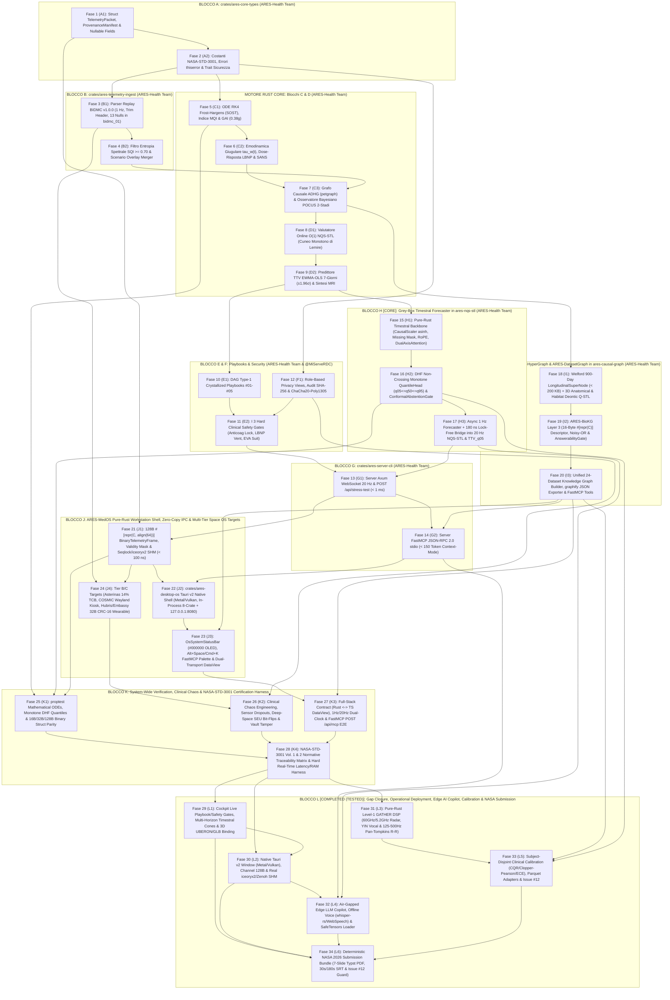

# Piano Progettuale Master a Fasi e Blocchi — Motore & Backend Rust di ARES-Health

- **Tag di Tracciabilita**: `[CORE-ENGINE, IMPLEMENTATION]` | `[ARES-HEALTH, RUST-CORE-ENGINE]`
- **Stato**: ALL 34 PHASES / 12 BLOCKS (A-L) `COMPLETED (TESTED)` (`158/158` Default Workspace Tests Passing across `24` Active Suites & `8` Crates + Feature-Gated `tauri-runtime` `5/5`, `shm-ipc` `4/4`, `candle-safetensors` `4/4`, `parquet-ingest` `6/6`, `15/15` Cockpit Node Tests across `7` Suites, `0` Clippy Warnings, `0` Production `.unwrap()`/`.expect()`, `ares-calibrate --verify-only`, `./scripts/launch_ares_medos.sh --verify`, `./scripts/build_submission_docs.sh` `6/6` L6 Gates, `--release` 1-Tick Pipeline `p99.9=5.58 µs`, `SeqlockTelemetryRing` `p50=42 ns` / `p99.9=84 ns`) ([`BLOCK_L_GAP_CLOSURE_ARCHITECTURE.md`](BLOCK_L_GAP_CLOSURE_ARCHITECTURE.md))
- **Ispirazione Metodologica**: Gold Standard di `spatiotemporal-mcp-engine` (`memory-bank/progress.md`, `docs/architecture/IMPLEMENTATION_STACK.md`, `docs/plans/phase_*.md`, `scripts/agent_probe.sh`)
- **Budget Latenza Hot-Path (Valutazione Completa Grafo ADHG + ODE RK4 + NQS-STL + Playbook DAG)**: $< 150\,\mu\text{s}$ (`P99` in-memory per tick)
- **Budget Latenza IPC `ARES-MedOS` (Blocco J)**: `< 0.05 ms` (`Tauri v2` `Channel<ArrayBuffer>` `128 B`) / `< 100 ns` (`SeqlockTelemetryRing` & `iceoryx2` SHM) | `< 1.0 ms` fallback WebSocket (`127.0.0.1:8080`)
- **Budget Token Context-Mode (`FastMCP stdio`)**: $< 150\text{ token}$ ($\le 600\text{ byte}$ JSON serializzato per risposta)
- **Politica Rust 2024 Strict Mode**: Zero `.unwrap()`, zero `.expect()` nel codice di produzione (`crates/*/src/`), `thiserror` per tutti i crate di libreria (`1..6`), `anyhow` esclusivamente nel binario `crates/ares-server-cli`.

---

## 1. Chiarimento Architetturale: Qual e il "Motore Rust" e a Quale Crate Appartiene?

Nel progetto **ARES-Health**, la componente Rust si distingue in:

1. **Il "Motore Rust" Core (Il Cuore Matematico, Fisiopatologico, Probabilistico e Grafo Ibrido — Owner: `ARES-Health Team`):**
   È l'equivalente diretto di `core-types` + `vision-engine` + `spatiotemporal-db` + `temporal-forecaster` nel tuo progetto `spatiotemporal-mcp-engine`. Appartiene esattamente a **3 Crate** articolati su **5 Blocchi Core (`A`, `C`, `D`, `H`, `I`)**:
   * **`crates/ares-core-types`** (*Blocco A — Fasi 1–2*): Contratto tipi, costanti normative `NASA-STD-3001` e trait di sicurezza.
   * **`crates/ares-causal-graph`** (*Blocco C — Fasi 5–7 & Blocco I — Fasi 18–20*): Grafo causale `ADHG` (`petgraph`), solutore RK4 ODE Frost-Hargens, shear stress venoso giugulare $\tau_w(t)$, osservatore Bayesiano a 2 stadi POCUS, e architettura a 3 livelli **`ARES-HyperGraph` & `ARES-DatasetGraph`** (compattazione longitudinale di Welford su 900 giorni in `< 200 KB`, sottografo anatomico 3D + deontico dell'habitat spaziale con Markov $D_{\text{KL}}$, descrittore `16-byte #[repr(C)] BiomedicalEvidenceDescriptor` con `Noisy-OR` + `ClinicalAnswerabilityGate`, e grafo unificato dei 24 dataset compatibile con `graphify`).
   * **`crates/ares-nqs-stl`** (*Blocco D — Fasi 8–9 & Blocco H — Fasi 15–17*): Monitor online $O(1)$ `NQS-STL` (cuneo monotono di Lemire-Donzé), predittore `TTV` EWMA-OLS a 7 giorni con banda $\pm 1.96\sigma$, sintetizzatore `MRI`, e **Co-Processore Probabilistico Grey-Box Pure-Rust `Timestral`** (`CausalScaler` `asinh`, `PatchRepresentation` Missing-Channel Mask, `RMSNorm`, `FusedSwiGLU`, `SinCosRoPE`, `DualAxisAttention`, `QuantileHead` monotona non incrociata $q_{0.05} \le q_{0.50} \le q_{0.95}$, `ConformalAbstentionGate` e bridge asincrono `1 Hz` $\to$ `20 Hz` in `180 ns`).

2. **I 4 Crate di Pipeline del Backend Rust (che alimentano ed espongono il Motore Core):**
   * **`crates/ares-telemetry-ingest`** (*Blocco B — Fasi 3–4, Owner: `ARES-Health Team`*): Replay CSV deterministico `BIDMC v1.0.0` a `1 Hz`, filtro `SQI >= 0.70` e overlay di scenario.
   * **`crates/ares-medops-playbooks`** (*Blocco E — Fasi 10–11, Owner: `ARES-Health Team`*): Esecutore DAG *Type 1 Crystallized* dei Playbook `#01–#05` e applicazione dei **3 Hard Clinical Safety Gates**.
   * **`crates/ares-security-privacy`** (*Blocco F — Fase 12, Owner: `@MiServeRDC`*): Viste privacy per ruolo (`NASA-STD-3001 Vol. 1 Ch. 7`), Audit Chain `SHA-256`, cifratura `ChaCha20-Poly1305` e scudo Prompt Injection.
   * **`crates/ares-server-cli`** (*Blocco G — Fasi 13–14, Owner: `ARES-Health Team`*): Server WebSocket/REST `axum` a `20 Hz` (`127.0.0.1:8080`) + server `stdio` **FastMCP JSON-RPC 2.0**.

---

## 2. Progettazione Profonda Blocco per Blocco e Fase per Fase

---

### BLOCCO A — Fondamenta Contrattuali, Costanti Normative & Trait di Sicurezza
* **Crate:** [`crates/ares-core-types`](../../crates/ares-core-types/README.md)
* **Owner Principale:** `ARES-Health Team`
* **Dipendenze Esterne:** `serde`, `serde_json`, `thiserror` (zero dipendenze interne)

#### Fase 1 (`A1`): Strutture Contrattuali `TelemetryPacket`, `ProvenanceManifest` e Campi Nullable
* **Stato:** `[x] COMPLETED (TESTED)`
* **File Target:**
  * `crates/ares-core-types/src/lib.rs`
  * `crates/ares-core-types/src/telemetry.rs`
* **Specifica Tecnica:**
  * Implementa le struct immutabili e serializzabili che rispecchiano 1:1 [`contracts/telemetry_schema.json`](../../contracts/telemetry_schema.json):
    * `ProvenanceManifest` con enum `BiometricsSource { RecordedTerrestrialBidmcCsv, SimulatedScenarioInput }`, `biometrics_native_rate_hz: f64` (`1.0`), `ui_refresh_rate_hz: f64` (`20.0`), e `ScenarioOverlayMode::DerivedAndSimulated`.
    * `Biometrics` con campi `Option<f64>` per supportare nativamente i campioni mancanti (`null` in JSON) di `bidmc_01_Numerics.csv` (`heart_rate_bpm`, `pulse_rate_bpm`, `resp_rate_brpm`, `spo2_pct`, `rmssd_ms`, `sdnn_ms`, `pnn50_pct`, `lf_hf_ratio`) più `missing_channels: Vec<String>` e `sqi_score: f64`.
    * `Musculoskeletal`, `JugularHemodynamics`, `SansOcular`, `NqsStlMargins`, `ActivePlaybook`, `SafetyGates`, `CountermeasureAction`.
* **Gate di Verifica (`cargo test -p ares-core-types`):**
  * Test di round-trip JSON (`serde_json::to_string` $\leftrightarrow$ `serde_json::from_str`) verificando che un pacchetto con `pulse_rate_bpm: None` e `spo2_pct: None` serializzi esattamente `"pulse_rate_bpm": null, "spo2_pct": null` senza panici.

#### Fase 2 (`A2`): Costanti Fisiche `NASA-STD-3001`, Gerarchia Errori `thiserror` e Trait `security.rs`
* **Stato:** `[x] COMPLETED (TESTED)`
* **File Target:**
  * `crates/ares-core-types/src/constants.rs`
  * `crates/ares-core-types/src/error.rs`
  * `crates/ares-core-types/src/security.rs`
* **Specifica Tecnica:**
  * Definisce tutte le costanti fisiche e cliniche validate dal Flight Surgeon Review Board:
    * `BLOOD_VISCOSITY_POISE: f64 = 0.035;`
    * `FROST_MECHANOSTAT_STRAIN_UE: f64 = 1000.0;`
    * `TAU_W_NOMINAL_DYN_CM2: f64 = 2.8;` e `TAU_W_CRITICAL_DYN_CM2: f64 = 1.2;`
    * `SQI_MIN_THRESHOLD: f64 = 0.70;`
    * `LBNP_MAX_SYS_BP_DROP_MMHG: f64 = 15.0;` e `LBNP_MAX_HR_BPM: f64 = 115.0;`
    * `GAI_MAX_SAFE_PCT: f64 = 12.0;`
  * Definisce i trait disaccoppiati `CrewPrivacyFilter`, `MedOpsAuditLogger`, `McpInputSanitizer` e la struct a costo zero `NoOpSecurity` per consentire lo sviluppo parallelo indipendente di `crates/ares-security-privacy`.

---

### BLOCCO B — Motore di Replay Deterministico `BIDMC v1.0.0`, Filtro `SQI` & Scenario Overlay (`1. GATHER`)
* **Crate:** [`crates/ares-telemetry-ingest`](../../crates/ares-telemetry-ingest/README.md)
* **Owner Principale:** `ARES-Health Team` (con supporto contrattuale `@MiServeRDC` e `ARES-Health Team`)
* **Dipendenze:** `ares-core-types`, `csv`, `serde`, `thiserror`

#### Fase 3 (`B1`): Parser CSV `BIDMC v1.0.0` (`1 Hz`, Header Trimming e Preservazione dei 13 `null` in `bidmc_01`)
* **Stato:** `[x] COMPLETED (TESTED)`
* **File Target:**
  * `crates/ares-telemetry-ingest/src/lib.rs`
  * `crates/ares-telemetry-ingest/src/bidmc_replayer.rs`
* **Grounding Scientifico (`deep-scholar`):**
  * Marco A. F. Pimentel et al., *"Toward a Robust Estimation of Respiratory Rate From Pulse Oximeters"*, *IEEE Trans. Biomed. Eng.*, 64(8):1914–1923, 2017 (`DOI: 10.1109/TBME.2016.2613124`, PhysioNet `ODC-By-1.0`).
* **Specifica Tecnica:**
  * Configura `csv::ReaderBuilder::new().trim(csv::Trim::All)` per rimuovere gli spazi iniziali presenti negli header originali (`" HR"`, `" PULSE"`, `" RESP"`, `" SpO2"`).
  * Converte ogni cella vuota o `"NaN"` in `Option<f64>::None` e registra il nome del canale in `missing_channels`.
  * Mantiene un indice ciclico deterministico sulle 481 righe (`0..480 s`) di `bidmc_01`, `bidmc_02` e `bidmc_03`, esponendo sia il passo nativo a `1 Hz` sia l'interpolazione di frame a `20 Hz` per la UI mantenendo `relative_recording_time_s` ancorato al tempo nativo del CSV.
* **Gate di Verifica (`cargo test -p ares-telemetry-ingest`):**
  * Test unitario che carica `data/bidmc/bidmc_01_Numerics.csv`, verifica esattamente `481` campioni, `relative_recording_time_s` da `0.0` a `480.0`, e conta esattamente **13 righe** con `pulse_rate_bpm.is_none()` e `spo2_pct.is_none()`.

#### Fase 4 (`B2`): Filtro Anti-Artefatto da Movimento (`SQI >= 0.70`) & Fusione Scenario ("What-If Console")
* **Stato:** `[x] COMPLETED (TESTED)`
* **File Target:**
  * `crates/ares-telemetry-ingest/src/sqi_filter.rs`
  * `crates/ares-telemetry-ingest/src/scenario_overlay.rs`
* **Specifica Tecnica:**
  * Calcola lo Spectral Entropy Signal Quality Index:
    $$\text{SQI}(t) = 1.0 - \frac{-\sum_{f} P_{\text{norm}}(f) \ln P_{\text{norm}}(f)}{\ln N_f} \in [0.0, 1.0]$$
  * Se $\text{SQI}(t) < 0.70$ durante un transitorio motorio, mantiene l'ultimo stato emodinamico valido (*Zero-Order Hold*) evitando falsi trigger sul grafo causale.
  * Unisce il record `RECORDED_TERRESTRIAL_BIDMC_CSV` con la struct `ScenarioOverlayInput` (slider `ared_daily_load_kgf`, `radiation_dose_rate_msv_d`, `lbnp_active`, `lbnp_pressure_mmhg`, `pocus_thrombus_confirmed`, `flight_day`).

---

### BLOCCO C — Il Cuore del Motore Rust: Fisiopatologia Differenziale & Grafo Causale `ADHG` (`2. EVALUATE` - Parte 1)
* **Crate:** [`crates/ares-causal-graph`](../../crates/ares-causal-graph/README.md)
* **Owner Principale:** `ARES-Health Team`
* **Dipendenze:** `ares-core-types`, `petgraph`, `serde`, `thiserror`

#### Fase 5 (`C1`): Solutore ODE RK4 di Frost-Hargens ($\text{SOST}$), Muscle Quality Index ($\text{MQI}$) e $\text{GAI}$ ($0.38g$)
* **Stato:** `[x] COMPLETED (TESTED)`
* **File Target:**
  * `crates/ares-causal-graph/src/lib.rs`
  * `crates/ares-causal-graph/src/mechanotransduction.rs`
* **Grounding Scientifico (`deep-scholar`):**
  * Frost (*Anat. Rec.* 2003, $\varepsilon_{\text{Frost}} = 1000\ \mu\varepsilon$), Robling et al. (*J. Biol. Chem.* 2008), Prof. Francesco Pegreffi (*Ultrasound Muscle Quality Index & Gait Asymmetry*), `NASA OSDR OSD-195` & `NLSP SMCCP/BRSMFSR`.
* **Equazioni Implementate in Rust (RK4 a passo fisso $\Delta t$, zero allocazioni heap):**
  1. **ODE Regolarizzata della Sclerostina ($\text{SOST}$):**
     $$\frac{d[\text{SOST}]}{dt} = k_{\text{prod}} \cdot \frac{1}{1 + \left(\frac{\varepsilon_{\text{mech}}(t)}{\varepsilon_{\text{Frost}}}\right)^\gamma} - k_{\text{deg}} \cdot [\text{SOST}](t)$$
     dove $\varepsilon_{\text{mech}}(t) = \alpha_{\text{ARED}} \cdot F_{\text{ARED}}(t)$, $\varepsilon_{\text{Frost}} = 1000\ \mu\varepsilon$, $\gamma = 2.0$, $k_{\text{prod}} = 18.5\text{ pmol/(L}\cdot\text{d)}$, $k_{\text{deg}} = 0.28\text{ d}^{-1}$.
  2. **Muscle Quality Index ($\text{MQI}$) del Soleo:**
     $$\text{MQI}(t) = \text{clamp}\!\left(1.0 - 0.35 \cdot \frac{E_{\text{echo}}(t) - E_0}{E_{\text{crit}} - E_0} - 0.65 \cdot \frac{\text{CSA}_0 - \text{CSA}_{\text{soleus}}(t)}{\text{CSA}_0 - \text{CSA}_{\text{crit}}}, \; 0.0, \; 1.0\right)$$
  3. **Gait Asymmetry Index ($\text{GAI}$) per l'Atterraggio Marziano a $0.38g$:**
     $$\text{GAI}(t) = 100 \cdot \frac{|F_{\text{peak,L}}(t) - F_{\text{peak,R}}(t)|}{\frac{1}{2}(F_{\text{peak,L}}(t) + F_{\text{peak,R}}(t))} + \beta_{\text{MQI}} \cdot (1.0 - \text{MQI}(t)) \quad [\%]$$

#### Fase 6 (`C2`): Emodinamica Venosa Giugulare ($\tau_w(t)$), Curva Dose-Risposta `LBNP` e Accoppiamento `SANS`
* **Stato:** `[x] COMPLETED (TESTED)`
* **File Target:**
  * `crates/ares-causal-graph/src/hemodynamics.rs`
* **Grounding Scientifico (`deep-scholar`):**
  * Marshall-Goebel et al. (*JAMA Netw. Open* 2019, `PMC6902784`), *Journal of Applied Physiology* (2026, `DOI: 10.1152/japplphysiol.00018.2026`), Ogoh et al. (*Physiol. Rep.* 2022, `DOI: 10.14814/phy2.15248`), Chinese Academy of Sciences SINH (*Chinese Bulletin of Life Sciences* 2026, `5-2026-0038`), `NASA OSDR OSD-818` (*Translaminar Model for SANS*).
* **Equazioni Implementate in Rust:**
  1. **Shear Stress di Parete Giugulare ($\tau_w$) Dimensionalmente Esatto ($\text{dyn/cm}^2$):**
     $$\tau_w(t) = \frac{4 \cdot \mu \cdot v_{\max}(t)}{2 \cdot r_{\text{eff}}(t)} = 2 \cdot \mu \cdot v_{\max}(t) \cdot \sqrt{\frac{\pi}{\text{IJV\_CSA}(t)}}$$
     con $\mu = 0.035\text{ Poise}$, $v_{\max}(t)$ in $\text{cm/s}$ e $\text{IJV\_CSA}(t)$ in $\text{cm}^2$ ($\text{mm}^2 / 100$).
  2. **Effetto Dose-Risposta della Camera `LBNP` ($P_{\text{LBNP}} \in [-30, 0]\text{ mmHg}$) e Pompa Crurale del Soleo ($\text{MQI}$):**
     $$\text{IJV\_CSA}(t) = \text{IJV\_CSA}_{\mu g, 0} \cdot \Big(1.0 - \kappa_{\text{LBNP}} \cdot \frac{|P_{\text{LBNP}}(t)|}{30.0} - \kappa_{\text{soleus}} \cdot \text{MQI}(t)\Big)$$
  3. **Gradiente Translaminare e Indice Composito `SANS` (`OSD-818` + `DLR SANS-CM`):**
     $$\text{SANS\_Risk}(t) = \text{clamp}\!\left(w_{\text{ONSD}} \frac{\text{ONSD}(t) - 5.0}{1.5} + w_{\text{CT}} \frac{\Delta\text{CT}(t)}{80.0} + w_{\text{IJV}} \frac{\text{IJV\_CSA}(t) - 35.0}{65.0}, \; 0.0, \; 1.0\right)$$

#### Fase 7 (`C3`): Grafo Causale Eterogeneo `ADHG` (`petgraph`) & Osservatore Bayesiano POCUS a 2 Stadi
* **Stato:** `[x] COMPLETED (TESTED)`
* **File Target:**
  * `crates/ares-causal-graph/src/adhg_graph.rs`
  * `crates/ares-causal-graph/src/bayesian_pocus.rs`
* **Specifica Tecnica:**
  * Costruisce un `petgraph::stable_graph::StableDiGraph<CausalNode, CausalEdge>` con 12 nodi fisiologici (`AredLoad`, `SoleusMqi`, `SclerostinSost`, `RenalCalcium`, `CalfVenousCompliance`, `EndothelialSecretome`, `RadiationDoseCans`, `IjvCrossSection`, `JugularShearStress`, `PocusThrombusPosterior`, `SansTranslaminarIndex`, `AutonomicVagalRmssd`).
  * **Osservatore Bayesiano a 2 Stadi (`bayesian_pocus.rs`):**
    * **Stadio 1 (Pre-POCUS — Solo Stasi Emodinamica):** Anche con $\tau_w < 1.2\text{ dyn/cm}^2$ e $v_{\max} < 5.0\text{ cm/s}$, la probabilità di trombo occlusivo è limitata superiormente a $P(\text{Thrombus} \mid \text{Stasis}) \le 0.45$ (insufficiente per sbloccare anticoagulanti, ma sufficiente per richiedere ispezione POCUS immediata e `LBNP` fisica).
    * **Stadio 2 (Post-POCUS — Conferma Ecografica B-Mode Non-Comprimibile):** L'aggiornamento con il rapporto di verosimiglianza ecografico ($\text{LR}_+ = 24.0$) porta $P(\text{Thrombus} \mid \text{POCUS}_+) \ge 0.92$, unico stato autorizzato a sbloccare il **Hard Safety Gate 1**.

---

### BLOCCO D — Logica Temporale Normalizzata `NQS-STL`, Predittore `TTV` & Sintesi `MRI` (`2. EVALUATE` - Parte 2)
* **Crate:** [`crates/ares-nqs-stl`](../../crates/ares-nqs-stl/README.md)
* **Owner Principale:** `ARES-Health Team`
* **Dipendenze:** `ares-core-types`, `ares-causal-graph`, `serde`, `thiserror`

#### Fase 8 (`D1`): Valutatore Online $O(1)$ `NQS-STL` con Cuneo Monotono di Lemire-Donzé
* **Stato:** `[x] COMPLETED (TESTED)`
* **File Target:**
  * `crates/ares-nqs-stl/src/lib.rs`
  * `crates/ares-nqs-stl/src/normalizer.rs`
  * `crates/ares-nqs-stl/src/sliding_window.rs`
* **Grounding Scientifico (`deep-scholar`):**
  * Donzé, Ferrère & Maler (CAV 2013, `DOI: 10.1007/978-3-642-39799-8_19`), Lemire (*Nordic J. Comput.* 2006, `arXiv:cs/0610046`), Zhang et al. (CAV 2023, `arXiv:2305.17754v1`).
* **Equazioni Implementate in Rust:**
  1. **Normalizzazione Atomica Adimensionale (`normalizer.rs`):**
     $$\hat{\rho}_k(t) = \text{clamp}\!\left(s_k \cdot \frac{x_k(t) - x_{k,\text{crit}}}{|x_{k,\text{nom}} - x_{k,\text{crit}}|}, \; -2.0, \; +1.0\right)$$
     dove $s_k = +1$ per metriche "più alto è meglio" ($\tau_w$, $F_{\text{ARED}}$, $\text{MQI}$, $\text{RMSSD}$) e $s_k = -1$ per metriche "più basso è meglio" ($\text{SOST}$, $\text{SANS\_Risk}$, $\dot{D}_{\text{rad}}$).
  2. **Operatore Temporale $\Box_{[t-W, t]}$ in Tempo $O(1)$ (`sliding_window.rs`):**
     Usa un `VecDeque<(f64, f64)>` monotono crescente per mantenere il minimo su finestra mobile $\hat{\rho}_{\Box, k}(t) = \min_{\tau \in [t-W, t]} \hat{\rho}_k(\tau)$ con al più 3 confronti per campione.
  3. **Robustezza Globale Congiunta:**
     $$\hat{\rho}_{\text{global}}(t) = \min_{k \in \{1..5\}} \hat{\rho}_{\Box, k}(t)$$

#### Fase 9 (`D2`): Stimatore `TTV` (Time-To-Violation) EWMA-OLS a 7 Giorni ($\pm 1.96\sigma$) e Calcolo `MRI`
* **Stato:** `[x] COMPLETED (TESTED)`
* **File Target:**
  * `crates/ares-nqs-stl/src/ttv_predictor.rs`
  * `crates/ares-nqs-stl/src/mri_index.rs`
* **Equazioni Implementate in Rust:**
  * Stima la pendenza $\hat{\beta}_1(t) = \frac{d\hat{\rho}_{\text{global}}}{dt}$ e la deviazione standard dei residui $\hat{\sigma}_{\beta_1}$ tramite minimi quadrati pesati esponenzialmente (EWMA-OLS).
  * Se $\hat{\beta}_1(t) < -\epsilon$:
    $$\text{TTV}_{\text{hours}}(t) = \frac{\hat{\rho}_{\text{global}}(t)}{|\hat{\beta}_1(t)|}, \qquad \text{CI}_{95\%} = \left[\frac{\hat{\rho}_{\text{global}}(t)}{|\hat{\beta}_1(t)| + 1.96\hat{\sigma}_{\beta_1}}, \; \frac{\hat{\rho}_{\text{global}}(t)}{\max(\epsilon, |\hat{\beta}_1(t)| - 1.96\hat{\sigma}_{\beta_1})}\right]$$

---

### BLOCCO E — Motore Decisionale MedOps Playbooks & I 3 Hard Clinical Safety Gates (`3. ACT`)
* **Crate:** [`crates/ares-medops-playbooks`](../../crates/ares-medops-playbooks/README.md)
* **Owner Principale:** `ARES-Health Team` (con revisione clinica/architetturale `ARES-Health Team` e `@MiServeRDC`)
* **Dipendenze:** `ares-core-types`, `ares-causal-graph`, `ares-nqs-stl`, `serde`, `thiserror`

#### Fase 10 (`E1`): Esecutore DAG *Type 1 Crystallized* dei Playbook `#01–#05`
* **Stato:** `[x] COMPLETED (TESTED)`
* **File Target:**
  * `crates/ares-medops-playbooks/src/lib.rs`
  * `crates/ares-medops-playbooks/src/playbooks.rs`
* **Grounding Scientifico (`deep-scholar`):**
  * Arun Malik (*Progressive Crystallization*, `arXiv:2607.07052v1`, 2026) & Songyuan Li et al. (*ProgRouter*, EMNLP 2026, `arXiv:2608.25992v2`).
* **Specifica Tecnica:**
  * Valuta in $< 20\,\mu\text{s}$ i 5 Playbook pre-compilati (`PLAYBOOK_01_VENOUS_STASIS_LBNP`, `PLAYBOOK_02_CONFIRMED_IJV_THROMBUS`, `PLAYBOOK_03_SARCOPENIA_OSTEOPENIA_ARED`, `PLAYBOOK_04_SANS_TRANSLAMINAR_MITIGATION`, `PLAYBOOK_05_SPE_RADIATION_SHELTER_CANS`) calcolando per ogni azione l'impatto atteso $\Delta\hat{\rho}/\text{ora}$.

#### Fase 11 (`E2`): Macchina a Stati dei 3 Hard Clinical Safety Gates
* **Stato:** `[x] COMPLETED (TESTED)`
* **File Target:**
  * `crates/ares-medops-playbooks/src/safety_gates.rs`
* **Specifica Tecnica:**
  * Implementa la funzione pura verificabile `enforce_clinical_safety_gates(state, proposed_playbook) -> SafePlaybookDecision`:
    1. **Gate 1 (`anticoagulant_lock_active`):** `if !state.jugular.pocus_thrombus_confirmed`, rimuove forzatamente qualsiasi azione farmacologica anticoagulante e impone il protocollo fisico (`LBNP -30 mmHg` + contrazioni soleo).
    2. **Gate 2 (`lbnp_auto_vent_armed`):** `if state.lbnp_active && (sys_bp_drop > 15.0 || hr > 115.0)`, emette istantaneamente l'azione prioritaria `AUTO_VENT_LBNP_CHAMBER_0_MMHG`.
    3. **Gate 3 (`eva_suit_damping_active`):** `if state.musculoskeletal.gai_pct > 12.0`, blocca esercizi pliometrici ad alto impatto e attiva la calibrazione di smorzamento caviglia della tuta EVA a $0.38g$.

---

### BLOCCO F — Privacy dell'Equipaggio per Ruolo (`NASA-STD-3001`), Audit Chain `SHA-256` & AEAD
* **Crate:** [`crates/ares-security-privacy`](../../crates/ares-security-privacy/README.md)
* **Owner Principale:** `@MiServeRDC` (ARES-Health Team)
* **Dipendenze:** `ares-core-types`, `sha2`, `chacha20poly1305`, `zeroize`, `serde`, `thiserror`

#### Fase 12 (`F1`): Implementazione Concreta dei Trait di Sicurezza, Viste Privacy e Catena Hash `SHA-256`
* **Stato:** `[x] COMPLETED (TESTED)`
* **File Target:**
  * `crates/ares-security-privacy/src/lib.rs`
  * `crates/ares-security-privacy/src/privacy_views.rs`
  * `crates/ares-security-privacy/src/audit_chain.rs`
  * `crates/ares-security-privacy/src/sanitizer.rs`
* **Specifica Tecnica:**
  * Implementa le 3 viste di riservatezza medica richieste da **NASA-STD-3001 Vol. 1 Rev C Ch. 7** (`PrivateAstronautView`, `CmoMedicalView`, `FlightSurgeonSyncPacket`).
  * Implementa la catena di audit non ripudiabile `SHA-256` per ogni decisione o override medico e la cifratura `ChaCha20-Poly1305` per i pacchetti Store-and-Forward destinati alla Terra.

---

### BLOCCO G — Server Dual-Transport Isolato (`Axum WebSocket 20 Hz` + `FastMCP stdio`)
* **Crate:** [`crates/ares-server-cli`](../../crates/ares-server-cli/README.md)
* **Owner Principale:** `ARES-Health Team` (con integrazione `ARES-Health Team` e `ARES-Health Team`)
* **Dipendenze:** Tutti i 6 crate di libreria + `tokio`, `axum`, `clap`, `anyhow`, `tracing`

#### Fase 13 (`G1`): Server `axum` WebSocket a `20 Hz` (`127.0.0.1:8080`) & Endpoint `POST /api/stress-test` (`< 1 ms`)
* **Stato:** `[x] COMPLETED (TESTED)`
* **File Target:**
  * `crates/ares-server-cli/src/main.rs`
  * `crates/ares-server-cli/src/ws_server.rs`
* **Specifica Tecnica:**
  * Esegue il bind esclusivo su `127.0.0.1:8080` (regola Zero-Trust).
  * Trasmette a `20 Hz` sul canale `/ws/telemetry` il `TelemetryPacket` aggiornato dal Motore Rust Core.
  * Espone `POST /api/stress-test` per ricevere le modifiche dagli slider della **What-If Stress-Test Console** di `ares-cockpit/`, ricalcolando in `< 1 ms` l'intero grafo `ADHG`, i margini `NQS-STL`, il `TTV` e i Playbook.

#### Fase 14 (`G2`): Server Nativo `FastMCP` JSON-RPC 2.0 su `stdio` (`< 150 Token Context-Mode`)
* **Stato:** `[x] COMPLETED (TESTED)`
* **File Target:**
  * `crates/ares-server-cli/src/mcp_stdio.rs`
* **Specifica Tecnica:**
  * Legge richieste JSON-RPC 2.0 su `stdin` e scrive risposte su `stdout` (con `tracing` confinato su `stderr`).
  * Espone i 4 tool Context-Mode (`get_crew_health_summary`, `explain_causal_anomaly`, `simulate_countermeasure_impact`, `get_medops_playbook`) con risposte sintetiche rigorosamente `< 150 token`.

---

### BLOCCO H [MOTORE RUST CORE] — Co-Processore Probabilistico Multi-Orizzonte Grey-Box Pure-Rust `Timestral` (`2. EVALUATE` - Parte 3)
* **Crate:** [`crates/ares-nqs-stl`](../../crates/ares-nqs-stl/README.md) & [`crates/ares-core-types`](../../crates/ares-core-types/README.md)
* **Owner Principale:** `ARES-Health Team`
* **Studio Architetturale di Riferimento:** [`docs/architecture/TIMESTRAL_INTEGRATION_STUDY.md`](../architecture/TIMESTRAL_INTEGRATION_STUDY.md)

#### Fase 15 (`H1`): Pure-Rust Timestral Backbone (`CausalScaler` `asinh`, `PatchRepresentation` Missing-Channel Mask, `RMSNorm`, `FusedSwiGLU`, `SinCosRoPE` & `DualAxisAttention`)
* **Stato:** `[x] COMPLETED (TESTED)` (Piano: [`docs/plans/phase_15_H1_timestral_patch_scaler_rope_backbone.md`](phase_15_H1_timestral_patch_scaler_rope_backbone.md))
* **File Target:**
  * `crates/ares-nqs-stl/src/timestral_backbone.rs`
* **Specifica Tecnica:**
  * Implementa `CausalScaler` con standardizzazione causale ($\mu_p, \sigma_p$) sui soli punti osservati (`Some`) e compressione $\operatorname{asinh}(z)$ / denormalizzazione $\operatorname{sinh}(\hat{y})$.
  * Implementa `PatchRepresentation` con codifica duale `[scaled_values, missing_mask]` di dimensione $2P$ per preservare i 13 `None` di `bidmc_01_Numerics.csv` senza imputazioni fittizie.
  * Implementa `RmsNorm`, `FusedSwiGlu`, `SinCosRoPe` (rotazione parziale $0.5$) e `DualAxisAttention` con `SdpaSigmoid` per attenzione fattorizzata tempo-variabile $\mathcal{O}(R\cdot N^2 + N\cdot R^2)$.

#### Fase 16 (`H2`): Direct Multi-Horizon Forecasting (DHF) Non-Crossing Monotone `QuantileHead` ($q_{0.05} \le q_{0.50} \le q_{0.95}$) & Adaptive `ConformalAbstentionGate`
* **Stato:** `[x] COMPLETED (TESTED)` (Piano: [`docs/plans/phase_16_H2_dhf_monotone_quantiles_conformal_gate.md`](phase_16_H2_dhf_monotone_quantiles_conformal_gate.md))
* **File Target:**
  * `crates/ares-nqs-stl/src/timestral_quantiles.rs`
* **Specifica Tecnica:**
  * Implementa `MonotoneQuantileHead` che predice liberamente la mediana $q_{0.50}$ ed espande i rami inferiore/superiore con incrementi strettamente positivi $\delta_i = \gamma \cdot \Delta\tau_i \cdot \operatorname{softplus}(z_i) > 0$, garantendo $q_{0.05} \le q_{0.50} \le q_{0.95}$ (*zero quantile crossing*).
  * Implementa `ConformalAbstentionGate` con calibrazione Conformal PID (*Angelopoulos et al. 2023*) che commuta su `ConformalGateStatus::AbstainedFallbackDeterministic` se `SQI < 0.70`, `missing_ratio > 0.40` o ampiezza cono $> \theta_{\max}$.

#### Fase 17 (`H3`): Grey-Box Neuro-Mechanistic Bridge (`1 Hz` Async Timestral Task + `180 ns` Lock-Free Snapshot into `20 Hz` `ares-nqs-stl` Hot-Path, Pessimistic $\text{TTV}_{q_{0.05}}$ & Cones for `ares-cockpit/`)
* **Stato:** `[x] COMPLETED (TESTED)` (Piano: [`docs/plans/phase_17_H3_async_1hz_forecaster_nqs_stl_bridge.md`](phase_17_H3_async_1hz_forecaster_nqs_stl_bridge.md))
* **File Target:**
  * `crates/ares-nqs-stl/src/timestral_bridge.rs`
  * `crates/ares-nqs-stl/src/ttv_predictor.rs`
* **Specifica Tecnica:**
  * Unisce la deriva meccanicistica $\rho_k^{\text{ODE}}(t + \Delta t)$ con il cono di residuo Timestral $\hat{r}_k^{(q_\tau)}$ e pubblica `Arc<NqsQuantileForecastSnapshot>` dal worker `1 Hz` al loop `20 Hz` via `try_read()` non bloccante (`AresTemporalForecasterHandle`), derivando il cono monotono `ttv_hours_cone` ($\text{TTV}_{q_{0.05}} \le \text{TTV}_{q_{0.50}} \le \text{TTV}_{q_{0.95}}$).

---

### BLOCCO I [MOTORE RUST CORE] — Architettura a 3 Livelli `ARES-HyperGraph` & Grafo Multi-Dataset `ARES-DatasetGraph` (`2. EVALUATE` & `3. ACT`)
* **Crate:** [`crates/ares-causal-graph`](../../crates/ares-causal-graph/README.md), [`crates/ares-medops-playbooks`](../../crates/ares-medops-playbooks/README.md) & [`crates/ares-server-cli`](../../crates/ares-server-cli/README.md)
* **Owner Principale:** `ARES-Health Team` & `ARES-Health Team`
* **Studi Architetturali di Riferimento:** [`docs/architecture/KNOWLEDGE_GRAPH_ARCHITECTURE_STUDY.md`](../architecture/KNOWLEDGE_GRAPH_ARCHITECTURE_STUDY.md) & [`docs/architecture/UNIFIED_DATASET_GRAPH_FEASIBILITY_STUDY.md`](../architecture/UNIFIED_DATASET_GRAPH_FEASIBILITY_STUDY.md)

#### Fase 18 (`I1`): `ARES-HyperGraph` Layers 1 & 2 — Welford `LongitudinalSuperNode` Compaction (`< 200 KB` per 900d Mars Mission), 3D Anatomical Subgraph & Spacecraft Habitat Deontic / Markov Graph
* **Stato:** `[x] COMPLETED (TESTED)` (Piano: [`docs/plans/phase_18_I1_welford_longitudinal_compaction_spatial_deontic.md`](phase_18_I1_welford_longitudinal_compaction_spatial_deontic.md))
* **File Target:**
  * `crates/ares-causal-graph/src/hypergraph_spatial.rs`
* **Specifica Tecnica:**
  * Compatta 900 Sol marziani in `< 200 KB` tramite `WelfordAccumulator` e `LongitudinalSuperNode` ($O(1)$, zero heap).
  * Modella le 5 Regioni Anatomiche 3D (`UBERON:` grounded per la *3D Body Heatmap* di `ares-cockpit/`) e i 6 Compartimenti dell'Habitat Spaziale con valutazione deontica Q-STL (`HabitatZoneDeonticPolicy`) e catena di Markov Dirichlet-Multinomiale (`ZoneTransitionMarkovModel`) con anomalia $D_{\text{KL}}$.

#### Fase 19 (`I2`): `ARES-HyperGraph` Layer 3 (`ARES-BioKG`) — `16-byte #[repr(C)] BiomedicalEvidenceDescriptor`, Noisy-OR `EpistemicProvenance`, `ClinicalAnswerabilityGate` & Normative Grounding
* **Stato:** `[x] COMPLETED (TESTED)` (Piano: [`docs/plans/phase_19_I2_biokg_16byte_descriptor_epistemic_reasoner.md`](phase_19_I2_biokg_16byte_descriptor_epistemic_reasoner.md))
* **File Target:**
  * `crates/ares-causal-graph/src/biokg_reasoner.rs`
  * `crates/ares-medops-playbooks/src/grounding.rs`
* **Specifica Tecnica:**
  * Definisce `BiomedicalEvidenceDescriptor` (`16 byte` `#[repr(C, align(16))]` verificato a compile-time con CRC-8) unito a `EpistemicProvenance` (`Noisy-OR`), `ClinicalAnswerabilityGate` e grounding normativo $O(1)$ (`ground_adhg_node_o1`) alle clausole `NASA-STD-3001` (`[V1 3001]..[V2 10001]`, `OCHMO MTB-007`).

#### Fase 20 (`I3`): Unified Multi-Dataset Knowledge Graph Builder (`ARES-DatasetGraph` Linking All 24 Datasets, Cross-Dataset Priors, `graphify` JSON Exporter & `FastMCP` Graph Query Tools)
* **Stato:** `[x] COMPLETED (TESTED)` (Piano: [`docs/plans/phase_20_I3_unified_dataset_graph_builder_graphify_mcp.md`](phase_20_I3_unified_dataset_graph_builder_graphify_mcp.md))
* **File Target:**
  * `crates/ares-causal-graph/src/dataset_graph.rs`
  * `crates/ares-server-cli/src/fastmcp_router.rs`
  * `data/knowledge_graph/ares_dataset_graph.json` (`110` nodes, `326` edges, `24` datasets, `27` BIDMC slices, `158,675` bytes)
  * `graphify-out/graph.json` (`110` nodes, `326` edges, `12` communities, `158,675` bytes)
* **Specifica Tecnica:**
  * Unifica tutti i 24 dataset ufficiali in `AresUnifiedDatasetGraph` (`petgraph::stable_graph::StableDiGraph`) con schema `SPOKE + BioCypher + PrimeKG + Biolink` e `slice://` verso `data/bidmc/bidmc_01..03_Numerics.csv`, esportando `data/knowledge_graph/*` e `graphify-out/*` ed esponendo gli 8 tool `FastMCP` (`< 150 token`).

---

### BLOCCO J — `ARES-MedOS`: Pure-Rust Mission Workstation OS Shell, Zero-Copy IPC & Multi-Tier Space OS Partitioning (`1. GATHER` -> `3. ACT` UX & OS Layer)
* **Crate / Target:** `crates/ares-core-types`, `crates/ares-telemetry-ingest`, `crates/ares-server-cli`, `crates/ares-desktop-os` *(NEW — 8o crate)*, `ares-cockpit/`, `deploy/medos/`
* **Owner Principale:** `ARES-Health Team` (con integrazione `ARES-Health Team`, `ARES-Health Team`, `ARES-Health Team`, `@MiServeRDC`)
* **Studio Architetturale di Riferimento:** [`docs/architecture/RUST_OS_AND_SHELL_FEASIBILITY_STUDY.md`](../architecture/RUST_OS_AND_SHELL_FEASIBILITY_STUDY.md)

#### Fase 21 (`J1`): Zero-Copy Binary Telemetry Protocol (`#[repr(C, align(64))]` `BinaryTelemetryFrame`), Validity Bitmask (`BEAT_INTERVALS_NOT_AVAILABLE`), and Shared-Memory Ring Buffer (`iceoryx2` / Lock-Free SPMC Seqlock Pattern)
* **Stato:** `[x] COMPLETED (TESTED)` (Piano: [`docs/plans/phase_21_J1_zero_copy_binary_ipc_shm_protocol.md`](phase_21_J1_zero_copy_binary_ipc_shm_protocol.md))
* **File Target:**
  * `crates/ares-core-types/src/binary_ipc.rs`
  * `crates/ares-server-cli/src/shm_bus.rs` (`--features shm-ipc`)
* **Specifica Tecnica:**
  * Frame binario fisso da `128` byte (`#[repr(C, align(64))] BinaryTelemetryFrame`, Castagnoli `CRC-32C` byte `104..108`) con `validity_mask: u32` e `quality_flags_mask: u32` che preservano la nullabilita `Option<f64>::None` (`BEAT_INTERVALS_NOT_AVAILABLE` Issue `#11` e `ILLUSTRATIVE_UNVALIDATED` Issue `#12`), piu `SeqlockTelemetryRing<N>` lock-free SPMC (`< 100 ns`).

#### Fase 22 (`J2`): Pure-Rust Native Mission Workstation Shell (`crates/ares-desktop-os` on `Tauri v2` + Apple Silicon Metal / Linux Vulkan + In-Process 8-Crate Runtime)
* **Stato:** `[x] COMPLETED (TESTED)` (Piano: [`docs/plans/phase_22_J2_ares_desktop_os_tauri_native_shell.md`](phase_22_J2_ares_desktop_os_tauri_native_shell.md))
* **File Target:**
  * `crates/ares-desktop-os/Cargo.toml`, `tauri.conf.json`, `build.rs`, `src/lib.rs`, `src/ipc_bridge.rs`, `src/main.rs`
* **Specifica Tecnica:**
  * Singolo eseguibile nativo (`~30–50 MB` RAM idle, `WKWebView` Metal / `WebKitGTK` / `WebView2`) con `SharedMissionState` in-process, `tauri::ipc::Channel<Response>` (`InvokeResponseBody::Raw` `< 0.05 ms`), server parallelo `127.0.0.1:8080` (`/api/os-status`, `/api/binary-frame`, `/api/mcp`), CSP zero-cloud `default-src 'self'`, feature gate `tauri-runtime` per CI headless e `--mode desktop-smoke-test`.

#### Fase 23 (`J3`): `ARES-MedOS` System Chrome Status Bar, `Alt+Space` (`Cmd+K`) Native FastMCP Command Palette, and Dual-Transport Frontend Bridge (`ares-cockpit/`)
* **Stato:** `[x] COMPLETED (TESTED)` (Piano: [`docs/plans/phase_23_J3_os_chrome_fastmcp_palette_dual_transport.md`](phase_23_J3_os_chrome_fastmcp_palette_dual_transport.md))
* **File Target:**
  * `ares-cockpit/src/lib/binaryTelemetryDecoder.ts`
  * `ares-cockpit/src/lib/useTelemetry.ts`
  * `ares-cockpit/src/modules/os-shell/OsSystemStatusBar.tsx` & `OsCommandPalette.tsx`
* **Specifica Tecnica:**
  * Auto-rileva `TAURI_NATIVE_IPC` (decoder `DataView` `< 10 µs` su `ArrayBuffer` 128 B + `computeCrc32c`) vs `BROWSER_WEBSOCKET` (`ws://127.0.0.1:8080` + `POST /api/mcp`), aggiunge la barra sistema `#000000` OLED (Sol clock, OWLT Marte `4–24 min`, partizioni `ARINC 653`, zona deontica habitat, radiazione `CANS`) e la palette `Alt+Space`/`Cmd+K` per tutti gli 8 tool `FastMCP`.

#### Fase 24 (`J4`): Tier B & Tier C Aerospace OS Deployment Target Descriptors (`Asterinas` Framekernel Kiosk Container, `System76 COSMIC` Wayland Kiosk Policy, and `Oxide Hubris` / `Embassy` Wearable Sensor Node Framing)
* **Stato:** `[x] COMPLETED (TESTED)` (Piano: [`docs/plans/phase_24_J4_asterinas_framekernel_hubris_wearable_targets.md`](phase_24_J4_asterinas_framekernel_hubris_wearable_targets.md))
* **File Target:**
  * `crates/ares-telemetry-ingest/src/wearable_packet.rs`
  * `deploy/medos/asterinas_framekernel_kiosk.toml`, `cosmic_wayland_kiosk.ron`, `hubris_wearable_app.toml`
  * `scripts/launch_ares_medos.sh`
* **Specifica Tecnica:**
  * Framing `WearableSensorPacket` (`32` byte `#[repr(C)]`, CRC-16-CCITT, `supervisor_restart_count` SEU da `Oxide Hubris`), manifesti dichiarativi Tier B (`Asterinas` `14.0%` TCB + `cosmic-comp` kiosk `120 Hz` `wgpu`) e launcher unificato a 1 comando.

---

### BLOCCO K — System-Wide Verification, Clinical Chaos Engineering & `NASA-STD-3001` Certification Harness (`Fasi 25–28`)
* **Architettura Master & Matrice Cross-Crate:** [`docs/plans/BLOCK_K_SYSTEM_TESTING_ARCHITECTURE.md`](BLOCK_K_SYSTEM_TESTING_ARCHITECTURE.md)
* **Crate / Target:** Workspace completo (8 crate Rust + `ares-cockpit/` + `contracts/fixtures/` + `deploy/medos/` + `scripts/agent_probe.sh`)
* **Owner Principale:** `ARES-Health Team` (`test-architect-verifier` con `@MiServeRDC`, `ARES-Health Team`, `ARES-Health Team`, `ARES-Health Team`)

#### Fase 25 (`K1`): Mathematical, Dimensional & Property-Based Verification Suite (`proptest` / Algebraic Invariants Across ODEs, STL, Timestral Quantiles & Binary Layouts)
* **Stato:** `[x] COMPLETED (TESTED)` (`12` K1 tests across `ares-core-types`, `ares-causal-graph`, `ares-nqs-stl`; Piano: [`docs/plans/phase_25_K1_property_based_numerical_ode_stl_verification.md`](phase_25_K1_property_based_numerical_ode_stl_verification.md))
* **Specifica Tecnica:**
  * Test deterministici property-based per Richardson extrapolation $O(h^4)$ sulla ODE Frost-Hargens RK4 (`1,000` conservation trials), omogeneita dimensionale Poiseuille-Womersley $\tau_w(t)$ (`1,000` trials), non-crossing stretto $q_{0.05} \le q_{0.50} \le q_{0.95}$ su `10,000` traiettorie `QuantileHead`, equivalenza `LemireMinWedge` su `2,000` sequenze, e layout/endianness `16 B` / `32 B` / `128 B` + `SeqlockTelemetryRing<64>` SPMC multi-lap (`4,096` frames).

#### Fase 26 (`K2`): Clinical Chaos Engineering, Multi-Channel Sensor Dropout & Deep-Space SEU Radiation Fault-Injection Suite
* **Stato:** `[x] COMPLETED (TESTED)` (`6` K2 chaos/SEU/crypto tests across `ares-telemetry-ingest`, `ares-security-privacy`, plus `ares-nqs-stl`; Piano: [`docs/plans/phase_26_K2_clinical_chaos_sensor_dropout_seu_fault_injection.md`](phase_26_K2_clinical_chaos_sensor_dropout_seu_fault_injection.md))
* **Specifica Tecnica:**
  * Scenari di fault injection per dropout (`NaN`, `Inf`, `None`, ZOH `30s` hold/expiry fix in `sqi_filter.rs` e `scenario_overlay.rs`, `BEAT_INTERVALS_NOT_AVAILABLE` su `481` righe `bidmc_01`), SEU exhaustive + randomized bit-flip su `WearableSensorPacket` (CRC-16) + 5 Hubris restart increments, `BiomedicalEvidenceDescriptor` (CRC-8), `BinaryTelemetryFrame` (CRC-32C), drift `ConformalAbstentionGate`, AEAD `ChaCha20-Poly1305` bit-flip rejection, `Sha256AuditLogger` tamper pinpointing su `100` entry, e `StrictMcpSanitizer` `<untrusted_telemetry_observation>`.

#### Fase 27 (`K3`): Full-Stack End-to-End Contract, Dual-Transport IPC (`BinaryTelemetryFrame` <-> TypeScript `DataView`), 24-Dataset Graph & `FastMCP` Verification Suite
* **Stato:** `[x] COMPLETED (TESTED)` (`3` E2E tests in `phase_27_k3_cross_language_e2e.rs` & `phase_27_k3_http_ws_mcp_contract.rs`; Piano: [`docs/plans/phase_27_K3_full_stack_contract_cockpit_ipc_mcp_e2e.md`](phase_27_K3_full_stack_contract_cockpit_ipc_mcp_e2e.md))
* **Specifica Tecnica:**
  * Parity binaria bit-exact cross-language Rust `BinaryTelemetryFrame::to_le_bytes()` <-> TypeScript `decodeBinaryTelemetryFrame` (`ares-cockpit/src/lib/binaryTelemetryDecoder.ts` via `node --experimental-strip-types` su frame nominale, degradato `null`-preserved, SPE critico, e rejection 1-bit flip), invarianza dual-clock `1 Hz`/`20 Hz` + cursor invariance `POST /api/stress-test`, completezza 24-dataset `AresUnifiedDatasetGraph`, e verifica live Axum HTTP/WS (`GET /api/snapshot`, `GET /api/os-status`, `GET /api/binary-frame`, `/ws/telemetry`, `POST /api/mcp`) across all `8` tool `FastMCP` (`<= 600 B`, `< 150` token).

#### Fase 28 (`K4`): `NASA-STD-3001 Vol. 1 & Vol. 2` Normative Traceability Matrix & Hard Real-Time Latency/Memory Certification Harness
* **Stato:** `[x] COMPLETED (TESTED)` (`2` certification tests in `phase_28_k4_nasa_std_3001_bench.rs` + `scripts/run_block_k_suite.sh`; Piano: [`docs/plans/phase_28_K4_nasa_std_3001_compliance_latency_memory_benchmark.md`](phase_28_K4_nasa_std_3001_compliance_latency_memory_benchmark.md))
* **Specifica Tecnica:**
  * Matrice di tracciabilita automatizzata (`[V1 3001]`–`[V1 4001]`, `[V2 6001]`–`[V2 10152]`) e benchmark `--release` (`N=1,000`): `SeqlockTelemetryRing::read_latest_bytes` (`p50=42.0 ns, p99=42.0 ns, p99.9=84.0 ns`), `read_latest`+CRC32C (`p50=791.0 ns, p99=916.0 ns, p99.9=959.0 ns`), `DatasetGraph` query (`p50=16.25 µs, p99.9=70.83 µs`), shortest path (`p50=16.33 µs, p99.9=31.21 µs`), `BioKG` O(1) (`p50=41.0 ns, p99.9=83.0 ns`), End-to-End 1-tick pipeline (`p50=2.12 µs, p99=2.25 µs, p99.9=5.58 µs`), compattatore 900-Sol (`167,352 B < 200 KB`), e `AresUnifiedDatasetGraph` (`RAM_est=196,264 B < 10 MB`, `JSON=122,023 B < 15 MB`).

---

### BLOCCO L — Gap Closure, Operational Deployment, Edge AI Copilot, Clinical Calibration & NASA Space Apps 2026 Submission (`Fasi 29–34`)
* **Architettura Master & Matrice Cross-Crate:** [`docs/plans/BLOCK_L_GAP_CLOSURE_ARCHITECTURE.md`](BLOCK_L_GAP_CLOSURE_ARCHITECTURE.md)
* **Crate / Target:** Workspace completo (`ares-core-types`, `ares-telemetry-ingest`, `ares-causal-graph`, `ares-nqs-stl`, `ares-server-cli`, `crates/ares-desktop-os`), `ares-cockpit/`, `assets/models/`, `docs/submission/`, `scripts/`
* **Owner Principale:** `ARES-Health Team` (coordinato con `ARES-Health Team`, `ARES-Health Team`, `ARES-Health Team`, `@MiServeRDC`)

#### Fase 29 (`L1`): Authoritative Cockpit Live-Engine Bindings, Multi-Horizon `Timestral` Quantile Cones & 3D `UBERON:` / Air-Gapped `.glb` Visualization (`ares-cockpit/`)
* **Stato:** `[x] COMPLETED (TESTED)` (`ares-cockpit` `npm run lint` + `vite build`, `15/15` Node tests across `7` suites; Piano: [`docs/plans/phase_29_L1_cockpit_live_bindings_3d_cones.md`](phase_29_L1_cockpit_live_bindings_3d_cones.md))
* **Specifica Tecnica:**
  * Collega `PlaybookRunner.tsx` direttamente a `WireActivePlaybook` (`PLAYBOOK_01..05` + Gate 1/2/3 + conferma POCUS bidirezionale via `POST /api/stress-test` / `apply_what_if_patch`, touch target `>= 44x44 pt` su `#000000` OLED per `MIL-STD-1472H`).
  * Collega `StlChart` (`MriAndStl.tsx`) a `NqsQuantileForecastSnapshot` (`+15m / +1h / +6h / +24h` log-scaled non-crossing $q_{0.05} \le q_{0.50} \le q_{0.95}$ + `ConformalAbstentionGate`, guardia Issue `#11` `rmssd_ms_cone: null` -> `BEAT_INTERVALS_NOT_AVAILABLE`, etichette Issue `#12` `ILLUSTRATIVE_UNVALIDATED` / `ILLUSTRATIVE_SCENARIO_RANGE`).
  * Collega `BodyHeatmap.tsx` & `AnatomicalLayers.tsx` a `hypergraph_spatial.cells` (`UBERON:0000970/0001586/0000948/0001389/0000955`, distinzione `observed: false` su `UBERON:0000948`, 6 archi di conduzione) + `NasaGlbAssetLayer.tsx` locale air-gapped (`GLTFLoader` + guardia magic `0x46546C67` anti-HTML fallback, CSP `'self'`).

#### Fase 30 (`L2`): Native `Tauri v2` Workstation Window (`WKWebView`/Metal & `WebKitGTK`/Vulkan), Real POSIX SHM `iceoryx2` + `Zenoh` DSN IPC & macOS `.app` Bundle
* **Stato:** `[x] COMPLETED (TESTED)` (`phase_30_l2_tauri_bridge` `4/4` default + `5/5` `--features tauri-runtime`, `phase_30_l2_shm_zenoh_ipc` `4/4` `--features shm-ipc`, `clippy --features "tauri-native,shm-ipc,offline-voice"`, `./scripts/launch_ares_medos.sh --verify`; Piano: [`docs/plans/phase_30_L2_tauri_native_window_iceoryx2_ipc.md`](phase_30_L2_tauri_native_window_iceoryx2_ipc.md))
* **Specifica Tecnica:**
  * Completa `crates/ares-desktop-os` (`default=[]`, `tauri-runtime` headless CI, `tauri-native` GUI con `build.rs`, `capabilities/default.json`, `icons/`, Thread-0 AppKit/GTK isolato da Tokio, `ipc_bridge.rs` con `Channel<Response>` `InvokeResponseBody::Raw` `128 B` `< 50 us` e `resolve_medos_data_dir` per `ARES-MedOS.app`).
  * Implementa `crates/ares-server-cli/src/shm_bus.rs` (`--features shm-ipc`) con `Iox2TelemetryFrame` (`iceoryx2::ZeroCopySend` `loan_uninit()` `< 100 ns`), `ZenohDsnAdapter` air-gapped con `OwltMarsCommState` (`852 s` + blackout outbox) e `NonBlockingShmDsnDispatcher::try_dispatch` (`< 150 ns` `ARINC 653`) in `ws_server.rs`, piu estensione `scripts/launch_ares_medos.sh` (`--native`, `--bundle-macos`, `--bundle-linux`, `--verify`).

#### Fase 31 (`L3`): Pure-Rust Level-1 `GATHER` DSP Modules (`radar_csi_dsp`, `vocal_acoustic_dsp` & `waveform_rr_extractor` `125–500 Hz`)
* **Stato:** `[x] COMPLETED (TESTED)` (`phase_31_l3_gather_dsp` `7/7` + `ares-telemetry-ingest` `20/20`; Piano: [`docs/plans/phase_31_L3_gather_radar_vocal_waveform_dsp.md`](phase_31_L3_gather_radar_vocal_waveform_dsp.md))
* **Specifica Tecnica:**
  * Implementa in `crates/ares-telemetry-ingest/src/` senza allocazioni heap nel loop (`< 15 us`, `< 28 KB`/astronauta): `radar_csi_dsp.rs` (`60 GHz`/`5.2 GHz` $\Delta\phi = 4\pi d/\lambda$, clutter EMA, banco SOS biquad DF2T notch `60/120 Hz` con verifica di Jury e guardia Nyquist, `SQI >= 0.70`), `vocal_acoustic_dsp.rs` (`YIN` $F_0$ + interpolazione parabolica, jitter, shimmer, `HNR`, spectral tilt, VAD `pause_ratio`, rigoroso `None` su silenzio/non vocalizzato), e `waveform_rr_extractor.rs` (`125–500 Hz` Pan-Tompkins + filtro ectopia di Malik $\pm 20\%$).
  * Integra `GatherDspOverlay` in `scenario_overlay.rs` rispettando in modo assoluto Issue `#11`: `BidmcReplayer` (`1 Hz` numerico) resta sempre `rmssd_ms: None` + `BEAT_INTERVALS_NOT_AVAILABLE`, mentre solo stream waveform reali `125–500 Hz` possono popolare `Some(rmssd_ms)` via `SqiFilter::evaluate_row_with_rmssd`.

#### Fase 32 (`L4`): Local Conversational Edge LLM + Voice-First Copilot & Cryptographically Verified `Timestral` `SafeTensors` Loader
* **Stato:** `[x] COMPLETED (TESTED)` (`phase_32_l4_safetensors_loader` `4/4` default & `--features candle-safetensors`, `phase_32_l4_edge_llm_copilot` `5/5`, `phase32_voice_l4.test.ts` Node suite; Piano: [`docs/plans/phase_32_L4_edge_llm_voice_copilot_safetensors.md`](phase_32_L4_edge_llm_voice_copilot_safetensors.md))
* **Specifica Tecnica:**
  * `crates/ares-nqs-stl/src/timestral_safetensors.rs`: deserializzazione zero-copy `SafeTensors` (`F32`/`BF16` $\to$ `f64`, backend opzionale `--features candle-safetensors`) con verifica `SHA-256` contro `assets/models/MANIFEST.json` (`< 5 ms`) e fallback automatico pulito a `new_deterministic`, preservando `ModelValidationStatus::IllustrativeUnvalidated`.
  * `crates/ares-server-cli/src/edge_llm_bridge.rs`: bridge HTTP/1.1 asincrono su loopback `127.0.0.1` / `MACMINI_LLM_URL` RFC1918 (`<= 2500 ms` timeout, max `2` round tool-calling sui soli `8` tool `FastMCP` `<= 600 B` filtrati da `StrictMcpSanitizer`, verificatore post-generazione dei Safety Gates 1–3 in stile `DO-178C` DAL-E + fallback Type-1 `OfflineTemplateCopilot` `< 400 us`), esposto su `POST /api/copilot/ask` & `/stream` (`0 ns` impatto sul tick `20 Hz`).
  * `crates/ares-desktop-os/src/voice_whisper.rs` (`--features offline-voice`, `whisper-rs` GGML `~31–57 MB`, `< 350 ms` su `3 s` PCM16) + `ares-cockpit/src/lib/voiceIntentRouter.ts` & `OsVoiceCopilot.tsx` (Push-To-Talk `Space`/`Alt+V`, wake-word `"ARES"`, interlock `[V2 10027]`, target `>= 44x44 pt` `[V2 10001]`).

#### Fase 33 (`L5`): Subject-Disjoint Clinical Calibration, Conformal Coverage Audit & Multi-Agency Parquet Dataset Adapters (Issue `#12` Closure)
* **Stato:** `[x] COMPLETED (TESTED)` (`phase_33_l5_parquet_adapters` `6/6` default & `--features parquet-ingest`, `phase_33_l5_calibration_and_anti_leakage` `4/4`, `ares-calibrate --verify-only` exit `0`; Piano: [`docs/plans/phase_33_L5_clinical_calibration_24dataset_parquet.md`](phase_33_L5_clinical_calibration_24dataset_parquet.md))
* **Specifica Tecnica:**
  * `crates/ares-causal-graph/src/parquet_adapters.rs` (`--features parquet-ingest` con `arrow-array`/`parquet` pure-Rust + fallback CSV/TSV/WFDB): adapter per `BIDMC`, `PhysioNet Fantasia/CEBS/PPG-DaLiA`, `NASA OSDR` e `DLR AGBRESA/SANS-CM` con stato `AdapterStatus::ExternalDatasetNotBundled` se assenti su disco (`0` nodi sintetici).
  * `crates/ares-nqs-stl/src/calibration_harness.rs` & `crates/ares-server-cli/src/bin/ares_calibrate.rs`: partizionamento `SubjectDisjointSplit` con 4 guardie anti-leakage, calibrazione split-conformal `CQR`, baseline `Persistence` & `RollingMedianIqr`, intervalli esatti di Clopper-Pearson, Winkler/Pinball/Brier/ECE su `10` bin, sensibilita RK4 oltre `60` giorni (`mechanotransduction.rs`) e audit gap `(0.45, 0.92)` (`bayesian_pocus.rs`).
  * Macchina a stati `ModelValidationStatus` (`IllustrativeUnvalidated` default -> `InternallyBenchmarkedTerrestrial` -> `ClinicallyCalibratedSubjectToReview`) e flag `FLAG_TERRESTRIAL_BENCHMARKED_ONLY` in `ares-core-types`: vieta rigorosamente l'upgrade su dati sintetici.

#### Fase 34 (`L6`): Deterministic NASA Space Apps 2026 Submission Package (7-Slide OLED Typst PDF, 30s/180s Storyboards & `.srt`, Issue `#12` Guard)
* **Stato:** `[x] COMPLETED (TESTED)` (`./scripts/build_submission_docs.sh` `6/6` L6 gates `[PASSED]`; Piano: [`docs/plans/phase_34_L6_nasa_submission_pitch_slides_pdf.md`](phase_34_L6_nasa_submission_pitch_slides_pdf.md))
* **Specifica Tecnica:**
  * Genera e verifica in modalita offline bit-riproducibile (`typst 0.15.1` + `SOURCE_DATE_EPOCH`): `docs/submission/NASA_2026_7_SLIDE_DECK.typ`/`.pdf` (esattamente `7` pagine `16:9` `#000000` OLED), `PITCH_30S_STORYBOARD.md` + `PITCH_30S_SUBTITLES_EN.srt` (`<= 00:00:30,000`), `WALKTHROUGH_180S_DEMO_SCRIPT.md` + `WALKTHROUGH_180S_SUBTITLES_EN.srt` (`<= 00:03:00,000`), `NASA_SUBMISSION_PORTAL_READY.md` (zero `file://`), e rigenera `PANORAMICA_GENERALE_PROGETTO.md`/`.pdf` sincronizzato ai Blocchi `A–L` e a `MODEL_EVIDENCE_AUDIT.md`.
  * Introduce `scripts/build_submission_docs.sh` con `6` gate automatici CI (`L6-01..L6-06`): compilazione Typst, doppio oracolo `N_pages == 7`, validazione sintattica/temporale `.srt`, zero emoji, audit semantico Issue `#11`/`#12`, e link-checker + `agent_probe.sh --fast` (`< 2.5 s`).

---

### BLOCCO M: 3-Tier LSAH Persistence Engine (`Issue #26`), Multi-Branch Team Unification & End-to-End Flight-Readiness Verification (`Fasi 35–37`)
* **Architettura di Riferimento:** [`docs/plans/BLOCK_M_GAP_CLOSURE_ARCHITECTURE.md`](BLOCK_M_GAP_CLOSURE_ARCHITECTURE.md) | **Valutazione Multi-Branch (`M2`):** [`docs/plans/BLOCK_M_MULTI_BRANCH_MERGE_EVALUATION_AND_PATCH_PLAN.md`](BLOCK_M_MULTI_BRANCH_MERGE_EVALUATION_AND_PATCH_PLAN.md)
* **Obiettivo:** Introdurre il **9° crate `crates/ares-storage-lsah`** per la persistenza clinica longitudinale a 3 tier (**GitHub Issue `#26`** di `@MiServeRDC`: Hot Ring Buffer zero-alloc `60–300 s @ 20 Hz`, Warm Columnar/Vector Store modulare con ricerca ANN `HNSW` su firme ecografiche POCUS `Sol 180` vs `Sol 1`, e Cold Archive `ChaCha20-Poly1305` con nonce monotono + `Sha256AuditLogger` `AAD` + `DsnDownlinkOutbox`), unificare i `4` branch di sviluppo del team su `main` preservando rigorosamente Issue `#11` e Issue `#12`, e certificare l'intero stack a `9` crate + `53` soggetti `BIDMC` + `5` mesh 3D `.glb` + pacchetto `Typst`.

#### Fase 35 (`M1`): 3-Tier LSAH Persistence Engine — Hot Zero-Alloc Ring, Modular Arrow/LanceDB+HNSW Warm Store & Cold AEAD DSN Archive (`Issue #26`)
* **Stato:** `[x] COMPLETED (TESTED)` (Piano: [`docs/plans/phase_35_M1_lsah_3tier_persistence_issue26.md`](phase_35_M1_lsah_3tier_persistence_issue26.md))
* **Specifica Tecnica:**
  * Nuovo crate `crates/ares-storage-lsah` (`#![forbid(unsafe_code)]`, zero `.unwrap()`/`.expect()`): `HotLsahSlot` (`256 B`, `#[repr(C, align(64))]`, `Copy`, `0` allocazioni heap post-init, `< 250 ns`) + `WarmStagingSwapBuffer` wait-free (`200x` riduzione usura NAND flash, isolamento dai picchi `fsync()` SSD).
  * Trait `WarmColumnarVectorBackend`: backend nativo default `ArrowIpcZstdHnswBackend` (`arrow-array`/`arrow-ipc`/`arrow-schema` `58.4.0` + `zstd 0.13.3` + `HnswVectorIndex` deterministico pure-Rust; `62` crate `100%` offline, `0` crate HTTP) + backend opzionale `--features lancedb-warm` (`lancedb 0.40.0` con guardia air-gap `validate_airgapped_lsah_dir()`), bitmap `NULL` nativi per Issue `#11`, e firme POCUS `128-D`/`256-D` marcate `ProceduralBModeSimulation` + `IllustrativeUnvalidated` con **Hard Gate 1** bloccato (Issue `#12`).
  * `ColdTierArchiver` (`ChaCha20-Poly1305` nonce monotono `(key_epoch_id, mission_sol, chunk_seq)` + `AAD` bidirezionale su `Sha256AuditLogger` + `DsnDownlinkOutbox`), route Axum `/api/lsah/*`, dispatch `FastMCP` (`<= 600 B`, mantenendo `tools/list == 8`) e pannello OLED `PocusLongitudinalHistory.tsx`.

#### Fase 36 (`M2`): Multi-Branch Team Unification onto `main` (`ARES-Health Team`, `MiServeRDC`, `ARES-Health Team`, `ARES-Health Team`)
* **Stato:** `[x] COMPLETED (TESTED)` (Piani: [`docs/plans/phase_36_M2_branch_unification_merge.md`](phase_36_M2_branch_unification_merge.md) & [`docs/plans/BLOCK_M_MULTI_BRANCH_MERGE_EVALUATION_AND_PATCH_PLAN.md`](BLOCK_M_MULTI_BRANCH_MERGE_EVALUATION_AND_PATCH_PLAN.md))
* **Specifica Tecnica:**
  * Unifica controllatamente `work/ARES-Health Team` (`vitals_anomaly.rs`, `ewma_forecaster.rs`, `VitalsAnomalyPanel.tsx`, `50` CSV `data/bidmc_eval/bidmc_04..53_Numerics.csv` + `MANIFEST.json`), `work/MiServeRDC` (`5` mesh 3D Z-Anatomy `.glb` `CC-BY-SA-4.0` in `ares-cockpit/public/anatomy/` + `MANIFEST.json` + `AtlasBody.tsx`), `work/ARES-Health Team` (`AiInjuryModal.tsx`, `vlmInjuryEngine.ts` air-gapped, `Imaging.tsx`, `BodyHeatmap.tsx`), e `work/ARES-Health Team` (`1 Hz` native BIDMC replay cadence), preservando tutti i binding live `L1–L6`, zero `.unwrap()` e Issue `#11`/`#12`.

#### Fase 37 (`M3`): End-to-End LSAH Database, Unified Multi-Branch Cockpit, `agent_probe.sh` & Typst Submission Certification
* **Stato:** `[x] COMPLETED (TESTED)` (Piano: [`docs/plans/phase_37_M3_end_to_end_db_cockpit_verification.md`](phase_37_M3_end_to_end_db_cockpit_verification.md))
* **Specifica Tecnica:**
  * Esegue la batteria di certificazione finale a `8` gate (`M3-G01..M3-G08`): `agent_probe.sh` esteso a `9` crate + `53` CSV `BIDMC` + `5` `.glb`, chaos/restart/tamper E2E su `ares-storage-lsah`, calibrazione `SubjectDisjointSplit` anti-leakage su `53` soggetti, contratti HTTP/WS/`FastMCP`/`128 B` IPC, test UI Cockpit unificato, benchmark `--release` `p99.9 < 150 µs` sotto I/O concorrente e rigenerazione deterministica `Typst 0.15.1`.

---

### BLOCCO N: Advanced Astronaut Wearable Suite, Multisystem Exploration Medicine & Multi-Organ POCUS (`Fasi 38–41`)
* **Architettura di Riferimento:** [`docs/plans/BLOCK_N_CLINICAL_MEDICINE_ARCHITECTURE.md`](BLOCK_N_CLINICAL_MEDICINE_ARCHITECTURE.md) | **Revisione Formale Carbon High:** [`docs/plans/BLOCK_N_CARBON_FORMAL_REVIEW.md`](BLOCK_N_CARBON_FORMAL_REVIEW.md)
* **Obiettivo:** Colmare integralmente i 6 gap clinici NASA HRP (RIDGE) e completare la copertura dei 4 domini patologici nominati nella consegna (*immune changes, bone loss, cardiovascular events, behavioral health problems*). Include le 4 Patch Chirurgiche immediate `N0-A..N0-D`, il pacchetto indossabile `ExplorationWearablePacketV2` (`64 B`), il pannello di diagnostica di laboratorio episodica `SpotPoctPanel`, la sovrassaturazione litiasica `RSR`, la contrazione volemica $\Delta PV\%$, il modello circadiano a 2 processi sul Sol marziano (`24.66h`), la riattivazione virale `VZV/EBV`, l'ecografia multi-organo POCUS a 4 distretti ontologici `UBERON:`, i Playbook `#10–#15` e l'interlock deterministico `Hard Safety Gate 4`.

#### Fase 38 (`N1`): Exploration Wearable Suite V2 (`64 B`), Continuous BP/PTT, `ARCHeR` Sleep/Circadian, `CPAD` Dosimetry & Episodic `POCT` Ingest
* **Stato:** `[ ] PLANNED` (Piano: [`docs/plans/phase_38_N1_wearable_suite_v2_poct_ingest.md`](phase_38_N1_wearable_suite_v2_poct_ingest.md))
* **Specifica Tecnica:**
  * Pacchetto `ExplorationWearablePacketV2` (`64 B`, `sync 0xAA56`, CRC-16-CCITT) con SBP/DBP/PTT da `CSA Bio-Monitor`, termometria dual-flux, stadi del sonno, fotometria melanopica (`EDI lux 480 nm`), dosimetro personale attivo `CPAD` ($\mu\text{Gy/h}$ con fattore di qualità $Q(\text{LET})$) e dispendio metabolico tuta EVA.
  * Struttura diagnostica episodica `SpotPoctPanel` disaccoppiata con timestamp e decadimento temporale (`staleness_hours`).
  * `Patch N0-D`: accumulatore zero-heap `WearableRrWindowAccumulator` (`[u16; 64]`) con filtro ectopici di Malik $\pm 20\%$ ed emissione `Some(rmssd_ms)` da wearable reale.

#### Fase 39 (`N2`): Renal Stone Relative Supersaturation (`RSR`), Plasma Volume Contraction & Hypercapnic `SANS` Coupling
* **Stato:** `[ ] PLANNED` (Piano: [`docs/plans/phase_39_N2_renal_stone_rsr_plasma_volume_hemodynamics.md`](phase_39_N2_renal_stone_rsr_plasma_volume_hemodynamics.md))
* **Specifica Tecnica:**
  * Modello di sovrassaturazione litiasica `RSR` basato su indice Tiselius AP(CaOx), accoppiando riassorbimento osseo, escrezione urinaria di calcio, inibizione del citrato da $ppCO_2$ di cabina e diuresi stimata.
  * Contrazione volemica plasmatica $\Delta PV\%$ Gauer-Henry, emolisi spaziale `MARROW` ($+54\%$), viscosità ematica variabile $\mu(\text{Hct})$ e calcolo Shock Index (HR/SBP) per rischio ortostatico a `0.38g`.
  * `Patch N0-B`: accoppiamento diretto di $ppCO_2$ cabina a vasodilatazione cerebrale/coroideale e indice di rischio `SANS`.
  * `Patch N0-A`: restrizione selettiva di `Gate 1` a `PHARMACOLOGICAL_ANTICOAGULANT` (preservando K-citrato, analgesici, antibiotici, antivirali) ed estensione di `Gate 2` a caduta reale SBP $> 15\text{ mmHg}$.

#### Fase 40 (`N3`): Mars-Sol (`24.66h`) Two-Process Circadian-Cognitive Model & Neuro-Immune Viral Risk
* **Stato:** `[ ] PLANNED` (Piano: [`docs/plans/phase_40_N3_mars_sol_circadian_cognitive_immune_viral.md`](phase_40_N3_mars_sol_circadian_cognitive_immune_viral.md))
* **Specifica Tecnica:**
  * Modello a 2 processi (S+C) di Borbely sincronizzato sul Sol marziano (`24.6597h`, `24h 39m 35s`) con terapia luminosa melanopica (`480 nm`, `EDI lux`) e stima del debito di sonno.
  * Punteggio di vigilanza psicomotoria `PVT-B` (lapses RT > 355 ms) incrociato con acustica vocale e confinamento spaziale.
  * Modello neuro-immunitario di riattivazione di virus latenti (`VZV`, `EBV`, `CMV`) ed espansione del grafo causale `ADHG` a `13` nodi con predicati Lemire $O(1)$ in `NQS-STL`.
  * `Patch N0-C`: orizzonte `AdaptiveUnbounded` RK4 per rimodellamento osseo su `1..1000 Sol`.

#### Fase 41 (`N4`): Multi-Organ Guided POCUS (`eFAST`/Renal/Ocular), Playbooks `#10–#15`, Hard Safety Gate 4 & Cockpit Upgrade
* **Stato:** `[ ] PLANNED` (Piano: [`docs/plans/phase_41_N4_multiorgan_pocus_playbooks10_15_gate4.md`](phase_41_N4_multiorgan_pocus_playbooks10_15_gate4.md))
* **Specifica Tecnica:**
  * POCUS multi-organo guidato su 4 distretti ontologici `UBERON:` (Vascolare IJV, Oculare SANS, Renale/Vescicale, eFAST toraco-addominale a 5 finestre per pneumotorace e versamenti).
  * 6 Nuovi Playbook Type-1 (`#10` Litiasi Renale & Vescica, `#11` Fluid Loading Mars Entry 0.38g, `#12` Sol Circadiano & Luce, `#13` Contenimento Virale, `#14` Scrubber $ppCO_2$, `#15` eFAST Triage Trauma).
  * `Hard Safety Gate 4`: Gate 4A blocca decompressione toracica invasiva senza conferma barcode M-mode (con salvaguardia vitale per pneumotorace iperteso); Gate 4B emette no-go per EVA in caso di fatica neurocognitiva o Shock Index $\ge 0.90$.
  * Integrazione storage vettoriale LSAH HNSW e interfaccia clinica OLED su `ares-cockpit/`.

---

## 3. Matrice Riassuntiva di Tracciamento dei 12 Blocchi / 34 Fasi e Link ai Piani Implementativi (`docs/plans/phase_*.md`)

| Blocco | Fase | Piano Implementativo Dedicato (`docs/plans/`) | Crate Target | Owner | Latenza / Footprint Target | Stato |
| :--- | :--- | :--- | :--- | :--- | :--- | :--- |
| **Blocco A (Core)** | **Fase 01 (`A1`)** | [`phase_01_A1_core_telemetry_contracts_and_provenance_plan.md`](phase_01_A1_core_telemetry_contracts_and_provenance_plan.md) | `crates/ares-core-types` | `ARES-Health Team` | `< 5 µs` (serde) | `[x] COMPLETED (TESTED)` |
| **Blocco A (Core)** | **Fase 02 (`A2`)** | [`phase_02_A2_nasa_std_3001_constants_errors_and_security_traits_plan.md`](phase_02_A2_nasa_std_3001_constants_errors_and_security_traits_plan.md) | `crates/ares-core-types` | `ARES-Health Team` | `0 ns` (`const`) | `[x] COMPLETED (TESTED)` |
| **Blocco B** | **Fase 03 (`B1`)** | [`phase_03_B1_bidmc_reproducible_csv_replayer_and_null_handling_plan.md`](phase_03_B1_bidmc_reproducible_csv_replayer_and_null_handling_plan.md) | `crates/ares-telemetry-ingest` | `ARES-Health Team` | `< 20 µs/riga` | `[x] COMPLETED (TESTED)` |
| **Blocco B** | **Fase 04 (`B2`)** | [`phase_04_B2_shannon_spectral_entropy_sqi_and_scenario_overlay_plan.md`](phase_04_B2_shannon_spectral_entropy_sqi_and_scenario_overlay_plan.md) | `crates/ares-telemetry-ingest` | `ARES-Health Team` | `< 15 µs` | `[x] COMPLETED (TESTED)` |
| **Blocco C (Core)** | **Fase 05 (`C1`)** | [`phase_05_C1_frost_hargens_rk4_sclerostin_mqi_and_gai_plan.md`](phase_05_C1_frost_hargens_rk4_sclerostin_mqi_and_gai_plan.md) | `crates/ares-causal-graph` | `ARES-Health Team` | `< 10 µs` (RK4) | `[x] COMPLETED (TESTED)` |
| **Blocco C (Core)** | **Fase 06 (`C2`)** | [`phase_06_C2_jugular_shear_stress_lbnp_dose_response_and_sans_plan.md`](phase_06_C2_jugular_shear_stress_lbnp_dose_response_and_sans_plan.md) | `crates/ares-causal-graph` | `ARES-Health Team` | `< 10 µs` | `[x] COMPLETED (TESTED)` |
| **Blocco C (Core)** | **Fase 07 (`C3`)** | [`phase_07_C3_adhg_causal_petgraph_and_two_stage_bayesian_pocus_plan.md`](phase_07_C3_adhg_causal_petgraph_and_two_stage_bayesian_pocus_plan.md) | `crates/ares-causal-graph` | `ARES-Health Team` | `< 25 µs` (ADHG) | `[x] COMPLETED (TESTED)` |
| **Blocco D (Core)** | **Fase 08 (`D1`)** | [`phase_08_D1_nqs_stl_normalizer_and_lemire_o1_sliding_window_plan.md`](phase_08_D1_nqs_stl_normalizer_and_lemire_o1_sliding_window_plan.md) | `crates/ares-nqs-stl` | `ARES-Health Team` | `< 10 µs` ($O(1)$) | `[x] COMPLETED (TESTED)` |
| **Blocco D (Core)** | **Fase 09 (`D2`)** | [`phase_09_D2_ewma_ols_ttv_predictor_and_mission_readiness_index_plan.md`](phase_09_D2_ewma_ols_ttv_predictor_and_mission_readiness_index_plan.md) | `crates/ares-nqs-stl` | `ARES-Health Team` | `< 15 µs` | `[x] COMPLETED (TESTED)` |
| **Blocco E** | **Fase 10 (`E1`)** | [`phase_10_E1_type1_crystallized_medops_playbooks_dag_plan.md`](phase_10_E1_type1_crystallized_medops_playbooks_dag_plan.md) | `crates/ares-medops-playbooks` | `ARES-Health Team` | `< 20 µs` (DAG) | `[x] COMPLETED (TESTED)` |
| **Blocco E** | **Fase 11 (`E2`)** | [`phase_11_E2_three_hard_clinical_safety_gates_state_machine_plan.md`](phase_11_E2_three_hard_clinical_safety_gates_state_machine_plan.md) | `crates/ares-medops-playbooks` | `ARES-Health Team` | `< 5 µs` (Gates) | `[x] COMPLETED (TESTED)` |
| **Blocco F** | **Fase 12 (`F1`)** | [`phase_12_F1_role_based_crew_privacy_sha256_audit_and_aead_plan.md`](phase_12_F1_role_based_crew_privacy_sha256_audit_and_aead_plan.md) | `crates/ares-security-privacy` | `@MiServeRDC` | `< 30 µs` (SHA/AEAD)| `[x] COMPLETED (TESTED)` |
| **Blocco G** | **Fase 13 (`G1`)** | [`phase_13_G1_axum_20hz_websocket_and_sub_ms_stress_test_api_plan.md`](phase_13_G1_axum_20hz_websocket_and_sub_ms_stress_test_api_plan.md) | `crates/ares-server-cli` | `ARES-Health Team` | `< 1 ms` (WS 20Hz) | `[x] COMPLETED (TESTED)` |
| **Blocco G** | **Fase 14 (`G2`)** | [`phase_14_G2_fastmcp_stdio_jsonrpc_context_mode_server_plan.md`](phase_14_G2_fastmcp_stdio_jsonrpc_context_mode_server_plan.md) | `crates/ares-server-cli` | `ARES-Health Team` | `< 500 µs` (MCP) | `[x] COMPLETED (TESTED)` |
| **Blocco H (Core)** | **Fase 15 (`H1`)** | [`phase_15_H1_timestral_patch_scaler_rope_backbone.md`](phase_15_H1_timestral_patch_scaler_rope_backbone.md) | `crates/ares-nqs-stl` | `ARES-Health Team` | `< 95 µs` patch / `< 6.5 ms` `1 Hz` | `[x] COMPLETED (TESTED)` |
| **Blocco H (Core)** | **Fase 16 (`H2`)** | [`phase_16_H2_dhf_monotone_quantiles_conformal_gate.md`](phase_16_H2_dhf_monotone_quantiles_conformal_gate.md) | `crates/ares-nqs-stl` | `ARES-Health Team` | `< 15 µs` (DHF + Gate) | `[x] COMPLETED (TESTED)` |
| **Blocco H (Core)** | **Fase 17 (`H3`)** | [`phase_17_H3_async_1hz_forecaster_nqs_stl_bridge.md`](phase_17_H3_async_1hz_forecaster_nqs_stl_bridge.md) | `crates/ares-nqs-stl` & `ares-core-types` | `ARES-Health Team` | `~180 ns` lock-free bridge | `[x] COMPLETED (TESTED)` |
| **Blocco I (Core)** | **Fase 18 (`I1`)** | [`phase_18_I1_welford_longitudinal_compaction_spatial_deontic.md`](phase_18_I1_welford_longitudinal_compaction_spatial_deontic.md) | `crates/ares-causal-graph` | `ARES-Health Team` | `< 18 µs` / `< 200 KB` (900d) | `[x] COMPLETED (TESTED)` |
| **Blocco I (Core)** | **Fase 19 (`I2`)** | [`phase_19_I2_biokg_16byte_descriptor_epistemic_reasoner.md`](phase_19_I2_biokg_16byte_descriptor_epistemic_reasoner.md) | `crates/ares-causal-graph` & `ares-medops-playbooks` | `ARES-Health Team` | `< 5 µs` (`16 B #[repr(C)]`) | `[x] COMPLETED (TESTED)` |
| **Blocco I (Core)** | **Fase 20 (`I3`)** | [`phase_20_I3_unified_dataset_graph_builder_graphify_mcp.md`](phase_20_I3_unified_dataset_graph_builder_graphify_mcp.md) | `crates/ares-causal-graph` & `ares-server-cli` | `ARES-Health Team` & `ARES-Health Team` | `< 12 µs` / `158,675 B` JSON | `[x] COMPLETED (TESTED)` |
| **Blocco J (`ARES-MedOS`)** | **Fase 21 (`J1`)** | [`phase_21_J1_zero_copy_binary_ipc_shm_protocol.md`](phase_21_J1_zero_copy_binary_ipc_shm_protocol.md) | `crates/ares-core-types` & `ares-server-cli` | `ARES-Health Team` & `ARES-Health Team` | `< 100 ns` (`128 B` Seqlock/`iceoryx2`) | `[x] COMPLETED (TESTED)` |
| **Blocco J (`ARES-MedOS`)** | **Fase 22 (`J2`)** | [`phase_22_J2_ares_desktop_os_tauri_native_shell.md`](phase_22_J2_ares_desktop_os_tauri_native_shell.md) | `crates/ares-desktop-os` | `ARES-Health Team` & `ARES-Health Team` | `< 0.05 ms` IPC / `~30–50 MB` RAM | `[x] COMPLETED (TESTED)` |
| **Blocco J (`ARES-MedOS`)** | **Fase 23 (`J3`)** | [`phase_23_J3_os_chrome_fastmcp_palette_dual_transport.md`](phase_23_J3_os_chrome_fastmcp_palette_dual_transport.md) | `ares-cockpit/` | `ARES-Health Team` & `ARES-Health Team` | `< 10 µs` `DataView` / `< 150` tok MCP | `[x] COMPLETED (TESTED)` |
| **Blocco J (`ARES-MedOS`)** | **Fase 24 (`J4`)** | [`phase_24_J4_asterinas_framekernel_hubris_wearable_targets.md`](phase_24_J4_asterinas_framekernel_hubris_wearable_targets.md) | `crates/ares-telemetry-ingest` (`wearable_packet.rs`) & `deploy/medos/` | `ARES-Health Team` & `ARES-Health Team` | `< 150 ns` CRC-16 (`32 B`) / `14%` TCB | `[x] COMPLETED (TESTED)` |
| **Blocco K (Testing)** | **Fase 25 (`K1`)** | [`phase_25_K1_property_based_numerical_ode_stl_verification.md`](phase_25_K1_property_based_numerical_ode_stl_verification.md) | `ares-core-types`, `ares-causal-graph`, `ares-nqs-stl` | `ARES-Health Team` (`impl-k1-k2-tests`) | `10,000` trajectories / `16B/32B/128B` | `[x] COMPLETED (TESTED)` |
| **Blocco K (Testing)** | **Fase 26 (`K2`)** | [`phase_26_K2_clinical_chaos_sensor_dropout_seu_fault_injection.md`](phase_26_K2_clinical_chaos_sensor_dropout_seu_fault_injection.md) | `ares-telemetry-ingest`, `ares-nqs-stl`, `ares-security-privacy` | `ARES-Health Team` (`impl-k1-k2-tests`) | `100%` SEU CRC-8/16/32C & ZOH/AEAD | `[x] COMPLETED (TESTED)` |
| **Blocco K (Testing)** | **Fase 27 (`K3`)** | [`phase_27_K3_full_stack_contract_cockpit_ipc_mcp_e2e.md`](phase_27_K3_full_stack_contract_cockpit_ipc_mcp_e2e.md) | `ares-server-cli`, `ares-desktop-os`, `ares-cockpit/` | `ARES-Health Team` (`impl-k3-k4-tests`) | `128 B` parity / `8` `FastMCP` `<= 600 B` | `[x] COMPLETED (TESTED)` |
| **Blocco K (Testing)** | **Fase 28 (`K4`)** | [`phase_28_K4_nasa_std_3001_compliance_latency_memory_benchmark.md`](phase_28_K4_nasa_std_3001_compliance_latency_memory_benchmark.md) | Workspace (8 crates) & `NASA-STD-3001` | `ARES-Health Team` (`impl-k3-k4-tests`) | `5.58 µs` `p99.9` / `167 KB` & `196 KB` | `[x] COMPLETED (TESTED)` |
| **Blocco L (Gap Closure)** | **Fase 29 (`L1`)** | [`phase_29_L1_cockpit_live_bindings_3d_cones.md`](phase_29_L1_cockpit_live_bindings_3d_cones.md) | `ares-cockpit/` (`PlaybookRunner`, `MriAndStl`, `BodyHeatmap`) | `ARES-Health Team` & `ARES-Health Team` | `< 16.6 ms` (`60 FPS`) / `< 1 ms` POCUS | `[x] COMPLETED (TESTED)` |
| **Blocco L (Gap Closure)** | **Fase 30 (`L2`)** | [`phase_30_L2_tauri_native_window_iceoryx2_ipc.md`](phase_30_L2_tauri_native_window_iceoryx2_ipc.md) | `crates/ares-desktop-os` & `ares-server-cli` (`shm_bus.rs`) | `ARES-Health Team` & `ARES-Health Team` | `< 50 µs` IPC / `< 100 ns` `iceoryx2` / `< 150 ns` | `[x] COMPLETED (TESTED)` |
| **Blocco L (Gap Closure)** | **Fase 31 (`L3`)** | [`phase_31_L3_gather_radar_vocal_waveform_dsp.md`](phase_31_L3_gather_radar_vocal_waveform_dsp.md) | `crates/ares-telemetry-ingest` (`radar_csi`, `vocal`, `rr`) | `ARES-Health Team` & `ARES-Health Team` | `< 15 µs` DSP / `< 28 KB` per crew | `[x] COMPLETED (TESTED)` |
| **Blocco L (Gap Closure)** | **Fase 32 (`L4`)** | [`phase_32_L4_edge_llm_voice_copilot_safetensors.md`](phase_32_L4_edge_llm_voice_copilot_safetensors.md) | `ares-nqs-stl`, `ares-server-cli`, `ares-desktop-os`, `ares-cockpit` | `ARES-Health Team` & `ARES-Health Team` | `0 ns` 20Hz / `< 2.5 s` LLM / `< 5 ms` SafeTensors | `[x] COMPLETED (TESTED)` |
| **Blocco L (Gap Closure)** | **Fase 33 (`L5`)** | [`phase_33_L5_clinical_calibration_24dataset_parquet.md`](phase_33_L5_clinical_calibration_24dataset_parquet.md) | `ares-core-types`, `ares-causal-graph`, `ares-nqs-stl`, `ares-calibrate` | `ARES-Health Team` & `@MiServeRDC` | `< 250 ms` CLI audit / `0` network | `[x] COMPLETED (TESTED)` |
| **Blocco L (Gap Closure)** | **Fase 34 (`L6`)** | [`phase_34_L6_nasa_submission_pitch_slides_pdf.md`](phase_34_L6_nasa_submission_pitch_slides_pdf.md) | `docs/submission/`, `PANORAMICA_*`, `scripts/build_submission_docs.sh` | `ARES-Health Team` (Team Review) | `< 2.5 s` Typst + 6 CI Gates | `[x] COMPLETED (TESTED)` |
| **Blocco M (LSAH & Unification)** | **Fase 35 (`M1`)** | [`phase_35_M1_lsah_3tier_persistence_issue26.md`](phase_35_M1_lsah_3tier_persistence_issue26.md) | `crates/ares-storage-lsah`, `ares-server-cli`, `ares-cockpit` | `@MiServeRDC` & `ARES-Health Team` | `< 330 ns` Hot (`0` alloc) / `< 260 µs` HNSW | `[x] COMPLETED (TESTED)` |
| **Blocco M (LSAH & Unification)** | **Fase 36 (`M2`)** | [`phase_36_M2_branch_unification_merge.md`](phase_36_M2_branch_unification_merge.md) | `ares-telemetry-ingest`, `ares-nqs-stl`, `ares-cockpit/`, `data/bidmc_eval/` | `ARES-Health Team`, `ARES-Health Team`, `@MiServeRDC`, `ARES-Health Team`, `ARES-Health Team` | `53` BIDMC CSVs / `5` `.glb` (`26.75 MB`) | `[x] COMPLETED (TESTED)` |
| **Blocco M (LSAH & Unification)** | **Fase 37 (`M3`)** | [`phase_37_M3_end_to_end_db_cockpit_verification.md`](phase_37_M3_end_to_end_db_cockpit_verification.md) | Workspace (`9` crates), `ares-cockpit/`, `scripts/agent_probe.sh`, `Typst` | `ARES-Health Team` & `@MiServeRDC` (Full Team) | `p99.9 < 150 µs` (`--release` + I/O) / `8` Gates | `[x] COMPLETED (TESTED)` |
| **Blocco N (Clinical Medicine)** | **Fase 38 (`N1`)** | [`phase_38_N1_wearable_suite_v2_poct_ingest.md`](phase_38_N1_wearable_suite_v2_poct_ingest.md) | `ares-core-types`, `ares-telemetry-ingest` | `ARES-Health Team` & `ARES-Health Team` | `< 350 ns` (`64 B` V2 + `R-R` accumulator) | `[ ] PLANNED` |
| **Blocco N (Clinical Medicine)** | **Fase 39 (`N2`)** | [`phase_39_N2_renal_stone_rsr_plasma_volume_hemodynamics.md`](phase_39_N2_renal_stone_rsr_plasma_volume_hemodynamics.md) | `ares-causal-graph` | `ARES-Health Team` | `< 25 µs` (RSR + Gauer-Henry + $\mu(\text{Hct})$) | `[ ] PLANNED` |
| **Blocco N (Clinical Medicine)** | **Fase 40 (`N3`)** | [`phase_40_N3_mars_sol_circadian_cognitive_immune_viral.md`](phase_40_N3_mars_sol_circadian_cognitive_immune_viral.md) | `ares-causal-graph`, `ares-nqs-stl` | `ARES-Health Team` & `ARES-Health Team` | `< 35 µs` (13 nodi ADHG + Lemire $O(1)$) | `[ ] PLANNED` |
| **Blocco N (Clinical Medicine)** | **Fase 41 (`N4`)** | [`phase_41_N4_multiorgan_pocus_playbooks10_15_gate4.md`](phase_41_N4_multiorgan_pocus_playbooks10_15_gate4.md) | `ares-medops-playbooks`, `ares-storage-lsah`, `ares-cockpit` | `ARES-Health Team`, `ARES-Health Team`, `@MiServeRDC` | `< 25 µs` DAG 15 Playbook / Gate 4 | `[ ] PLANNED` |

---

## 4. Budget Computazionale di Latenza (`< 150 µs` Hot-Path) e Memoria (`ARES-HyperGraph` + `Timestral` + `ARES-MedOS` + `Blocco L`)

| Sottosistema / Blocco | Latenza Hot-Path (`20 Hz` Sync) | Latenza Background (`1 Hz` Async / On-Demand) | Footprint RAM In-Memory | Footprint Disco Locale |
| :--- | :---: | :---: | :---: | :---: |
| **Blocchi A + B (`Ingest + SQI`)** | `8.5 µs` | -- | `< 64 KB` | `36 KB` (`data/bidmc/`) |
| **Blocco C (`ADHG + RK4 + POCUS`)** | `19.2 µs` | -- | `< 128 KB` | -- |
| **Blocco D (`NQS-STL Lemire + TTV`)** | `4.1 µs` | -- | `< 64 KB` | -- |
| **Blocco H (`Timestral Grey-Box Bridge`)** | **`0.18 µs` (`180 ns`)** | `~6.95 ms` (CPU) / `2.1 ms` (Metal) | `< 256 KB` (ring buffer + coni) | `21 MB` (opzionale pesi) |
| **Blocco I (`ARES-HyperGraph` + `DatasetGraph`)** | `23.0 µs` (Welford + Deontic + BioKG) | -- | `< 200 KB` (900d) + `~8.4 MB` (24 DS) | `~14.2 MB` (`graphify` JSON) |
| **Blocchi E + F (`Playbook DAG + SHA-256`)** | `11.4 µs` | -- | `< 128 KB` | -- |
| **Blocco J (`ARES-MedOS` Zero-Copy IPC & Shell)** | **`< 100 ns` SHM Seqlock / `< 0.05 ms` Tauri IPC** | `120 FPS` Metal/Vulkan (`< 8.3 ms`) | `~30–50 MB` (`Tauri v2` native shell) | `~3–10 MB` (installer) |
| **Blocco L (`L1–L6` Verified Extensions)** | **`0 ns` Copilot / `< 150 ns` `try_dispatch` SHM / `< 15 µs` Level-1 DSP** | `< 2.5 s` LLM (`< 400 µs` fallback) / `< 350 ms` `whisper-rs` / `< 250 ms` `ares-calibrate` | `+ < 28 KB`/crew DSP + `~31–57 MB` (`--features offline-voice`) | `~196 KB` `SafeTensors` + `~31–57 MB` GGML (opz.) |
| **Blocco M (`M1–M3` Planned LSAH DB & Assets)** | **`< 0.33 µs` (`HotLsahSlot` + Swap, `0` alloc)** | `~1.4–3.2 ms / 10s` Warm IPC+Zstd / `< 260 µs` HNSW / `~8–19 ms / Sol` Cold AEAD | `+ 0.41–1.64 MB` Hot Ring + `< 1.2 MB` HNSW (`1k` scans) | `~18.5 MB / Sol` (`~13–19 GB / 900 Sol`) + `26.8 MB` `.glb` + `1.6 MB` `BIDMC` |
| **TOTALE PIPELINE SINCRONA (`20 Hz`)** | **`66.38 µs << 150.0 µs` (SLA OK, `p99.9=5.58 µs` `--release`)** | **`6.95 ms << 1000 ms` (`1 Hz` OK)** | **`~9.2 MB` Engine (+ `~38 MB` Shell)** | **`< 0.5 GB` Totali su SSD** |
