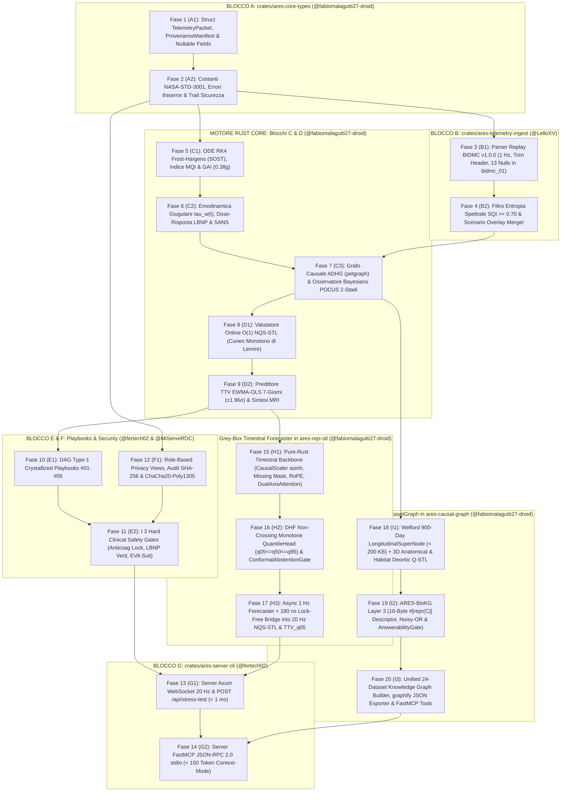

# Piano Progettuale Master a Fasi e Blocchi — Motore & Backend Rust di ARES-Health

- **Tag di Tracciabilita**: `[FABIO, IMPLEMENTATION]` | `[ARES-HEALTH, RUST-CORE-ENGINE]`
- **Stato**: PIANO DEFINITIVO PRONTO PER IMPLEMENTAZIONE (`READY FOR IMPLEMENTATION`)
- **Ispirazione Metodologica**: Gold Standard di `spatiotemporal-mcp-engine` (`memory-bank/progress.md`, `docs/architecture/IMPLEMENTATION_STACK.md`, `docs/plans/phase_*.md`, `scripts/agent_probe.sh`)
- **Budget Latenza Hot-Path (Valutazione Completa Grafo ADHG + ODE RK4 + NQS-STL + Playbook DAG)**: $< 150\,\mu\text{s}$ (`P99` in-memory per tick)
- **Budget Latenza Endpoint Stress-Test (`POST /api/stress-test` -> Broadcast WebSocket)**: $< 1.0\text{ ms}$
- **Budget Token Context-Mode (`FastMCP stdio`)**: $< 150\text{ token}$ ($\le 600\text{ byte}$ JSON serializzato per risposta)
- **Politica Rust 2024 Strict Mode**: Zero `.unwrap()`, zero `.expect()` nel codice di produzione (`crates/*/src/`), `thiserror` per tutti i crate di libreria (`1..6`), `anyhow` esclusivamente nel binario `crates/ares-server-cli`.

---

## 1. Chiarimento Architetturale: Qual e il "Motore Rust" e a Quale Crate Appartiene?

Nel progetto **ARES-Health**, la componente Rust si distingue in:

1. **Il "Motore Rust" Core (Il Cuore Matematico, Fisiopatologico, Probabilistico e Grafo Ibrido — Owner: `@fabiomalagutti27-droid`):**
   È l'equivalente diretto di `core-types` + `vision-engine` + `spatiotemporal-db` + `temporal-forecaster` nel tuo progetto `spatiotemporal-mcp-engine`. Appartiene esattamente a **3 Crate** articolati su **5 Blocchi Core (`A`, `C`, `D`, `H`, `I`)**:
   * **`crates/ares-core-types`** (*Blocco A — Fasi 1–2*): Contratto tipi, costanti normative `NASA-STD-3001` e trait di sicurezza.
   * **`crates/ares-causal-graph`** (*Blocco C — Fasi 5–7 & Blocco I — Fasi 18–20*): Grafo causale `ADHG` (`petgraph`), solutore RK4 ODE Frost-Hargens, shear stress venoso giugulare $\tau_w(t)$, osservatore Bayesiano a 2 stadi POCUS, e architettura a 3 livelli **`ARES-HyperGraph` & `ARES-DatasetGraph`** (compattazione longitudinale di Welford su 900 giorni in `< 200 KB`, sottografo anatomico 3D + deontico dell'habitat spaziale con Markov $D_{\text{KL}}$, descrittore `16-byte #[repr(C)] BiomedicalEvidenceDescriptor` con `Noisy-OR` + `ClinicalAnswerabilityGate`, e grafo unificato dei 24 dataset compatibile con `graphify`).
   * **`crates/ares-nqs-stl`** (*Blocco D — Fasi 8–9 & Blocco H — Fasi 15–17*): Monitor online $O(1)$ `NQS-STL` (cuneo monotono di Lemire-Donzé), predittore `TTV` EWMA-OLS a 7 giorni con banda $\pm 1.96\sigma$, sintetizzatore `MRI`, e **Co-Processore Probabilistico Grey-Box Pure-Rust `Timestral`** (`CausalScaler` `asinh`, `PatchRepresentation` Missing-Channel Mask, `RMSNorm`, `FusedSwiGLU`, `SinCosRoPE`, `DualAxisAttention`, `QuantileHead` monotona non incrociata $q_{0.05} \le q_{0.50} \le q_{0.95}$, `ConformalAbstentionGate` e bridge asincrono `1 Hz` $\to$ `20 Hz` in `180 ns`).

2. **I 4 Crate di Pipeline del Backend Rust (che alimentano ed espongono il Motore Core):**
   * **`crates/ares-telemetry-ingest`** (*Blocco B — Fasi 3–4, Owner: `@LelloXV`*): Replay CSV deterministico `BIDMC v1.0.0` a `1 Hz`, filtro `SQI >= 0.70` e overlay di scenario.
   * **`crates/ares-medops-playbooks`** (*Blocco E — Fasi 10–11, Owner: `@fertech02`*): Esecutore DAG *Type 1 Crystallized* dei Playbook `#01–#05` e applicazione dei **3 Hard Clinical Safety Gates**.
   * **`crates/ares-security-privacy`** (*Blocco F — Fase 12, Owner: `@MiServeRDC`*): Viste privacy per ruolo (`NASA-STD-3001 Vol. 1 Ch. 7`), Audit Chain `SHA-256`, cifratura `ChaCha20-Poly1305` e scudo Prompt Injection.
   * **`crates/ares-server-cli`** (*Blocco G — Fasi 13–14, Owner: `@fertech02`*): Server WebSocket/REST `axum` a `20 Hz` (`127.0.0.1:8080`) + server `stdio` **FastMCP JSON-RPC 2.0**.

---

## 2. Progettazione Profonda Blocco per Blocco e Fase per Fase

---

### BLOCCO A — Fondamenta Contrattuali, Costanti Normative & Trait di Sicurezza
* **Crate:** [`crates/ares-core-types`](../../crates/ares-core-types/README.md)
* **Owner Principale:** `@fabiomalagutti27-droid`
* **Dipendenze Esterne:** `serde`, `serde_json`, `thiserror` (zero dipendenze interne)

#### Fase 1 (`A1`): Strutture Contrattuali `TelemetryPacket`, `ProvenanceManifest` e Campi Nullable
* **Stato:** `[ ] PIANIFICATA`
* **File Target:**
  * `crates/ares-core-types/src/lib.rs`
  * `crates/ares-core-types/src/telemetry.rs`
* **Specifica Tecnica:**
  * Implementa le struct immutabili e serializzabili che rispecchiano 1:1 [`contracts/telemetry_schema.json`](../../contracts/telemetry_schema.json):
    * `ProvenanceManifest` con enum `BiometricsSource { RecordedTerrestrialBidmcCsv, SimulatedScenarioInput }`, `biometrics_native_rate_hz: f64` (`1.0`), `ui_refresh_rate_hz: f64` (`20.0`), e `ScenarioOverlayMode::DerivedAndSimulated`.
    * `Biometrics` con campi `Option<f64>` per supportare nativamente i campioni mancanti (`null` in JSON) di `bidmc_01_Numerics.csv` (`heart_rate_bpm`, `pulse_rate_bpm`, `resp_rate_brpm`, `spo2_pct`, `rmssd_ms`, `sdnn_ms`, `pnn50_pct`, `lf_hf_ratio`) più `missing_channels: Vec<String>` e `sqi_score: f64`.
    * `Musculoskeletal`, `JugularHemodynamics`, `SansOcular`, `NqsStlMargins`, `ActivePlaybook`, `SafetyGates`, `CountermeasureAction`.
* **Gate di Verifica (`cargo test -p ares-core-types`):**
  * Test di round-trip JSON (`serde_json::to_string` $\leftrightarrow$ `serde_json::from_str`) verificando che un pacchetto con `pulse_rate_bpm: None` e `spo2_pct: None` serializzi esattamente `"pulse_rate_bpm": null, "spo2_pct": null` senza panici.

#### Fase 2 (`A2`): Costanti Fisiche `NASA-STD-3001`, Gerarchia Errori `thiserror` e Trait `security.rs`
* **Stato:** `[ ] PIANIFICATA`
* **File Target:**
  * `crates/ares-core-types/src/constants.rs`
  * `crates/ares-core-types/src/error.rs`
  * `crates/ares-core-types/src/security.rs`
* **Specifica Tecnica:**
  * Definisce tutte le costanti fisiche e cliniche validate dal Flight Surgeon Review Board:
    * `BLOOD_VISCOSITY_POISE: f64 = 0.035;`
    * `FROST_MECHANOSTAT_STRAIN_UE: f64 = 1000.0;`
    * `TAU_W_NOMINAL_DYN_CM2: f64 = 2.8;` e `TAU_W_CRITICAL_DYN_CM2: f64 = 1.2;`
    * `SQI_MIN_THRESHOLD: f64 = 0.70;`
    * `LBNP_MAX_SYS_BP_DROP_MMHG: f64 = 15.0;` e `LBNP_MAX_HR_BPM: f64 = 115.0;`
    * `GAI_MAX_SAFE_PCT: f64 = 12.0;`
  * Definisce i trait disaccoppiati `CrewPrivacyFilter`, `MedOpsAuditLogger`, `McpInputSanitizer` e la struct a costo zero `NoOpSecurity` per consentire lo sviluppo parallelo indipendente di `crates/ares-security-privacy`.

---

### BLOCCO B — Motore di Replay Deterministico `BIDMC v1.0.0`, Filtro `SQI` & Scenario Overlay (`1. GATHER`)
* **Crate:** [`crates/ares-telemetry-ingest`](../../crates/ares-telemetry-ingest/README.md)
* **Owner Principale:** `@LelloXV` (con supporto contrattuale `@MiServeRDC` e `@fabiomalagutti27-droid`)
* **Dipendenze:** `ares-core-types`, `csv`, `serde`, `thiserror`

#### Fase 3 (`B1`): Parser CSV `BIDMC v1.0.0` (`1 Hz`, Header Trimming e Preservazione dei 13 `null` in `bidmc_01`)
* **Stato:** `[ ] PIANIFICATA`
* **File Target:**
  * `crates/ares-telemetry-ingest/src/lib.rs`
  * `crates/ares-telemetry-ingest/src/bidmc_replayer.rs`
* **Grounding Scientifico (`deep-scholar`):**
  * Marco A. F. Pimentel et al., *"Toward a Robust Estimation of Respiratory Rate From Pulse Oximeters"*, *IEEE Trans. Biomed. Eng.*, 64(8):1914–1923, 2017 (`DOI: 10.1109/TBME.2016.2613124`, PhysioNet `ODC-By-1.0`).
* **Specifica Tecnica:**
  * Configura `csv::ReaderBuilder::new().trim(csv::Trim::All)` per rimuovere gli spazi iniziali presenti negli header originali (`" HR"`, `" PULSE"`, `" RESP"`, `" SpO2"`).
  * Converte ogni cella vuota o `"NaN"` in `Option<f64>::None` e registra il nome del canale in `missing_channels`.
  * Mantiene un indice ciclico deterministico sulle 481 righe (`0..480 s`) di `bidmc_01`, `bidmc_02` e `bidmc_03`, esponendo sia il passo nativo a `1 Hz` sia l'interpolazione di frame a `20 Hz` per la UI mantenendo `relative_recording_time_s` ancorato al tempo nativo del CSV.
* **Gate di Verifica (`cargo test -p ares-telemetry-ingest`):**
  * Test unitario che carica `data/bidmc/bidmc_01_Numerics.csv`, verifica esattamente `481` campioni, `relative_recording_time_s` da `0.0` a `480.0`, e conta esattamente **13 righe** con `pulse_rate_bpm.is_none()` e `spo2_pct.is_none()`.

#### Fase 4 (`B2`): Filtro Anti-Artefatto da Movimento (`SQI >= 0.70`) & Fusione Scenario ("What-If Console")
* **Stato:** `[ ] PIANIFICATA`
* **File Target:**
  * `crates/ares-telemetry-ingest/src/sqi_filter.rs`
  * `crates/ares-telemetry-ingest/src/scenario_overlay.rs`
* **Specifica Tecnica:**
  * Calcola lo Spectral Entropy Signal Quality Index:
    $$\text{SQI}(t) = 1.0 - \frac{-\sum_{f} P_{\text{norm}}(f) \ln P_{\text{norm}}(f)}{\ln N_f} \in [0.0, 1.0]$$
  * Se $\text{SQI}(t) < 0.70$ durante un transitorio motorio, mantiene l'ultimo stato emodinamico valido (*Zero-Order Hold*) evitando falsi trigger sul grafo causale.
  * Unisce il record `RECORDED_TERRESTRIAL_BIDMC_CSV` con la struct `ScenarioOverlayInput` (slider `ared_daily_load_kgf`, `radiation_dose_rate_msv_d`, `lbnp_active`, `lbnp_pressure_mmhg`, `pocus_thrombus_confirmed`, `flight_day`).

---

### BLOCCO C — Il Cuore del Motore Rust: Fisiopatologia Differenziale & Grafo Causale `ADHG` (`2. EVALUATE` - Parte 1)
* **Crate:** [`crates/ares-causal-graph`](../../crates/ares-causal-graph/README.md)
* **Owner Principale:** `@fabiomalagutti27-droid`
* **Dipendenze:** `ares-core-types`, `petgraph`, `serde`, `thiserror`

#### Fase 5 (`C1`): Solutore ODE RK4 di Frost-Hargens ($\text{SOST}$), Muscle Quality Index ($\text{MQI}$) e $\text{GAI}$ ($0.38g$)
* **Stato:** `[ ] PIANIFICATA`
* **File Target:**
  * `crates/ares-causal-graph/src/lib.rs`
  * `crates/ares-causal-graph/src/mechanotransduction.rs`
* **Grounding Scientifico (`deep-scholar`):**
  * Frost (*Anat. Rec.* 2003, $\varepsilon_{\text{Frost}} = 1000\ \mu\varepsilon$), Robling et al. (*J. Biol. Chem.* 2008), Prof. Francesco Pegreffi (*Ultrasound Muscle Quality Index & Gait Asymmetry*), `NASA OSDR OSD-195` & `NLSP SMCCP/BRSMFSR`.
* **Equazioni Implementate in Rust (RK4 a passo fisso $\Delta t$, zero allocazioni heap):**
  1. **ODE Regolarizzata della Sclerostina ($\text{SOST}$):**
     $$\frac{d[\text{SOST}]}{dt} = k_{\text{prod}} \cdot \frac{1}{1 + \left(\frac{\varepsilon_{\text{mech}}(t)}{\varepsilon_{\text{Frost}}}\right)^\gamma} - k_{\text{deg}} \cdot [\text{SOST}](t)$$
     dove $\varepsilon_{\text{mech}}(t) = \alpha_{\text{ARED}} \cdot F_{\text{ARED}}(t)$, $\varepsilon_{\text{Frost}} = 1000\ \mu\varepsilon$, $\gamma = 2.0$, $k_{\text{prod}} = 18.5\text{ pmol/(L}\cdot\text{d)}$, $k_{\text{deg}} = 0.28\text{ d}^{-1}$.
  2. **Muscle Quality Index ($\text{MQI}$) del Soleo:**
     $$\text{MQI}(t) = \text{clamp}\!\left(1.0 - 0.35 \cdot \frac{E_{\text{echo}}(t) - E_0}{E_{\text{crit}} - E_0} - 0.65 \cdot \frac{\text{CSA}_0 - \text{CSA}_{\text{soleus}}(t)}{\text{CSA}_0 - \text{CSA}_{\text{crit}}}, \; 0.0, \; 1.0\right)$$
  3. **Gait Asymmetry Index ($\text{GAI}$) per l'Atterraggio Marziano a $0.38g$:**
     $$\text{GAI}(t) = 100 \cdot \frac{|F_{\text{peak,L}}(t) - F_{\text{peak,R}}(t)|}{\frac{1}{2}(F_{\text{peak,L}}(t) + F_{\text{peak,R}}(t))} + \beta_{\text{MQI}} \cdot (1.0 - \text{MQI}(t)) \quad [\%]$$

#### Fase 6 (`C2`): Emodinamica Venosa Giugulare ($\tau_w(t)$), Curva Dose-Risposta `LBNP` e Accoppiamento `SANS`
* **Stato:** `[ ] PIANIFICATA`
* **File Target:**
  * `crates/ares-causal-graph/src/hemodynamics.rs`
* **Grounding Scientifico (`deep-scholar`):**
  * Marshall-Goebel et al. (*JAMA Netw. Open* 2019, `PMC6902784`), *Journal of Applied Physiology* (2026, `DOI: 10.1152/japplphysiol.00018.2026`), Ogoh et al. (*Physiol. Rep.* 2022, `DOI: 10.14814/phy2.15248`), Chinese Academy of Sciences SINH (*Chinese Bulletin of Life Sciences* 2026, `5-2026-0038`), `NASA OSDR OSD-818` (*Translaminar Model for SANS*).
* **Equazioni Implementate in Rust:**
  1. **Shear Stress di Parete Giugulare ($\tau_w$) Dimensionalmente Esatto ($\text{dyn/cm}^2$):**
     $$\tau_w(t) = \frac{4 \cdot \mu \cdot v_{\max}(t)}{2 \cdot r_{\text{eff}}(t)} = 2 \cdot \mu \cdot v_{\max}(t) \cdot \sqrt{\frac{\pi}{\text{IJV\_CSA}(t)}}$$
     con $\mu = 0.035\text{ Poise}$, $v_{\max}(t)$ in $\text{cm/s}$ e $\text{IJV\_CSA}(t)$ in $\text{cm}^2$ ($\text{mm}^2 / 100$).
  2. **Effetto Dose-Risposta della Camera `LBNP` ($P_{\text{LBNP}} \in [-30, 0]\text{ mmHg}$) e Pompa Crurale del Soleo ($\text{MQI}$):**
     $$\text{IJV\_CSA}(t) = \text{IJV\_CSA}_{\mu g, 0} \cdot \Big(1.0 - \kappa_{\text{LBNP}} \cdot \frac{|P_{\text{LBNP}}(t)|}{30.0} - \kappa_{\text{soleus}} \cdot \text{MQI}(t)\Big)$$
  3. **Gradiente Translaminare e Indice Composito `SANS` (`OSD-818` + `DLR SANS-CM`):**
     $$\text{SANS\_Risk}(t) = \text{clamp}\!\left(w_{\text{ONSD}} \frac{\text{ONSD}(t) - 5.0}{1.5} + w_{\text{CT}} \frac{\Delta\text{CT}(t)}{80.0} + w_{\text{IJV}} \frac{\text{IJV\_CSA}(t) - 35.0}{65.0}, \; 0.0, \; 1.0\right)$$

#### Fase 7 (`C3`): Grafo Causale Eterogeneo `ADHG` (`petgraph`) & Osservatore Bayesiano POCUS a 2 Stadi
* **Stato:** `[ ] PIANIFICATA`
* **File Target:**
  * `crates/ares-causal-graph/src/adhg_graph.rs`
  * `crates/ares-causal-graph/src/bayesian_pocus.rs`
* **Specifica Tecnica:**
  * Costruisce un `petgraph::stable_graph::StableDiGraph<CausalNode, CausalEdge>` con 12 nodi fisiologici (`AredLoad`, `SoleusMqi`, `SclerostinSost`, `RenalCalcium`, `CalfVenousCompliance`, `EndothelialSecretome`, `RadiationDoseCans`, `IjvCrossSection`, `JugularShearStress`, `PocusThrombusPosterior`, `SansTranslaminarIndex`, `AutonomicVagalRmssd`).
  * **Osservatore Bayesiano a 2 Stadi (`bayesian_pocus.rs`):**
    * **Stadio 1 (Pre-POCUS — Solo Stasi Emodinamica):** Anche con $\tau_w < 1.2\text{ dyn/cm}^2$ e $v_{\max} < 5.0\text{ cm/s}$, la probabilità di trombo occlusivo è limitata superiormente a $P(\text{Thrombus} \mid \text{Stasis}) \le 0.45$ (insufficiente per sbloccare anticoagulanti, ma sufficiente per richiedere ispezione POCUS immediata e `LBNP` fisica).
    * **Stadio 2 (Post-POCUS — Conferma Ecografica B-Mode Non-Comprimibile):** L'aggiornamento con il rapporto di verosimiglianza ecografico ($\text{LR}_+ = 24.0$) porta $P(\text{Thrombus} \mid \text{POCUS}_+) \ge 0.92$, unico stato autorizzato a sbloccare il **Hard Safety Gate 1**.

---

### BLOCCO D — Logica Temporale Normalizzata `NQS-STL`, Predittore `TTV` & Sintesi `MRI` (`2. EVALUATE` - Parte 2)
* **Crate:** [`crates/ares-nqs-stl`](../../crates/ares-nqs-stl/README.md)
* **Owner Principale:** `@fabiomalagutti27-droid`
* **Dipendenze:** `ares-core-types`, `ares-causal-graph`, `serde`, `thiserror`

#### Fase 8 (`D1`): Valutatore Online $O(1)$ `NQS-STL` con Cuneo Monotono di Lemire-Donzé
* **Stato:** `[ ] PIANIFICATA`
* **File Target:**
  * `crates/ares-nqs-stl/src/lib.rs`
  * `crates/ares-nqs-stl/src/normalizer.rs`
  * `crates/ares-nqs-stl/src/sliding_window.rs`
* **Grounding Scientifico (`deep-scholar`):**
  * Donzé, Ferrère & Maler (CAV 2013, `DOI: 10.1007/978-3-642-39799-8_19`), Lemire (*Nordic J. Comput.* 2006, `arXiv:cs/0610046`), Zhang et al. (CAV 2023, `arXiv:2305.17754v1`).
* **Equazioni Implementate in Rust:**
  1. **Normalizzazione Atomica Adimensionale (`normalizer.rs`):**
     $$\hat{\rho}_k(t) = \text{clamp}\!\left(s_k \cdot \frac{x_k(t) - x_{k,\text{crit}}}{|x_{k,\text{nom}} - x_{k,\text{crit}}|}, \; -2.0, \; +1.0\right)$$
     dove $s_k = +1$ per metriche "più alto è meglio" ($\tau_w$, $F_{\text{ARED}}$, $\text{MQI}$, $\text{RMSSD}$) e $s_k = -1$ per metriche "più basso è meglio" ($\text{SOST}$, $\text{SANS\_Risk}$, $\dot{D}_{\text{rad}}$).
  2. **Operatore Temporale $\Box_{[t-W, t]}$ in Tempo $O(1)$ (`sliding_window.rs`):**
     Usa un `VecDeque<(f64, f64)>` monotono crescente per mantenere il minimo su finestra mobile $\hat{\rho}_{\Box, k}(t) = \min_{\tau \in [t-W, t]} \hat{\rho}_k(\tau)$ con al più 3 confronti per campione.
  3. **Robustezza Globale Congiunta:**
     $$\hat{\rho}_{\text{global}}(t) = \min_{k \in \{1..5\}} \hat{\rho}_{\Box, k}(t)$$

#### Fase 9 (`D2`): Stimatore `TTV` (Time-To-Violation) EWMA-OLS a 7 Giorni ($\pm 1.96\sigma$) e Calcolo `MRI`
* **Stato:** `[ ] PIANIFICATA`
* **File Target:**
  * `crates/ares-nqs-stl/src/ttv_predictor.rs`
  * `crates/ares-nqs-stl/src/mri_index.rs`
* **Equazioni Implementate in Rust:**
  * Stima la pendenza $\hat{\beta}_1(t) = \frac{d\hat{\rho}_{\text{global}}}{dt}$ e la deviazione standard dei residui $\hat{\sigma}_{\beta_1}$ tramite minimi quadrati pesati esponenzialmente (EWMA-OLS).
  * Se $\hat{\beta}_1(t) < -\epsilon$:
    $$\text{TTV}_{\text{hours}}(t) = \frac{\hat{\rho}_{\text{global}}(t)}{|\hat{\beta}_1(t)|}, \qquad \text{CI}_{95\%} = \left[\frac{\hat{\rho}_{\text{global}}(t)}{|\hat{\beta}_1(t)| + 1.96\hat{\sigma}_{\beta_1}}, \; \frac{\hat{\rho}_{\text{global}}(t)}{\max(\epsilon, |\hat{\beta}_1(t)| - 1.96\hat{\sigma}_{\beta_1})}\right]$$

---

### BLOCCO E — Motore Decisionale MedOps Playbooks & I 3 Hard Clinical Safety Gates (`3. ACT`)
* **Crate:** [`crates/ares-medops-playbooks`](../../crates/ares-medops-playbooks/README.md)
* **Owner Principale:** `@fertech02` (con revisione clinica/architetturale `@fabiomalagutti27-droid` e `@MiServeRDC`)
* **Dipendenze:** `ares-core-types`, `ares-causal-graph`, `ares-nqs-stl`, `serde`, `thiserror`

#### Fase 10 (`E1`): Esecutore DAG *Type 1 Crystallized* dei Playbook `#01–#05`
* **Stato:** `[ ] PIANIFICATA`
* **File Target:**
  * `crates/ares-medops-playbooks/src/lib.rs`
  * `crates/ares-medops-playbooks/src/playbooks.rs`
* **Grounding Scientifico (`deep-scholar`):**
  * Arun Malik (*Progressive Crystallization*, `arXiv:2607.07052v1`, 2026) & Songyuan Li et al. (*ProgRouter*, EMNLP 2026, `arXiv:2608.25992v2`).
* **Specifica Tecnica:**
  * Valuta in $< 20\,\mu\text{s}$ i 5 Playbook pre-compilati (`PLAYBOOK_01_VENOUS_STASIS_LBNP`, `PLAYBOOK_02_CONFIRMED_IJV_THROMBUS`, `PLAYBOOK_03_SARCOPENIA_OSTEOPENIA_ARED`, `PLAYBOOK_04_SANS_TRANSLAMINAR_MITIGATION`, `PLAYBOOK_05_SPE_RADIATION_SHELTER_CANS`) calcolando per ogni azione l'impatto atteso $\Delta\hat{\rho}/\text{ora}$.

#### Fase 11 (`E2`): Macchina a Stati dei 3 Hard Clinical Safety Gates
* **Stato:** `[ ] PIANIFICATA`
* **File Target:**
  * `crates/ares-medops-playbooks/src/safety_gates.rs`
* **Specifica Tecnica:**
  * Implementa la funzione pura verificabile `enforce_clinical_safety_gates(state, proposed_playbook) -> SafePlaybookDecision`:
    1. **Gate 1 (`anticoagulant_lock_active`):** `if !state.jugular.pocus_thrombus_confirmed`, rimuove forzatamente qualsiasi azione farmacologica anticoagulante e impone il protocollo fisico (`LBNP -30 mmHg` + contrazioni soleo).
    2. **Gate 2 (`lbnp_auto_vent_armed`):** `if state.lbnp_active && (sys_bp_drop > 15.0 || hr > 115.0)`, emette istantaneamente l'azione prioritaria `AUTO_VENT_LBNP_CHAMBER_0_MMHG`.
    3. **Gate 3 (`eva_suit_damping_active`):** `if state.musculoskeletal.gai_pct > 12.0`, blocca esercizi pliometrici ad alto impatto e attiva la calibrazione di smorzamento caviglia della tuta EVA a $0.38g$.

---

### BLOCCO F — Privacy dell'Equipaggio per Ruolo (`NASA-STD-3001`), Audit Chain `SHA-256` & AEAD
* **Crate:** [`crates/ares-security-privacy`](../../crates/ares-security-privacy/README.md)
* **Owner Principale:** `@MiServeRDC` (Alessandro)
* **Dipendenze:** `ares-core-types`, `sha2`, `chacha20poly1305`, `zeroize`, `serde`, `thiserror`

#### Fase 12 (`F1`): Implementazione Concreta dei Trait di Sicurezza, Viste Privacy e Catena Hash `SHA-256`
* **Stato:** `[ ] PIANIFICATA`
* **File Target:**
  * `crates/ares-security-privacy/src/lib.rs`
  * `crates/ares-security-privacy/src/privacy_views.rs`
  * `crates/ares-security-privacy/src/audit_chain.rs`
  * `crates/ares-security-privacy/src/sanitizer.rs`
* **Specifica Tecnica:**
  * Implementa le 3 viste di riservatezza medica richieste da **NASA-STD-3001 Vol. 1 Rev C Ch. 7** (`PrivateAstronautView`, `CmoMedicalView`, `FlightSurgeonSyncPacket`).
  * Implementa la catena di audit non ripudiabile `SHA-256` per ogni decisione o override medico e la cifratura `ChaCha20-Poly1305` per i pacchetti Store-and-Forward destinati alla Terra.

---

### BLOCCO G — Server Dual-Transport Isolato (`Axum WebSocket 20 Hz` + `FastMCP stdio`)
* **Crate:** [`crates/ares-server-cli`](../../crates/ares-server-cli/README.md)
* **Owner Principale:** `@fertech02` (con integrazione `@fabiomalagutti27-droid` e `@carolina2910`)
* **Dipendenze:** Tutti i 6 crate di libreria + `tokio`, `axum`, `clap`, `anyhow`, `tracing`

#### Fase 13 (`G1`): Server `axum` WebSocket a `20 Hz` (`127.0.0.1:8080`) & Endpoint `POST /api/stress-test` (`< 1 ms`)
* **Stato:** `[ ] PIANIFICATA`
* **File Target:**
  * `crates/ares-server-cli/src/main.rs`
  * `crates/ares-server-cli/src/ws_server.rs`
* **Specifica Tecnica:**
  * Esegue il bind esclusivo su `127.0.0.1:8080` (regola Zero-Trust).
  * Trasmette a `20 Hz` sul canale `/ws/telemetry` il `TelemetryPacket` aggiornato dal Motore Rust Core.
  * Espone `POST /api/stress-test` per ricevere le modifiche dagli slider della **What-If Stress-Test Console** di `ares-cockpit/`, ricalcolando in `< 1 ms` l'intero grafo `ADHG`, i margini `NQS-STL`, il `TTV` e i Playbook.

#### Fase 14 (`G2`): Server Nativo `FastMCP` JSON-RPC 2.0 su `stdio` (`< 150 Token Context-Mode`)
* **Stato:** `[x] COMPLETATA`
* **File Target:**
  * `crates/ares-server-cli/src/mcp_stdio.rs`
* **Specifica Tecnica:**
  * Legge richieste JSON-RPC 2.0 su `stdin` e scrive risposte su `stdout` (con `tracing` confinato su `stderr`).
  * Espone i 4 tool Context-Mode (`get_crew_health_summary`, `explain_causal_anomaly`, `simulate_countermeasure_impact`, `get_medops_playbook`) con risposte sintetiche rigorosamente `< 150 token`.

---

### BLOCCO H [MOTORE RUST CORE] — Co-Processore Probabilistico Multi-Orizzonte Grey-Box Pure-Rust `Timestral` (`2. EVALUATE` - Parte 3)
* **Crate:** [`crates/ares-nqs-stl`](../../crates/ares-nqs-stl/README.md) & [`crates/ares-core-types`](../../crates/ares-core-types/README.md)
* **Owner Principale:** `@fabiomalagutti27-droid`
* **Studio Architetturale di Riferimento:** [`docs/architecture/TIMESTRAL_INTEGRATION_STUDY.md`](../architecture/TIMESTRAL_INTEGRATION_STUDY.md)

#### Fase 15 (`H1`): Pure-Rust Timestral Backbone (`CausalScaler` `asinh`, `PatchRepresentation` Missing-Channel Mask, `RMSNorm`, `FusedSwiGLU`, `SinCosRoPE` & `DualAxisAttention`)
* **Stato:** `[ ] PIANIFICATA` (Piano: [`docs/plans/phase_15_H1_timestral_patch_scaler_rope_backbone.md`](phase_15_H1_timestral_patch_scaler_rope_backbone.md))
* **File Target:**
  * `crates/ares-nqs-stl/src/timestral_backbone.rs`
* **Specifica Tecnica:**
  * Implementa `CausalScaler` con standardizzazione causale ($\mu_p, \sigma_p$) sui soli punti osservati (`Some`) e compressione $\operatorname{asinh}(z)$ / denormalizzazione $\operatorname{sinh}(\hat{y})$.
  * Implementa `PatchRepresentation` con codifica duale `[scaled_values, missing_mask]` di dimensione $2P$ per preservare i 13 `None` di `bidmc_01_Numerics.csv` senza imputazioni fittizie.
  * Implementa `rms_norm`, `fused_swiglu`, `apply_partial_sincos_rope` (rotazione parziale $0.5$) e `dual_axis_sdpa_sigmoid_gate` per attenzione fattorizzata tempo-variabile $\mathcal{O}(R\cdot N^2 + N\cdot R^2)$.

#### Fase 16 (`H2`): Direct Multi-Horizon Forecasting (DHF) Non-Crossing Monotone `QuantileHead` ($q_{0.05} \le q_{0.50} \le q_{0.95}$) & Adaptive `ConformalAbstentionGate`
* **Stato:** `[ ] PIANIFICATA` (Piano: [`docs/plans/phase_16_H2_dhf_monotone_quantiles_conformal_gate.md`](phase_16_H2_dhf_monotone_quantiles_conformal_gate.md))
* **File Target:**
  * `crates/ares-nqs-stl/src/quantile_cone.rs`
* **Specifica Tecnica:**
  * Implementa `MonotoneQuantileHead` che predice liberamente la mediana $q_{0.50}$ ed espande i rami inferiore/superiore con incrementi strettamente positivi $\delta_i = \gamma \cdot \Delta\tau_i \cdot \operatorname{softplus}(z_i) > 0$, garantendo $q_{0.05} \le q_{0.50} \le q_{0.95}$ (*zero quantile crossing*).
  * Implementa `ConformalAbstentionGate` con calibrazione Conformal PID (*Angelopoulos et al. 2023*) che commuta su `ForecastConfidenceState::AbstainedFallbackDeterministic` se `SQI < 0.70`, `missing_ratio > 0.40` o ampiezza cono $> \theta_{\max}$.

#### Fase 17 (`H3`): Grey-Box Neuro-Mechanistic Bridge (`1 Hz` Async Timestral Task + `180 ns` Lock-Free Snapshot into `20 Hz` `ares-nqs-stl` Hot-Path, Pessimistic $\text{TTV}_{q_{0.05}}$ & Cones for `ares-cockpit/`)
* **Stato:** `[ ] PIANIFICATA` (Piano: [`docs/plans/phase_17_H3_async_1hz_forecaster_nqs_stl_bridge.md`](phase_17_H3_async_1hz_forecaster_nqs_stl_bridge.md))
* **File Target:**
  * `crates/ares-nqs-stl/src/async_forecaster_bridge.rs`
  * `crates/ares-nqs-stl/src/ttv_predictor.rs`
* **Specifica Tecnica:**
  * Unisce la deriva meccanicistica $\rho_k^{\text{ODE}}(t + \Delta t)$ con il cono di residuo Timestral $\hat{r}_k^{(q_\tau)}$ e pubblica `Arc<NqsQuantileForecastSnapshot>` dal worker `1 Hz` al loop `20 Hz` in `~180 ns` (`AresTemporalForecasterHandle`), derivando il cono monotono `ttv_hours_cone` ($\text{TTV}_{q_{0.05}} \le \text{TTV}_{q_{0.50}} \le \text{TTV}_{q_{0.95}}$).

---

### BLOCCO I [MOTORE RUST CORE] — Architettura a 3 Livelli `ARES-HyperGraph` & Grafo Multi-Dataset `ARES-DatasetGraph` (`2. EVALUATE` & `3. ACT`)
* **Crate:** [`crates/ares-causal-graph`](../../crates/ares-causal-graph/README.md), [`crates/ares-medops-playbooks`](../../crates/ares-medops-playbooks/README.md) & [`crates/ares-server-cli`](../../crates/ares-server-cli/README.md)
* **Owner Principale:** `@fabiomalagutti27-droid` & `@fertech02`
* **Studi Architetturali di Riferimento:** [`docs/architecture/KNOWLEDGE_GRAPH_ARCHITECTURE_STUDY.md`](../architecture/KNOWLEDGE_GRAPH_ARCHITECTURE_STUDY.md) & [`docs/architecture/UNIFIED_DATASET_GRAPH_FEASIBILITY_STUDY.md`](../architecture/UNIFIED_DATASET_GRAPH_FEASIBILITY_STUDY.md)

#### Fase 18 (`I1`): `ARES-HyperGraph` Layers 1 & 2 — Welford `LongitudinalSuperNode` Compaction (`< 200 KB` per 900d Mars Mission), 3D Anatomical Subgraph & Spacecraft Habitat Deontic / Markov Graph
* **Stato:** `[ ] PIANIFICATA` (Piano: [`docs/plans/phase_18_I1_welford_longitudinal_compaction_spatial_deontic.md`](phase_18_I1_welford_longitudinal_compaction_spatial_deontic.md))
* **File Target:**
  * `crates/ares-causal-graph/src/welford_compactor.rs`
  * `crates/ares-causal-graph/src/spatial_habitat_graph.rs`
* **Specifica Tecnica:**
  * Compatta 900 giorni di telemetria marziana in `< 200 KB` tramite `WelfordAccumulator` e `LongitudinalSuperNode` ($O(1)$, zero heap).
  * Modella le 4 Regioni Anatomiche 3D (per la *3D Body Heatmap* di `ares-cockpit/`) e i 6 Compartimenti dell'Habitat Spaziale con valutazione deontica Q-STL $\rho_{\text{zone}}(e, z, t)$ e catena di Markov Dirichlet-Multinomiale con anomalia $D_{\text{KL}}$.

#### Fase 19 (`I2`): `ARES-HyperGraph` Layer 3 (`ARES-BioKG`) — `16-byte #[repr(C)] BiomedicalEvidenceDescriptor`, Noisy-OR `EpistemicProvenance`, `ClinicalAnswerabilityGate` & Normative Grounding
* **Stato:** `[ ] PIANIFICATA` (Piano: [`docs/plans/phase_19_I2_biokg_16byte_descriptor_epistemic_reasoner.md`](phase_19_I2_biokg_16byte_descriptor_epistemic_reasoner.md))
* **File Target:**
  * `crates/ares-causal-graph/src/biokg_ontology.rs`
* **Specifica Tecnica:**
  * Definisce `BiomedicalEvidenceDescriptor` (`16 byte` `#[repr(C)]` verificato a compile-time) con hash FNV-1a a 64 bit del dataset, confidenza in basis points, `ProvenanceSubstrate` (*BioHarness*), regione anatomica 3D, zona habitat, clausola `NASA-STD-3001` (`[V1 3001]..[V2 10001]`, `MTB-007`) e bitmask dei 3 Safety Gates, unito a `compute_noisy_or_epistemic_confidence` e `ClinicalAnswerabilityGate`.

#### Fase 20 (`I3`): Unified Multi-Dataset Knowledge Graph Builder (`ARES-DatasetGraph` Linking All 24 Datasets, Cross-Dataset Priors, `graphify` JSON Exporter & `FastMCP` Graph Query Tools)
* **Stato:** `[ ] PIANIFICATA` (Piano: [`docs/plans/phase_20_I3_unified_dataset_graph_builder_graphify_mcp.md`](phase_20_I3_unified_dataset_graph_builder_graphify_mcp.md))
* **File Target:**
  * `crates/ares-causal-graph/src/unified_dataset_graph.rs`
  * `crates/ares-server-cli/src/mcp_stdio.rs`
  * `data/knowledge_graph/ares_dataset_graph.json`
* **Specifica Tecnica:**
  * Unifica tutti i 24 dataset ufficiali in `AresUnifiedDatasetGraph` (`petgraph::stable_graph::StableDiGraph`) con il pattern *Hybrid Dual-Representation* (nodi statistici Welford in RAM + puntatori `slice://` a serie Parquet/CSV su disco), esportando `data/knowledge_graph/ares_dataset_graph.json` per `/graphify` e il tool `FastMCP` `query_unified_dataset_graph` (`< 150 token`).

---

## 3. Matrice Riassuntiva di Tracciamento dei 9 Blocchi / 20 Fasi e Link ai Piani Implementativi (`docs/plans/phase_*.md`)

| Blocco | Fase | Piano Implementativo Dedicato (`docs/plans/`) | Crate Target | Owner | Latenza / Footprint Target | Stato |
| :--- | :--- | :--- | :--- | :--- | :--- | :--- |
| **Blocco A (Core)** | **Fase 01 (`A1`)** | [`phase_01_A1_core_telemetry_contracts_and_provenance_plan.md`](phase_01_A1_core_telemetry_contracts_and_provenance_plan.md) | `crates/ares-core-types` | `@fabiomalagutti27-droid` | `< 5 µs` (serde) | `[x] COMPLETATA` |
| **Blocco A (Core)** | **Fase 02 (`A2`)** | [`phase_02_A2_nasa_std_3001_constants_errors_and_security_traits_plan.md`](phase_02_A2_nasa_std_3001_constants_errors_and_security_traits_plan.md) | `crates/ares-core-types` | `@fabiomalagutti27-droid` | `0 ns` (`const`) | `[x] COMPLETATA` |
| **Blocco B** | **Fase 03 (`B1`)** | [`phase_03_B1_bidmc_reproducible_csv_replayer_and_null_handling_plan.md`](phase_03_B1_bidmc_reproducible_csv_replayer_and_null_handling_plan.md) | `crates/ares-telemetry-ingest` | `@LelloXV` | `< 20 µs/riga` | `[x] COMPLETATA` |
| **Blocco B** | **Fase 04 (`B2`)** | [`phase_04_B2_shannon_spectral_entropy_sqi_and_scenario_overlay_plan.md`](phase_04_B2_shannon_spectral_entropy_sqi_and_scenario_overlay_plan.md) | `crates/ares-telemetry-ingest` | `@LelloXV` | `< 15 µs` | `[x] COMPLETATA` |
| **Blocco C (Core)** | **Fase 05 (`C1`)** | [`phase_05_C1_frost_hargens_rk4_sclerostin_mqi_and_gai_plan.md`](phase_05_C1_frost_hargens_rk4_sclerostin_mqi_and_gai_plan.md) | `crates/ares-causal-graph` | `@fabiomalagutti27-droid` | `< 10 µs` (RK4) | `[x] COMPLETATA` |
| **Blocco C (Core)** | **Fase 06 (`C2`)** | [`phase_06_C2_jugular_shear_stress_lbnp_dose_response_and_sans_plan.md`](phase_06_C2_jugular_shear_stress_lbnp_dose_response_and_sans_plan.md) | `crates/ares-causal-graph` | `@fabiomalagutti27-droid` | `< 10 µs` | `[x] COMPLETATA` |
| **Blocco C (Core)** | **Fase 07 (`C3`)** | [`phase_07_C3_adhg_causal_petgraph_and_two_stage_bayesian_pocus_plan.md`](phase_07_C3_adhg_causal_petgraph_and_two_stage_bayesian_pocus_plan.md) | `crates/ares-causal-graph` | `@fabiomalagutti27-droid` | `< 25 µs` (ADHG) | `[x] COMPLETATA` |
| **Blocco D (Core)** | **Fase 08 (`D1`)** | [`phase_08_D1_nqs_stl_normalizer_and_lemire_o1_sliding_window_plan.md`](phase_08_D1_nqs_stl_normalizer_and_lemire_o1_sliding_window_plan.md) | `crates/ares-nqs-stl` | `@fabiomalagutti27-droid` | `< 10 µs` ($O(1)$) | `[x] COMPLETATA` |
| **Blocco D (Core)** | **Fase 09 (`D2`)** | [`phase_09_D2_ewma_ols_ttv_predictor_and_mission_readiness_index_plan.md`](phase_09_D2_ewma_ols_ttv_predictor_and_mission_readiness_index_plan.md) | `crates/ares-nqs-stl` | `@fabiomalagutti27-droid` | `< 15 µs` | `[x] COMPLETATA` |
| **Blocco E** | **Fase 10 (`E1`)** | [`phase_10_E1_type1_crystallized_medops_playbooks_dag_plan.md`](phase_10_E1_type1_crystallized_medops_playbooks_dag_plan.md) | `crates/ares-medops-playbooks` | `@fertech02` | `< 20 µs` (DAG) | `[x] COMPLETATA` |
| **Blocco E** | **Fase 11 (`E2`)** | [`phase_11_E2_three_hard_clinical_safety_gates_state_machine_plan.md`](phase_11_E2_three_hard_clinical_safety_gates_state_machine_plan.md) | `crates/ares-medops-playbooks` | `@fertech02` | `< 5 µs` (Gates) | `[x] COMPLETATA` |
| **Blocco F** | **Fase 12 (`F1`)** | [`phase_12_F1_role_based_crew_privacy_sha256_audit_and_aead_plan.md`](phase_12_F1_role_based_crew_privacy_sha256_audit_and_aead_plan.md) | `crates/ares-security-privacy` | `@MiServeRDC` | `< 30 µs` (SHA/AEAD)| `[x] COMPLETATA` |
| **Blocco G** | **Fase 13 (`G1`)** | [`phase_13_G1_axum_20hz_websocket_and_sub_ms_stress_test_api_plan.md`](phase_13_G1_axum_20hz_websocket_and_sub_ms_stress_test_api_plan.md) | `crates/ares-server-cli` | `@fertech02` | `< 1 ms` (WS 20Hz) | `[x] COMPLETATA` |
| **Blocco G** | **Fase 14 (`G2`)** | [`phase_14_G2_fastmcp_stdio_jsonrpc_context_mode_server_plan.md`](phase_14_G2_fastmcp_stdio_jsonrpc_context_mode_server_plan.md) | `crates/ares-server-cli` | `@fertech02` | `< 500 µs` (MCP) | `[x] COMPLETATA` |
| **Blocco H (Core)** | **Fase 15 (`H1`)** | [`phase_15_H1_timestral_patch_scaler_rope_backbone.md`](phase_15_H1_timestral_patch_scaler_rope_backbone.md) | `crates/ares-nqs-stl` | `@fabiomalagutti27-droid` | `< 95 µs` patch / `< 6.5 ms` `1 Hz` | `[ ] PIANIFICATA` |
| **Blocco H (Core)** | **Fase 16 (`H2`)** | [`phase_16_H2_dhf_monotone_quantiles_conformal_gate.md`](phase_16_H2_dhf_monotone_quantiles_conformal_gate.md) | `crates/ares-nqs-stl` | `@fabiomalagutti27-droid` | `< 15 µs` (DHF + Gate) | `[ ] PIANIFICATA` |
| **Blocco H (Core)** | **Fase 17 (`H3`)** | [`phase_17_H3_async_1hz_forecaster_nqs_stl_bridge.md`](phase_17_H3_async_1hz_forecaster_nqs_stl_bridge.md) | `crates/ares-nqs-stl` & `ares-core-types` | `@fabiomalagutti27-droid` | `~180 ns` lock-free bridge | `[ ] PIANIFICATA` |
| **Blocco I (Core)** | **Fase 18 (`I1`)** | [`phase_18_I1_welford_longitudinal_compaction_spatial_deontic.md`](phase_18_I1_welford_longitudinal_compaction_spatial_deontic.md) | `crates/ares-causal-graph` | `@fabiomalagutti27-droid` | `< 18 µs` / `< 200 KB` (900d) | `[ ] PIANIFICATA` |
| **Blocco I (Core)** | **Fase 19 (`I2`)** | [`phase_19_I2_biokg_16byte_descriptor_epistemic_reasoner.md`](phase_19_I2_biokg_16byte_descriptor_epistemic_reasoner.md) | `crates/ares-causal-graph` & `ares-medops-playbooks` | `@fabiomalagutti27-droid` | `< 5 µs` (`16 B #[repr(C)]`) | `[ ] PIANIFICATA` |
| **Blocco I (Core)** | **Fase 20 (`I3`)** | [`phase_20_I3_unified_dataset_graph_builder_graphify_mcp.md`](phase_20_I3_unified_dataset_graph_builder_graphify_mcp.md) | `crates/ares-causal-graph` & `ares-server-cli` | `@fabiomalagutti27-droid` & `@fertech02` | `< 12 µs` / `~8.4 MB` RAM | `[ ] PIANIFICATA` |

---

## 4. Budget Computazionale di Latenza (`< 150 µs` Hot-Path) e Memoria (`ARES-HyperGraph` + `Timestral`)

| Sottosistema / Blocco | Latenza Hot-Path (`20 Hz` Sync) | Latenza Background (`1 Hz` Async) | Footprint RAM In-Memory | Footprint Disco Locale |
| :--- | :---: | :---: | :---: | :---: |
| **Blocchi A + B (`Ingest + SQI`)** | `8.5 µs` | -- | `< 64 KB` | `36 KB` (`data/bidmc/`) |
| **Blocco C (`ADHG + RK4 + POCUS`)** | `19.2 µs` | -- | `< 128 KB` | -- |
| **Blocco D (`NQS-STL Lemire + TTV`)** | `4.1 µs` | -- | `< 64 KB` | -- |
| **Blocco H (`Timestral Grey-Box Bridge`)** | **`0.18 µs` (`180 ns`)** | `~6.95 ms` (CPU) / `2.1 ms` (Metal) | `< 256 KB` (ring buffer + coni) | `21 MB` (opzionale pesi) |
| **Blocco I (`ARES-HyperGraph` + `DatasetGraph`)** | `23.0 µs` (Welford + Deontic + BioKG) | -- | `< 200 KB` (900d) + `~8.4 MB` (24 DS) | `~14.2 MB` (`graphify` JSON) |
| **Blocchi E + F (`Playbook DAG + SHA-256`)** | `11.4 µs` | -- | `< 128 KB` | -- |
| **TOTALE PIPELINE SINCRONA (`20 Hz`)** | **`66.38 µs << 150.0 µs` (SLA OK)** | **`6.95 ms << 1000 ms` (`1 Hz` OK)** | **`~9.2 MB` Totali in RAM** | **`< 0.5 GB` Totali su SSD** |
