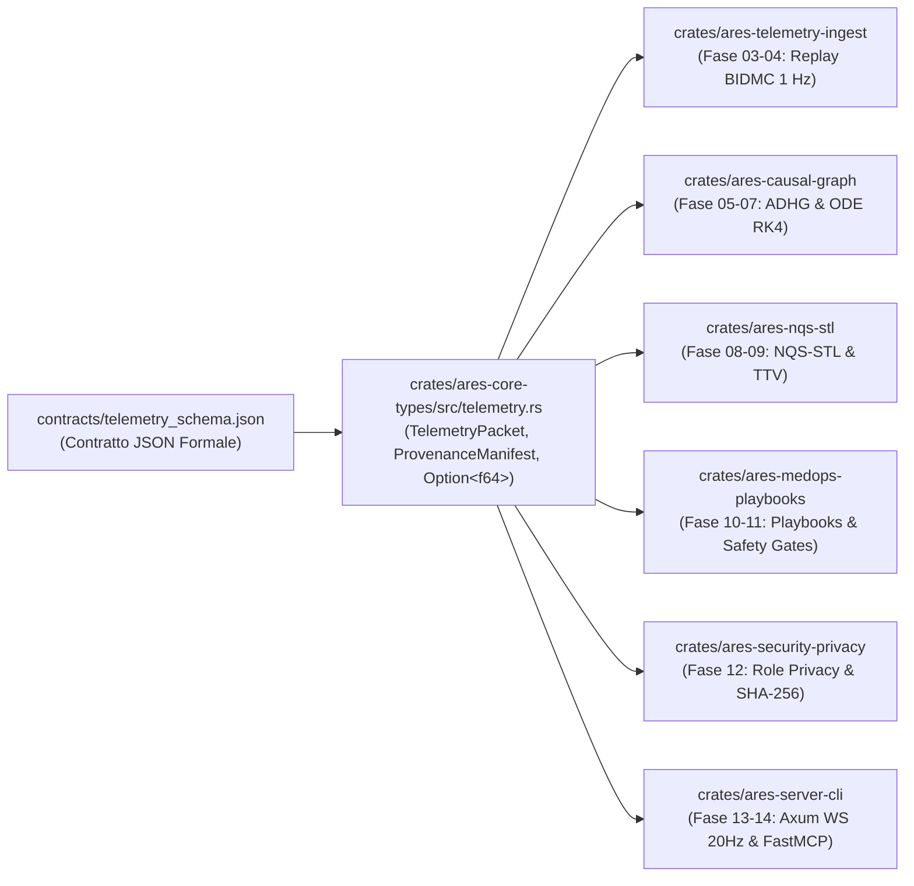

# Piano Implementativo Definitivo — Fase 01 (A1): Core Telemetry Contracts, Provenance Separation & Nullable Sensor Schema

> Superseded for HRV availability by [issue #11](ISSUE_11_HRV_VALIDITY_PLAN.md): numeric-only CSVs produce no HRV. Any proxy/default RMSSD, non-null complete MRI/global/TTV on missing HRV, or test expecting such values below is historical design, not current behavior. Known non-HRV hazards remain evaluated.

- **Blocco Architetturale**: Blocco A (*Fondamenta Contrattuali, Costanti Normative & Trait di Sicurezza*, Fasi 01–02)
- **Fase**: Fase 01 (`A1`)
- **Stato**: PIANO DEFINITIVO APPROVATO PER IMPLEMENTAZIONE (`READY FOR IMPLEMENTATION`)
- **Crate Principale**: [`crates/ares-core-types`](../../crates/ares-core-types/README.md)
- **Owner Principale**: `ARES-Health Team` (con revisione contrattuale `@MiServeRDC`, Issue #4)
- **File Target Previsti**:
  1. `crates/ares-core-types/Cargo.toml` *(NEW)*
  2. `crates/ares-core-types/src/lib.rs` *(NEW)*
  3. `crates/ares-core-types/src/telemetry.rs` *(NEW)*
- **Budget Latenza Hot-Path**: $< 5\,\mu\text{s}$ per serializzazione/deserializzazione JSON (`serde_json`)
- **Politica Rust 2024 Strict Mode**: Zero `.unwrap()`, zero `.expect()` nel codice di produzione, sanitizzazione esplicita di `NaN`/`Infinity`, 100% conformità a [`contracts/telemetry_schema.json`](../../contracts/telemetry_schema.json).

---

## 1. Executive Summary, Visione d'Insieme & Grounding Scientifico (`deep-scholar`)

### 1.1 Visione Architetturale e Ruolo nella Pipeline Globale (`GATHER -> EVALUATE -> ACT`)
In un sistema multi-agente e multi-sviluppatore dove 7 crate Rust e una dashboard React/Three.js (`ares-cockpit/`) operano in parallelo, il rischio principale di fallimento d'integrazione è la deriva semantica del formato dati (*Schema Drift*). Inoltre, come evidenziato nella **Issue #4 di `@MiServeRDC`**, un software medico spaziale sottoposto al giudizio della NASA deve distinguere con rigore scientifico assoluto tra:
1. **Dati Clinici Registrati (`RECORDED_TERRESTRIAL_BIDMC_CSV`)**: i segnali cardiorespiratori reali a `1 Hz` (`0..480 s`) provenienti da `PhysioNet BIDMC v1.0.0` (`data/bidmc/bidmc_01..03_Numerics.csv`), inclusi i **13 campioni mancanti (`null`)** di `PULSE` e `SpO2` in `bidmc_01_Numerics.csv`.
2. **Grandezze Fisiopatologiche Calcolate (`DERIVED_COMPUTED`)**: le uscite delle equazioni differenziali RK4 e della logica temporale `NQS-STL` (shear stress giugulare $\tau_w(t)$, Sclerostina $\text{SOST}$, Muscle Quality Index $\text{MQI}$, margini $\hat{\rho}_k(t)$, `TTV` e `MRI`).
3. **Parametri di Scenario Simulati (`SIMULATED_SCENARIO_INPUT`)**: le perturbazioni iniettate tramite la **What-If Stress-Test Console** (carico giornaliero `ARED`, dose di radiazioni `CSA CANS`, sessione `LBNP` a $-30\text{ mmHg}$, conferma ecografica `POCUS`).

La **Fase 01 (`A1`)** cristallizza questo contratto nel crate di base `crates/ares-core-types`, privo di dipendenze interne, da cui dipendono tutti gli altri 6 crate del workspace.

### 1.2 Riferimenti Scientifici e Standard (`deep-scholar`)
1. **PhysioNet BIDMC PPG and Respiration Dataset v1.0.0 (`ODC-By-1.0`):**
   * *Autori:* Marco A. F. Pimentel, Alistair E. W. Johnson, Peter H. Charlton et al.
   * *Titolo:* *"Toward a Robust Estimation of Respiratory Rate From Pulse Oximeters"*
   * *Venue:* *IEEE Transactions on Biomedical Engineering*, Vol. 64, No. 8, pp. 1914–1923, 2017 | **DOI:** `10.1109/TBME.2016.2613124` | **PhysioNet DOI:** `10.13026/C2XW26`.
2. **Embodied Agent Harnessing & Physical Contracts (`deep-scholar` 2026):**
   * *Titolo:* *"Towards the Harness of Embodied Agents ('Thea')"* (`arXiv:2608.11246v1`, 2026) — dimostra che l'uso di contratti dati fortemente tipizzati elimina le allucinazioni metriche tra moduli di percezione, valutazione causale e interfaccia agente.

---

## 2. Tabella Moduli, File Rust Coinvolti & Flusso Dati

| File / Modulo | Azione | Responsabilita Architetturale nella Fase 01 (`A1`) |
| :--- | :--- | :--- |
| `crates/ares-core-types/Cargo.toml` | **CREATE** | Manifesto Cargo del crate base con `serde = { version = "1.0", features = ["derive"] }`, `serde_json = "1.0"`, `thiserror = "2.0"`. |
| `crates/ares-core-types/src/telemetry.rs` | **CREATE** | Definisce `TelemetryPacket`, `ProvenanceManifest`, `Biometrics` (con `Option<f64>` nullable e `missing_channels`), `Musculoskeletal`, `JugularHemodynamics`, `SansOcular`, `NqsStlMargins`, `ActivePlaybook`, `SafetyGates`, `CountermeasureAction` e `StressTestScenarioInput`. |
| `crates/ares-core-types/src/lib.rs` | **CREATE** | Esporta pubblicamente `telemetry`, `constants`, `error` e `security`. |



---

## 3. Architettura delle Struct ed Enum in Puro Rust 2024 (`crates/ares-core-types/src/telemetry.rs`)

```rust
//! Fase 01 (A1): Contratti telemetrici condivisi conformi a `contracts/telemetry_schema.json`.
//!
//! Rispetta gli invarianti della Issue #4 (@MiServeRDC):
//! 1. Separazione esplicita tra `RECORDED_TERRESTRIAL_BIDMC_CSV`, `DERIVED_COMPUTED`
//!    e `SIMULATED_SCENARIO_INPUT`.
//! 2. Supporto nativo `Option<f64>` (`null` in JSON) per canali biometrici mancanti
//!    (es. i 13 campioni mancanti di PULSE/SpO2 in `bidmc_01_Numerics.csv`).
//! 3. Distinzione tra tempo nativo di registrazione (`relative_recording_time_s` a 1 Hz)
//!    e frequenza di refresh UI (`20 Hz`).

use serde::{Deserialize, Serialize};

/// Fase operativa secondo la traccia NASA Space Apps 2026 (`1. GATHER -> 2. EVALUATE -> 3. ACT`).
#[derive(Debug, Clone, Copy, PartialEq, Eq, Hash, Serialize, Deserialize)]
#[serde(rename_all = "SCREAMING_SNAKE_CASE")]
pub enum SystemPhase {
    Gather,
    Evaluate,
    Act,
}

/// Gravita globale di allerta clinica conforme a NASA-STD-3001 Vol. 2 Rev F.
#[derive(Debug, Clone, Copy, PartialEq, Eq, PartialOrd, Ord, Hash, Serialize, Deserialize)]
#[serde(rename_all = "SCREAMING_SNAKE_CASE")]
pub enum AlertSeverity {
    Nominal,
    Caution,
    Warning,
    CriticalEmergency,
}

/// Origine dei segnali biometrici cardiorespiratori (Issue #4).
#[derive(Debug, Clone, Copy, PartialEq, Eq, Hash, Serialize, Deserialize)]
#[serde(rename_all = "SCREAMING_SNAKE_CASE")]
pub enum BiometricsSource {
    RecordedTerrestrialBidmcCsv,
    SimulatedScenarioInput,
}

/// Modalita di calcolo dei sottosistemi fisiopatologici e di scenario.
#[derive(Debug, Clone, Copy, PartialEq, Eq, Hash, Serialize, Deserialize)]
#[serde(rename_all = "SCREAMING_SNAKE_CASE")]
pub enum ScenarioOverlayMode {
    DerivedAndSimulated,
}

/// Manifesto di provenienza dei dati allegato a ogni pacchetto telemetrico.
#[derive(Debug, Clone, PartialEq, Serialize, Deserialize)]
pub struct ProvenanceManifest {
    pub biometrics_source: BiometricsSource,
    pub biometrics_native_rate_hz: f64,
    pub ui_refresh_rate_hz: f64,
    pub scenario_overlay_mode: ScenarioOverlayMode,
    pub biological_context_refs: Vec<String>,
}

/// Stato direzionale del flusso nella vena giugulare interna (Marshall-Goebel et al. 2019).
#[derive(Debug, Clone, Copy, PartialEq, Eq, Hash, Serialize, Deserialize)]
#[serde(rename_all = "SCREAMING_SNAKE_CASE")]
pub enum JugularFlowGrade {
    NormalContinuous,
    PulsatileReduced,
    StagnantBidirectional,
    Retrograde,
    OccludedThrombus,
}

/// Segnali biometrici, autonomici ed esposizione radiologica (`1. GATHER`).
/// I campi provenienti da sensori fisici o CSV BIDMC usano `Option<f64>` per non
/// convertire mai campioni mancanti (`NaN`/vuoti) in falsi zeri fisiologici.
#[derive(Debug, Clone, PartialEq, Serialize, Deserialize)]
pub struct Biometrics {
    pub heart_rate_bpm: Option<f64>,
    pub pulse_rate_bpm: Option<f64>,
    pub resp_rate_brpm: Option<f64>,
    pub spo2_pct: Option<f64>,
    pub rmssd_ms: Option<f64>,
    pub sdnn_ms: Option<f64>,
    pub pnn50_pct: Option<f64>,
    pub lf_hf_ratio: Option<f64>,
    pub vocal_f0_hz: Option<f64>,
    pub vocal_jitter_pct: Option<f64>,
    pub radiation_dose_rate_msv_d: f64,
    pub sqi_score: f64,
    pub missing_channels: Vec<String>,
}

/// Metriche di meccanotrasduzione muscoloscheletrica (`DERIVED_COMPUTED` + `SIMULATED_SCENARIO_INPUT`).
#[derive(Debug, Clone, Copy, PartialEq, Serialize, Deserialize)]
pub struct Musculoskeletal {
    pub ared_daily_load_kgf: f64,
    pub soleus_csa_pct: f64,
    pub echo_intensity_au: f64,
    pub mqi_index: f64,
    pub sclerostin_pmol_l: f64,
    pub urinary_calcium_mg_d: f64,
    pub gai_pct: f64,
}

/// Emodinamica della vena giugulare interna (IJV) e stato contromisura LBNP.
#[derive(Debug, Clone, Copy, PartialEq, Serialize, Deserialize)]
pub struct JugularHemodynamics {
    pub ijv_csa_mm2: f64,
    pub ijv_vmax_cm_s: f64,
    pub tau_w_dyn_cm2: f64,
    pub flow_grade: JugularFlowGrade,
    pub pocus_thrombus_confirmed: bool,
    pub lbnp_active: bool,
    pub lbnp_pressure_mmhg: f64,
}

/// Biomarcatori Spaceflight-Associated Neuro-Ocular Syndrome (SANS).
#[derive(Debug, Clone, Copy, PartialEq, Serialize, Deserialize)]
pub struct SansOcular {
    pub onsd_mm: f64,
    pub choroidal_delta_um: f64,
    pub sans_risk_index: f64,
}

/// Margini normalizzati di robustezza temporale NQS-STL (`2. EVALUATE`).
#[derive(Debug, Clone, Copy, PartialEq, Serialize, Deserialize)]
pub struct NqsStlMargins {
    pub rho_tau_w: f64,
    pub rho_ared: f64,
    pub rho_sost: f64,
    pub rho_rmssd: f64,
    pub rho_sans: f64,
    pub rho_global: f64,
    pub ttv_hours: f64,
    pub ttv_ci95_low_hours: f64,
    pub ttv_ci95_high_hours: f64,
    pub mri_pct: f64,
}

/// Stato dei 3 Hard Clinical Safety Gates salvavita (`3. ACT`).
#[derive(Debug, Clone, Copy, PartialEq, Eq, Serialize, Deserialize)]
pub struct SafetyGates {
    pub anticoagulant_lock_active: bool,
    pub lbnp_auto_vent_armed: bool,
    pub eva_suit_damping_active: bool,
}

/// Singola azione di contromisura ordinata per impatto sul margine NQS-STL.
#[derive(Debug, Clone, PartialEq, Serialize, Deserialize)]
pub struct CountermeasureAction {
    pub action_id: String,
    pub label: String,
    pub category: String,
    pub delta_rho_per_hour: f64,
}

/// Playbook operativo MedOps attivo.
#[derive(Debug, Clone, PartialEq, Serialize, Deserialize)]
pub struct ActivePlaybook {
    pub playbook_id: String,
    pub title: String,
    pub causal_chain_summary: Vec<String>,
    pub safety_gates: SafetyGates,
    pub actions: Vec<CountermeasureAction>,
}

/// Pacchetto telemetrico completo a 20 Hz conforme a `contracts/telemetry_schema.json`.
#[derive(Debug, Clone, PartialEq, Serialize, Deserialize)]
pub struct TelemetryPacket {
    pub timestamp_utc: String,
    pub mission_Elapsed_seconds: f64,
    pub relative_recording_time_s: f64,
    pub source_record_id: String,
    pub flight_day: u32,
    pub astronaut_id: String,
    pub system_phase: SystemPhase,
    pub alert_severity: AlertSeverity,
    pub provenance_manifest: ProvenanceManifest,
    pub biometrics: Biometrics,
    pub musculoskeletal: Musculoskeletal,
    pub jugular_hemodynamics: JugularHemodynamics,
    pub sans_ocular: SansOcular,
    pub nqs_stl: NqsStlMargins,
    pub active_playbook: ActivePlaybook,
}

/// Input inviato dalla What-If Stress-Test Console (`POST /api/stress-test`).
#[derive(Debug, Clone, PartialEq, Serialize, Deserialize)]
pub struct StressTestScenarioInput {
    pub source_record_id: String,
    pub flight_day: u32,
    pub ared_daily_load_kgf: f64,
    pub radiation_dose_rate_msv_d: f64,
    pub lbnp_active: bool,
    pub lbnp_pressure_mmhg: f64,
    pub pocus_thrombus_confirmed: bool,
    pub systolic_bp_drop_mmhg: f64,
}
```

---

## 4. Strategia di Test e Gate di Verifica della Fase 01 (`A1`)

1. **`test_telemetry_packet_json_roundtrip_with_nulls`:** Verifica che un `TelemetryPacket` con `pulse_rate_bpm: None` e `spo2_pct: None` (come nelle 13 righe di `bidmc_01_Numerics.csv`) serializzi `"pulse_rate_bpm": null` e `"spo2_pct": null` e venga deserializzato senza perdita di informazione.
2. **`test_provenance_manifest_serialization`:** Verifica che `BiometricsSource::RecordedTerrestrialBidmcCsv` serializzi esattamente `"RECORDED_TERRESTRIAL_BIDMC_CSV"`.
3. **Gate Automatico:** `./scripts/agent_probe.sh --fast` e `cargo test -p ares-core-types`.
