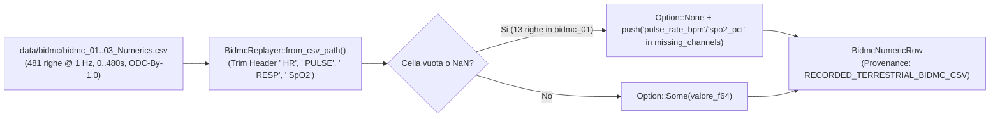

# Piano Implementativo Definitivo — Fase 03 (B1): Reproducible BIDMC v1.0.0 CSV Replayer, Header Trimming & Missing-Value (`null`) Preservation

- **Blocco Architetturale**: Blocco B (*Motore di Replay Deterministico `BIDMC v1.0.0`, Filtro `SQI` & Scenario Overlay — `1. GATHER`*, Fasi 03–04)
- **Fase**: Fase 03 (`B1`)
- **Stato**: PIANO DEFINITIVO APPROVATO PER IMPLEMENTAZIONE (`READY FOR IMPLEMENTATION`)
- **Crate Principale**: [`crates/ares-telemetry-ingest`](../../crates/ares-telemetry-ingest/README.md)
- **Owner Principale**: `ARES-Health Team` (con specifica di provenienza `@MiServeRDC` Issue #4 e skill `telemetry-replay-verifier`)
- **File Target Previsti**:
  1. `crates/ares-telemetry-ingest/Cargo.toml` *(NEW)*
  2. `crates/ares-telemetry-ingest/src/lib.rs` *(NEW)*
  3. `crates/ares-telemetry-ingest/src/bidmc_replayer.rs` *(NEW)*
- **Budget Latenza Hot-Path**: $< 20\,\mu\text{s}$ per lookup/interpolazione riga in-memory (`O(1)` da slice pre-caricata)
- **Politica Rust 2024 Strict Mode**: Zero `.unwrap()`, zero `.expect()`, trimming obbligatorio degli spazi iniziali negli header CSV (`" HR"`, `" PULSE"`, `" RESP"`, `" SpO2"`), preservazione rigorosa di `Option<f64>::None` per i 13 campioni mancanti in `bidmc_01_Numerics.csv`.

---

## 1. Executive Summary, Visione d'Insieme & Grounding Scientifico (`deep-scholar`)

### 1.1 Visione Architetturale e Conformita alla Issue #4
La **Fase 03 (`B1`)** implementa il primo anello della catena **`1. GATHER`** richiesta dal brief NASA. Anziché usare numeri casuali non riproducibili, il modulo `bidmc_replayer.rs` carica e riproduce deterministicamente i 3 file clinici reali di **PhysioNet `BIDMC PPG and Respiration Dataset v1.0.0`** archiviati in [`data/bidmc/`](../../data/bidmc/README.md) (`bidmc_01_Numerics.csv`, `bidmc_02_Numerics.csv`, `bidmc_03_Numerics.csv`, 481 righe ciascuno, campionamento nativo `1 Hz` da `0` a `480 s`).

Due dettagli ingegneristici critici (documentati nella **Issue #4 di `@MiServeRDC`** e nell'invariante `Entry 006` di `memory-bank/experienceLog.md`) sono risolti a livello strutturale:
1. **Whitespace negli Header CSV Originali:** I file originali PhysioNet hanno uno spazio prima del nome delle colonne (`Time [s], HR, PULSE, RESP, SpO2`). Il parser usa `.trim()` su ogni header e cella.
2. **Gestione Tollerante ai Guasti dei 13 Valori Mancanti (`bidmc_01`):** In `bidmc_01_Numerics.csv`, 13 righe hanno valori mancanti (`NaN`/vuoti) su `PULSE` e `SpO2`. Il parser li converte in `Option<f64>::None` e popola `missing_channels: vec!["pulse_rate_bpm", "spo2_pct"]`, evitando falsi allarmi di ipossiemia (`SpO2 = 0%`).

### 1.2 Riferimenti Scientifici (`deep-scholar`)
1. **Marco A. F. Pimentel, Alistair E. W. Johnson, Peter H. Charlton, Drew Birrenkott, Peter J. Watkinson, Lionel Tarassenko, David A. Clifton:**
   * *Titolo:* *"Toward a Robust Estimation of Respiratory Rate From Pulse Oximeters"*
   * *Venue:* *IEEE Transactions on Biomedical Engineering*, Vol. 64, No. 8, pp. 1914–1923, 2017 | **DOI:** `10.1109/TBME.2016.2613124` | **PhysioNet DOI:** `10.13026/C2XW26` (`ODC-By-1.0`).
2. **Ary L. Goldberger et al.:**
   * *Titolo:* *"PhysioBank, PhysioToolkit, and PhysioNet: Components of a New Research Resource for Complex Physiologic Signals"*, *Circulation*, 101(23):e215–e220, 2000.

---

## 2. Tabella Moduli, File Rust Coinvolti & Flusso Dati

| File / Modulo | Azione | Responsabilita Architetturale nella Fase 03 (`B1`) |
| :--- | :--- | :--- |
| `crates/ares-telemetry-ingest/Cargo.toml` | **CREATE** | Dipendenze `ares-core-types`, `csv = "1.3"`, `serde = { version = "1.0", features = ["derive"] }`, `thiserror = "2.0"`. |
| `crates/ares-telemetry-ingest/src/bidmc_replayer.rs` | **CREATE** | Struct `BidmcNumericRow`, `BidmcReplayer` (con indice ciclico `1 Hz` e campionamento `20 Hz` per la UI) ed errori `IngestError`. |
| `crates/ares-telemetry-ingest/src/lib.rs` | **CREATE** | Esporta `bidmc_replayer`, `sqi_filter` e `scenario_overlay`. |



---

## 3. Architettura di `bidmc_replayer.rs` in Puro Rust 2024

```rust
//! Fase 03 (B1): Replay deterministico di PhysioNet BIDMC v1.0.0 (`1 Hz`, `0..480 s`).

use std::fs::File;
use std::io::{BufRead, BufReader};
use std::path::Path;
use thiserror::Error;

#[derive(Debug, Error, Clone, PartialEq)]
pub enum IngestError {
    #[error("impossibile leggere il file CSV BIDMC '{path}': {reason}")]
    CsvIoError { path: String, reason: String },

    #[error("header CSV BIDMC non valido in '{path}': trovato '{found}'")]
    InvalidCsvHeader { path: String, found: String },

    #[error("il dataset BIDMC '{record_id}' non contiene alcuna riga valida")]
    EmptyDataset { record_id: String },

    #[error("valore timestamp 'Time [s]' non valido alla riga {line}: '{raw}'")]
    InvalidTimestamp { line: usize, raw: String },
}

/// Singolo campione numerico a 1 Hz estratto da `bidmc_*_Numerics.csv`.
#[derive(Debug, Clone, PartialEq)]
pub struct BidmcNumericRow {
    pub record_id: String,
    pub relative_time_s: f64,
    pub hr_bpm: Option<f64>,
    pub pulse_bpm: Option<f64>,
    pub resp_brpm: Option<f64>,
    pub spo2_pct: Option<f64>,
    pub missing_channels: Vec<String>,
}

/// Motore di replay deterministico in-memory per una registrazione BIDMC (`481` righe, `0..480 s`).
#[derive(Debug, Clone)]
pub struct BidmcReplayer {
    record_id: String,
    rows: Vec<BidmcNumericRow>,
    cursor_idx: usize,
}

impl BidmcReplayer {
    /// Carica e valida un file `bidmc_*_Numerics.csv` effettuando il trimming degli spazi
    /// negli header (`" HR"`, `" PULSE"`, `" RESP"`, `" SpO2"`) e preservando i valori mancanti come `None`.
    pub fn from_csv_path(record_id: &str, path: &Path) -> Result<Self, IngestError> {
        let file = File::open(path).map_err(|e| IngestError::CsvIoError {
            path: path.display().to_string(),
            reason: e.to_string(),
        })?;
        let reader = BufReader::new(file);
        let mut lines = reader.lines();

        let header_line = lines
            .next()
            .ok_or_else(|| IngestError::EmptyDataset {
                record_id: record_id.to_string(),
            })?
            .map_err(|e| IngestError::CsvIoError {
                path: path.display().to_string(),
                reason: e.to_string(),
            })?;

        let headers: Vec<&str> = header_line.split(',').map(str::trim).collect();
        if headers != ["Time [s]", "HR", "PULSE", "RESP", "SpO2"] {
            return Err(IngestError::InvalidCsvHeader {
                path: path.display().to_string(),
                found: header_line,
            });
        }

        let mut rows = Vec::with_capacity(481);
        for (idx, line_res) in lines.enumerate() {
            let line_num = idx + 2;
            let line = line_res.map_err(|e| IngestError::CsvIoError {
                path: path.display().to_string(),
                reason: e.to_string(),
            })?;
            if line.trim().is_empty() {
                continue;
            }
            let cols: Vec<&str> = line.split(',').map(str::trim).collect();
            let raw_time = cols.first().copied().unwrap_or("");
            let relative_time_s = raw_time.parse::<f64>().map_err(|_| {
                IngestError::InvalidTimestamp {
                    line: line_num,
                    raw: raw_time.to_string(),
                }
            })?;

            let mut missing_channels = Vec::new();
            let hr_bpm = Self::parse_nullable_channel(
                cols.get(1).copied(),
                "heart_rate_bpm",
                &mut missing_channels,
            );
            let pulse_bpm = Self::parse_nullable_channel(
                cols.get(2).copied(),
                "pulse_rate_bpm",
                &mut missing_channels,
            );
            let resp_brpm = Self::parse_nullable_channel(
                cols.get(3).copied(),
                "resp_rate_brpm",
                &mut missing_channels,
            );
            let spo2_pct = Self::parse_nullable_channel(
                cols.get(4).copied(),
                "spo2_pct",
                &mut missing_channels,
            );

            rows.push(BidmcNumericRow {
                record_id: record_id.to_string(),
                relative_time_s,
                hr_bpm,
                pulse_bpm,
                resp_brpm,
                spo2_pct,
                missing_channels,
            });
        }

        if rows.is_empty() {
            return Err(IngestError::EmptyDataset {
                record_id: record_id.to_string(),
            });
        }

        Ok(Self {
            record_id: record_id.to_string(),
            rows,
            cursor_idx: 0,
        })
    }

    #[inline]
    fn parse_nullable_channel(
        raw_cell: Option<&str>,
        channel_name: &'static str,
        missing: &mut Vec<String>,
    ) -> Option<f64> {
        match raw_cell {
            Some(s) if !s.is_empty() && !s.eq_ignore_ascii_case("nan") => match s.parse::<f64>() {
                Ok(v) if v.is_finite() => Some(v),
                _ => {
                    missing.push(channel_name.to_string());
                    None
                }
            },
            _ => {
                missing.push(channel_name.to_string());
                None
            }
        }
    }

    /// Restituisce il numero totale di campioni a 1 Hz caricati (481 per `0..480 s`).
    #[inline]
    pub fn len(&self) -> usize {
        self.rows.len()
    }

    #[inline]
    pub fn is_empty(&self) -> bool {
        self.rows.is_empty()
    }

    /// Restituisce il campione corrente e avanza ciclicamente il cursore (`0..len`).
    #[inline]
    pub fn next_row(&mut self) -> &BidmcNumericRow {
        let idx = self.cursor_idx % self.rows.len();
        self.cursor_idx = (self.cursor_idx + 1) % self.rows.len();
        &self.rows[idx]
    }

    /// Accesso diretto deterministico per secondo relativo `0..=480`.
    #[inline]
    pub fn row_at_second(&self, second_idx: usize) -> &BidmcNumericRow {
        let clamped = second_idx.min(self.rows.len().saturating_sub(1));
        &self.rows[clamped]
    }

    #[inline]
    pub fn record_id(&self) -> &str {
        &self.record_id
    }
}
```

---

## 4. Strategia di Test e Gate di Verifica della Fase 03 (`B1`)

1. **`test_bidmc_01_loads_481_rows_and_13_missing_pulse_spo2`:** Carica `data/bidmc/bidmc_01_Numerics.csv`, verifica `replayer.len() == 481`, `row_at_second(0).relative_time_s == 0.0`, `row_at_second(480).relative_time_s == 480.0`, e verifica che esattamente **13 righe** abbiano `pulse_bpm.is_none()` e `spo2_pct.is_none()` con `"pulse_rate_bpm"` e `"spo2_pct"` in `missing_channels`.
2. **`test_bidmc_02_and_03_have_zero_missing_values`:** Carica `bidmc_02_Numerics.csv` e `bidmc_03_Numerics.csv` e verifica `481` righe ciascuno con `0` canali mancanti.
