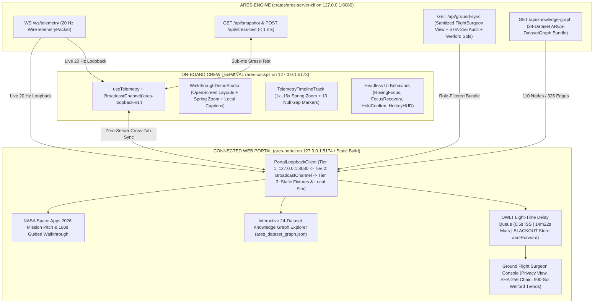

# Piano Implementativo Definitivo — Fase 30 (M1): Connected Mission Control Web Portal (`ares-portal`) & Astronaut Cockpit Enhancement (`ares-cockpit` + OpenScreen Telemetry/Demo Engine + Vercel Labs UI Behavioral Primitives)

- **Blocco Architetturale**: Blocco M (*Connected Telemedicine Web Portal, Walkthrough Demo Studio & Microgravity Behavioral UI*)
- **Fase**: Fase 30 (`M1`)
- **Stato**: PIANO DEFINITIVO APPROVATO PER IMPLEMENTAZIONE (`READY FOR IMPLEMENTATION`)
- **Workspace & Moduli Target**:
  1. [`ares-portal/`](../../ares-portal) *(NEW — Ground Control Telemedicine Portal & Mission Pitch Showcase)*
  2. [`ares-cockpit/`](../../ares-cockpit/README.md) *(UPDATE — OpenScreen Spring-Zoom Timeline & Walkthrough Studio + Vercel Labs UI Headless Behavioral Primitives)*
  3. [`crates/ares-server-cli/`](../../crates/ares-server-cli/README.md) *(UPDATE — Read-Only Ground Sync & Knowledge Graph Loopback Endpoints)*
- **Owner Principale**: `ARES-Health Team` (Architettura & Contratti Loopback), `ARES-Health Team` (Cockpit UX & Portal UI), `ARES-Health Team` (Axum Loopback Endpoints & Replay Fixtures), `@MiServeRDC` (Privacy Tiers & SHA-256 Store-and-Forward Inspector)
- **Budget Latenza & Prestazioni (`NASA-STD-3001 Vol. 2 Rev F`)**:
  - **Feedback Controlli Discreti (`[V2 10022]`)**: $\le 16\text{ ms}$ (limite standard $\le 100\text{ ms}$)
  - **Latenza Display Continuo / Spring Zoom (`[V2 10152]`)**: $60\text{ FPS}$ costanti ($\le 16.6\text{ ms}$, limite standard $\le 50\text{ ms}$)
  - **Round-Trip Stress-Test Loopback (`POST /api/stress-test` $\to$ WS Broadcast)**: $< 1.0\text{ ms}$
  - **Chiamate Rete Esterne / Cloud API / CDN Font**: `0` (**100% Air-Gapped Edge-Native**)
- **Invarianti Non Negoziabili**:
  - **ZERO EMOJI** ovunque nel codice, nei commenti, nella UI e nella documentazione (solo icone SVG geometriche inline con `aria-hidden="true"` o etichette testuali monospaziate).
  - **Air-Gapped Edge Execution**: Nessuna dipendenza da Google Fonts, CDN esterni, WebRTC cloud o API LLM/TTS/STT remote.
  - **Onesta Scientifica e Provenienza (`Issue #11` & `Issue #12`, `Entries 006-009`)**: Preservazione rigorosa di `null` sui canali mancanti (`rmssd_ms: null` con `BEAT_INTERVALS_NOT_AVAILABLE`, 13 campioni mancanti in `bidmc_01_Numerics.csv`), distinzione esplicita tra `RECORDED_TERRESTRIAL_BIDMC_CSV` e `SIMULATED_SCENARIO_INPUT`, ed esposizione permanente del badge `ILLUSTRATIVE_UNVALIDATED` (*"Modello di scenario illustrativo non validato clinicamente"*).

---

## 1. Executive Summary & Grounding Scientifico / Open-Source

### 1.1 Visione Architetturale:Separazione ed Interconnessione tra Bordo (`ares-cockpit`) e Terra (`ares-portal`)

Nelle missioni lunari e marziane (**Lunar Gateway, Artemis II+, Mars Transit a `0g` e Superficie Marziana a `0.38g`**), il ritardo radio sola andata (*One-Way Light Time*, `OWLT`) varia da **4 a 24 minuti** (**8–48 minuti A/R**) fino al blackout totale di **14 giorni** durante la congiunzione solare superiore. Questa fisica impone una **dualita architetturale netta**, ampiamente documentata nella letteratura sui **Biodigital Twins per Astronauti** e nei sistemi di **Mission Control Web Portal** (lineage NASA Apollo 13 $\to$ **NASA Ames Open MCT** $\to$ **NASA ExMC / Autonomous Medical Operations**):

1. **`ares-cockpit` (On-Board Crew Medical Terminal — `127.0.0.1:5173`)**:
   Terminale clinico single-screen a zero scroll su sfondo OLED puro `#000000` progettato per l'equipaggio in microgravita (`NASA-STD-3001 Vol. 2 [V2 10001]`). Opera a latenza zero (`< 1 ms`) contro il motore Safe Rust locale (`ares-server-cli` su `127.0.0.1:8080`), guidando il ciclo chiuso autonomo **`1. GATHER -> 2. EVALUATE -> 3. ACT`** con i 3 Hard Clinical Safety Gates.
2. **`ares-portal` (Connected Ground Control Telemedicine Portal & Mission Pitch Showcase — `127.0.0.1:5174` / Static Bundle)**:
   Sito web connesso progettato per due ruoli complementari:
   - **Console Telemedica di Terra (Houston MCC / Flight Surgeon):** Riceve i pacchetti Store-and-Forward cifrati (`ChaCha20-Poly1305` + catena di audit `SHA-256`, vista `GroundFlightSurgeon` conforme a `NASA-STD-3001 Vol. 1 Ch. 7 [V1 3003]`), visualizza il divario temporale `OWLT` tra lo stato istantaneo a bordo di Marte e l'ultimo pacchetto ricevuto a Terra, esplora i **900 Sol compattati con Welford (`< 200 KB`)** e interroga visualmente il grafo della conoscenza multi-agenzia **`ARES-DatasetGraph` (24 dataset ufficiali, 110 nodi, 326 archi Biolink)**.
   - **Mission Pitch & Interactive Judge Showcase:** Offre alla giuria della **NASA Space Apps Challenge 2026** una narrazione interattiva strutturata sui 5 pilastri ufficiali di valutazione (*Impact, Creativity, Validity, Relevance, Presentation*), collegata in tempo reale al motore Rust via loopback o eseguibile in modalita statica 100% offline grazie al motore deterministico di fallback e alle fixture contrattuali certificate.

---

### 1.2 Analisi Tecnica e Clean-Room Porting dei Pattern Open-Source (`openscreen` & `vercel-labs/ui`)

Abbiamo ispezionato direttamente il codice sorgente dei repository open-source [`getopenscreen/openscreen`](https://github.com/getopenscreen/openscreen) (licenza MIT) e [`vercel-labs/ui`](https://github.com/vercel-labs/ui) (`@ui-sdk/core`), estraendone i pattern ingegneristici ad alto valore per reimplementarli **clean-room in TypeScript/React 19 puro a zero dipendenze cloud e zero bloat Electron/PixiJS**:

| Repository Sorgente | Modulo / File Analizzato | Pattern Ingegneristico Estratto | Adattamento Clean-Room in ARES-Health (`ares-cockpit` & `ares-portal`) |
| :--- | :--- | :--- | :--- |
| `getopenscreen/openscreen` | `src/lib/zoomMath/motionSmoothing.ts` & `constants.ts` | Solutore elastico smorzato del secondo ordine (`stiffness`, `damping`, `mass`, `restDelta = 0.0005`, `restSpeed = 0.02`, $\Delta t$ clampato in $[1, 80]\text{ ms}$) e durata logaritmica dello zoom $T_{\text{zoom}}(s) = 600 + 550\ln(\max(1, s))\text{ ms}$ con chaining pan (`1500 ms` gap). | **`springPhysics.ts` & `TelemetryTimelineTrack.tsx`:** Zoom elastico fluido (`1x` finestra completa `480 s` $\leftrightarrow$ `16x` ispezione singolo campione `1 Hz` e gap `null` di `bidmc_01`) e camera focus automatico sui pannelli clinici durante i walkthrough guidati, con bypass immediato se `prefers-reduced-motion: reduce`. |
| `getopenscreen/openscreen` | `src/lib/layoutTypes.ts` & `src/components/video-editor/types.ts` | **Layouts Track** dinamica (`picture-in-picture`, `dual-frame`, `vertical-stack`, `camera-only`, `no-webcam` con transizione `0.2 s`), `ZoomRegion` (`cx, cy, depth, rotationPreset`) con contenimento prospettico 3D (`computeRotation3DContainScale`) e `CursorTelemetryPoint` smorzato. | **`WalkthroughDemoStudio.tsx`:** Regia deterministica integrata per la demo da `180 s` (`Hook -> Gather -> Evaluate -> Act -> Close`). Commuta dinamicamente il layout tra `cockpit-full`, `dual-frame-3d-pocus`, `split-mars-earth-owlt` e applica zoom elastico automatico sui Safety Gates attivi. |
| `getopenscreen/openscreen` | `src/lib/captioning/` & `AnnotationRegion` (`auto-caption`) | Sottotitoli generati e sincronizzati **100% on-device** senza alcun upload audio in cloud, con trascrizione cliccabile che taglia/salta direttamente al segmento temporale nella timeline. | **`LocalCaptionsOverlay.tsx` & `demoTranscripts.ts`:** Tracce sottotitoli bilingui (`EN` / `IT`) strutturate in JSON locale (`startMs`, `endMs`, `phase`, `speaker`, `clinicalRef`) con trascrizione interattiva *click-to-seek* che imposta istantaneamente `WhatIf`, `Phase` e focus camera senza alcuna API cloud. |
| `vercel-labs/ui` | `packages/core/src/foundation/kernel/primitive.ts` & `focus/roving-focus.ts` | Separazione tra **Behaviors** headless e **Slots** DOM (`data-slot`, `data-state`); **`createRovingFocus`** mantiene un singolo tab stop (`tabIndex={0}` sull'elemento attivo, `-1` sugli altri) con navigazione a frecce, `Home`/`End` e memoria dell'ultimo elemento focalizzato. | **`src/lib/ui-behaviors/rovingFocus.ts`:** Applicato alla barra `1. GATHER -> 2. EVALUATE -> 3. ACT`, ai sub-tab `EVALUATE`, ai preset dei layer 3D, al selettore `UOMO / DONNA` (`role="radiogroup"`) e agli step dei Playbook MedOps, eliminando la trappola di decine di `Tab` consecutivi in microgravita. |
| `vercel-labs/ui` | `packages/core/src/foundation/focus/focus-recovery.ts` & `kernel/modality.ts` | **`createFocusRecovery`** e **`isFocusFromKeyboard`**: quando un controllo scompare o viene disabilitato (es. pulsante `clear` o pannello chiuso), il focus non cade mai su `document.body` ma viene recuperato deterministicamente sul fallback dichiarato; focus ring visibili solo/sempre secondo modalita e mai oscurati (`WCAG 2.2 AA`). | **`src/lib/ui-behaviors/focusRecovery.ts`:** Quando il Safety Gate 2 (`AUTO_VENT_LBNP_CHAMBER`) disabilita lo slider `LBNP`, il focus viene trasferito istantaneamente sul pulsante di sicurezza `RE-ARM LBNP`; alla chiusura dell'ispettore 3D ritorna al nodo anatomico sorgente. |
| `vercel-labs/ui` | `packages/core/src/foundation/direct-manipulation/hold.ts` & `repeat.ts` | **`bindHold`** (pressione prolungata intenzionale con feedback progressivo e annullamento al rilascio anticipato) e **`bindRepeat`** (incremento ripetuto controllato da tastiera/pulsante). | **`HoldToConfirmButton.tsx` (`NASA-STD-3001 [V2 10027]`):** Interblocco anti-attivazione accidentale da `600 ms` (con anello SVG di progresso) per azioni cliniche critiche in assenza di peso (riarmo LBNP post-sincope, conferma step farmacologico post-POCUS). |
| `vercel-labs/ui` | `packages/core/src/foundation/platform/platform.ts`, `announce.ts` & `page/agent/agent.ts` | Matching scorciatoie (`matchesShortcut`, `ariaKeyshortcuts`), annunciatore ARIA live (`announce` polite/assertive) e bridge strutturato (`createAgent`) per permettere agli agenti di interrogare stato e azioni disponibili senza scraping visivo fragile. | **`MissionHotkeyHud.tsx` & `aresAgentBridge.ts`:** Overlay HUD attivabile con `?` o `Alt+H`, attributi `aria-keyshortcuts` su ogni comando primario, regione `aria-live` per allarmi clinici e registro locale `window.__ARES_UI_AGENT__` per ispezione deterministica offline e test automatici. |

---

### 1.3 Riferimenti Normativi e Letteratura Scientifica (`deep-scholar`)

1. **NASA Office of the Chief Health and Medical Officer (OCHMO):**
   - *NASA-STD-3001 Volume 1, Rev C (2023):* Crew Health — Clausole `[V1 3001]–[V1 3006]` (Livelli di cura medica autonoma ExMC I–V), Capitolo 7 `[V1 7001]` (Governance della privacy medica dell'equipaggio e confidenzialita dei dati comportamentali/clinici).
   - *NASA-STD-3001 Volume 2, Rev F (2026):* Human Factors, Habitability, and Environmental Health — Sezione 10 Crew Interfaces: `[V2 10001]` (Usability NMSUS), `[V2 10002]` (Prevenzione errori indotti dal design), `[V2 10022]` (Feedback comandi discreti $\le 100\text{ ms}$), `[V2 10152]` (Latenza display dinamici $\le 50\text{ ms}$), `[V2 10023]`–`[V2 10024]` (Procedure elettroniche con stato step esplicito), `[V2 10027]` (Prevenzione attivazione involontaria controlli critici).
2. **NASA Ames Research Center — Open MCT (Open Mission Control Technologies) & Mission Control Web Portal Literature:**
   - Trimyer et al. / NASA AMMOS & Open MCT Architecture: separazione tra *Time Conductor* (finestra temporale live vs storica fissata), *Telemetry Dictionary* tipizzato, indicatori espliciti di *Staleness / Gap* e disaccoppiamento tra trasporto di rete e viste di telemetria.
3. **Biodigital Twins in Spaceflight & Deep-Space Autonomous Medical Operations:**
   - Schmidt & Simske (2026), *INSIGHT* (`DOI: 10.1002/inst.70066`); NASA STMD Game Changing Development — *Autonomous Medical Operations (AMO)*: utilizzo di gemelli digitali fisiologici accoppiati a telemetria indossabile ed ecografia POCUS per simulazioni controfattuali (*What-If*) durante il blackout comunicativo Terra-Marte.
4. **Audit Interno di Evidenza Scientifica (`Issue #12`):**
   - [`docs/architecture/MODEL_EVIDENCE_AUDIT.md`](../architecture/MODEL_EVIDENCE_AUDIT.md): distinzione obbligatoria tra osservazioni terrestri registrate (`PhysioNet BIDMC v1.0.0`, Pimentel et al. 2017, `DOI: 10.1109/TBME.2016.2613124`) e output di scenario illustrativi (`ILLUSTRATIVE_UNVALIDATED`, `ILLUSTRATIVE_SCENARIO_RANGE`).

---

## 2. Architettura del Sistema Connesso (`ares-portal` + `ares-cockpit` + `ares-server-cli`)

### 2.1 Topologia di Connessione Dual-Loopback, Simulatore OWLT e Fallback Offline

Il portale web (`ares-portal`) e il cockpit di bordo (`ares-cockpit`) condividono un livello di trasporto resiliente a **3 stadi di fallback deterministico**, garantendo funzionamento immediato sia durante il test live con il backend Rust attivo, sia come sito statico standalone aperto da un giudice senza server in esecuzione:



#### Protocollo di Connessione a 3 Livelli (`PortalLoopbackClient`)
1. **Tier 1 — `ENGINE_LIVE_LOOPBACK` (`127.0.0.1:8080` attivo):**
   - Sottoscrive `ws://127.0.0.1:8080/ws/telemetry` (grazie a `tokio::sync::broadcast::Sender<String>` in `SharedMissionState`, `ares-cockpit` e `ares-portal` ricevono in parallelo ogni singolo frame a `20 Hz` senza contesa).
   - Interroga `GET /api/snapshot`, `GET /api/ground-sync` e `GET /api/knowledge-graph` all'avvio.
   - Espone un selettore di **Regime di Comunicazione Terra-Spazio**:
     - `DIRECT_JURY_INSPECTION (0 ms)`: mostra istantaneamente lo stesso tick del cockpit per consentire alla giuria di verificare la sincronizzazione sub-millisecondo.
     - `REALISTIC_MARS_OWLT (4m..24m accelerabile 60x / SOLAR_CONJUNCTION_BLACKOUT)`: accoda i pacchetti in un ring buffer client-side `OwltDelayBuffer`, dimostrando visivamente perche un medico a Houston **non puo** fermare una sincope in LBNP o sbloccare un anticoagulante in tempo reale, e come il bundle cifrato `FlightSurgeonStoreAndForwardPacket` arrivi a Terra con catena `SHA-256` verificata una volta trascorso l'`OWLT` o riaperto il ponte radio DSN.
2. **Tier 2 — `CROSS_TAB_COCKPIT_SYNC` (`BroadcastChannel('ares-loopback-v1')`):**
   - Se `ares-server-cli` non e in esecuzione ma l'utente ha aperto `ares-cockpit` e `ares-portal` in due schede/finestre dello stesso browser, `ares-cockpit` trasmette su `BroadcastChannel('ares-loopback-v1')` i pacchetti della simulazione deterministica locale e gli eventi `WhatIf`, mantenendo i due siti sincronizzati live a `20 Hz` senza alcun backend di rete.
3. **Tier 3 — `STATIC_AIRGAPPED_FALLBACK` (100% Standalone Zero-Server):**
   - Se ne `ares-server-cli` ne una scheda `ares-cockpit` sono attivi, `ares-portal` carica i fixture certificati (`telemetry_bidmc_replay.json`, `telemetry_whatif_overlay.json`, `missing_channel_frame.json`, `sans_alert_frame.json`) e il grafo statico `ares_dataset_graph.json`, eseguendo localmente il motore deterministico `scenario.ts` con etichetta esplicita `OFFLINE_STATIC_SIMULATION` + `ILLUSTRATIVE_UNVALIDATED`.

---

### 2.2 Struttura delle Sezioni del Portale Connesso (`ares-portal`)

Il portale `ares-portal` adotta un tema coerente **Aerospace OLED `#000000` / `#05070B`** con tipografia di sistema ad alto contrasto (`Inter` / `ui-sans-serif` + `JetBrains Mono` / `ui-monospace`, zero font remoti) ed e articolato in **5 viste navigabili tramite barra superiore accessibile (`RovingFocus`)**:

1. **`[01. MISSION OVERVIEW & PITCH]` (Mission Showcase & 5 NASA Judging Pillars):**
   - Hero tecnico interattivo con contatore live del ritardo luce Terra-Marte (`OWLT`), stato del link (`ENGINE_LIVE_LOOPBACK` vs `CROSS_TAB_COCKPIT_SYNC` vs `STATIC_AIRGAPPED_FALLBACK`), e pulsante diretto `LAUNCH LIVE COCKPIT` / `START 180s GUIDED DEMO`.
   - Mappa interattiva dell'architettura `GATHER -> EVALUATE -> ACT` e dei **7 Crate Safe Rust** con metriche reali verificate (`< 150 us` hot-path tick, `77+` test workspace, `0` `.unwrap()`, `< 200 KB` Welford 900-Sol RAM, `< 150 token` FastMCP).
   - Pannello di Trasparenza Scientifica (`Model Evidence Audit — Issue #12`) che espone chiaramente cosa e dato clinico registrato (`PhysioNet BIDMC v1.0.0`) e cosa e modello meccanicistico/scenari illustrativi (`ILLUSTRATIVE_UNVALIDATED`).
2. **`[02. GROUND TELEMEDICINE MCC]` (Houston Flight Surgeon Store-and-Forward Console):**
   - Confronto side-by-side **"Spacecraft Edge Now (t)"** vs **"Earth Ground MCC Last Received (t - OWLT)"** con coda visiva dei pacchetti in volo nello spazio profondo.
   - Ispettore dei **3 Tier di Privacy (`NASA-STD-3001 Vol. 1 Ch. 7`)**: mostra come i dati grezzi vocali/comportamentali restino confinati in `AstronautSelf` / `CrewMedicalOfficer` a bordo, mentre a Terra giunga esclusivamente il `FlightSurgeonStoreAndForwardPacket` filtrato e firmato nella catena hash `SHA-256` (`audit_chain_tip_hex`, `entries_count`, verifica integrita crittografica).
   - Grafico longitudinale dei **Sol Marziani (`Welford LongitudinalSuperNode`)** con anomalie pinnate (`pinned_anomaly == true`).
3. **`[03. BIODIGITAL TWIN & SAFETY GATES LAB]` (Interactive Counterfactual Sandbox):**
   - Incorpora una vista sincronizzata del Gemello Anatomico 3D UOMO/DONNA (sviluppato in dettaglio nella **Fase 31 `M2`**) e il banco di prova dei **3 Hard Clinical Safety Gates** (Gate 1 Anticoagulanti POCUS, Gate 2 Auto-Vent LBNP `-30 mmHg`, Gate 3 Smorzamento Tuta EVA a `0.38g` per `GAI > 12%`), permettendo ai giudici di testare scenari estremi e leggere le formule matematiche esatte con unita fisiche.
4. **`[04. 24-DATASET KNOWLEDGE GRAPH]` (`ARES-DatasetGraph` Explorer):**
   - Visualizzatore interattivo force/layered canvas 2D offline alimentato da `ares_dataset_graph.json` (`110` nodi, `326` archi Biolink, `12` comunita, `24` dataset ufficiali NASA OSDR, HRP, NLSP, LSAH, CSA, ESA, DLR, JAXA, TRISH, PhysioNet + `27` slice temporali reali `bidmc_01..03`).
   - Ricerca istantanea `< 1 ms` per nodo fisiologico `ADHG`, codice dataset (`DS_01`..`DS_24`), curie `UBERON:` o clausola normativa `NASA-STD-3001`, con visualizzazione del cammino causale/epistemico a 1-2 salti.
5. **`[05. WALKTHROUGH STUDIO (180s)]` (Embedded OpenScreen Pitch Director):**
   - Player interattivo della demo ufficiale da `180 secondi` sincronizzato con il cockpit tramite il motore **OpenScreen Layouts + Spring Zoom + Local Captions**, con timeline multi-traccia e trascrizione cliccabile in Inglese e Italiano.

---

### 2.3 Miglioramenti Architetturali a `ares-cockpit`

All'interno di `ares-cockpit/` vengono introdotti tre moduli ad alto impatto ergonomico e dimostrativo senza appesantire la singola schermata operativa:

1. **`TelemetryTimelineTrack` (ispirato a `getopenscreen/openscreen`):**
   - Sostituisce e potenzia la striscia statica `RecordedHistoryStrip` in `App.tsx` (pagina `1. GATHER` e barra compatta opzionale in `2. EVALUATE`) con una timeline multi-traccia dotata di **Spring Zoom (`1x`..`16x`)**:
     - **Traccia 1 (`RECORDED 1 HZ BIDMC`):** fino a `481` secondi (`0..480 s`), evidenziando in ambra (`#facc15`) i **13 campioni `null`** di `bidmc_01` senza mai interpolarli a zero (`Entry 006`).
     - **Traccia 2 (`NQS-STL MARGIN` $\hat{\rho}_{\min}$):** curva di robustezza con soglia critica $\hat{\rho} = 0$.
     - **Traccia 3 (`SAFETY GATE & PLAYBOOK MARKERS`):** marker temporali immutabili per attivazione `LBNP AUTO-VENT`, scansione `POCUS` e cambio Playbook.
2. **`WalkthroughDemoStudio` (Modalita Regia & Pitch OpenScreen in `ares-cockpit`):**
   - Attivabile dal pulsante `[DEMO STUDIO]` nell'header o con scorciatoia `Alt+D` (rimane spento durante l'uso clinico normale per rispettare `NASA-STD-3001 [V2 10002]`).
   - Esegue uno storyboard JSON deterministico a **5 atti** (`00:00-00:25 Hook Mars Blackout`, `00:25-01:00 Gather BIDMC + Null Safety + SQI`, `01:00-01:50 Evaluate Dual-Gender 3D Twin + Frost-Hargens + Shear tau_w`, `01:50-02:35 Act Playbook #05 + Gate 1 Lock + Gate 2 Auto-Vent`, `02:35-03:00 Ground Sync & Close`).
   - Applica **Spring Camera Zoom** (`cx, cy, scale`) sul pannello del cockpit protagonista dell'atto corrente, commuta la **Layouts Track** (`cockpit-full`, `dual-frame`, `vertical-stack`) e mostra **Local Captions** offline (`EN`/`IT`) con trascrizione laterale cliccabile.
3. **Libreria Interna `src/lib/ui-behaviors/` (ispirata a `vercel-labs/ui`):**
   - Zero dipendenze esterne instabili in beta: implementazione pulita, tipizzata e testata in TypeScript stretto dei 5 comportamenti fondamentali (`rovingFocus`, `focusRecovery`, `holdInteraction`, `hotkeyRegistry`, `agentBridge`), applicata sistematicamente a tutti i moduli di `ares-cockpit`.

---

## 3. Formulazione Matematica Rigorosa

### 3.1 Dinamica Elastica Smorzata dello Spring Zoom & Viewport Panning (`OpenScreen` Adaptation)

Sia $z(t) \in [1.0, 16.0]$ il fattore di ingrandimento temporale o visuale e $\mathbf{f}(t) = (c_x(t), c_y(t)) \in [0, 1]^2$ il centro normalizzato di fuoco rispetto al target $(z^\star, \mathbf{f}^\star)$. Ogni coordinata scalare $u(t) \in \{z(t), c_x(t), c_y(t)\}$ evolve secondo l'oscillatore armonico smorzato del secondo ordine con passo temporale clampato $\Delta t = \operatorname{clamp}(\Delta t_{\text{raf}}, 1\text{ ms}, 80\text{ ms})$:

$$m \frac{d^2 u}{dt^2} + c \frac{du}{dt} + k \big(u(t) - u^\star\big) = 0$$

Con parametrizzazione critica/quasi-critica priva di oscillazioni parassite nauseogene in microgravita:
- **Timeline Zoom:** $k = 380\text{ N/m}$, $c = 38\text{ N}\cdot\text{s/m}$, $m = 1.0\text{ kg}$ ($\zeta = \frac{c}{2\sqrt{km}} \approx 0.975 < 1$, assestamento rapido senza overshoot visivo fastidioso), soglie di arresto esatto $\epsilon_u = 5 \times 10^{-4}$ e $\epsilon_v = 2 \times 10^{-2}\text{ s}^{-1}$.
- **Durata Nominale Transizione Walkthrough (`OpenScreen` `zoomTransitionMs`):**
  $$T_{\text{trans}}(s) = T_{\text{base}} + T_{\ln} \cdot \ln\!\big(\max(1.0, s)\big), \quad T_{\text{base}} = 600\text{ ms},\; T_{\ln} = 550\text{ ms}$$
- **Bypass Accessibilita Vestibolare:** Se `window.matchMedia('(prefers-reduced-motion: reduce)').matches === true` oppure l'astronauta attiva `REDUCED MOTION` per chinetosi spaziale (*Space Motion Sickness*), il solutore impone istantaneamente $u(t^+) = u^\star, \; \dot{u}(t^+) = 0$.

### 3.2 Modello della Coda Asincrona `OWLT` Store-and-Forward Terra-Marte

Sia $\tau_{\text{OWLT}}(d_{\text{AU}}) = \frac{d_{\text{Terra-Marte}}}{c} \in [240\text{ s}, 1440\text{ s}]$ (oppure $\tau_{\text{OWLT}} = +\infty$ durante la congiunzione solare). Un pacchetto `FlightSurgeonStoreAndForwardPacket` generato a bordo al tempo $t_{\text{emit}}$ diventa visibile alla console di Terra `ares-portal` solo al tempo:

$$t_{\text{recv}} = \begin{cases} t_{\text{emit}} + \dfrac{\tau_{\text{OWLT}}}{\alpha_{\text{sim}}} & \text{se link DSN attivo } (\tau_{\text{OWLT}} < +\infty) \\ t_{\text{reopen}} + \dfrac{\tau_{\text{OWLT}}(t_{\text{reopen}})}{\alpha_{\text{sim}}} & \text{se emesso in blackout solare } (t_{\text{emit}} < t_{\text{reopen}}) \end{cases}$$

dove $\alpha_{\text{sim}} \in \{1, 60, 300\}$ e il moltiplicatore di compressione temporale selezionabile dal giudice nella demo (con $\alpha_{\text{sim}} = 1$ tempo reale astronomico). L'integrita della coda e garantita dalla catena ricorsiva `SHA-256`:

$$H_n = \operatorname{SHA256}\!\big(H_{n-1} \,\|\, \text{timestamp\_ms}_n \,\|\, \text{role}_n \,\|\, \text{canonical\_payload}_n\big), \quad H_0 = 0^{64}$$

### 3.3 Interblocco Temporale Anti-Attivazione Involontaria (`bindHold`, `NASA-STD-3001 [V2 10027]`)

Per un comando medico critico con soglia di mantenimento $T_{\text{hold}} = 600\text{ ms}$, la frazione di armamento $\eta(t) \in [0, 1]$ durante la pressione continua da $t_0$ e:

$$\eta(t) = \operatorname{clamp}\!\left(\frac{t - t_0}{T_{\text{hold}}},\; 0.0,\; 1.0\right)$$

Il comando viene emesso (`onCommit()`) **solo ed esclusivamente** all'istante in cui $\eta(t) = 1.0$. Qualsiasi evento `pointerup`, `pointercancel`, `blur`, `Escape` o rilascio di `Space`/`Enter` per $t - t_0 < T_{\text{hold}}$ azzera immediatamente $\eta(t^+) = 0$ senza effetti collaterali sullo stato clinico.

---

## 4. Contratti Dati TypeScript & Endpoint Loopback Rust

### 4.1 Nuovi Endpoint Read-Only in `crates/ares-server-cli/src/ws_server.rs`

Per alimentare `ares-portal` con i dati reali di `ares-security-privacy`, `ares-causal-graph` (`MissionLongitudinalCompactor` + `AresUnifiedDatasetGraph`) senza alterare di una virgola `WireTelemetryPacket` ne `contracts/telemetry_schema.json`, aggiungiamo due route `GET` read-only al router Axum su `127.0.0.1:8080`:

```rust
/// Risposta read-only per la console Ground Control (`GET /api/ground-sync`).
/// Espone esclusivamente la vista sanitizzata per il Flight Surgeon di Terra
/// (NASA-STD-3001 Vol. 1 Ch. 7), il riepilogo della catena di audit SHA-256
/// e i super-nodi longitudinali compattati di Welford.
#[derive(Debug, Clone, Serialize, Deserialize)]
pub struct GroundSyncSnapshotResponse {
    pub astronaut_id: String,
    pub privacy_tier_enforced: &'static str, // "GROUND_FLIGHT_SURGEON_SANITIZED"
    pub model_validation_status: &'static str, // "ILLUSTRATIVE_UNVALIDATED"
    pub audit_chain_verified: bool,
    pub audit_entries_count: usize,
    pub latest_audit_hash_hex: String,
    pub current_sol: u32,
    pub longitudinal_memory_bytes: usize,
    pub pinned_anomaly_sols: Vec<u16>,
    pub daily_sol_summaries: Vec<SolWelfordSummaryDto>,
    pub latest_wire_packet: WireTelemetryPacket,
}

#[derive(Debug, Clone, Serialize, Deserialize)]
pub struct SolWelfordSummaryDto {
    pub sol: u16,
    pub tick_count: u64,
    pub pinned_anomaly: bool,
    pub tau_w_mean: f64,
    pub sost_mean: f64,
    pub mqi_mean: f64,
    pub sans_mean: f64,
    pub rho_global_mean: Option<f64>,
}
```

E la route `GET /api/knowledge-graph`, che serializza il `GraphifyExportBundle` gia presente in `state.dataset_graph.export_graphify_bundle()` in $< 1\text{ ms}$ (zero `.unwrap()`, gestione errori con `Result<Json<...>, StatusCode>`).

### 4.2 Contratti TypeScript per `WalkthroughDemoStudio`, `SpringZoom` e `UI Behaviors`

```typescript
// ares-cockpit/src/lib/openscreen/types.ts

export type CockpitLayoutPreset =
  | 'cockpit-full'
  | 'dual-frame-3d-pocus'
  | 'vertical-stack-eval'
  | 'split-mars-earth-owlt';

export interface SpringConfig {
  stiffness: number;
  damping: number;
  mass: number;
  restDelta?: number;
  restSpeed?: number;
}

export interface SpringState {
  value: number;
  velocity: number;
  initialized: boolean;
}

export interface DemoZoomKeyframe {
  id: string;
  startMs: number;
  endMs: number;
  scale: number; // 1.0 .. 2.4
  focusCx: number; // 0.0 .. 1.0 normalized viewport X
  focusCy: number; // 0.0 .. 1.0 normalized viewport Y
  targetSlotId: string; // e.g. 'slot-gather-cards', 'slot-3d-twin', 'slot-safety-gates'
}

export interface LocalCaptionCue {
  id: string;
  startMs: number;
  endMs: number;
  lang: 'en' | 'it';
  phase: 'HOOK' | 'GATHER' | 'EVALUATE' | 'ACT' | 'CLOSE';
  speaker: 'FLIGHT_DIRECTOR' | 'CMO_COCKPIT' | 'SAFETY_GATE_ENGINE';
  text: string;
  normativeRef: string; // e.g. 'NASA-STD-3001 [V1 3006] / Entry 002'
}

export interface DemoActScenarioTrigger {
  atMs: number;
  phase: 'GATHER' | 'EVALUATE' | 'ACT';
  evalTab?: 'BODY_3D' | 'POCUS' | 'MUSCLE_BONE' | 'FORECAST';
  layoutPreset: CockpitLayoutPreset;
  whatIfPatch?: Partial<{
    sex: 'MALE' | 'FEMALE';
    mission_day: number;
    ppco2_mmhg: number;
    ared_load_pct: number;
    lbnp_mmhg: number;
    artifact_level: number;
  }>;
  thrombusPatch?: boolean | null;
}
```

```typescript
// ares-cockpit/src/lib/ui-behaviors/types.ts

export type RovingOrientation = 'horizontal' | 'vertical' | 'both';

export interface UseRovingFocusOptions {
  orientation?: RovingOrientation;
  loop?: boolean;
  activeKey: string;
  orderedKeys: readonly string[];
  disabledKeys?: ReadonlySet<string>;
  onSelectKey?: (key: string) => void;
}

export interface AgentUiActionDescriptor {
  id: string;
  label: string;
  shortcut?: string;
  category: 'NAVIGATION' | 'WHAT_IF' | '3D_TWIN' | 'MEDOPS_SAFETY' | 'DEMO_STUDIO';
  enabled: boolean;
  invoke: () => void;
}

export interface AresUiAgentSnapshot {
  activePhase: 'GATHER' | 'EVALUATE' | 'ACT';
  evalTab: string;
  linkState: string;
  crewSex: 'MALE' | 'FEMALE';
  alarmLevel: string;
  modelValidationStatus: 'ILLUSTRATIVE_UNVALIDATED';
  availableActions: Omit<AgentUiActionDescriptor, 'invoke'>[];
}
```

---

## 5. Lista Ordinata dei File da Creare o Modificare per i Worker Flash

I worker Flash devono eseguire il piano rispettando rigorosamente l'ordine delle **4 Wave** sottostanti per evitare rotture di compilazione TypeScript/Rust e conflitti di merge.

### Wave 1 — Backend Loopback Read-Only Endpoints (`crates/ares-server-cli`)

| Ordine | File Path | Azione | Worker Target | Specifica Tecnica Esatta |
| :---: | :--- | :---: | :---: | :--- |
| **1** | `crates/ares-server-cli/src/ws_server.rs` | **MODIFY** | `flash-rust-loopback` | Aggiungere le struct `GroundSyncSnapshotResponse` e `SolWelfordSummaryDto`, il metodo `SharedMissionState::ground_sync_snapshot(&self) -> Option<GroundSyncSnapshotResponse>` (che legge `audit_logger`, `longitudinal_compactor.daily_super_nodes()`, `pinned_anomaly_sols()` e `to_wire_packet()` filtrando eventuali metadati privati secondo il ruolo `CrewRole::GroundFlightSurgeon`), e registrare in `build_axum_router` le due route read-only `GET /api/ground-sync` e `GET /api/knowledge-graph` (quest'ultima restituisce `Json(state.dataset_graph.export_graphify_bundle())`). Zero `.unwrap()`, zero `.expect()`, CORS loopback gia coperto da `loopback_cors_middleware`. Aggiungere 2 unit test per verificare HTTP 200 e payload JSON valido. |

### Wave 2 — Librerie Headless UI Behaviors (`vercel-labs/ui` Pattern) & OpenScreen Motion/Timeline Engine in `ares-cockpit`

| Ordine | File Path | Azione | Worker Target | Specifica Tecnica Esatta |
| :---: | :--- | :---: | :---: | :--- |
| **2** | `ares-cockpit/src/lib/ui-behaviors/types.ts` | **CREATE** | `flash-cockpit-behaviors` | Definire tutti i tipi headless (`RovingOrientation`, `UseRovingFocusOptions`, `FocusRecoveryOptions`, `HoldConfirmOptions`, `HotkeyDefinition`, `AgentUiActionDescriptor`, `AresUiAgentSnapshot`). |
| **3** | `ares-cockpit/src/lib/ui-behaviors/rovingFocus.ts` | **CREATE** | `flash-cockpit-behaviors` | Implementare l'hook `useRovingFocus` ispirato a `@ui-sdk/core` (`roving-focus.ts`): calcolo puro di `tabIndex` (`0` per il key attivo/preferito, `-1` per gli altri), gestione `ArrowLeft`/`ArrowRight`/`ArrowUp`/`ArrowDown`/`Home`/`End`, attributi `data-slot` e `data-roving-active`, memoria dell'ultimo stop focalizzato. |
| **4** | `ares-cockpit/src/lib/ui-behaviors/focusRecovery.ts` | **CREATE** | `flash-cockpit-behaviors` | Implementare `useFocusRecovery` e `useKeyboardModality`: monitora se un elemento focalizzato viene smontato o riceve `disabled = true` (es. blocco slider LBNP su Safety Gate 2) e sposta nel frame successivo il focus sul `fallbackRef` dichiarato anziche lasciarlo cadere su `document.body`; espone anche `announcePolite` / `announceAssertive` per la live region ARIA. |
| **5** | `ares-cockpit/src/lib/ui-behaviors/holdConfirm.ts` | **CREATE** | `flash-cockpit-behaviors` | Implementare l'hook `useHoldToConfirm` (`600 ms` default, `requestAnimationFrame` progress $\eta \in [0, 1]$, supporto sia pointer che tastiera `Space`/`Enter`, abort immediato su `Escape`/`blur`/`pointerup` anticipato) e il componente `HoldToConfirmButton.tsx` con anello SVG ad alto contrasto conforme a `NASA-STD-3001 [V2 10027]`. |
| **6** | `ares-cockpit/src/lib/ui-behaviors/hotkeyRegistry.ts` | **CREATE** | `flash-cockpit-behaviors` | Implementare `useMissionHotkeys` e `aresAgentBridge.ts`: gestore globale scorciatoie che ignora eventi provenienti da `<input>` testuali/`<select>`, formatta `aria-keyshortcuts`, ed espone `window.__ARES_UI_AGENT__` (`getSnapshot()`, `invokeAction(id)`) per ispezione locale deterministica. |
| **7** | `ares-cockpit/src/lib/openscreen/springPhysics.ts` | **CREATE** | `flash-cockpit-openscreen` | Porting clean-room in TypeScript puro (zero librerie esterne) del solutore elastico smorzato di `getopenscreen/openscreen` (`createSpringState`, `stepSpringValue` con integrazione semi-implicita / analitica stabile per $\Delta t \in [1, 80]\text{ ms}$, `zoomTransitionMs`, `computeRotation3DContainScale`, rispetto automatico di `prefers-reduced-motion`). |
| **8** | `ares-cockpit/src/lib/openscreen/demoStoryboard.ts` | **CREATE** | `flash-cockpit-openscreen` | Definire la regia deterministica dei `180 secondi` in 5 atti (`HOOK`, `GATHER`, `EVALUATE`, `ACT`, `CLOSE`), i `DemoZoomKeyframe`, le transizioni `CockpitLayoutPreset` e le tracce sottotitoli locali `EN` e `IT` (`LocalCaptionCue[]`) con riferimenti `NASA-STD-3001` e `MODEL_EVIDENCE_AUDIT`. Zero emoji. |
| **9** | `ares-cockpit/src/lib/loopbackBroadcast.ts` | **CREATE** | `flash-cockpit-openscreen` | Implementare il canale `BroadcastChannel('ares-loopback-v1')` bidirezionale che pubblica i frame `TelemetryPacket` e lo stato `WhatIf` da `ares-cockpit` verso `ares-portal` (e viceversa quando il giudice usa la sandbox del portale in modalita offline). |

### Wave 3 — Nuovi Moduli UI e Integrazione Accessibile in `ares-cockpit`

| Ordine | File Path | Azione | Worker Target | Specifica Tecnica Esatta |
| :---: | :--- | :---: | :---: | :--- |
| **10** | `ares-cockpit/src/modules/telemetry-timeline/TelemetryTimelineTrack.tsx` | **CREATE** | `flash-cockpit-ui` | Componente timeline telemetrica multi-traccia con **Spring Zoom (`1x`..`16x`)** (rotella/pulsanti `+`/`-`/tastiera `[` e `]`), playhead scrubbing ispettivo (che non altera mai il buffer immutabile registrato), evidenziazione gialla dei gap `null` (`bidmc_01`), traccia $\hat{\rho}_{\min}(t)$ e marker eventi Safety Gate. |
| **11** | `ares-cockpit/src/modules/demo-studio/WalkthroughDemoStudio.tsx` | **CREATE** | `flash-cockpit-ui` | Regia interattiva OpenScreen integrata: barra di controllo regia (`PLAY/PAUSE`, selettore atto `1..5`, toggle `AUTO-ZOOM`, selettore `LAYOUT`, switch lingua sottotitoli `EN/IT`, pannello trascrizione cliccabile *click-to-seek*) + overlay sottotitoli locale in basso ad alto contrasto OLED. |
| **12** | `ares-cockpit/src/modules/hotkey-hud/MissionHotkeyHud.tsx` | **CREATE** | `flash-cockpit-ui` | Modale HUD ad alto contrasto attivabile con `?` o `Alt+H` (chiusura `Escape` con `FocusRecovery` sul trigger), che elenca tutte le scorciatoie da tastiera per navigazione in microgravita (`1/2/3`, `G`, `L`, `Space`, `[/]`, `R`, `Alt+D`) e lo stato del bridge agente locale. |
| **13** | `ares-cockpit/src/index.css` | **MODIFY** | `flash-cockpit-ui` | Aggiungere le regole globali per focus ring OLED ad altissima visibilita (`:focus-visible` `2px solid #22d3ee`, `outline-offset: 2px`, box-shadow nera anti-occlusione), target tattili minimi `44px` (`NASA-STD-3001`), `scroll-padding-top` (`WCAG 2.2 AA Focus Not Obscured`) e rispetto di `@media (prefers-reduced-motion: reduce)`. |
| **14** | `ares-cockpit/src/modules/header-triphase/TriPhaseHeader.tsx` | **MODIFY** | `flash-cockpit-ui` | Integrare `useRovingFocus` sulla barra `1. GATHER -> 2. EVALUATE -> 3. ACT`, aggiungere `aria-keyshortcuts="1"`, `"2"`, `"3"`, pulsanti compatti `[DEMO 180s]` (`Alt+D`) e `[HOTKEYS ?]`, e badge permanente `ILLUSTRATIVE MODEL` (`Issue #12`). |
| **15** | `ares-cockpit/src/modules/whatif-console/WhatIfConsole.tsx` | **MODIFY** | `flash-cockpit-ui` | Integrare `useRovingFocus` (`role="radiogroup"`) sul selettore `UOMO / DONNA`, `useFocusRecovery` dallo slider `LBNP` bloccato verso il pulsante di riarmo, e sostituire il semplice click di `I FEEL FINE - RE-ARM LBNP` con `HoldToConfirmButton` (`600 ms` hold interlock). |
| **16** | `ares-cockpit/src/modules/playbook-runner/PlaybookRunner.tsx` | **MODIFY** | `flash-cockpit-ui` | Integrare `useRovingFocus` sui selettori Playbook e stato trombo POCUS (`UNSCANNED` / `ABSENT` / `CONFIRMED`), stati espliciti `[DONE]` / `[ACTIVE]` / `[PENDING]` (`[V2 10023-10024]`) e `HoldToConfirmButton` per la conferma dello step con `gate === 'ANTICOAG'` quando sbloccato da POCUS positivo. |
| **17** | `ares-cockpit/src/lib/useTelemetry.ts` | **MODIFY** | `flash-cockpit-ui` | Espandere il buffer `recordedHistory` fino a `481` campioni (`0..480 s` dell'intero ciclo `BIDMC`) mantenendo $O(1)$ amortizzato, e collegare `loopbackBroadcast.ts` per sincronizzare automaticamente `ares-portal` in cross-tab. |
| **18** | `ares-cockpit/src/App.tsx` | **MODIFY** | `flash-cockpit-ui` | Connettere `TelemetryTimelineTrack`, `WalkthroughDemoStudio`, `MissionHotkeyHud`, `useMissionHotkeys`, la regione `aria-live` per allarmi/Safety Gates e il contenitore `SpringZoomViewport` (attivo solo quando `WalkthroughDemoStudio` ha `autoZoom === true`). |

### Wave 4 — Sito Web Connesso `ares-portal` (Ground Control Telemedicine Portal & Mission Pitch Showcase)

| Ordine | File Path | Azione | Worker Target | Specifica Tecnica Esatta |
| :---: | :--- | :---: | :---: | :--- |
| **19** | `ares-portal/package.json` | **CREATE** | `flash-portal-scaffold` | Configurazione Vite 6 + React 19 + TypeScript ~5.7 + Tailwind CSS v4 (`--port 5174 --host 127.0.0.1`), script `dev`, `build`, `lint` (`tsc -b --noEmit`) e `preview`. Zero dipendenze cloud. |
| **20** | `ares-portal/tsconfig.json` & `ares-portal/vite.config.ts` & `ares-portal/index.html` & `ares-portal/src/index.css` & `ares-portal/src/main.tsx` | **CREATE** | `flash-portal-scaffold` | Configurazione TypeScript strict (`noUnusedLocals`, `noUnusedParameters`), alias puliti o import condivisi tipizzati, tema OLED `#000000` / `#05070B`, system font stack air-gapped e focus rings accessibili. |
| **21** | `ares-portal/src/lib/portalLoopbackClient.ts` | **CREATE** | `flash-portal-core` | Client resiliente a 3 livelli (`Tier 1: http/ws 127.0.0.1:8080` + `/api/ground-sync` + `/api/knowledge-graph`; `Tier 2: BroadcastChannel('ares-loopback-v1')`; `Tier 3: Static Fixtures + Deterministic Local Simulator`) con validazione schema rigorosa prima di accettare qualsiasi frame. |
| **22** | `ares-portal/src/lib/owltStoreAndForwardSim.ts` | **CREATE** | `flash-portal-core` | Simulatore matematico della coda `OWLT` Terra-Marte (`0 ms Direct Jury`, `0.5 s LEO/ISS`, `14m 22s Mars Transit` con acceleratore `1x/60x/300x`, `Solar Conjunction Blackout` con rilascio batch Store-and-Forward e verifica hash `SHA-256`). |
| **23** | `ares-portal/src/data/bundledFallbackAssets.ts` | **CREATE** | `flash-portal-core` | Esporta in modo statico/tipizzato i fixture di fallback da `contracts/fixtures/` e un estratto fedele/importabile di `data/knowledge_graph/ares_dataset_graph.json` affinche `npm run build` produca un sito 100% funzionante anche offline senza server. |
| **24** | `ares-portal/src/modules/pitch-overview/MissionPitchOverview.tsx` | **CREATE** | `flash-portal-views` | Pagina `01. MISSION OVERVIEW & PITCH`: Hero con telemetria live di stato, 5 card dei criteri NASA Space Apps 2026 con prove tecniche misurabili, diagramma architetturale interattivo dei 7 crate Rust e registro di trasparenza `MODEL_EVIDENCE_AUDIT.md` (`ILLUSTRATIVE_UNVALIDATED`). |
| **25** | `ares-portal/src/modules/ground-mcc/GroundTelemedicineConsole.tsx` | **CREATE** | `flash-portal-views` | Pagina `02. GROUND TELEMEDICINE MCC`: confronto sincronizzato *Mars Habitat Now* vs *Houston MCC Delayed*, ispettore dei 3 tier di privacy `NASA-STD-3001 Vol. 1 Ch. 7`, verificatore della catena `SHA-256` e trend longitudinale a 900 Sol (`WelfordSuperNode`). |
| **26** | `ares-portal/src/modules/safety-sandbox/SafetyGatesCounterfactualLab.tsx` | **CREATE** | `flash-portal-views` | Pagina `03. BIODIGITAL TWIN & SAFETY GATES LAB`: console interattiva per testare i 3 Hard Clinical Safety Gates, equazioni dimensionali ($\tau_w$, ODE Frost-Hargens, `NQS-STL`) e link/sincronizzazione diretta con il modello 3D UOMO/DONNA (Fase 31 `M2`). |
| **27** | `ares-portal/src/modules/knowledge-graph/DatasetGraphExplorer.tsx` | **CREATE** | `flash-portal-views` | Pagina `04. 24-DATASET KNOWLEDGE GRAPH`: canvas 2D interattivo offline (pan, spring zoom, click nodo, filtro per agenzia NASA/CSA/ESA/DLR/JAXA/PhysioNet, ricerca cammino causale `ADHG` $\leftrightarrow$ Dataset $\leftrightarrow$ Clausola `NASA-STD-3001`). |
| **28** | `ares-portal/src/App.tsx` & `ares-portal/README.md` | **CREATE** | `flash-portal-views` | Shell principale del portale connesso con navigazione `RovingFocus`, barra di stato del link loopback/OWLT, modalita Demo 180s sincronizzata e documentazione operativa in `ares-portal/README.md`. |
| **29** | `scripts/agent_probe.sh` | **MODIFY** | `flash-verifier` | Aggiungere la verifica opzionale/deterministica di `ares-portal` (`npm run lint && npm run build` quando `ares-portal/node_modules` e presente) e uno scan regex che blocchi qualsiasi chiamata `https://` nel codice runtime `ares-cockpit/src` e `ares-portal/src` o qualsiasi carattere emoji. |

---

## 6. Matrice di Verifica, Sicurezza Clinica e Conformita `NASA-STD-3001`

Prima di dichiarare completata la **Fase 30 (`M1`)**, i worker devono verificare tutti i seguenti gate deterministici:

1. **Compilazione e Test Rust (`crates/ares-server-cli`):**
   ```bash
   cargo test --workspace
   cargo clippy --workspace -- -D warnings
   ```
   - `GET http://127.0.0.1:8080/api/ground-sync` e `GET http://127.0.0.1:8080/api/knowledge-graph` rispondono `200 OK` in `< 2 ms` senza alcun `.unwrap()` in produzione.
2. **Compilazione Strict TypeScript e Build Produzione (`ares-cockpit` & `ares-portal`):**
   ```bash
   cd ares-cockpit && npm run lint && npm run build
   cd ../ares-portal && npm install && npm run lint && npm run build
   ```
3. **Verifica Invarianti Cliniche e Provenienza (`Entries 001-009`):**
   - In puro replay `BIDMC` (`whatIfOverlayActive == false`), `HRV (RMSSD)` mostra `UNAVAILABLE (BEAT_INTERVALS_NOT_AVAILABLE)` e i 13 campioni mancanti di `bidmc_01` compaiono nella `TelemetryTimelineTrack` come marker `MISSING` (mai `0`).
   - Il badge `ILLUSTRATIVE_UNVALIDATED` e sempre visibile su ogni pannello di scenario/previsione sia in `ares-cockpit` sia in `ares-portal`, usando la dicitura *"scenario range"* e mai *"95% CI calibrato"*.
4. **Verifica Zero Cloud & Zero Emoji:**
   - Ispezione automatica su `ares-cockpit/src/`, `ares-portal/src/` e `docs/plans/`: `0` URL esterni di font/API/CDN caricati a runtime, `0` caratteri emoji.
