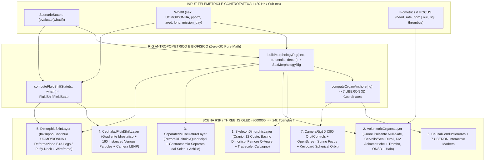

# Piano Implementativo Definitivo — Fase 31 (M2): Rotatable Dual-Gender (`UOMO / DONNA`) 3D Volumetric Anatomical Biodigital Twin & Microgravity Cephalad Fluid Shift Engine

- **Blocco Architetturale**: Blocco M (*Rotatable Dual-Gender 3D Biodigital Twin, Volumetric Organ Telemetry & Microgravity Fluid Shift Visualization*)
- **Fase**: Fase 31 (`M2`)
- **Stato**: PIANO DEFINITIVO APPROVATO PER IMPLEMENTAZIONE (`READY FOR IMPLEMENTATION`)
- **Workspace & Moduli Target**:
  1. [`ares-cockpit/src/modules/body-3d-heatmap/`](../../ares-cockpit/src/modules/body-3d-heatmap) *(MAJOR UPGRADE — Dual-Gender Parametric Rig, 7 Volumetric Organs, Cephalad Fluid Shift Field, 360-Degree Spring Camera Rig & Keyboard Orbit)*
  2. [`ares-cockpit/src/App.tsx`](../../ares-cockpit/src/App.tsx) *(UPDATE — Pass-through di `whatIf`, `packet.biometrics.heart_rate_bpm` e `thrombus` verso `BodyHeatmap` preservando il gate `UnavailableSubsystemPanel` per puro replay `BIDMC`)*
  3. [`ares-portal/src/modules/safety-sandbox/SafetyGatesCounterfactualLab.tsx`](../../ares-portal) *(INTEGRATION CONTRACT — Riuso diretto o sincronizzazione loopback del componente Twin 3D progettato in questa fase con la Fase 30 `M1`)*
- **Owner Principale**: `ARES-Health Team` (3D R3F / Three.js Graphics & HSI), `ARES-Health Team` (Invarianti Fisiche, UBERON Mapping & Performance Budget), `@ale` (Calibrazione Antropometrica `NASA-STD-3001` & Fisiologia Microgravitaria)
- **Budget Prestazioni WebGL & Fattori Umani (`NASA-STD-3001 Vol. 2 Rev F`)**:
  - **Frame Rate Target (`[V2 10152]`)**: $60\text{ FPS}$ costanti ($\le 16.6\text{ ms}$ frame budget; $< 4.0\text{ ms}$ GPU draw time su GPU integrata mobile/spacecraft)
  - **Budget Geometrico Totale**: $< 24{,}000$ triangoli attivi complessivi, $< 45$ draw call (`InstancedMesh` obbligatoria per particelle venose e vertebre/trabecole ripetitive)
  - **Allocazioni Heap in `useFrame`**: `0` allocazioni per frame (tutti i `THREE.Vector3`, `THREE.Color`, `THREE.Matrix4` pre-allocati fuori dal loop di render; `geometry.dispose()` e `material.dispose()` deterministici su cambio profilo `UOMO / DONNA`)
  - **Asset Esterni / Rete / Cloud CDN**: `0` (**100% Geometria Procedurale Parametrica Locale** — nessun file `.glb`/`.gltf` scaricato da URL remoti)
- **Invarianti Non Negoziabili**:
  - **ZERO EMOJI** ovunque nel codice, nei commenti, nelle label 3D HTML, nella UI e nella documentazione.
  - **Air-Gapped Edge Execution**: Rendering 100% locale in WebGL2 (`three ^0.171.0`, `@react-three/fiber ^9.0.0`, `@react-three/drei ^10.0.0`).
  - **Rigore Fisico, Clinico e Provenienza (`Entries 001, 004, 006, 008, 009` & `Issue #12`)**:
    - Sforzo di taglio endoteliale: $\tau_w(t) = 2\mu \cdot v_{\max}(t)\sqrt{\pi / \text{CSA}(t)}$ in $\text{dyn/cm}^2$ con $\mu = 0.035\text{ Poise}$.
    - Nessun valore d'organo fabbricato quando lo stream attivo e puro replay terrestre `PhysioNet BIDMC v1.0.0` (`!hasHemodynamics && !hasMusculoskeletal` mantiene `UnavailableSubsystemPanel`).
    - Quando `packet.biometrics.heart_rate_bpm === null` o `s.hrAccepted === false` (`SQI < 0.60`), la contrazione sistolica 3D del cuore si arresta in modo pulito mostrando lo stato `HR MISSING / SQI REJECTED` (mai `0 bpm` ne battito sintetico nascosto).
    - Esposizione permanente del badge `ILLUSTRATIVE_UNVALIDATED` (*"Illustrative scenario morphology — not clinically calibrated"*).

---

## 1. Executive Summary, Audit dell'Esistente e Grounding Scientifico

### 1.1 Gap Analysis del Modulo 3D Attuale (`BodyHeatmap.tsx` & `AnatomicalLayers.tsx`)

L'ispezione diretta di [`BodyHeatmap.tsx`](../../ares-cockpit/src/modules/body-3d-heatmap/BodyHeatmap.tsx) (303 righe) e [`AnatomicalLayers.tsx`](../../ares-cockpit/src/modules/body-3d-heatmap/AnatomicalLayers.tsx) (435 righe) ha evidenziato 7 limiti strutturali che questa **Fase 31 (`M2`)** risolve in modo definitivo:

1. **Coordinate Statiche dei Nodi 3D (`P` in `BodyHeatmap.tsx` righe 103–109):** I 5 marker cliccabili (`onsd`, `ijv`, `femur`, `soleus`, `calcaneus`) usano coordinate fisse che non seguono ne il cambio `MALE / FEMALE` ne l'allungamento spinale in microgravita, causando disallineamento visivo rispetto alle ossa/muscoli; mancano inoltre i nodi cliccabili per **Cuore (`UBERON:0000948`)** e **Cervello (`UBERON:0000955`)**, gia presenti nel grafo Rust [`hypergraph_spatial.rs`](../../crates/ares-causal-graph/src/hypergraph_spatial.rs).
2. **Dimorfismo Sessuale Incompleto:**
   - Il bacino e modellato con soli 2 tubi simmetrici privi di svasatura iliaca (*iliac ala flare*), larghezza sacrale e **angolo sottopubico** ($\approx 82^\circ$ nella donna vs $\approx 56^\circ$ nell'uomo).
   - Il femore ha posizione `[-0.13, 0.14, 0.01]` e rotazione `0.04 rad` identiche per uomo e donna, ignorando l'**angolo Q femorale** ($\theta_Q \approx 17^\circ$ `DONNA` vs $\theta_Q \approx 12^\circ$ `UOMO`), determinante per la biomeccanica dell'atterraggio e della marcia a `0.38g` su Marte (`GAI`, Safety Gate 3).
   - `VascularNeuroLayer` non riceve nemmeno la prop `sex: CrewSex`.
3. **Triceps Surae Fuso in Singola Mesh (`geo.calf`):** Gastrocnemio e soleo sono fusi in un unico solido di rivoluzione. In microgravita le fibre lente posturali di tipo I del **Soleo (`UBERON:0001389`)** atrofizzano molto piu rapidamente del gastrocnemio fasico; i due muscoli e il **Tendine d'Achille** inserito sul **Calcagno (`UBERON:0001450`)** devono essere geometricamente separati.
4. **Assenza di Asimmetria Giugulare e Trombo Intraluminale:** `ijvL` e `ijvR` sono identiche, mentre la letteratura spaziale dimostra marcata asimmetria anatomica (lume destro dominante, ma stasi retrograda e trombosi ostruttiva prevalentemente nella **IJV sinistra**; Marshall-Goebel et al. 2019) e manca la visualizzazione 3D del coagulo intraluminale quando POCUS conferma `thrombus === true` (Safety Gate 1).
5. **Assenza di Struttura Corticale/Trabecolare in Femore e Calcagno:** Il calcagno e rappresentato da due `boxGeometry` rettangolari opachi, senza architettura interna trabecolare sensibile alla Sclerostina (`SOST`) e senza cono vettoriale di asimmetria del passo marziano (`GAI`).
6. **Assenza Totale dell'Effetto Dinamico di Fluid Shift Cefalico (`~2.0 L`):** Manca un layer volumetrico/particellare che mostri la traslocazione cefalica dei fluidi in `0g` (*"bird legs"* agli arti inferiori + congestione venosa toraco-cervico-cranica) e l'**inversione caudale del flusso** quando viene attivata la camera a pressione negativa **`LBNP` (`-25 .. -45 mmHg`)**.
7. **Controllo Camera Base senza Preset, Spring Focus o Accessibilita da Tastiera:** `OrbitControls` non offre viste cliniche rapide (`ANTERIOR`, `POSTERIOR`, `LEFT LATERAL`, `RIGHT LATERAL`, `CRANIAL-IJV`, `LOWER-LIMB`), non applica transizioni elastiche (*OpenScreen* spring focus) sul nodo selezionato e non permette rotazione orbitale da tastiera in assenza di mouse (`vercel-labs/ui` pattern).

---

### 1.2 Letteratura Scientifica, Antropometria `NASA-STD-3001` e Ontologia `UBERON`

1. **Antropometria Spaziale e Dimorfismo Sessuale (`NASA-STD-3001` & `ANSUR II`):**
   - *NASA-STD-3001 Volume 2, Rev F (2026), Section 4 (Anthropometry, Biomechanics, and Strength) & Data Tables:* Copertura obbligatoria dal **5° percentile femminile** al **95° percentile maschile**, inclusa l'elongazione spinale in microgravita del **`+3% .. +6%`** per scarico dei dischi intervertebrali toraco-lombari (Young & Rajulu, NASA Anthropometric Source Book).
   - Differenze cardiovascolari e ortostatiche sesso-specifiche nel volo spaziale: minore volume plasmatico assoluto, maggiore compliance venosa pelvico-splancnica e maggiore suscettibilita all'intolleranza ortostatica post-volo/sotto LBNP nelle astronaute (`lbnpSbpSens = 1.18` in `SEX_PROFILES.FEMALE` vs `1.00` in `MALE`), a fronte di una diversa incidenza clinica di rimodellamento del globo oculare in `SANS` (Harm et al. 2001 *J Appl Physiol*; Waters et al. 2002; *npj Microgravity* sex/gender decadal reviews).
2. **Fluid Shift Cefalico, Emodinamica Giugulare e `SANS` (`deep-scholar`):**
   - **Marshall-Goebel et al. (2019)**, *JAMA Network Open* (`DOI: 10.1001/jamanetworkopen.2019.15011`): distensione della vena giugulare interna in microgravita, flusso stagnante/retrogrado e primo caso documentato di trombosi ostruttiva della **IJV sinistra** sulla ISS, oltre all'efficacia della **LBNP (`-25 mmHg`)** nel ripristinare il drenaggio venoso caudale.
   - **Mader & Gibson (2022)** (`DOI: 10.1016/b978-0-323-91524-3.00013-2`), **Bateman & Bateman (2022, 2024)** *npj Microgravity* (`DOI: 10.1038/s41526-022-00188-6`, `10.1038/s41526-024-00365-9`), **Hu et al. (2024)** *npj Microgravity* (`DOI: 10.1038/s41526-024-00449-6`): accoppiamento tra congestione del sistema venoso cranico/giugulare, ipercapnia di cabina (`ppCO2`), impedenza di efflusso dei seni venosi durali e distensione della guaina del nervo ottico retrobulbare (`ONSD`).
3. **Atrofia del Soleo, Rimodellamento Trabecolare e Marcia Marziana (`0.38g`):**
   - **NASA OSDR `OSD-51` / `OSD-195` / `OSD-818`**, **ESA Myotones** e **Frost Mechanostat (`1987`, soglia $1000\ \mu\varepsilon$)**: scarico selettivo del soleo (`-1.5%/mese` non protetto), riduzione dell'irisina miochinica, upregulation della Sclerostina osteocitaria (`SOST`) con riassorbimento trabecolare nel triangolo di Ward del collo femorale e nella tuberosita calcaneare.
4. **Allineamento Ontologico Rigoroso (`UBERON` — `hypergraph_spatial.rs` linea 17):**
   - Cervello / SNC vestibolare: **`UBERON:0000955`**
   - Globo oculare & guaina del nervo ottico (`ONSD / SANS`): **`UBERON:0000970`**
   - Vena giugulare interna (`IJV`): **`UBERON:0001586`** *(Nota vincolante da `hypergraph_spatial.rs`: non usare mai `UBERON:0001585`, che identifica la vena cava anteriore)*
   - Cuore / asse cardio-autonomico: **`UBERON:0000948`**
   - Femore prossimale e diafisi: **`UBERON:0000981`**
   - Muscolo soleo: **`UBERON:0001389`**
   - Calcagno: **`UBERON:0001450`**

---

## 2. Architettura del Modello 3D Dual-Gender, Matrice di Dimorfismo e Organi Volumetrici

### 2.1 Pipeline di Rendering Parametrico e Controllo Interattivo



---

### 2.2 Matrice Quantitativa del Dimorfismo Sessuale (`UOMO / MALE` vs `DONNA / FEMALE`)

Tutte le proporzioni geometriche del rig `SexMorphologyRig` sono derivate dai rapporti antropometrici `NASA-STD-3001 Vol. 2` / `ANSUR II` normalizzati in spazio scena Three.js ($1.0\text{ unita scena} \approx 0.72\text{ m}$, range verticale $[-0.78, +1.78]$), con supporto opzionale ai preset percentili (`P05_FEMALE`, `P50_NOMINAL`, `P95_MALE`) e all'allungamento spinale microgravitario $\epsilon_{\text{spine}}(t) = 0.045 \cdot \text{decon}$ (`+4.5%` a regime sul tratto toraco-lombare):

| Distretto Anatomico / Parametro Clinico | Profilo `UOMO` (`MALE` — `ASTRO-01`) | Profilo `DONNA` (`FEMALE` — `ASTRO-02`) | Impatto Geometrico 3D e Biomeccanico in ARES-Health |
| :--- | :--- | :--- | :--- |
| **Statura Antropometrica di Riferimento (`P50` / Range)** | $175.6\text{ cm}$ (`P95`: $186.9\text{ cm}$) — Scala assiale rig $1.000$ | $162.8\text{ cm}$ (`P05`: $151.9\text{ cm}$) — Scala assiale rig $0.942$ | Scala verticale armonica di cranio, arti e colonna (+ elongazione spinale intervertebrale `0g` $\epsilon_{\text{spine}}$). |
| **Larghezza Biacromiale Spalle (`shoulderHalfSpan`)** | $39.8\text{ cm}$ (`0.285` unita scena) | $35.4\text{ cm}$ (`0.244` unita scena, $-14.4\%$) | Clavicola piu lunga e orizzontale in `UOMO`; trapezio e cuffia dei rotatori piu affusolati in `DONNA`. |
| **Gabbia Toracica (`ribWidthScale` / `ribDepthScale`)** | `W: 1.00`, `AP Depth: 1.00`, sterno `0.275` | `W: 0.88`, `AP Depth: 0.86`, sterno `0.238` | 10 coppie costali + arco costale inferiore piu stretto in `DONNA`, volume toracico superiore piu espanso in `UOMO`. |
| **Bacino: Larghezza Bi-iliaca & Svasatura Ali Iliache** | `pelvisWidthScale = 0.94`, creste alte e strette (`pelvic inlet` cuoriforme) | `pelvisWidthScale = 1.14`, ali iliache svasate lateralmente (`pelvic inlet` ginecoide ovale) | Sacro piu largo e piu corto in `DONNA`; distanza inter-acetabolare aumentata (`hipJointX = 0.138` vs `0.122`). |
| **Angolo Sottopubico (`subpubicArchDeg`)** | **$56^\circ$** (arco acuto a `V` rovesciata) | **$82^\circ$** (arco ampio ad `U` rovesciata) | Modellato esplicitamente con tubi ischio-pubici convergenti sulla sinfisi pubica anteriore. |
| **Angolo Q Femorale (`femoralQAngleDeg`, $\theta_Q$)** | **$12.0^\circ$** (`0.209 rad` obliquita valga funzionale) | **$17.0^\circ$** (`0.297 rad` obliquita valga funzionale) | In `DONNA`, la maggiore distanza acetabolare converge verso i condili mediali del ginocchio (`kneeX = 0.106`), aumentando il momento valgo all'atterraggio a `0.38g`. |
| **Masse Muscolari Arti Superiori e Torace** | Deltoide/Bicipite `1.00`, Pettorale squadrato largo | Deltoide/Bicipite `0.83`, profilo toraco-mammario anatomico sul layer `Skin` | Differenza fisiologica di sezione trasversa muscolare del cingolo scapolare (`NASA-STD-3001` Strength Tables). |
| **Muscolo Soleo (`UBERON:0001389`) & Gastrocnemio** | Nominale **`16.0 mm`**, Critico **`12.0 mm`** (`SEX_PROFILES.MALE`) | Nominale **`14.0 mm`**, Critico **`10.5 mm`** (`SEX_PROFILES.FEMALE`) | Soleo profondo separato dal gastrocnemio superficiale; scala radiale guidata in tempo reale da `s.soleusMm / soleusNominal`. |
| **Vena Giugulare Interna (`UBERON:0001586`)** | Baseline `CSA = 0.75 cm^2`, Critica `2.50 cm^2` | Baseline `CSA = 0.62 cm^2`, Critica `2.20 cm^2` | Raggio luminale dinamico $r(t) = \sqrt{\text{CSA}(t)/\pi}$, con **IJV Destra** $+18\%$ di calibro basale e **IJV Sinistra** sede preferenziale di stasi/trombo. |
| **Guaina Nervo Ottico (`UBERON:0000970`, `ONSD`)** | Nominale `5.0 mm`, Critica `5.8 mm` | Nominale `4.8 mm`, Critica `5.5 mm` | Cilindro subaracnoideo retrobulbare circondato dall'alone bayesiano traslucido $\pm 1.96\sigma_{\text{ONSD}}$. |
| **Sensibilita Emodinamica `LBNP` (`lbnpSbpSens`)** | `1.00x` (`sbpBase = 120 mmHg`, `hrLimit = 115 bpm`) | `1.18x` (`sbpBase = 112 mmHg`, `hrLimit = 120 bpm`) | Maggiore deplezione pressoria sotto aspirazione caudale `LBNP`, collegata direttamente al Safety Gate 2 (`AUTO_VENT_LBNP`). |

---

### 2.3 Specifica Dettagliata dei 7 Organi Volumetrici e dei Layer Muscolo-Scheletrici

Ogni organo e modellato in 3D procedurale ad alta leggibilita clinica su fondo OLED `#000000`, collegato al rispettivo margine di robustezza `NQS-STL` $\hat{\rho}_k(t) \in (-\infty, +1.0]$ e selezionabile sia con click/touch 3D sia da tastiera:

1. **Cuore Volumetrico e Arco Aortico (`heart`, `UBERON:0000948`):**
   - **Geometria:** Cono biventricolare asimmetrico orientato verso l'apice sinistro anteriore (`rotationZ = -0.32 rad`), atrio destro/sinistro superiore, arco aortico ascendente/discendente con tronchi sovraortici, vena cava superiore (`SVC`) e vena cava inferiore (`IVC`).
   - **Dinamica Fisiologica Null-Safe:** Quando `hrAccepted === true` e `heartRateBpm !== null`, il miocardio esegue una contrazione sistolica volumetrica isovolumetrica/eiettiva a frequenza $f_{\text{HR}} = \text{HR}/60\text{ Hz}$ ($\Delta s_{\text{systole}} \approx 6\%$). Se `hrAccepted === false` o `heartRateBpm === null` (es. campione mancante in `bidmc_01` o artefatto `SQI < 0.60`), la pulsazione **si congela immediatamente** al volume diastolico neutro e si attiva un anello wireframe ambra `SQI REJECTED / HR MISSING` (`Entries 006 & 008`).
2. **Cervello, Cervelletto e Seni Venosi Durali (`brain`, `UBERON:0000955`):**
   - **Geometria:** Emisferi cerebrali destro/sinistro scolpiti con scissura interemisferica longitudinale, lobi frontale/occipitale, cervelletto posteriore, tronco encefalico e **Seno Sagittale Superiore + Seni Trasversi/Sigmoidei** che drenano direttamente nei bulbi giugulari superiori.
   - **Dinamica Fisiologica:** L'intensita emissiva dei seni venosi durali risponde alla vasodilatazione ipercapnica cerebrale (`s.rho.ppco2`) e all'impedenza di drenaggio venoso (`s.csa`), rendendo visibile la catena causale `Cabina ppCO2 -> Vasodilatazione Cerebrale -> Congestione Dural-Giugulare -> SANS`.
3. **Vena Giugulare Interna Asimmetrica & Trombo POCUS (`ijv`, `UBERON:0001586`):**
   - **Geometria:** Doppio condotto curvo `CatmullRomCurve3` dal forame giugulare cranico (`y = 1.50`) alla confluenza succlavia/anonima (`y = 1.12`), con asimmetria anatomica realistica: **IJV Destra** con calibro fisiologico dominante ($1.15 \times r_{\text{mean}}$) e **IJV Sinistra** piu sottile ma soggetta a maggiore compressione/stasi retrograda ($0.88 \times r_{\text{mean}}$ a riposo, fino a distensione sferica sacculare quando $\text{CSA} > 2.0\text{ cm}^2$).
   - **Safety Gate 1 Visual Interlock:** Quando l'ecografia POCUS conferma un trombo (`thrombus === true`), all'interno del lume della **IJV Sinistra** compare una mesh ellissoidale iperecogena rosso-ambra (`IntraluminalThrombusMesh`) con alone pulsante di allarme; quando `thrombus !== true`, anche con $\tau_w < 4.0\text{ dyn/cm}^2$ appare solo il bagliore di stasi endoteliale senza coagulo confermato, spiegando visivamente il blocco degli anticoagulanti sistemici.
4. **Globi Oculari e Guaina Retrobulbare del Nervo Ottico (`onsd`, `UBERON:0000970`):**
   - **Geometria:** Globi sclerali bilaterali con anello irideo/corneale anteriore (essenziale per percepire immediatamente l'orientamento della testa durante la rotazione a $360^\circ$), nucleo assonale del nervo ottico (`r = 1.5 mm` scalato) + **guaina subaracnoidea distensibile** il cui diametro esterno scala esattamente con `s.onsdMm` (`4.8..6.8 mm`).
   - **Alone d'Incertezza Bayesiano:** Un cilindro coassiale traslucido esterno mostra l'ampiezza $\pm 1.96 \cdot \sigma_{\text{ONSD}}(t)$ (`s.onsdSigmaMm`), che si espande visibilmente con `s.daysSinceScan` e collassa istantaneamente quando l'astronauta preme `LOG 2-MIN EYE SCAN NOW`.
5. **Femore Dual-Shell Corticale + Trabecolare (`femur`, `UBERON:0000981`):**
   - **Geometria:** Testa femorale sferica nell'acetabolo pelvico, collo anatomico inclinato ($126^\circ$ angolo cervico-diafisario), grande trocantere, diafisi orientata secondo l'angolo Q $\theta_Q(\text{sex})$ e condili femorali distali.
   - **Rimodellamento Meccanostatico:** Guscio corticale esterno semitrasparente che lascia intravedere nel collo femorale (**Triangolo di Ward**) un reticolo trabecolare interno la cui densita/opacita decresce proporzionalmente a `s.bmdLossPct` mentre la tinta vira verso il colore di rischio `s.rho.sclerostin` quando `SOST` supera la soglia critica.
6. **Soleo Profondo Separato, Gastrocnemio e Tendine d'Achille (`soleus`, `UBERON:0001389`):**
   - **Geometria:** Separazione anatomica netta del compartimento posteriore della gamba:
     - **Soleo profondo** posizionato anteriormente al gastrocnemio (`z = -0.025`), con striature chevron che indicano l'angolo di pennazione fascicolare $\theta_{\text{penn}} = \text{clamp}(12 + (\text{soleusMm} - 11), 8^\circ, 35^\circ)$ e scala radiale diretta `s.soleusMm / P.soleusNominal`.
     - **Gastrocnemio superficiale** (capo mediale e capo laterale distinti, `z = -0.048`, semitrasparente per non occultare il soleo sottostante).
     - **Tendine d'Achille** fibroso bianco-avorio che unisce distalmente soleo e gastrocnemio inserendosi sulla tuberosita posteriore del calcagno.
7. **Calcagno Volumetrico & Cono di Stabilita Marziana `0.38g` (`calcaneus`, `UBERON:0001450`):**
   - **Geometria:** Sostituzione dei vecchi `boxGeometry` con una geometria anatomica sagomata del retropiede (tuberosita calcaneare posteriore, sustentaculum tali, arco plantare e avampiede metatarsale) con nucleo trabecolare sensibile a `s.bmdLossPct`.
   - ** Safety Gate 3 (`GAI`) Floor Ring:** Sotto i piedi del gemello digitale viene renderizzata una piattaforma goniometrica circolare (`r = 0.48`) con tacche cardinali (`0° ANT`, `90° R`, `180° POST`, `270° L`) e due impronte di carico plantare (`0.38g MARS GRF`): all'aumentare di `s.gaiPct` oltre il limite del `10%`, il baricentro proiettato oscilla asimmetricamente colorandosi di rosso/arancio.

---

## 3. Formulazioni Matematiche e Biofisiche Esatte

### 3.1 Campo di Fluid Shift Cefalico in Microgravita e Inversione sotto `LBNP`

In gravita terrestre ($1g$), il gradiente idrostatico $\Delta P = \rho_{\text{blood}} g h$ trattiene circa $1.5\text{–}2.0\text{ L}$ di volume ematico ed extravascolare nel compartimento venoso degli arti inferiori al di sotto del **Punto di Indifferenza Idrostatica** ($y_{\text{HIP}} \approx 0.72$ in coordinate scena, subito sotto il diaframma/cuore). In microgravita ($0g$), l'annullamento del peso idrostatico sposta tale volume verso torace, collo e cranio; l'applicazione della **Lower Body Negative Pressure (`LBNP`, $P_{\text{LBNP}} \in [-50, 0]\text{ mmHg}$)** ricrea artificialmente un gradiente pressorio caudale.

Definiamo l'**Indice Adimensionale di Fluid Shift Cefalico Netto** $\Phi_{\text{shift}}(t) \in [0, 1]$:

$$\Phi_{\text{shift}}(t) = \text{clamp}\!\left(0.18 + 0.72 \cdot d(t) + 0.06 \cdot \max\!\bigl(0,\, P_{\text{CO}_2}(t) - 2.5\bigr) + 0.08 \cdot \frac{\Delta_{\text{soleus}\%}(t)}{30} - 0.017 \cdot \bigl|P_{\text{LBNP}}(t)\bigr|,\; 0.0,\; 1.0\right)$$

dove $d(t) = 1 - e^{-\text{day}/220}$ (`s.decon`). Da $\Phi_{\text{shift}}(t)$ derivano tre effetti 3D simultanei e coerenti:

1. **Profilo Assiale di Ridistribuzione Tissutale $\Delta R_{\text{skin}}(y, t)$ (*"Bird Legs"* vs *"Puffy Neck/Face"*):**
   Per ogni quota verticale $y$ dell'inviluppo cutaneo rispetto a $y_{\text{HIP}} = 0.72$:
   $$\sigma_{\text{radius}}(y, t) = \begin{cases} 1 - 0.085 \cdot \Phi_{\text{shift}}(t) \cdot \text{clamp}\!\left(\dfrac{y_{\text{HIP}} - y}{1.35},\, 0,\, 1\right) & \text{se } y < y_{\text{HIP}} \quad (\text{deplezione arti inferiori fino a } -8.5\%) \\[8pt] 1 + 0.065 \cdot \Phi_{\text{shift}}(t) \cdot \text{clamp}\!\left(\dfrac{y - y_{\text{HIP}}}{0.90},\, 0,\, 1\right) & \text{se } y \ge y_{\text{HIP}} \quad (\text{turgore toraco-cervico-facciale fino a } +6.5\%) \end{cases}$$
2. **Velocita di Avvezione delle Particelle Venose Istantate (`InstancedMesh`, $N = 160$):**
   La velocita assiale normalizzata lungo i condotti venosi principali (vene femorali/iliache $\to$ vena cava inferiore $\to$ atrio destro $\leftrightarrow$ vene giugulari interne) vale:
   $$v_{\text{venous}}(t) = 0.28 \cdot \bigl(\Phi_{\text{shift}}(t) - 0.42\bigr) - 0.012 \cdot \bigl|P_{\text{LBNP}}(t)\bigr|$$
   - In **`0g` senza contromisure** ($P_{\text{LBNP}} = 0$, $\text{day} \ge 30$): $v_{\text{venous}}(t) > 0$ nella meta inferiore (risalita cefalica continua dagli arti inferiori verso il torace/collo) mentre nel tratto giugulare superiore la velocita rallenta fino a quasi zero / oscillazione retrograda quando $\tau_w(t) < 4.0\text{ dyn/cm}^2$ (**stasi venosa giugulare**).
   - Con **`LBNP` attiva** ($\bigl|P_{\text{LBNP}}\bigr| \ge 25\text{ mmHg}$): $v_{\text{venous}}(t) < 0$, invertendo visibilmente il moto delle particelle verso il bacino e le gambe (**drenaggio caudale attivo**) e riducendo in tempo reale il calibro delle mesh `ijvL` e `ijvR`.
   - Se scatta il **Safety Gate 2 (`AUTO_VENT_LBNP_CHAMBER` per $\Delta\text{SBP} > 15\text{ mmHg}$ o $\text{HR} > \text{HR}_{\text{limit}}$)**: `lbnp_mmhg` torna istantaneamente a `0 mmHg`, la camera cilindrica traslucida LBNP attorno alle gambe emette un flash di sfiato di sicurezza e scompare.

---

### 3.2 Trigonometria dell'Angolo Q Femorale e Ancoraggio Parametrico dei 7 Nodi

Sia $x_{\text{hip}}(\text{sex})$ la semidistanza acetabolare (`0.122` per `UOMO`, `0.138` per `DONNA`) e $x_{\text{knee}}(\text{sex})$ la semidistanza intercondiloidea al ginocchio (`0.112` per `UOMO`, `0.105` per `DONNA`) su una lunghezza femorale $L_{\text{femur}}(\text{sex})$. L'inclinazione frontale del femore nel piano coronale $(X, Y)$ e:

$$\theta_{\text{shaft}}(\text{sex}) = \arcsin\!\left(\frac{x_{\text{hip}}(\text{sex}) - x_{\text{knee}}(\text{sex})}{L_{\text{femur}}(\text{sex})}\right), \qquad \theta_Q(\text{sex}) = \begin{cases} 12.0^\circ & \text{se } \text{sex} = \text{MALE} \\ 17.0^\circ & \text{se } \text{sex} = \text{FEMALE} \end{cases}$$

Tutte le coordinate 3D dei **7 nodi interattivi `TwinNodeId`** (`brain`, `onsd`, `ijv`, `heart`, `femur`, `soleus`, `calcaneus`) e i punti di controllo degli archi causali di Bezier vengono ricalcolati deterministicamente da `computeOrganAnchors(rig: SexMorphologyRig)` affinche restino **sempre incollati al centro anatomico esatto** dell'organo corrispondente sia per `UOMO` sia per `DONNA` a qualunque angolo di rotazione.

---

### 3.3 Camera Rig Sferico a $360^\circ$, OpenScreen Spring Focus e Navigazione da Tastiera

Per combinare fluidita cinematografica (*OpenScreen* `motionSmoothing.ts`) e accessibilita completa senza mouse in microgravita (*Vercel Labs UI* `roving-focus` + `focus-recovery`):

- La camera orbita liberamente a **$360^\circ$ completi** in azimut $\theta \in (-\pi, +\pi]$ attorno all'asse longitudinale $Y$ del corpo, con angolo polare $\phi \in [0.22\pi, 0.82\pi]$ e distanza radiale $r \in [1.55, 6.20]$.
- Quando l'utente seleziona un **Preset di Vista** (`ANTERIOR 0°`, `RIGHT 90°`, `POSTERIOR 180°`, `LEFT 270°`, `HEAD/NECK ZOOM`, `LOWER LIMB ZOOM`) oppure clicca uno dei **7 nodi `UBERON`**, il solutore elastico smorzato (`springPhysics.ts` della Fase 30, con fallback self-contained se invocato standalone: `stiffness = 210`, `damping = 26`, `mass = 1.0`) interpola dolcemente sia `camera.position` sia `OrbitControls.target` verso l'organo scelto, **interrompendosi immediatamente al primo input manuale di drag/wheel dell'utente** per non sottrarre mai il controllo manuale.
- Quando il viewport 3D ha il focus da tastiera (`tabIndex={0}`, `role="application"`, `aria-label="Rotatable 3D Astronaut Biodigital Twin"`):
  - `ArrowLeft` / `ArrowRight`: ruotano il modello di $\pm 15^\circ$ in azimut ($\pm 45^\circ$ con `Shift`).
  - `ArrowUp` / `ArrowDown`: inclinano l'elevazione polare di $\pm 10^\circ$.
  - `+` / `-`: zoom in / zoom out.
  - `0` o `R`: reset istantaneo alla vista anteriore completa.
  - `M` / `F` (o switch `UOMO / DONNA`): commuta il profilo biologico preservando l'angolo di rotazione corrente della camera!

---

## 4. Contratti TypeScript & Interfacce Componenti

### 4.1 Rig Antropometrico e Nodi `UBERON` (`ares-cockpit/src/modules/body-3d-heatmap/anthropometry.ts`)

```typescript
import type { CrewSex, ScenarioState, PredicateKey } from '../../lib/scenario';

export type V3 = [number, number, number];

export type AnthropometricPercentile = 'P05_FEMALE' | 'P50_NOMINAL' | 'P95_MALE';

export type TwinNodeId =
  | 'brain'     // UBERON:0000955 — Brain & Dural Venous Sinuses
  | 'onsd'      // UBERON:0000970 — Eye Globe & Retrobulbar Optic Nerve Sheath
  | 'ijv'       // UBERON:0001586 — Asymmetric Internal Jugular Vein (Left/Right)
  | 'heart'     // UBERON:0000948 — Volumetric Heart & Aortic Arch
  | 'femur'     // UBERON:0000981 — Proximal Femur (Ward's Triangle) & Diaphysis
  | 'soleus'    // UBERON:0001389 — Deep Soleus separated from Gastrocnemius
  | 'calcaneus';// UBERON:0001450 — Calcaneus & Mars 0.38g Gait Asymmetry Vector

export type CameraViewPreset =
  | 'ANTERIOR'
  | 'RIGHT_LATERAL'
  | 'POSTERIOR'
  | 'LEFT_LATERAL'
  | 'CRANIAL_SANS_IJV'
  | 'LOWER_LIMB_MARS';

export interface SexMorphologyRig {
  sex: CrewSex;
  displayLabelIt: 'UOMO' | 'DONNA';
  displayLabelEn: 'MALE' | 'FEMALE';
  percentile: AnthropometricPercentile;
  statureCm: number;
  axialScale: number;
  spinalElongationRatio: number; // +0.00 .. +0.045 in 0g
  shoulderHalfSpan: number;
  clavicleLength: number;
  ribWidthScale: number;
  ribDepthScale: number;
  sternumLength: number;
  waistRadiusScale: number;
  pelvisWidthScale: number;
  iliacFlareFactor: number;
  subpubicArchDeg: number;       // 56 deg UOMO vs 82 deg DONNA
  hipJointX: number;
  kneeJointX: number;
  ankleJointX: number;
  femurLength: number;
  tibiaLength: number;
  femoralShaftTiltRad: number;
  femoralQAngleDeg: number;      // 12 deg UOMO vs 17 deg DONNA
  upperLimbMuscleScale: number;
  thighMuscleScale: number;
  soleusNominalMm: number;       // 16.0 UOMO vs 14.0 DONNA
  soleusCriticalMm: number;      // 12.0 UOMO vs 10.5 DONNA
  ijvRightDominance: number;     // 1.15
  ijvLeftStasisFactor: number;   // 0.88 baseline, higher distension sensitivity
}

export interface OrganNodeDescriptor {
  id: TwinNodeId;
  uberonCurie:
    | 'UBERON:0000955'
    | 'UBERON:0000970'
    | 'UBERON:0001586'
    | 'UBERON:0000948'
    | 'UBERON:0000981'
    | 'UBERON:0001389'
    | 'UBERON:0001450';
  label: string;
  position: V3;
  cameraFocusOffset: V3;
  predicateKey: PredicateKey;
  rho: number;
  formattedValue: string;
}

export function buildMorphologyRig(
  sex: CrewSex,
  decon: number,
  percentile?: AnthropometricPercentile,
): SexMorphologyRig;

export function computeOrganAnchors(
  rig: SexMorphologyRig,
  s: ScenarioState,
  heartRateBpm: number | null,
): Record<TwinNodeId, OrganNodeDescriptor>;
```

### 4.2 Motore Matematico Fluid Shift (`ares-cockpit/src/modules/body-3d-heatmap/fluidShiftMath.ts`)

```typescript
import type { ScenarioState, WhatIf } from '../../lib/scenario';

export interface FluidShiftFieldState {
  /** Dimensionless net cephalad translocation index in [0, 1]. */
  cephaladShiftIndex: number;
  /** Estimated translocated fluid volume in mL (0 .. ~2100 mL, illustrative scenario range). */
  translocatedVolumeMl: number;
  /** Signed axial venous particle velocity (+ = cephalad drift, - = caudal LBNP drainage). */
  venousAdvectionVelocity: number;
  /** True when LBNP negative pressure actively reverses flow caudally. */
  caudalReversalActive: boolean;
  /** Lower-limb tissue radius multiplier (< 1.0 in 0g "bird legs"). */
  lowerLimbScale: number;
  /** Cervical/cranial soft-tissue multiplier (> 1.0 in 0g "puffy neck/face"). */
  cranialNeckScale: number;
  /** Normalized LBNP chamber suction intensity in [0, 1] for 3D chamber visualization. */
  lbnpChamberNormalized: number;
}

export function computeFluidShiftState(
  s: ScenarioState,
  whatIf?: Pick<WhatIf, 'ppco2_mmhg' | 'lbnp_mmhg' | 'mission_day'>,
): FluidShiftFieldState;

export function sampleTissueShiftScaleAtY(y: number, field: FluidShiftFieldState): number;
```

### 4.3 Contratto Props Retrocompatibile di `BodyHeatmap.tsx`

Per non rompere alcun test o callsite esistente e abilitare contemporaneamente i nuovi input fisiologici e il riuso nel portale `ares-portal` (Fase 30 `M1`):

```typescript
export interface BodyHeatmapProps {
  s: ScenarioState;
  sex: CrewSex;
  /** Optional full WhatIf state to drive LBNP chamber & fluid-shift reversal directly. */
  whatIf?: Pick<WhatIf, 'ppco2_mmhg' | 'ared_load_pct' | 'lbnp_mmhg' | 'mission_day'>;
  /** Nullable live/simulated heart rate; null freezes cardiac beat cleanly (Entries 006 & 008). */
  heartRateBpm?: number | null;
  /** POCUS thrombus confirmation state for Left IJV intraluminal clot visualization (Safety Gate 1). */
  thrombusConfirmed?: boolean | null;
  onChangeSex?: (sex: CrewSex) => void;
  onOpenTab?: (tab: TargetTab) => void;
  /** Optional initial camera preset (useful for WalkthroughDemoStudio & ares-portal). */
  initialViewPreset?: CameraViewPreset;
}
```

---

## 5. Lista Ordinata dei File da Creare o Modificare per i Worker Flash

I worker Flash devono eseguire questa **Fase 31 (`M2`)** seguendo rigorosamente l'ordine delle **4 Wave** sottostanti. I path sono partizionati all'interno di `ares-cockpit/src/modules/body-3d-heatmap/` in modo da **non generare conflitti Git** con i worker della Fase 30 (`M1`).

### Wave 1 — Fondamenta Matematiche Pure: Antropometria Dual-Gender & Fluid Shift (`Zero-Three.js Pure TS`)

| Ordine | File Path | Azione | Worker Target | Specifica Tecnica Esatta |
| :---: | :--- | :---: | :---: | :--- |
| **1** | `ares-cockpit/src/modules/body-3d-heatmap/anthropometry.ts` | **CREATE** | `flash-3d-math` | Implementare `SexMorphologyRig`, `TwinNodeId` (7 nodi mappati alle CURIE `UBERON` esatte di `hypergraph_spatial.rs`, incluso `UBERON:0001586` per `IJV`), `CameraViewPreset`, `buildMorphologyRig(sex, decon, percentile)` con tutti i parametri dimorfici (`subpubicArchDeg`: `56` vs `82`, `femoralQAngleDeg`: `12` vs `17`, `shoulderHalfSpan`, `ribWidthScale`, `pelvisWidthScale`, `soleusNominalMm`: `16.0` vs `14.0`, elongazione spinale `0g`) e `computeOrganAnchors` + `describeTwinNode` con spiegazioni cliniche chiare e riferimenti Safety Gate. Zero dipendenze DOM/WebGL per testabilita unitaria immediata. |
| **2** | `ares-cockpit/src/modules/body-3d-heatmap/fluidShiftMath.ts` | **CREATE** | `flash-3d-math` | Implementare `computeFluidShiftState` ($\Phi_{\text{shift}}(t) \in [0, 1]$, volume traslocato illustrativo in mL, velocita di avvezione venosa con inversione di segno sotto `LBNP`, fattori di scala tissutali `lowerLimbScale` e `cranialNeckScale` attorno a $y_{\text{HIP}} = 0.72$) e le traiettorie parametriche pre-campionate dei condotti venosi per le particelle istanziate. |
| **3** | `ares-cockpit/src/modules/body-3d-heatmap/geometryBuilders.ts` | **CREATE** | `flash-3d-math` | Estrarre ed evolvere i builder procedurali Three.js (`smoothLathe`, `deformedFluidShiftLathe`, `tubeFrom`, `buildDimorphicPelvisGeometry`, `buildDualShellFemurGeometry`, `buildContouredCalcaneusGeometry`, `disposeGeometryRecord`) garantendo `computeVertexNormals()` accurato e zero memory leak WebGL quando l'utente commuta rapidamente `UOMO / DONNA`. |

### Wave 2 — Layer Anatomici Parametrici, Dimorfismo Sessuale, Organi Volumetrici & Fluid Shift Field

| Ordine | File Path | Azione | Worker Target | Specifica Tecnica Esatta |
| :---: | :--- | :---: | :---: | :--- |
| **4** | `ares-cockpit/src/modules/body-3d-heatmap/SkeletonDimorphicLayer.tsx` | **CREATE** | `flash-3d-anatomy` | Implementare lo scheletro parametrico completo guidato da `SexMorphologyRig`: cranio con orbite e mandibola dimorfica, colonna a `S` con elongazione intervertebrale `0g`, 10 paia di coste + sterno + clavicole angolate, **bacino dimorfico completo** (sacro, ali iliache svasate e **arco sottopubico a $56^\circ$ vs $82^\circ$**), **femore dual-shell corticale + reticolo trabecolare del Triangolo di Ward** inclinato all'angolo Q $\theta_Q(\text{sex})$, tibia/perone, **calcagno anatomico sagomato** e piattaforma goniometrica circolare a terra con cono vettoriale `Mars 0.38g GAI`. |
| **5** | `ares-cockpit/src/modules/body-3d-heatmap/VolumetricOrgansLayer.tsx` | **CREATE** | `flash-3d-organs` | Implementare i **5 organi viscerali/vascolo-neurologici volumetrici** guidati da `SexMorphologyRig` e telemetria: (a) **Cuore** biventricolare + arco aortico + `SVC/IVC` con battito sistolico in `useFrame` sincronizzato a `heartRateBpm` e **arresto sicuro + anello ambra** quando `heartRateBpm === null` o `!s.hrAccepted`; (b) **Cervello** bilobato + cervelletto + seni venosi durali sensibili a `ppCO2`; (c) **IJV Destra e Sinistra asimmetriche** con raggio $r = \sqrt{\text{CSA}/\pi}$, colore $\tau_w$ e **mesh trombo intraluminale nella IJV Sinistra** quando `thrombusConfirmed === true`; (d) **Globi oculari** con iride anteriore + **ONSD retrobulbare** + alone bayesiano traslucido $\pm 1.96\sigma_{\text{ONSD}}$. |
| **6** | `ares-cockpit/src/modules/body-3d-heatmap/SeparatedMusculatureLayer.tsx` | **CREATE** | `flash-3d-anatomy` | Implementare la muscolatura dimorfica (`UOMO / DONNA`) per torace, addome, deltoidi, bicipiti, avambracci e quadricipiti (orientati secondo $\theta_Q$), con **separazione anatomica esplicita del Triceps Surae**: **Soleo profondo** (`UBERON:0001389`, scalato radialmente con `s.soleusMm / rig.soleusNominalMm` + chevron di pennazione $\theta_{\text{penn}}$), **Gastrocnemio mediale e laterale superficiali** semitrasparenti e **Tendine d'Achille** inserito sul calcagno. |
| **7** | `ares-cockpit/src/modules/body-3d-heatmap/CephaladFluidShiftLayer.tsx` | **CREATE** | `flash-3d-organs` | Implementare l'effetto visivo dinamico del **Fluid Shift Cefalico in Microgravita**: (a) `THREE.InstancedMesh` a budget fisso ($N = 160$ particelle ematiche, zero allocazioni heap in `useFrame`) che risalgono dagli arti inferiori verso torace/collo in `0g`, rallentano in stasi nella IJV quando $\tau_w < 4.0\text{ dyn/cm}^2$ e **invertono il moto caudalmente** quando `LBNP` e attiva; (b) involucro cilindrico wireframe/traslucido della **Camera a Pressione Negativa `LBNP`** attorno a bacino e gambe quando `|lbnp_mmhg| > 0`; (c) anello piano al **Punto di Indifferenza Idrostatica (`HIP`)**. |
| **8** | `ares-cockpit/src/modules/body-3d-heatmap/DimorphicSkinLayer.tsx` | **CREATE** | `flash-3d-anatomy` | Evolvere il layer `Skin` continuo (`UOMO / DONNA`) integrando la deformazione radiale morbida del fluid shift $\sigma_{\text{radius}}(y, t)$ (*"bird legs"* distali vs turgore cervico-facciale), lineamenti cranio-facciali anteriori chiari (arcata sopraccigliare, ponte nasale, padiglioni auricolari, mani e piedi) per orientamento immediato a $360^\circ$, e wireframe ciano opzionale in modalita X-Ray. |
| **9** | `ares-cockpit/src/modules/body-3d-heatmap/AnatomicalLayers.tsx` | **MODIFY** | `flash-3d-anatomy` | Trasformare `AnatomicalLayers.tsx` in un barrel/facade pulito che riesporta `riskColor`, `V3` e i nuovi 5 layer modulari (`SkeletonDimorphicLayer`, `VolumetricOrgansLayer`, `SeparatedMusculatureLayer`, `CephaladFluidShiftLayer`, `DimorphicSkinLayer`), mantenendo alias retrocompatibili per eventuali import esistenti. |

### Wave 3 — Camera Rig Sferico $360^\circ$, Spring Focus & Controlli HUD Accessibili (`OpenScreen` + `Vercel Labs UI`)

| Ordine | File Path | Azione | Worker Target | Specifica Tecnica Esatta |
| :---: | :--- | :---: | :---: | :--- |
| **10** | `ares-cockpit/src/modules/body-3d-heatmap/CameraRig3D.tsx` | **CREATE** | `flash-3d-controls` | Implementare il controller camera R3F che avvolge `OrbitControls` (`enablePan={false}`, rotazione azimutale libera a $360^\circ$, `minPolarAngle={0.22 * Math.PI}`, `maxPolarAngle={0.82 * Math.PI}`, `minDistance={1.55}`, `maxDistance={6.2}`): applica interpolazione elastica smorzata (*OpenScreen* spring math con rispetto automatico di `prefers-reduced-motion`) quando cambia `viewPreset` o `focusedNodePosition`, cedendo istantaneamente il controllo su `onStart` di drag/wheel dell'utente, ed espone l'angolo azimutale corrente in gradi (`0..359 deg`) per il compasso HUD. |
| **11** | `ares-cockpit/src/modules/body-3d-heatmap/TwinHudControls.tsx` | **CREATE** | `flash-3d-controls` | Implementare i controlli HUD accessibili (*Vercel Labs UI* roving-focus & focus-recovery pattern, zero dipendenze esterne, compatibile sia prima sia dopo il merge della Fase 30): (a) **Selettore prominente `UOMO (MALE)` / `DONNA (FEMALE)`** con `role="radiogroup"`, navigazione a frecce, badge antropometrico (`175.6 cm | Q=12 deg | Soleus 16 mm` vs `162.8 cm | Q=17 deg | Soleus 14 mm`); (b) **Selettore Percentile** (`P05F / P50 / P95M`); (c) **Barra Preset Angoli Camera** (`ANT 0°`, `RIGHT 90°`, `POST 180°`, `LEFT 270°`, `HEAD/IJV`, `LEGS/MARS`, `RESET`); (d) **Indicatore Telemetry Fluid Shift & LBNP** (`SHIFT +1.65 L CEPHALAD` vs `LBNP CAUDAL REVERSAL`) + badge obbligatorio `ILLUSTRATIVE_UNVALIDATED`. |

### Wave 4 — Assemblaggio Finale `BodyHeatmap.tsx`, Collegamento `App.tsx` e Test Deterministici

| Ordine | File Path | Azione | Worker Target | Specifica Tecnica Esatta |
| :---: | :--- | :---: | :---: | :--- |
| **12** | `ares-cockpit/src/modules/body-3d-heatmap/BodyHeatmap.tsx` | **MODIFY** | `flash-3d-integrator` | Integrare `buildMorphologyRig`, `computeFluidShiftState`, `computeOrganAnchors`, i **6 toggle di layer** (`Skin`, `Muscles (Sep. Soleus)`, `Organs/Vascular`, `Skeleton/Trabecular`, `Fluid Shift`, `UBERON Nodes & Arcs`), i **6 preset clinici** (`ALL LAYERS`, `FLUID SHIFT 0G`, `VASCULAR / SANS`, `MUSCLE + BONE`, `SKELETON Q-ANGLE`, `SKIN MORPHOLOGY`), i **7 marker interattivi `UBERON`** con archi causali di Bezier dinamici, la navigazione da tastiera (`ArrowKeys` orbita sferica, `Tab`/lista accessibile dei 7 organi per chi non usa puntatore, `FocusRecovery` alla chiusura del drawer dettagli) e `CameraRig3D`. |
| **13** | `ares-cockpit/src/App.tsx` | **MODIFY** | `flash-3d-integrator` | Aggiornare esclusivamente la chiamata `<BodyHeatmap ... />` nel tab `BODY_3D` passando `whatIf={whatIf}`, `heartRateBpm={packet.biometrics.heart_rate_bpm}` e `thrombusConfirmed={effectiveThrombus}` senza toccare il guard `!hasHemodynamics && !hasMusculoskeletal` che mostra `UnavailableSubsystemPanel` in puro replay `BIDMC`. |
| **14** | `ares-cockpit/scripts/verify_twin_math.mjs` | **CREATE** | `flash-3d-verifier` | Script deterministico eseguibile con `node` (o test TypeScript compilato) che verifica: (1) invarianti dimorfiche `UOMO` vs `DONNA` ($\theta_Q$: `17 > 12`, `subpubicArchDeg`: `82 > 56`, `shoulderHalfSpan`: `MALE > FEMALE`, `pelvisWidthScale`: `FEMALE > MALE`); (2) inversione del segno di `venousAdvectionVelocity` passando da `lbnp_mmhg = 0` a `lbnp_mmhg = -40`; (3) CURIE `UBERON:0001586` per `ijv` (mai `0001585`); (4) allineamento finito (`!Number.isNaN`) di tutti i 7 ancoraggi 3D; (5) scan zero-emoji su tutti i file creati/modificati. |

---

## 6. Matrice di Verifica, Sicurezza Clinica e Conformita `NASA-STD-3001`

Prima di dichiarare completata la **Fase 31 (`M2`)**, i worker devono superare tutti i seguenti gate deterministici:

1. **Compilazione Strict TypeScript e Bundle Produzione (`ares-cockpit`):**
   ```bash
   cd ares-cockpit && npm run lint && npm run build
   node scripts/verify_twin_math.mjs
   ```
   - Zero errori `tsc -b` (`noUnusedLocals`, `noUnusedParameters` attivi), zero warning di import inutilizzati.
2. **Verifica Funzionale e Biomeccanica `UOMO / DONNA` & $360^\circ$:**
   - Commutando `UOMO` <-> `DONNA` dalla barra superiore o dalla `WhatIfConsole` (o con hotkey), il modello aggiorna istantaneamente larghezza spalle, gabbia toracica, svasatura pelvica, arco sottopubico ($56^\circ \leftrightarrow 82^\circ$), angolo Q femorale ($12^\circ \leftrightarrow 17^\circ$), spessore nominale del soleo (`16.0 mm` <-> `14.0 mm`) e posizione esatta dei 7 nodi `UBERON`, **mantenendo invariato l'angolo di rotazione corrente della camera**.
   - Ruotando di $360^\circ$ (mouse drag, preset `ANT / RIGHT / POST / LEFT` o frecce da tastiera), nella vista posteriore (`180°`) sono chiaramente distinguibili i due capi del gastrocnemio, il soleo profondo sottostante, il tendine d'Achille e la tuberosita del calcagno.
3. **Verifica Fisiologica Fluid Shift, Safety Gates e Null-Safety (`Entries 001, 006, 008, 009`):**
   - Portando `Mission Day` da `0` a `180` con `LBNP = 0 mmHg`: $\Phi_{\text{shift}}$ cresce, le particelle venose risalgono verso il collo, la `IJV` si dilata secondo $r = \sqrt{\text{CSA}/\pi}$ e $\tau_w$ scende sotto `4.0 dyn/cm^2`.
   - Portando `LBNP` a `-35 mmHg`: compare la camera `LBNP` traslucida sulle gambe, il flusso particellare inverte direzione verso il basso, `CSA` giugulare rientra e $\tau_w$ risale. Se la caduta di `SBP` supera `15 mmHg` (**Safety Gate 2**), la camera `LBNP` sfiata automaticamente a `0 mmHg`.
   - Portando `Sensor Noise / Artifact` oltre il limite (`SQI < 0.60`): `hrAccepted` diventa `false`, `heartRateBpm` diventa `null` e il cuore 3D arresta la pulsazione mostrando l'indicatore `HR MISSING / SQI REJECTED`.
   - In puro replay `PhysioNet BIDMC v1.0.0` (`whatIfOverlayActive == false`), il tab `BODY_3D` continua a mostrare `UnavailableSubsystemPanel` senza alcun valore d'organo fabbricato.
4. **Verifica Zero Cloud, Zero Memory Leak WebGL & Zero Emoji:**
   - `0` richieste HTTP verso domini esterni/CDN, `0` geometrie orfane non liberate al cambio stato, `0` caratteri emoji nel codice e nella documentazione.
