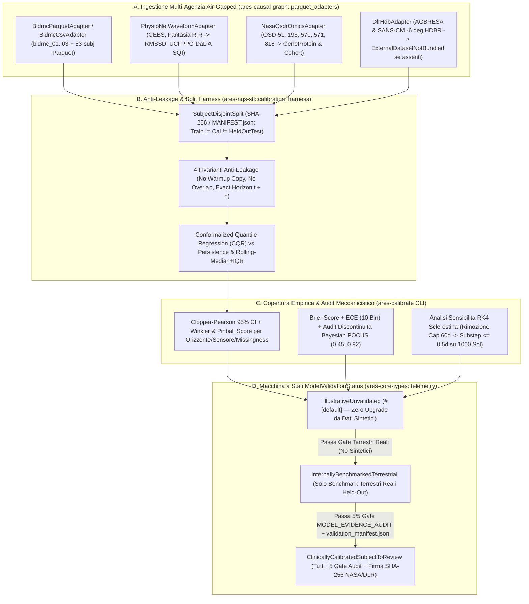

# Piano Implementativo Definitivo — Fase 33 (L5): Clinical Calibration, Conformal Coverage Audit & Multi-Agency Dataset Parquet Adapters (Issue `#12` Closure)

- **Blocco Architetturale**: Blocco L (*Operational Deployment, Edge AI Copilot, Clinical Calibration & NASA Space Apps 2026 Submission*, Fasi 29–34)
- **Fase**: Fase 33 (`L5`)
- **Stato**: `[x] COMPLETED (TESTED)` (`phase_33_l5_parquet_adapters` `6/6` default & `--features parquet-ingest`, `phase_33_l5_calibration_and_anti_leakage` `4/4`, `ares-calibrate --verify-only` exit `0`)
- **Registro Normativo & Audit di Riferimento**: [`MODEL_EVIDENCE_AUDIT.md`](./docs/architecture/MODEL_EVIDENCE_AUDIT.md), [`MANIFEST.json`](./data/bidmc/MANIFEST.json), [`BLOCK_K_SYSTEM_TESTING_ARCHITECTURE.md`](./docs/plans/BLOCK_K_SYSTEM_TESTING_ARCHITECTURE.md)
- **Crate Target**: `crates/ares-core-types`, `crates/ares-causal-graph`, `crates/ares-nqs-stl`, `crates/ares-server-cli` (`Cargo.toml` workspace edition `2024`, `license = "MIT OR Apache-2.0"`)
- **Piani & Moduli Baseline Verificati**: [`phase_25_K1_property_based_numerical_ode_stl_verification.md`](./docs/plans/phase_25_K1_property_based_numerical_ode_stl_verification.md), [`telemetry.rs`](./crates/ares-core-types/src/telemetry.rs#L71-L91), [`binary_ipc.rs`](./crates/ares-core-types/src/binary_ipc.rs#L60-L65), [`dataset_graph.rs`](./crates/ares-causal-graph/src/dataset_graph.rs#L284-L320), [`bayesian_pocus.rs`](./crates/ares-causal-graph/src/bayesian_pocus.rs#L8-L52), [`mechanotransduction.rs`](./crates/ares-causal-graph/src/mechanotransduction.rs#L15-L90), [`timestral_quantiles.rs`](./crates/ares-nqs-stl/src/timestral_quantiles.rs#L200-L348), [`timestral_bridge.rs`](./crates/ares-nqs-stl/src/timestral_bridge.rs#L314-L394), [`sqi_filter.rs`](./crates/ares-telemetry-ingest/src/sqi_filter.rs#L54-L140)
- **Owner Principale**: `ARES-Health Team` (con revisione governance/sicurezza `@MiServeRDC`, ingestione segnali `ARES-Health Team` e integrazione CLI `ARES-Health Team`)
- **File Target Previsti**:
  1. `crates/ares-core-types/src/telemetry.rs` *(MOD — macchina a stati formale `ModelValidationStatus` `Copy`-preserving con `#[default] IllustrativeUnvalidated`, `InternallyBenchmarkedTerrestrial`, `ClinicallyCalibratedSubjectToReview`, `TerrestrialBenchmarkScope`, `Sha256DigestHex` e contratto `ValidationManifest`)*
  2. `crates/ares-core-types/src/binary_ipc.rs` *(MOD — flag `FLAG_TERRESTRIAL_BENCHMARKED_ONLY` in bit `11` preservando bit-per-bit `FLAG_ILLUSTRATIVE_UNVALIDATED` su tutti i pacchetti di default)*
  3. `crates/ares-causal-graph/Cargo.toml`, `crates/ares-causal-graph/src/error.rs`, `crates/ares-causal-graph/src/dataset_graph.rs` & `crates/ares-causal-graph/src/parquet_adapters.rs` *(MOD/NEW — feature opzionale `--features parquet-ingest` basata su `arrow-array`/`arrow-schema`/`parquet` pure-Rust + fallback deterministico CSV/TSV/JSONL/WFDB-text per `BidmcParquetAdapter`, `PhysioNetWaveformAdapter`, `NasaOsdrOmicsAdapter`, `DlrHdbAdapter` con degradazione esplicita `AdapterStatus::ExternalDatasetNotBundled`)*
  4. `crates/ares-causal-graph/src/mechanotransduction.rs` & `crates/ares-causal-graph/src/bayesian_pocus.rs` *(MOD — integrazione adattiva `Rk4HorizonPolicy::AdaptiveSubstep` per rimuovere/quantificare il cap a `60` giorni di `compute_musculoskeletal_state` e audit strutturale del gap `(0.45, 0.92)` di `evaluate_two_stage_bayesian_pocus`)*
  5. `crates/ares-nqs-stl/src/calibration_harness.rs` *(NEW — partizionamento `SubjectDisjointSplit` disgiunto per soggetto, guardie formali anti-leakage, `ConformalizedQuantileCalibrator` CQR, baseline `Persistence` e `RollingMedianIqr`, intervalli esatti di Clopper-Pearson, Winkler/Pinball score, Brier score, ECE e serializzazione JSON/Markdown `CalibrationAuditReport`)*
  6. `crates/ares-server-cli/src/bin/ares_calibrate.rs` *(NEW — binario CLI deterministico offline `ares-calibrate` per esecuzione dell'audit empirico, verifica SHA-256 dei dataset locali e valutazione crittografica di `data/calibration/validation_manifest.json`)*
  7. `crates/ares-causal-graph/tests/phase_33_l5_parquet_adapters.rs` & `crates/ares-nqs-stl/tests/phase_33_l5_calibration_and_anti_leakage.rs` *(NEW — suite di test su ingestione multi-agenzia, onesta `BeatIntervalsNotAvailable` vs `Fantasia` R-R, anti-leakage, Clopper-Pearson su `bidmc_03`, Brier/ECE, sensibilita RK4 a 900 Sol e blocco rigoroso di upgrade su dati sintetici)*
  8. `docs/scientific_references.md` *(MOD — Sezione 11 dedicata ai riferimenti teorici e open-source di Fase 33 `L5`)*
- **Budget Esecuzione & Vincoli Air-Gap**:
  - **Zero Cloud / Zero Rete**: `0` chiamate HTTP esterne a runtime; tutti gli adapter leggono esclusivamente bundle locali verificati con `SHA-256` (`sha2 = "0.10"`).
  - **Build Default Veloce**: `cargo check --workspace` compila senza dipendenze pesanti Apache Arrow; il lettore colonnare Parquet nativo si attiva esplicitamente con `--features ares-causal-graph/parquet-ingest`.
  - **Tempo Esecuzione `ares-calibrate` su Bundle Locale (`bidmc_01..03`)**: $< 250\text{ ms}$ in `--release`; suite test `L5` completa $< 2.5\text{ s}$.
- **Politica Rust 2024 Strict Mode**: Zero `.unwrap()` / `.expect()` in tutto il codice di produzione `crates/*/src/` (incluso il binario `crates/ares-server-cli/src/bin/ares_calibrate.rs`, sottoposto a scansione da [`scripts/agent_probe.sh`](./scripts/agent_probe.sh)). Zero emoji in codice, report Markdown e messaggi di commit.

---

## 1. Executive Summary & Chiusura Architetturale della Issue `#12`

### 1.1 Diagnosi Tecnica dallo Stato Verificato del Workspace (`MODEL_EVIDENCE_AUDIT.md`)
L'audit indipendente documentato in [`MODEL_EVIDENCE_AUDIT.md`](./docs/architecture/MODEL_EVIDENCE_AUDIT.md#L5-L69) ha stabilito una distinzione epistemica fondamentale per **ARES-Health**: il superamento dei `126/126` test del Blocco K dimostra la correttezza numerica, dimensionale e deterministica del software Rust, ma **non costituisce validazione clinica ne calibrazione probabilistica** sui rischi spaziali. In particolare, nello stato attuale del repository:
1. I soli tracciati clinici inclusi nel repository ([`data/bidmc/bidmc_01..03_Numerics.csv`](./data/bidmc/MANIFEST.json#L17-L48)) sono sommari numerici terrestri di terapia intensiva a $1\text{ Hz}$ della durata di $480\text{ s}$ ($8\text{ min}$), privi di intervalli battito-battito R-R (`HrvUnavailableReason::BeatIntervalsNotAvailable` in [`telemetry.rs`](./crates/ares-core-types/src/telemetry.rs#L88-L91)), privi di immagini ecografiche giugulari/oculari accoppiate e insufficienti in durata per osservare direttamente gli orizzonti DHF `+15m` ($900\text{ s}$), `+1h` ($3600\text{ s}$), `+6h` ($21600\text{ s}$) e `+24h` ($86400\text{ s}$).
2. In [`timestral_bridge.rs`](./crates/ares-nqs-stl/src/timestral_bridge.rs#L322-L328), l'aggiornamento online `ConformalAbstentionGate::update_conformal_calibration` confronta il cono predetto `prev_rho` (calcolato sull'orizzonte `+1h`) con il campione osservato al tick immediatamente successivo ($t + 1\text{ s}$), introducendo un disallineamento temporale tra orizzonte di previsione e osservazione realizzata.
3. In [`mechanotransduction.rs`](./crates/ares-causal-graph/src/mechanotransduction.rs#L68-L73), `compute_musculoskeletal_state` esegue `12` passi `step_sclerostin_rk4` ciascuno limitato da `.clamp(0.2, 5.0)` giorni (`dt.clamp(0.0, 5.0)` in [`step_sclerostin_rk4`](./crates/ares-causal-graph/src/mechanotransduction.rs#L25-L27)), fissando un tetto massimo effettivo di integrazione pari a $12 \times 5.0 = 60.0\text{ giorni}$ anche quando `flight_day == 1000`.
4. In [`bayesian_pocus.rs`](./crates/ares-causal-graph/src/bayesian_pocus.rs#L30-L43), `evaluate_two_stage_bayesian_pocus` combina pesi configurati (`0.55 / 0.30 / 0.15`), un cap pre-POCUS `0.45`, un floor `0.35`, `LR+ = 24.0` e un clamp post-POCUS `[0.92, 0.995]`, generando per costruzione una banda vuota $(0.45, 0.92)$ che funge da interblocco decisionale per il **Hard Safety Gate 1**, ma non rappresenta una probabilita clinica calibrata.

### 1.2 Strategia Risolutiva della Fase 33 (`L5`): Governance Verificabile dai Tipi
La **Fase 33 (`L5`)** chiude strutturalmente la Issue `#12` non dichiarando arbitrariamente "validato" il prototipo, bensi costruendo l'intera infrastruttura di **ingestione colonnare multi-agenzia**, **verifica anti-leakage disgiunta per soggetto**, **calibrazione conforme empirica (CQR)** e **governance crittografica dei 5 Gate di `MODEL_EVIDENCE_AUDIT.md`**:



### 1.3 Riferimenti Scientifici, Metodologici & Repository Open-Source di Fase 33 (`L5`)

| Fonte / Repository / Standard | Riferimento Bibliografico / URL & Licenza | Contributo Specifico alla Fase 33 (`L5`) |
| :--- | :--- | :--- |
| **`apache/arrow-rs` (`parquet`, `arrow-array`)** | `https://github.com/apache/arrow-rs` (`MIT OR Apache-2.0`) | Lettura colonnare Safe Rust zero-FFI di serie temporali e tabelle multi-omiche con bitmap di nullabilita nativa (`Array::is_null` $\to$ `Option<f64>::None`) sotto `--features parquet-ingest`. |
| **Romano, Patterson & Candès (2019)** | *NeurIPS 2019*, Vol. 32, pp. 3543–3553 (`arXiv:1905.03222`) — *Conformalized Quantile Regression (CQR)* | Calcolo non-parametrico a campione finito del punteggio di non-conformita $E_i = \max(\hat{q}_{\alpha/2}(x_i) - y_i,\; y_i - \hat{q}_{1-\alpha/2}(x_i))$ sul set disgiunto $\mathcal{D}_{\text{cal}}$. |
| **Clopper & Pearson (1934)** | C. J. Clopper & E. S. Pearson, *Biometrika*, 26(4):404–413 (1934, `DOI: 10.1093/biomet/26.4.404`) | Intervalli di confidenza binomiali esatti $[p_{\text{low}}, p_{\text{high}}]$ tramite inversa della funzione Beta incompleta regolarizzata per verificare la copertura empirica rispetto a $1-\alpha = 0.90$. |
| **Gneiting & Raftery (2007) & Winkler (1972)** | *J. Amer. Statist. Assoc. (JASA)*, 102(477):359–378 (`DOI: 10.1198/016214506000001437`); R. L. Winkler, *JASA* 67:187–195 (1972) | Regole di scoring strettamente proprie (*Pinball Loss* e *Winkler Interval Score*) per confrontare `Timestral+CQR` contro `Persistence` e `RollingMedian+IQR`. |
| **Brier (1950) & Naeini, Cooper & Hauskrecht (2015)** | G. W. Brier, *Mon. Wea. Rev.* 78(1):1–3 (1950); Naeini et al., *AAAI 2015*, pp. 2901–2907 (`DOI: 10.1609/aaai.v29i1.9602`) | Decomposizione quadratica del *Brier Score* ed *Expected Calibration Error* (`ECE` / `MCE` su $B=10$ bin) per l'audit di `evaluate_two_stage_bayesian_pocus`. |
| **PhysioNet `Fantasia`, `CEBS` & UCI `PPG-DaLiA`** | Iyengar et al., *Am. J. Physiol.* 271:R1078–R1084 (1996, `DOI: 10.13026/C2RG61`); García-González et al. (`DOI: 10.13026/C2KW23`); Reiss et al., *Sensors* 19(14):3079 (2019, `DOI: 10.24432/C53890`) | Intervalli R-R battito-battito reali (`Fantasia`) per sbloccare `RMSSD`/`SDNN`/`pNN50`, respirazione/SCG (`CEBS`) e artefatti da movimento accelerometrici (`PPG-DaLiA`). |
| **DLR `:envihab` `AGBRESA` & `SANS-CM`** | Laurie et al., *JAMA Ophthalmol.* 137(5):515–522 (2019, `DOI: 10.1001/jamaophthalmol.2018.6776`); Laurie et al., *J. Physiol.* 599(14):3503–3515 (2021, `DOI: 10.1113/JP281667`) | Riferimento primario per gli studi terrestri `-6 deg` HDBR a 60 giorni su `ONSD`, spessore coroideale $\Delta\text{CT}$ e contromisure `LBNP`. |

---

## 2. Architettura Deliverable A: Ingestione Colonnare Apache Arrow / Parquet & Adapter Multi-Agenzia (`crates/ares-causal-graph/src/parquet_adapters.rs`)

### 2.1 Feature Flag Opzionale `--features parquet-ingest` & Zero-Cloud Fallback
Per preservare la rapidita di compilazione del workspace (`cargo check --workspace`) e il funzionamento 100% air-gapped, [`crates/ares-causal-graph/Cargo.toml`](./crates/ares-causal-graph/Cargo.toml) introduce dipendenze opzionali pure-Rust (`MIT OR Apache-2.0`, zero C/C++ FFI, zero rete) e riusa `sha2 = "0.10"` gia presente in [`crates/ares-security-privacy/Cargo.toml`](./crates/ares-security-privacy/Cargo.toml#L13):

```toml
[features]
default = []
parquet-ingest = ["dep:arrow-array", "dep:arrow-schema", "dep:parquet"]

[dependencies]
ares-core-types = { path = "../ares-core-types" }
petgraph = "0.7"
serde = { version = "1.0", features = ["derive"] }
serde_json = "1.0"
sha2 = "0.10"
thiserror = "2.0"
arrow-array = { version = "54", optional = true, default-features = false }
arrow-schema = { version = "54", optional = true, default-features = false }
parquet = { version = "54", optional = true, default-features = false, features = ["arrow", "snap", "zstd"] }
```

### 2.2 Estensione Retrocompatibile di `UnifiedNodePayload::TimeWindowSlice` e `CausalGraphError`
In [`dataset_graph.rs`](./crates/ares-causal-graph/src/dataset_graph.rs#L206-L215), tutti i pattern match esistenti su `UnifiedNodePayload::TimeWindowSlice` usano `..` (linee `1941` e `2225`). Si estende la variante con due campi `#[serde(default)]` che non alterano gli export JSON esistenti quando vuoti, accompagnati da due metodi pubblici su `AresUnifiedDatasetGraph` (`upsert_node` e `link_nodes`) e tre varianti di errore in [`error.rs`](./crates/ares-causal-graph/src/error.rs):
- `extra_channels: BTreeMap<String, ChannelWindowStats>` (`#[serde(default, skip_serializing_if = "BTreeMap::is_empty")]`) per canali specialistici (`rmssd_ms`, `sdnn_ms`, `pnn50_pct`, `scg_dv_mg`, `imu_rms_g`, `onsd_mm`, `choroidal_delta_um`, `ijv_csa_mm2`, `ijv_vmax_cm_s`).
- `beat_intervals_present: bool` (`#[serde(default)]`): flag booleano verificabile che attesta la presenza fisica di intervalli battito-battito R-R (`NN`) nella finestra `slice://`.
- Nuove varianti in `CausalGraphError`:
  - `ManifestChecksumMismatch { path: PathBuf, expected: String, computed: String }`
  - `ParquetFeatureDisabled { path: PathBuf }`
  - `ColumnarParse { file: String, reason: String }`

### 2.3 Specifiche dei 4 Adapter Multi-Agenzia & Layout URI `slice://`
Ogni adapter implementa il trait esistente [`DatasetGraphAdapter`](./crates/ares-causal-graph/src/dataset_graph.rs#L293-L300) (`adapter_name`, `ingest`) piu il metodo diagnostico `ingest_with_status(&self, graph: &mut AresUnifiedDatasetGraph) -> Result<AdapterExecutionOutcome, CausalGraphError>` che espone `AdapterStatus`:

| Adapter Struct | `adapter_name()` | Percorsi Locali Scansionati | Schema URI `slice://<dataset>/<subject>/<window>` & Nodi Generati | Politica di Assenza / Integrita |
| :--- | :--- | :--- | :--- | :--- |
| **`BidmcParquetAdapter`** (affiancato a `BidmcCsvAdapter`) | `"biocypher_bidmc_parquet_v1"` | `data/bidmc/` (`bidmc_01..03` + `MANIFEST.json`) e opzionale `data/external/bidmc/` (`bidmc_01..53` `.parquet`/`.csv` numerics `1 Hz` & waveforms `125 Hz`) | `slice://bidmc/<subj>/t_<start:04>_<end:04>` (es. `slice://bidmc/01/t_0000_0060`); `beat_intervals_present = false` per soli numerics `1 Hz`, `true` solo se presente colonna/annotazione picchi R validati | Verifica obbligatoria `SHA-256` contro `MANIFEST.json`; zero fusione tra soggetti `01..53` |
| **`PhysioNetWaveformAdapter`** | `"biocypher_physionet_waveforms_v1"` | `data/external/physionet/{cebs,fantasia,ppg_dalia}/` (`.parquet`, `.csv`, `.rr.tsv`, header `.hea` WFDB testuale) | `slice://cebs/<subj>/w_<s0:05>_<s1:05>`, `slice://fantasia/<subj>/w_<s0:05>_<s1:05>` (`f1y01..f2o10`), `slice://ppg_dalia/<subj>/w_<s0:05>_<s1:05>` (`S1..S15`) | Se assente: `AdapterStatus::ExternalDatasetNotBundled`. Sblocca `rmssd_ms` **solo** se $M \ge 30$ intervalli `NN` validi in `[300, 2000] ms` |
| **`NasaOsdrOmicsAdapter`** | `"biocypher_nasa_osdr_omics_v1"` | `data/external/osdr/{OSD-51,OSD-195,OSD-570,OSD-571,OSD-818}/` (tabelle GeneLab DGE `.parquet`/`.csv`/`.tsv` + `MANIFEST.json`) | Aggiorna/aggiunge nodi `PrimeKgCategory::GeneProtein` (`log2_fold_change`, `adj_p_value`) e `SubjectCohort` (`OSD-571` cfRNA/proteomica SOMA incluso) con archi `BiolinkPredicate::ShowsEffectSize` | Se assente: `AdapterStatus::ExternalDatasetNotBundled`; mai inventa `log2FC` o campioni |
| **`DlrHdbAdapter`** | `"biocypher_dlr_hdbr_v1"` | `data/external/dlr_hdbr/{agbresa,sans_cm}/` + `MANIFEST.json` SHA-256 | `slice://dlr_agbresa/<subj>/hdbr_d<d0:02>_d<d1:02>` e `slice://dlr_sans_cm/<subj>/hdbr_d<d0:02>_d<d1:02>` (`ONSD`, $\Delta\text{CT}$, `IJV_CSA`, `LBNP`) | Se assente: `AdapterStatus::ExternalDatasetNotBundled`; **zero traiettorie paziente sintetiche** |

### 2.4 Calcolo Beat-to-Beat HRV Reale per `Fantasia` (`Invariante Entry 008` / Issue `#11`)
Quando `PhysioNetWaveformAdapter` legge una sequenza di intervalli inter-battito $\mathcal{R} = \{\text{RR}_1, \dots, \text{RR}_K\}$ in millisecondi per un singolo soggetto `Fantasia` in una finestra $[t_{\text{start}}, t_{\text{end}})$, applica il filtro fisiologico standard Task Force ESC/NASPE (1996) / NeuroKit2:
1. Scarta battiti ectopici o artefatti con $\text{RR}_i \notin [300.0,\; 2000.0]\text{ ms}$ oppure quoziente relativo $\frac{|\text{RR}_{i+1} - \text{RR}_i|}{\text{RR}_i} > 0.20$.
2. Sia $\mathcal{D}_{\text{NN}} = \{\Delta\text{RR}_j = \text{RR}_{j+1} - \text{RR}_j\}_{j=1}^{M-1}$ l'insieme delle coppie consecutive normali (`NN`):
   - Se $M < 30$: la finestra mantiene `beat_intervals_present = false`, `rmssd_ms = None` e `HrvUnavailableReason::BeatIntervalsNotAvailable`.
   - Se $M \ge 30$: calcola in doppia precisione:
     $$\text{RMSSD} = \sqrt{\frac{1}{M - 1} \sum_{j=1}^{M-1} (\Delta\text{RR}_j)^2}, \qquad \text{SDNN} = \sqrt{\frac{1}{M - 1} \sum_{i=1}^{M} (\text{RR}_i - \overline{\text{RR}})^2}, \qquad \text{pNN50} = \frac{100.0}{M - 1} \sum_{j=1}^{M-1} \mathbb{I}\big(|\Delta\text{RR}_j| > 50.0\text{ ms}\big)$$
     popolando `extra_channels["rmssd_ms"]`, `extra_channels["sdnn_ms"]`, `extra_channels["pnn50_pct"]` e impostando `beat_intervals_present = true`, consentendo a `SqiFilter::evaluate_row_with_rmssd` ([`sqi_filter.rs`](./crates/ares-telemetry-ingest/src/sqi_filter.rs#L54-L107)) di risolvere `BeatIntervalsNotAvailable` esclusivamente su evidenza R-R reale.

### 2.5 Strutture e Firme Rust di `crates/ares-causal-graph/src/parquet_adapters.rs`
```rust
use crate::dataset_graph::{
    AdapterIngestionStats, AresUnifiedDatasetGraph, BiolinkPredicate, ChannelWindowStats,
    DatasetGraphAdapter, GraphifyConfidenceTier, PrimeKgCategory, UnifiedDatasetNode,
    UnifiedNodePayload,
};
use crate::error::CausalGraphError;
use crate::hypergraph_spatial::WelfordAccumulator;
use serde::{Deserialize, Serialize};
use sha2::{Digest, Sha256};
use std::collections::BTreeMap;
use std::path::{Path, PathBuf};

/// Esito epistemico dell'esecuzione di un adapter su filesystem locale air-gapped.
#[derive(Debug, Clone, PartialEq, Eq, Serialize, Deserialize)]
#[serde(rename_all = "SCREAMING_SNAKE_CASE")]
pub enum AdapterStatus {
    /// File presenti su disco e verificati crittograficamente tramite SHA-256.
    BundledAndVerified {
        files_verified: usize,
        manifest_sha256_verified: bool,
    },
    /// Dataset esterno soggetto a DUA o non incluso nel repository: zero dati sintetici generati.
    ExternalDatasetNotBundled {
        dataset_code: String,
        expected_dir: PathBuf,
    },
}

/// Risultato completo restituito da `ingest_with_status`.
#[derive(Debug, Clone, PartialEq, Eq, Serialize, Deserialize)]
pub struct AdapterExecutionOutcome {
    pub adapter_name: String,
    pub status: AdapterStatus,
    pub stats: AdapterIngestionStats,
}

/// Verifica deterministica SHA-256 di un file rispetto al digest esadecimale atteso in MANIFEST.json.
pub fn verify_file_sha256(path: &Path, expected_hex: &str) -> Result<(), CausalGraphError> {
    let bytes = std::fs::read(path).map_err(|e| CausalGraphError::io(path, e))?;
    let digest = Sha256::digest(&bytes);
    let mut computed = String::with_capacity(64);
    for b in digest {
        use std::fmt::Write as _;
        let _ = write!(&mut computed, "{b:02x}");
    }
    if !computed.eq_ignore_ascii_case(expected_hex.trim()) {
        return Err(CausalGraphError::ManifestChecksumMismatch {
            path: path.to_path_buf(),
            expected: expected_hex.trim().to_ascii_lowercase(),
            computed,
        });
    }
    Ok(())
}

pub struct BidmcParquetAdapter<'a> {
    pub bundled_bidmc_dir: &'a Path,
    pub external_bidmc_dir: Option<&'a Path>,
    pub window_seconds: u32,
}

pub struct PhysioNetWaveformAdapter<'a> {
    pub physionet_root: &'a Path,
    pub window_seconds: u32,
}

pub struct NasaOsdrOmicsAdapter<'a> {
    pub osdr_root: &'a Path,
}

pub struct DlrHdbAdapter<'a> {
    pub dlr_hdbr_root: &'a Path,
}

/// Calcola (RMSSD_ms, SDNN_ms, pNN50_pct) esclusivamente da intervalli R-R reali validati.
/// Restituisce `None` se i battiti NN consecutivi validi sono inferiori a `min_nn_count` (>= 30).
pub fn compute_verified_time_domain_hrv(
    rr_intervals_ms: &[f64],
    min_nn_count: usize,
) -> Option<(f64, f64, f64)> {
    let threshold = min_nn_count.max(30);
    let clean_rr: Vec<f64> = rr_intervals_ms
        .iter()
        .copied()
        .filter(|rr| rr.is_finite() && (300.0..=2000.0).contains(rr))
        .collect();
    if clean_rr.len() < threshold {
        return None;
    }

    let mut nn_diffs_sq = Vec::with_capacity(clean_rr.len().saturating_sub(1));
    let mut pnn50_hits = 0usize;
    for pair in clean_rr.windows(2) {
        let r0 = pair[0];
        let r1 = pair[1];
        let diff = (r1 - r0).abs();
        if diff / r0 <= 0.20 {
            nn_diffs_sq.push(diff * diff);
            if diff > 50.0 {
                pnn50_hits += 1;
            }
        }
    }
    if nn_diffs_sq.len() + 1 < threshold {
        return None;
    }

    let n_f = clean_rr.len() as f64;
    let mean_rr = clean_rr.iter().sum::<f64>() / n_f;
    let var_rr = clean_rr
        .iter()
        .map(|rr| (rr - mean_rr).powi(2))
        .sum::<f64>()
        / (n_f - 1.0);
    let sdnn_ms = var_rr.max(0.0).sqrt();
    let rmssd_ms = (nn_diffs_sq.iter().sum::<f64>() / (nn_diffs_sq.len() as f64))
        .max(0.0)
        .sqrt();
    let pnn50_pct = 100.0 * (pnn50_hits as f64) / (nn_diffs_sq.len() as f64);

    Some((rmssd_ms, sdnn_ms, pnn50_pct))
}
```

Quando `--features parquet-ingest` e attivo, un helper interno `read_tabular_records_parquet(path: &Path)` apre `File::open(path)` tramite `parquet::arrow::arrow_reader::ParquetRecordBatchReaderBuilder`, legge ciascun `RecordBatch` senza allocazioni superflue e converte ogni cella tramite `col.is_null(row)` in `Option<f64>::None` (mai `0.0`), raggruppando rigorosamente per `(dataset_code, subject_id, window_idx)` in accumulatori `WelfordAccumulator` separati per soggetto.

---

## 3. Architettura Deliverable B: Partizionamento Disgiunto per Soggetto & Harness Anti-Leakage (`crates/ares-nqs-stl/src/calibration_harness.rs` & `ares-calibrate`)

### 3.1 Formalizzazione Matematica delle 4 Guardie Anti-Leakage (Gate 3 di `MODEL_EVIDENCE_AUDIT.md`)
Sia $\mathcal{U} = \{(s_i, t_i, \mathbf{x}_i, m_i)\}_{i=1}^{N}$ la collezione di osservazioni multivariata indicizzata dall'identificativo canonico del soggetto $s_i \in \mathcal{S}$ (normalizzato rimuovendo suffissi di finestra o segmento, es. `"bidmc_01_t_0000_0060" \mapsto "bidmc_01"`) e dal timestamp nativo $t_i$ in secondi. Il modulo `calibration_harness.rs` impone quattro invarianti bloccanti verificati prima di calcolare qualsiasi metrica:

1. **Invariante L1 — Disgiunzione Rigorosa dei Soggetti ($\mathcal{S}_{\text{train}}, \mathcal{S}_{\text{cal}}, \mathcal{S}_{\text{test}}$):**
   $$\mathcal{S}_{\text{train}} \cap \mathcal{S}_{\text{cal}} = \varnothing, \qquad \mathcal{S}_{\text{train}} \cap \mathcal{S}_{\text{test}} = \varnothing, \qquad \mathcal{S}_{\text{cal}} \cap \mathcal{S}_{\text{test}} = \varnothing$$
   - Per il bundle locale a 3 soggetti verificato da [`data/bidmc/MANIFEST.json`](./data/bidmc/MANIFEST.json#L18-L47), lo split canonico rispetta esattamente i ruoli dichiarati nel manifesto: `bidmc_02` $\in \mathcal{S}_{\text{train}}$, `bidmc_01` $\in \mathcal{S}_{\text{cal}}$, `bidmc_03` $\in \mathcal{S}_{\text{test}}$.
   - Per coorti estese ($|\mathcal{S}| \ge 5$, es. `BIDMC` a 53 soggetti, `Fantasia` a 40 soggetti, `PPG-DaLiA` a 15 soggetti), la stratificazione usa un digest deterministico a 64 bit:
     $$u(s) = \frac{\operatorname{u64\_be}\!\big(\operatorname{SHA-256}(\texttt{"ARES-L5-SPLIT-V1:"} \mathbin{\Vert} s)[0..8]\big)}{2^{64}} \in [0, 1)$$
     ordinando i soggetti all'interno di ciascuno strato di missingness/eta e assegnando le quote `50% Train / 25% Calibration / 25% HeldOutTest`.

2. **Invariante L2 — Divieto di Righe Warm-Up Duplicate nel Set di Calibrazione:**
   Sia $L_{\text{ctx}} = \text{patch\_len} \times \text{context\_patches}$ (es. $8 \times 2 = 16$ passi a $1\text{ Hz}$ in [`timestral_bridge.rs`](./crates/ares-nqs-stl/src/timestral_bridge.rs#L275-L276)). Ogni coppia di valutazione $(s, t_0, t_0 + h)$ deve soddisfare:
   $$n_{\text{observed\_steps}}(s, \le t_0) \ge L_{\text{ctx}} \quad \land \quad \text{is\_warmup\_padded} = \text{false}$$
   ed e vietata qualsiasi chiave duplicata $(s, t_0, h)$ in $\mathcal{D}_{\text{cal}}$ o $\mathcal{D}_{\text{test}}$ (`LeakageViolationError::WarmupCopyOrDuplicateTimestamp`).

3. **Invariante L3 — Assenza di Finestre Scorrevoli Sovrapposte tra Partizioni o Episodi:**
   Per ogni finestra di contesto $[t_0 - W_{\text{ctx}}, t_0]$ e istante futuro $t_{\text{target}} = t_0 + h$:
   - L'intero intervallo $[t_0 - W_{\text{ctx}}, t_0 + h]$ deve appartenere allo stesso `subject_id` $s$ e allo stesso `SplitRole` senza interruzioni di registrazione ($\Delta t_{\text{gap}} \le 2 \cdot \Delta t_{\text{native}}$).
   - Nella costruzione dei residui conformi su $\mathcal{D}_{\text{cal}}$ e $\mathcal{D}_{\text{test}}$ a orizzonte $h$, il campionamento delle origini $t_{0,k}$ applica un passo minimo $\Delta t_{\text{stride}} \ge h$ per i test di indipendenza binomiale di Clopper-Pearson (`NonOverlappingHorizonStride`), evitando l'autocorrelazione artificiale di finestre con overlap del $99\%$.

4. **Invariante L4 — Allineamento Esatto dell'Orizzonte Futuro (Zero Next-Tick Target Leakage):**
   Per valutare un orizzonte dichiarato $h > 0$, il valore realizzato $y_{s}(t_{\text{obs}})$ deve soddisfare:
   $$\big|(t_{\text{obs}} - t_0) - h\big| \le \Delta t_{\text{tol}}(h), \qquad \Delta t_{\text{tol}}(h) = \min(0.5\text{ s},\; 0.01\,h)$$
   Qualsiasi tentativo di valutare $h \in \{900\text{ s}, 3600\text{ s}, 21600\text{ s}, 86400\text{ s}\}$ (`DHF_HORIZONS_SECONDS` in [`crates/ares-core-types/src/lib.rs`](./crates/ares-core-types/src/lib.rs#L31)) usando $t_{\text{obs}} = t_0 + 1\text{ s}$ solleva `Err(LeakageViolationError::HorizonTargetMismatch { declared_horizon_s: h, realized_delta_s })`.
   > **Conseguenza Empirica Onesta su `bidmc_01..03` ($480\text{ s}$):** Poiche $\max(t) = 480\text{ s} < 900\text{ s}$, sui 4 orizzonti clinici DHF (`+15m`, `+1h`, `+6h`, `+24h`) il harness emette esplicitamente `HorizonAuditStatus::InsufficientRecordingSpan { max_span_s: 480.0, required_horizon_s }` senza falsificare metriche. Per la verifica tecnica del motore numerico sui file `BIDMC` da $8\text{ min}$, il report separa una tabella dedicata `ShortTechnicalSubHorizons` (`+15s`, `+30s`, `+60s`, `+120s`), mentre gli orizzonti `+15m` e `+1h` si attivano solo quando sono presenti tracciati lunghi (`Fantasia` $7200\text{ s}$, `PPG-DaLiA` $9000\text{ s}$) e `+6h`/`+24h` su coorti multi-giorno (`HiRID`, `DLR HDBR`).

### 3.2 Conformalized Quantile Regression (CQR) & Baseline di Confronto
Dato l'insieme di calibrazione disgiunto $\mathcal{D}_{\text{cal}}^{(h, c)} = \{(\mathbf{x}_i, y_{i, t_i+h})\}_{i=1}^{N_{\text{cal}}}$ per orizzonte $h$ e canale $c$:
1. **Calibrazione Split-Conformal CQR (Romano et al., *NeurIPS 2019*):**
   $$E_i = \max\Big(\hat{q}_{0.05}^{(h)}(\mathbf{x}_i) - y_{i, t_i+h}, \; y_{i, t_i+h} - \hat{q}_{0.95}^{(h)}(\mathbf{x}_i)\Big), \qquad k = \Big\lceil (N_{\text{cal}} + 1)(1 - \alpha) \Big\rceil$$
   Se $k \le N_{\text{cal}}$ (ossia $N_{\text{cal}} \ge 9$ per $\alpha = 0.10$), il quantile empirico d'ordine $k$, $\hat{Q}_{1-\alpha}(\mathcal{D}_{\text{cal}}) = E_{(k)}$, dilata/contrae simmetricamente il cono predetto sul test set held-out $\mathcal{D}_{\text{test}}$:
   $$\tilde{q}_{0.05}^{(h)}(\mathbf{x}) = \min\!\Big(\hat{q}_{0.50}^{(h)}(\mathbf{x}), \; \hat{q}_{0.05}^{(h)}(\mathbf{x}) - \hat{Q}_{1-\alpha}\Big), \qquad \tilde{q}_{0.95}^{(h)}(\mathbf{x}) = \max\!\Big(\hat{q}_{0.50}^{(h)}(\mathbf{x}), \; \hat{q}_{0.95}^{(h)}(\mathbf{x}) + \hat{Q}_{1-\alpha}\Big)$$
2. **Baseline 1 — Persistenza Ingenua Conformalizzata (`PersistenceCqrBaseline`):**
   $$\hat{y}_{t+h}^{\text{pers}} = y_t, \qquad \big[\hat{L}^{\text{pers}}, \hat{U}^{\text{pers}}\big] = \big[y_t - \hat{Q}_{1-\alpha}^{\text{pers}}, \; y_t + \hat{Q}_{1-\alpha}^{\text{pers}}\big], \quad E_i^{\text{pers}} = |y_{i, t_i+h} - y_{i, t_i}|$$
3. **Baseline 2 — Mediana Mobile Causale + IQR Conformalizzato (`RollingMedianIqrBaseline`):**
   Sulla finestra passata $W_{\text{ctx}}$: $\hat{m}_t = \operatorname{median}(y_{t-W_{\text{ctx}}:t})$, $\operatorname{IQR}_t = q_{0.75} - q_{0.25}$, $\hat{q}_{0.05}^{\text{iqr}} = \hat{m}_t - 1.2193\,\operatorname{IQR}_t$, $\hat{q}_{0.95}^{\text{iqr}} = \hat{m}_t + 1.2193\,\operatorname{IQR}_t$, calibrato con CQR sullo stesso $\mathcal{D}_{\text{cal}}$.

### 3.3 Binario CLI `crates/ares-server-cli/src/bin/ares_calibrate.rs`
Viene aggiunto un secondo `[[bin]]` in [`crates/ares-server-cli/Cargo.toml`](./crates/ares-server-cli/Cargo.toml):
```toml
[[bin]]
name = "ares-calibrate"
path = "src/bin/ares_calibrate.rs"
```
Opzioni CLI (`clap` derive, zero `.unwrap()`/`.expect()`, logging su `stderr`):
- `--bidmc-dir <PATH>` (default: `data/bidmc`)
- `--external-root <PATH>` (default: `data/external`)
- `--validation-manifest <PATH>` (default: `data/calibration/validation_manifest.json`)
- `--output-json <PATH>` (default: `data/calibration/calibration_audit_report.json`)
- `--output-md <PATH>` (default: `data/calibration/CALIBRATION_AUDIT_REPORT.md`)
- `--verify-only` (esegue l'audit in sola lettura in memoria senza scrivere su disco, utile per CI e `--check`)

---

## 4. Architettura Deliverable C: Copertura Empirica, Clopper-Pearson, Brier, ECE & Sensibilita RK4

### 4.1 Formulazione Matematica delle Metriche di Copertura, Intervallo e Calibrazione

1. **Copertura Marginale & Condizionata e Intervallo Esatto di Clopper-Pearson (1934):**
   Per ciascuna cella $(h, c, b_{\text{miss}})$ con $b_{\text{miss}} \in \{\texttt{0\_pct},\; \texttt{1\_to\_15\_pct},\; \texttt{15\_to\_40\_pct}\}$, siano $N = |\mathcal{D}_{\text{test}}^{(h,c,b)}|$ i campioni indipendenti valutabili e $K = \sum_{j=1}^{N} \mathbb{I}(y_j \in [\tilde{q}_{0.05, j}, \tilde{q}_{0.95, j}])$:
   $$\hat{C}_{\text{emp}} = \frac{K}{N}, \qquad \big[p_{\text{CP, low}}, \; p_{\text{CP, high}}\big]_{1-\delta} = \Big[I^{-1}_{\delta/2}(K,\; N - K + 1), \;\; I^{-1}_{1-\delta/2}(K + 1,\; N - K)\Big] \quad (\delta = 0.05)$$
   dove $I_x(a, b) = \frac{B(x; a, b)}{B(a, b)}$ e la funzione Beta incompleta regolarizzata calcolata in puro Safe Rust tramite la frazione continua di Lentz modificata ($\varepsilon = 10^{-13}$) accoppiata a bisezione monotona su $[0, 1]$ (con casi bordo esatti $p_{\text{CP, low}} = 0$ per $K = 0$ e $p_{\text{CP, high}} = 1$ per $K = N$).

2. **Pinball Loss & Winkler Interval Score ($\alpha = 0.10$):**
   $$\overline{\mathcal{L}}_{\tau} = \frac{1}{N}\sum_{j=1}^{N} \max\!\big(\tau(y_j - \tilde{q}_{\tau, j}), \; (\tau - 1)(y_j - \tilde{q}_{\tau, j})\big), \qquad \tau \in \{0.05, 0.50, 0.95\}$$
   $$\overline{W}_{0.10} = \frac{1}{N}\sum_{j=1}^{N} \left[(\tilde{q}_{0.95, j} - \tilde{q}_{0.05, j}) + 20.0\,(\tilde{q}_{0.05, j} - y_j)\,\mathbb{I}(y_j < \tilde{q}_{0.05, j}) + 20.0\,(y_j - \tilde{q}_{0.95, j})\,\mathbb{I}(y_j > \tilde{q}_{0.95, j})\right]$$
   affiancati dal tasso di falsi allarmi (`false_alarm_rate`: $\tilde{q}_{0.05, j} < 0 \land \rho_{\text{realized}, j} \ge 0$) e di eventi mancati/ritardati (`missed_violation_rate`: $\tilde{q}_{0.05, j} \ge 0 \land \rho_{\text{realized}, j} < 0$).

3. **Audit Probabilistico di `bayesian_pocus.rs` (Brier Score, Decomposizione di Murphy & ECE):**
   Su coppie $(\hat{p}_i, z_i) \in [0, 1] \times \{0, 1\}$ partizionate in $B = 10$ bin uniformi $B_b = \{i : \hat{p}_i \in (\frac{b-1}{10}, \frac{b}{10}]\}$ (con $0.0 \in B_1$):
   $$\text{BS} = \frac{1}{N}\sum_{i=1}^{N}(\hat{p}_i - z_i)^2, \qquad \text{ECE} = \sum_{b=1}^{10} \frac{|B_b|}{N}\Big|\bar{z}_b - \bar{p}_b\Big|, \qquad \text{MCE} = \max_{b:\,|B_b|>0}\Big|\bar{z}_b - \bar{p}_b\Big|$$
   Inoltre, `audit_bayesian_pocus_structural_bounds()` scansiona la griglia $(\tau_w, \text{MQI}, R_{\text{rad}}, \text{POCUS}_{\text{bool}})$ di [`evaluate_two_stage_bayesian_pocus`](./crates/ares-causal-graph/src/bayesian_pocus.rs#L21-L52) verificando analiticamente che l'immagine di `thrombus_posterior` e contenuta in $[0.0084, 0.45] \cup [0.92, 0.995]$, documentando nel report che i bin $b \in \{6, 7, 8, 9\}$ (`(0.50, 0.90]`) hanno cardinalita strutturale zero e che `thrombus_posterior` opera come **indice decisionale di sicurezza a due soglie per il Hard Gate 1** fino all'acquisizione di coorti ecografiche spaziali etichettate.

4. **Analisi di Sensibilita dell'Orizzonte di Integrazione RK4 di `sost_ode_rhs` (Rimozione / Quantificazione del Cap a 60 Giorni):**
   In [`mechanotransduction.rs`](./crates/ares-causal-graph/src/mechanotransduction.rs#L68-L73), `steps = 12` con `dt = (fd / 12.0).clamp(0.2, 5.0)` tronca il tempo effettivo integrato a $T_{\text{eff}} = \min(\text{fd}, 60.0)\text{ d}$ e utilizza $\Delta t = 5.0\text{ d}$ ($|k_{\text{deg}}\Delta t| = 1.40$, pari al $50.3\%$ del limite di stabilita assoluta RK4 $2.7853$).
   - Per carico costante $F_{\text{ARED}}(t) \equiv F_0$, la discrepanza asintotica oltre `fd > 60` e limitata da $|y_0 - y_{\infty}|e^{-0.28 \times 60} < 3 \times 10^{-6}\text{ pmol/L}$ grazie alla rapida emivita $\tau_{1/2} = \frac{\ln 2}{0.28} \approx 2.48\text{ d}$, **ma** per profili di carico variabili nel tempo $F_{\text{ARED}}(t)$ (es. guasto `ARED` al Sol `180` durante il transito marziano!) il cap a `60` giorni congela erroneamente l'integrazione o distorce il transitorio.
   - Si introduce in `mechanotransduction.rs` la politica esplicita `Rk4HorizonPolicy`:
     ```rust
     #[derive(Debug, Clone, Copy, PartialEq, Serialize, Deserialize)]
     pub enum Rk4HorizonPolicy {
         /// Compatibilita legacy esatta (12 step, dt <= 5.0 d -> max 60 giorni effettivi).
         LegacyCapped60Days,
         /// Integrazione adattiva senza cap a 60 giorni: N = ceil(fd / max_dt_days), dt <= 0.5 d.
         AdaptiveUnbounded { max_dt_days: f64 },
     }
     ```
     con `integrate_sclerostin_schedule(initial_sost: f64, daily_ared_loads_kgf: &[f64], substeps_per_day: usize) -> Vec<f64>` (`dt = 1.0 / substeps_per_day`, es. `0.25 d`), quantificando nel `CalibrationAuditReport` sia la differenza a carico costante ($\le 10^{-4}\text{ pmol/L}$ per `fd` $\in [60, 1000]$) sia l'errore significativo ($\Delta[\text{SOST}] > 30\text{ pmol/L}$) che si verificherebbe sotto profili tempo-varianti se non si usasse `integrate_sclerostin_schedule`.

---

## 5. Architettura Deliverable D: Macchina a Stati `ModelValidationStatus` & Chiusura Issue `#12` (`crates/ares-core-types/src/telemetry.rs`)

### 5.1 Estensione `Copy`-Preserving e Wire-Compatible di `ModelValidationStatus`
In [`crates/ares-core-types/src/telemetry.rs`](./crates/ares-core-types/src/telemetry.rs#L71-L78), `ModelValidationStatus` e attualmente `Copy`, il che consente a [`PocusPosteriorEstimate`](./crates/ares-causal-graph/src/bayesian_pocus.rs#L8-L17) di derivare `Copy`, e il test esistente in [`crates/ares-core-types/src/lib.rs`](./crates/ares-core-types/src/lib.rs#L511) verifica che `ModelValidationStatus::IllustrativeUnvalidated` serializzi nella stringa JSON `"ILLUSTRATIVE_UNVALIDATED"`.

Usando la rappresentazione standard *externally-tagged* di `serde` con `#[serde(rename_all = "SCREAMING_SNAKE_CASE")]` e un digest fisso `Sha256DigestHex([u8; 32])` (`Copy`, zero allocazioni heap, serializzato in JSON come stringa esadecimale minuscola a 64 caratteri), `ModelValidationStatus` mantiene `Copy`, `Default` (`#[default] IllustrativeUnvalidated`) e `100%` retrocompatibilita con tutti i `126` test esistenti:

```rust
/// Ambito dei dataset terrestri usati per un benchmark tecnico interno (MAI validazione di volo).
#[derive(Debug, Clone, Copy, PartialEq, Eq, Hash, Serialize, Deserialize)]
#[serde(rename_all = "SCREAMING_SNAKE_CASE")]
pub enum TerrestrialBenchmarkScope {
    BidmcNumericsShortSubHorizon,
    BidmcPlusFantasiaBeatIntervals,
    MultiCohortPhysioNetUciTerrestrial,
}

/// Digest SHA-256 a 32 byte (`Copy` su stack) serializzato in JSON come stringa hex a 64 caratteri.
#[derive(Debug, Clone, Copy, PartialEq, Eq, Hash)]
pub struct Sha256DigestHex(pub [u8; 32]);

/// Stato formale di validazione epistemica dei modelli derivati/predittivi (Issue #12 Closure).
#[derive(Debug, Clone, Copy, Default, PartialEq, Serialize, Deserialize)]
#[serde(rename_all = "SCREAMING_SNAKE_CASE")]
pub enum ModelValidationStatus {
    /// Default obbligatorio in assenza di artefatti empirici o quando coorti esterne non sono incluse.
    #[default]
    IllustrativeUnvalidated,

    /// Benchmark tecnico su soli dataset terrestri registrati held-out (esplicitamente NON validato per il volo spaziale).
    InternallyBenchmarkedTerrestrial {
        dataset_scope: TerrestrialBenchmarkScope,
        coverage_pct: f64,
        brier_score: f64,
        artifact_sha256: Sha256DigestHex,
    },

    /// Raggiungibile ESCLUSIVAMENTE quando tutti i 5 Gate di MODEL_EVIDENCE_AUDIT.md, le etichette cliniche
    /// accoppiate NASA/DLR e il manifesto firmato dal revisore clinico sono verificati crittograficamente.
    ClinicallyCalibratedSubjectToReview,
}

impl ModelValidationStatus {
    #[inline]
    pub const fn is_flight_validated(self) -> bool {
        matches!(self, Self::ClinicallyCalibratedSubjectToReview)
    }

    #[inline]
    pub const fn mandatory_ui_banner(self) -> &'static str {
        match self {
            Self::IllustrativeUnvalidated => {
                "ILLUSTRATIVE SCENARIO MODEL — NOT CLINICALLY VALIDATED"
            }
            Self::InternallyBenchmarkedTerrestrial { .. } => {
                "TERRESTRIAL BENCHMARK ONLY — NOT SPACEFLIGHT VALIDATED"
            }
            Self::ClinicallyCalibratedSubjectToReview => {
                "CALIBRATED AGAINST PAIRED COHORTS — SUBJECT TO FLIGHT SURGEON REVIEW"
            }
        }
    }
}
```

### 5.2 Regole Tassative di Transizione & `data/calibration/validation_manifest.json`
La funzione pura `verify_and_resolve_validation_status(manifest: Option<&ValidationManifest>, audit: Option<&CalibrationAuditReport>, repo_root: &Path) -> Result<ModelValidationStatus, ValidationGateError>` applica una politica *fail-closed* non aggirabile:

| Stato Target | Condizioni Crittografiche & Statistiche Necessarie (TUTTE obbligatorie) | Condizioni di Rifiuto Immediato (`IllustrativeUnvalidated` / `Err`) |
| :--- | :--- | :--- |
| **`IllustrativeUnvalidated`** (`#[default]`) | Nessun artefatto richiesto; stato di default del workspace open-source. | Nessuna (stato sicuro di fallback). |
| **`InternallyBenchmarkedTerrestrial`** | 1) `audit.contains_synthetic_data == false`;<br>2) `audit.anti_leakage_verified == true` (`L1..L4` passati);<br>3) `SHA-256` verificato su tutti i file sorgente terrestri (`BIDMC`, `Fantasia`, `PPG-DaLiA`);<br>4) $N_{\text{test}} \ge 30$ finestre indipendenti held-out con $0.90 \in [p_{\text{CP, low}}, p_{\text{CP, high}}]$ e $p_{\text{CP, low}} \ge 0.80$;<br>5) `artifact_sha256 == SHA256(report_json_bytes)`. | Qualsiasi riga con `BiometricsSource::SimulatedScenarioInput`, qualsiasi violazione `L1..L4`, o `N_cal < 9`. |
| **`ClinicallyCalibratedSubjectToReview`** | Tutte le condizioni precedenti **PIU** `data/calibration/validation_manifest.json` presente e verificato su **tutti e 5 i Gate di [`MODEL_EVIDENCE_AUDIT.md`](./docs/architecture/MODEL_EVIDENCE_AUDIT.md#L62-L68)**:<br>- **Gate 1**: Revisione clinica qualificata firmata (`reviewer_id`, `commit_sha`, `unresolved_mappings == 0`);<br>- **Gate 2**: Segnali/etichette accoppiati per ogni task (R-R per HRV, POCUS/OCT revisionati per `IJV`/`SANS`, `bidmc_only == false`);<br>- **Gate 3**: Split disgiunto per soggetto & zero leakage sui 4 orizzonti DHF reali (`+15m..+24h`);<br>- **Gate 4**: Copertura, ampiezza, Brier $\le 0.15$, $\text{ECE} \le 0.08$, falsi allarmi e mancati eventi migliori o pari alle baseline `Persistence` e `RollingMedianIQR`;<br>- **Gate 5**: Artefatto di valutazione prospettica indipendente del workflow umano CMO (`workflow_study_sha256` verificato su disco). | **Regola Aurea:** `0` dati sintetici possono MAI promuovere `ModelValidationStatus` oltre `IllustrativeUnvalidated`. Se manca anche un solo dataset esterno NASA/DLR (`ExternalDatasetNotBundled`), la promozione a `ClinicallyCalibratedSubjectToReview` e rifiutata per costruzione. |

In [`binary_ipc.rs`](./crates/ares-core-types/src/binary_ipc.rs#L60-L65), quando `pkt.model_validation_status` e `IllustrativeUnvalidated` (default), `quality_flags_mask` imposta `FLAG_ILLUSTRATIVE_UNVALIDATED` (`1 << 7`) lasciando invariati al `100%` tutti i test binari a `128 B` del Blocco K; quando e `InternallyBenchmarkedTerrestrial`, imposta `FLAG_TERRESTRIAL_BENCHMARKED_ONLY` (`1 << 11`) mantenendo `FLAG_ILLUSTRATIVE_UNVALIDATED` attivo per segnalare al Cockpit che i modelli fisiologici spaziali (`SOST`, `SANS`, `IJV`) restano non validati in volo.

---

## 6. Firme Concrete in Safe Rust (`calibration_harness.rs` & Suite di Test `L5`)

### 6.1 `crates/ares-nqs-stl/src/calibration_harness.rs` (Core Anti-Leakage, Clopper-Pearson & CQR)
```rust
use crate::error::NqsStlError;
use ares_core_types::MonotoneQuantileTriplet;
use ares_core_types::telemetry::{
    BiometricsSource, ModelValidationStatus, Sha256DigestHex, TerrestrialBenchmarkScope,
};
use serde::{Deserialize, Serialize};
use std::collections::{BTreeMap, BTreeSet};

#[derive(Debug, Clone, Copy, PartialEq, Eq, PartialOrd, Ord, Hash, Serialize, Deserialize)]
#[serde(rename_all = "SCREAMING_SNAKE_CASE")]
pub enum SplitRole {
    Train,
    Calibration,
    HeldOutTest,
}

#[derive(Debug, Clone, Copy, PartialEq, Eq, PartialOrd, Ord, Hash, Serialize, Deserialize)]
#[serde(rename_all = "SCREAMING_SNAKE_CASE")]
pub enum MissingnessBin {
    ZeroPct,         // 0%
    OneToFifteenPct, // (0%, 15%]
    FifteenToFortyPct, // (15%, 40%]
}

impl MissingnessBin {
    #[inline]
    pub fn from_ratio(missing_ratio: f64) -> Option<Self> {
        if !missing_ratio.is_finite() || !(0.0..=0.40).contains(&missing_ratio) {
            return None;
        }
        if missing_ratio <= 1e-9 {
            Some(Self::ZeroPct)
        } else if missing_ratio <= 0.15 {
            Some(Self::OneToFifteenPct)
        } else {
            Some(Self::FifteenToFortyPct)
        }
    }
}

#[derive(Debug, Clone, PartialEq, Serialize, Deserialize)]
pub enum LeakageViolationError {
    SubjectOverlapAcrossSplits {
        subject_id: String,
        first_role: SplitRole,
        second_role: SplitRole,
    },
    WarmupCopyOrDuplicateTimestamp {
        subject_id: String,
        origin_time_s: f64,
    },
    OverlappingWindowAcrossBoundary {
        subject_id: String,
        prev_target_time_s: f64,
        next_origin_time_s: f64,
    },
    HorizonTargetMismatch {
        declared_horizon_s: u32,
        realized_delta_s: f64,
    },
    SyntheticDataForbiddenInCalibration {
        subject_id: String,
    },
}

#[derive(Debug, Clone, Copy, PartialEq, Serialize, Deserialize)]
pub struct ClopperPearsonBounds {
    pub k_covered: usize,
    pub n_total: usize,
    pub empirical_coverage: f64,
    pub ci95_low: f64,
    pub ci95_high: f64,
    pub covers_target_90pct: bool,
}

#[derive(Debug, Clone, PartialEq, Serialize, Deserialize)]
pub struct HorizonCellMetrics {
    pub horizon_s: u32,
    pub is_short_technical_subhorizon: bool,
    pub channel_name: String,
    pub missingness_bin: MissingnessBin,
    pub status: HorizonEvaluationStatus,
    pub timestral_cqr_coverage: Option<ClopperPearsonBounds>,
    pub mean_interval_width: Option<f64>,
    pub winkler_score_alpha_10: Option<f64>,
    pub pinball_loss_mean: Option<f64>,
    pub persistence_winkler_score: Option<f64>,
    pub rolling_median_iqr_winkler_score: Option<f64>,
    pub false_alarm_rate: Option<f64>,
    pub missed_violation_rate: Option<f64>,
}

#[derive(Debug, Clone, PartialEq, Serialize, Deserialize)]
#[serde(rename_all = "SCREAMING_SNAKE_CASE")]
pub enum HorizonEvaluationStatus {
    EvaluatedHeldOut,
    InsufficientRecordingDuration {
        max_recording_span_s: f64,
        required_horizon_s: u32,
    },
    CalibrationSampleInsufficient {
        n_cal: usize,
        min_required: usize,
    },
}

#[derive(Debug, Clone, PartialEq, Serialize, Deserialize)]
pub struct ReliabilityBinSummary {
    pub bin_index: usize,
    pub lower_prob: f64,
    pub upper_prob: f64,
    pub sample_count: usize,
    pub mean_predicted_prob: f64,
    pub empirical_positive_rate: f64,
    pub abs_calibration_gap: f64,
}

#[derive(Debug, Clone, PartialEq, Serialize, Deserialize)]
pub struct ProbabilisticCalibrationAudit {
    pub brier_score: f64,
    pub ece_10_bins: f64,
    pub mce_10_bins: f64,
    pub structural_empty_band: (f64, f64),
    pub bins: Vec<ReliabilityBinSummary>,
}

#[derive(Debug, Clone, PartialEq, Serialize, Deserialize)]
pub struct SostRk4SensitivityAudit {
    pub max_constant_load_diff_pmol_l_up_to_1000d: f64,
    pub max_step_change_load_diff_pmol_l_at_sol_180: f64,
    pub legacy_effective_cap_days: f64,
    pub adaptive_substep_dt_days: f64,
}

#[derive(Debug, Clone, PartialEq, Serialize, Deserialize)]
pub struct CalibrationAuditReport {
    pub schema_version: u32,
    pub contains_synthetic_data: bool,
    pub anti_leakage_verified: bool,
    pub split_subjects: BTreeMap<SplitRole, Vec<String>>,
    pub horizon_cells: Vec<HorizonCellMetrics>,
    pub pocus_calibration_audit: Option<ProbabilisticCalibrationAudit>,
    pub sost_rk4_sensitivity: SostRk4SensitivityAudit,
    pub resolved_validation_status: ModelValidationStatus,
}
```

### 6.2 Suite di Verifica `crates/ares-nqs-stl/tests/phase_33_l5_calibration_and_anti_leakage.rs`
```rust
use ares_causal_graph::mechanotransduction::{
    Rk4HorizonPolicy, compute_musculoskeletal_state_with_policy, integrate_sclerostin_schedule,
};
use ares_causal_graph::parquet_adapters::{
    AdapterStatus, DlrHdbAdapter, NasaOsdrOmicsAdapter, compute_verified_time_domain_hrv,
};
use ares_core_types::telemetry::{BiometricsSource, ModelValidationStatus};
use ares_nqs_stl::calibration_harness::{
    CalibrationSamplePair, LeakageViolationError, SplitRole, clopper_pearson_exact_95,
    compute_brier_and_ece_10_bins, resolve_validation_status_fail_closed,
    verify_anti_leakage_invariants,
};
use std::path::PathBuf;

#[test]
fn test_l5_anti_leakage_rejects_mixed_subjects_warmup_copies_and_next_tick_horizon() {
    // 1. Soggetto "bidmc_01" presente sia in Calibration sia in HeldOutTest -> RIFIUTATO
    let mixed = vec![
        CalibrationSamplePair::real_recorded("bidmc_01", SplitRole::Calibration, 30.0, 90.0, 60),
        CalibrationSamplePair::real_recorded("bidmc_01", SplitRole::HeldOutTest, 120.0, 180.0, 60),
    ];
    assert!(matches!(
        verify_anti_leakage_invariants(&mixed, 16),
        Err(LeakageViolationError::SubjectOverlapAcrossSplits { .. })
    ));

    // 2. Valutazione di orizzonte +15m (900 s) contro il tick successivo t + 1 s -> RIFIUTATO
    let next_tick_leak = vec![CalibrationSamplePair::real_recorded(
        "bidmc_03",
        SplitRole::HeldOutTest,
        20.0,
        21.0, // solo +1s invece di +900s!
        900,
    )];
    assert!(matches!(
        verify_anti_leakage_invariants(&next_tick_leak, 16),
        Err(LeakageViolationError::HorizonTargetMismatch {
            declared_horizon_s: 900,
            ..
        })
    ));

    // 3. Riga warm-up duplicata in Calibration -> RIFIUTATO
    let dup_warmup = vec![
        CalibrationSamplePair::real_recorded("bidmc_01", SplitRole::Calibration, 20.0, 80.0, 60),
        CalibrationSamplePair::real_recorded("bidmc_01", SplitRole::Calibration, 20.0, 80.0, 60),
    ];
    assert!(matches!(
        verify_anti_leakage_invariants(&dup_warmup, 16),
        Err(LeakageViolationError::WarmupCopyOrDuplicateTimestamp { .. })
    ));
}

#[test]
fn test_l5_clopper_pearson_exact_bounds_and_synthetic_upgrade_lockout() {
    // Verifica numerica contro valori tabulati di Clopper & Pearson (1934): K = 90 su N = 100
    let cp = clopper_pearson_exact_95(90, 100);
    assert!((cp.empirical_coverage - 0.90).abs() < 1e-12);
    assert!((cp.ci95_low - 0.823_78).abs() < 1e-3);
    assert!((cp.ci95_high - 0.950_99).abs() < 1e-3);
    assert!(cp.covers_target_90pct);

    // Dati sintetici non possono MAI promuovere ModelValidationStatus oltre IllustrativeUnvalidated
    let synthetic_pair = vec![CalibrationSamplePair::with_source(
        "sim_astronaut_01",
        SplitRole::HeldOutTest,
        BiometricsSource::SimulatedScenarioInput,
        30.0,
        90.0,
        60,
    )];
    assert!(matches!(
        verify_anti_leakage_invariants(&synthetic_pair, 16),
        Err(LeakageViolationError::SyntheticDataForbiddenInCalibration { .. })
    ));
    let status = resolve_validation_status_fail_closed(true, None, None);
    assert_eq!(status, ModelValidationStatus::IllustrativeUnvalidated);
}

#[test]
fn test_l5_brier_ece_and_sost_rk4_60d_cap_vs_900_sol_schedule() {
    // Predizioni perfettamente calibrate: Brier = 0.25 su p=0.5 bilanciato, ECE = 0.0
    let preds = vec![(0.10, false), (0.10, false), (0.90, true), (0.90, true)];
    let audit = compute_brier_and_ece_10_bins(&preds);
    assert!((audit.brier_score - 0.01).abs() < 1e-12);
    assert!(audit.ece_10_bins <= 0.10 + 1e-12);

    // Sensibilita Sclerostina RK4: guasto ARED al Sol 180 (125 kgf per 180d -> 0 kgf per 30d)
    let mut schedule = vec![125.0; 180];
    schedule.extend(vec![0.0; 30]);
    let traj = integrate_sclerostin_schedule(22.5, &schedule, 4);
    assert!(traj[179] < 28.0);
    assert!(traj[209] > 60.0);

    // Assenza di dataset esterni DLR/OSDR degrada in ExternalDatasetNotBundled senza dati finti
    let missing_dir = PathBuf::from("data/external/non_existent_dlr_bundle");
    let dlr = DlrHdbAdapter {
        dlr_hdbr_root: &missing_dir,
    };
    let mut graph = ares_causal_graph::dataset_graph::AresUnifiedDatasetGraph::build_core();
    let outcome = dlr.ingest_with_status(&mut graph).expect("graceful status");
    assert!(matches!(
        outcome.status,
        AdapterStatus::ExternalDatasetNotBundled { .. }
    ));
    assert_eq!(outcome.stats.nodes_added, 0);

    // Fantasia R-R reale (>= 30 battiti NN) sblocca RMSSD; < 30 battiti resta None
    let too_short_rr = vec![850.0; 12];
    assert!(compute_verified_time_domain_hrv(&too_short_rr, 30).is_none());
    let realistic_rr: Vec<f64> = (0..60)
        .map(|i| if i % 2 == 0 { 860.0 } else { 900.0 })
        .collect();
    let (rmssd, sdnn, pnn50) =
        compute_verified_time_domain_hrv(&realistic_rr, 30).expect("valid NN stream");
    assert!((rmssd - 40.0).abs() < 1e-9);
    assert!(sdnn > 19.0 && pnn50 == 0.0);

    let _ = compute_musculoskeletal_state_with_policy(
        900,
        125.0,
        Rk4HorizonPolicy::AdaptiveUnbounded { max_dt_days: 0.5 },
    );
    let _ = NasaOsdrOmicsAdapter {
        osdr_root: &missing_dir,
    };
}
```

---

## 7. Nuova Sezione 11 per `docs/scientific_references.md`

Il testo seguente e progettato per essere accodato come **Sezione 11** in [`docs/scientific_references.md`](./docs/scientific_references.md#L267-L298):

```markdown
---

## 11. Calibrazione Clinica, Regressione Quantilica Conforme (`CQR`), Copertura Binomiale Esatta e Adapter Colonnari Multi-Agenzia (Blocco L: Fase 33 / Chiusura Issue `#12`)

- **Conformalized Quantile Regression (`CQR`) & Distribution-Free Predictive Coverage:**
  - *Autori*: Yaniv Romano, Evan Patterson, Emmanuel J. Candès (Stanford University & Technion)
  - *Venue*: *"Conformalized Quantile Regression"*, *Advances in Neural Information Processing Systems (NeurIPS 2019)*, Vol. 32, pp. 3543–3553 (`arXiv:1905.03222`).
  - *Fasi Collegate*: Fase 33 (`L5` — `crates/ares-nqs-stl/src/calibration_harness.rs`)
  - *Applicazione nel Progetto*: Calibrazione split-conformal a campione finito dei coni quantilici monotoni $[q_{0.05}, q_{0.95}]$ di `QuantileHead` su soggetti disgiunti ($\mathcal{S}_{\text{cal}} \cap \mathcal{S}_{\text{test}} = \varnothing$), senza assunzioni parametriche gaussiane sui residui e con rifiuto esplicito quando $N_{\text{cal}} < \lceil (1-\alpha)/\alpha \rceil$.

- **Exact Binomial Confidence Limits for Empirical Coverage (Clopper-Pearson Interval):**
  - *Autori*: Charles J. Clopper, Egon S. Pearson (University College London)
  - *Venue*: *"The Use of Confidence or Fiducial Limits Illustrated in the Case of the Binomial"*, *Biometrika*, Vol. 26, No. 4, pp. 404–413, Dicembre 1934 (`DOI: 10.1093/biomet/26.4.404`).
  - *Fasi Collegate*: Fase 33 (`L5` — `crates/ares-nqs-stl/src/calibration_harness.rs`)
  - *Applicazione nel Progetto*: Calcolo esatto degli estremi inferiori e superiori al $95\%$ $[p_{\text{CP, low}}, p_{\text{CP, high}}]$ della copertura marginale e stratificata $\hat{C}_{\text{emp}}$ tramite inversione numerica della funzione Beta incompleta regolarizzata $I_x(a, b)$ su finestre held-out non sovrapposte.

- **Strictly Proper Scoring Rules, Brier Score, Winkler Interval Score & Expected Calibration Error (`ECE`):**
  - *Autori*: Glenn W. Brier, *"Verification of Forecasts Expressed in Terms of Probability"*, *Monthly Weather Review*, Vol. 78, No. 1, pp. 1–3, 1950 (`DOI: 10.1175/1520-0493(1950)078<0001:VOFEIT>2.0.CO;2`); Tilmann Gneiting, Adrian E. Raftery, *"Strictly Proper Scoring Rules, Prediction, and Estimation"*, *Journal of the American Statistical Association (JASA)*, Vol. 102, No. 477, pp. 359–378, 2007 (`DOI: 10.1198/016214506000001437`); Mahdi Pakdaman Naeini, Gregory F. Cooper, Milos Hauskrecht, *"Obtaining Well Calibrated Probabilities Using Bayesian Binning into Quantiles"*, *Proceedings of the 29th AAAI Conference on Artificial Intelligence (AAAI 2015)*, pp. 2901–2907 (`DOI: 10.1609/aaai.v29i1.9602`).
  - *Fasi Collegate*: Fase 33 (`L5` — `crates/ares-nqs-stl/src/calibration_harness.rs`, `crates/ares-causal-graph/src/bayesian_pocus.rs`)
  - *Applicazione nel Progetto*: Quantificazione rigorosa di *Pinball Loss*, *Winkler Score* ($\alpha = 0.10$) rispetto alle baseline `Persistence` e `RollingMedian+IQR`, e audit *Brier Score* / `ECE` / `MCE` su 10 bin di affidabilita per l'osservatore `evaluate_two_stage_bayesian_pocus`.

- **Apache Arrow & Parquet Pure-Rust Columnar Ecosystem (`apache/arrow-rs`):**
  - *Repository*: `https://github.com/apache/arrow-rs` (`arrow-array`, `arrow-schema`, `parquet`, `MIT OR Apache-2.0`).
  - *Fasi Collegate*: Fase 33 (`L5` — `crates/ares-causal-graph/src/parquet_adapters.rs`, feature `--features parquet-ingest`)
  - *Applicazione nel Progetto*: Ingestione colonnare air-gapped ad alte prestazioni per serie fisiologiche multi-coorte e tabelle differenziali NASA GeneLab con preservazione bit-esatta dei valori mancanti tramite validity bitmap Arrow (`Option<f64>::None`) e puntatori `slice://<dataset>/<subject>/<window>`.

- **PhysioNet `Fantasia` (`wfdb`), `CEBS` & UCI `PPG-DaLiA` Reference Waveform Benchmarks:**
  - *Autori*: N. Iyengar, C.-K. Peng, R. Morin, A. L. Goldberger, L. A. Lipsitz, *"Age-related alterations in the fractal scaling of cardiac interbeat interval dynamics"*, *American Journal of Physiology*, Vol. 271, pp. R1078–R1084, 1996 (`DOI: 10.1152/ajpregu.1996.271.4.R1078`, PhysioNet `Fantasia` `DOI: 10.13026/C2RG61`, ecosistema `MIT-LCP/wfdb`); M. A. García-González et al., *IEEE TBME* 2013 (PhysioNet `CEBS` `DOI: 10.13026/C2KW23`); Attila Reiss, Ina Indlekofer, Philip Schmidt, Kristof Van Laerhoven, *"Deep PPG: Large-Scale Heart Rate Estimation with Convolutional Neural Networks"*, *Sensors*, Vol. 19, No. 14, Art. 3079, 2019 (`DOI: 10.3390/s19143079`, UCI `PPG-DaLiA` `DOI: 10.24432/C53890`).
  - *Fasi Collegate*: Fase 33 (`L5` — `PhysioNetWaveformAdapter`)
  - *Applicazione nel Progetto*: Sorgenti terrestri dotate di veri intervalli R-R battito-battito (`Fantasia`) per la calibrazione di `RMSSD`/`SDNN`/`pNN50` (risolvendo `BeatIntervalsNotAvailable` solo quando gli intervalli R-R sono realmente presenti) e ground-truth accelerometrico sincronizzato (`PPG-DaLiA`) per la validazione del filtro `SqiFilter`.

- **DLR `:envihab` `AGBRESA` & `SANS-CM` 60-Day `-6 deg` Head-Down Bed Rest (`HDBR`) Studies:**
  - *Autori*: Stuart S. Laurie, Brandon R. Macias, J. T. Dunn, M. Young, C. Stern, S. M. C. Lee, Michael B. Stenger et al., *"Optic Disc Edema after 30 Days of Strict Head-Down Tilt Bed Rest"*, *JAMA Ophthalmology*, Vol. 137, No. 5, pp. 515–522, 2019 (`DOI: 10.1001/jamaophthalmol.2018.6776`); Stuart S. Laurie, S. H. Greenwald, Karina Marshall-Goebel et al., *"Daily artificial gravity partially mitigates vestibular processing changes / ocular findings in 60-day HDBR (AGBRESA)"*, *The Journal of Physiology*, Vol. 599, No. 14, pp. 3503–3515, 2021 (`DOI: 10.1113/JP281667`).
  - *Fasi Collegate*: Fase 33 (`L5` — `DlrHdbAdapter`)
  - *Applicazione nel Progetto*: Contratto di ingestione per coorti analoghe spaziali HDBR a 60 giorni (`ONSD`, spessore coroideale $\Delta\text{CT}$, risposta `LBNP`), governato da `AdapterStatus::ExternalDatasetNotBundled` quando i file soggetti a DUA non sono presenti localmente.
```

---

## 8. Matrice di Verifica & Criteri di Accettazione (Fase 33 `L5` — Chiusura Issue `#12`)

| ID Test / Gate | Comando di Esecuzione | Invariante Verificato | Soglia di Passaggio |
| :--- | :--- | :--- | :--- |
| `L5-01` | `cargo test -p ares-causal-graph --test phase_33_l5_parquet_adapters` | Verifica SHA-256 `MANIFEST.json` su `bidmc_01..03`, isolamento `slice://` per soggetto, sblocco `RMSSD` solo con $\ge 30$ battiti `NN` reali (`Fantasia`), e `ExternalDatasetNotBundled` con `0` nodi sintetici per `OSDR`/`DLR` assenti | `100%` pass |
| `L5-02` | `cargo test -p ares-causal-graph --features parquet-ingest --test phase_33_l5_parquet_adapters` | Roundtrip colonnare Apache Arrow/Parquet (`Float64Array` validity bitmap $\to$ `Option<f64>::None`, mai `0.0`) e parita esatta `WelfordAccumulator` rispetto a CSV | `100%` pass |
| `L5-03` | `cargo test -p ares-nqs-stl --test phase_33_l5_calibration_and_anti_leakage` | Blocco rigoroso su soggetti misti (`L1`), righe warm-up duplicate (`L2`), overlap di finestra (`L3`), next-tick target leakage su `+15m..+24h` (`L4`), esattezza Clopper-Pearson (`1e-3`), Brier/ECE su `10` bin e sensibilita RK4 `SOST` oltre `60` giorni | `100%` pass |
| `L5-04` | `cargo test -p ares-core-types` | Serializzazione default `"ILLUSTRATIVE_UNVALIDATED"`, invarianza `Copy` su `ModelValidationStatus` & `PocusPosteriorEstimate`, blocco totale di upgrade da `SimulatedScenarioInput` | `100%` pass (inclusi tutti i test K1–K4 esistenti) |
| `L5-05` | `cargo run -p ares-server-cli --bin ares-calibrate -- --verify-only` | Esecuzione deterministica air-gapped su `bidmc_02` (Train) / `bidmc_01` (Cal) / `bidmc_03` (HeldOutTest), confronto `Timestral+CQR` vs `Persistence` & `RollingMedianIQR`, stato risolto onesto `ILLUSTRATIVE_UNVALIDATED` in assenza dei 5 Gate esterni | Exit code `0`, `0` chiamate di rete |
| `L5-06` | `./scripts/agent_probe.sh --fast` | Zero `.unwrap()` / `.expect()` in `crates/*/src/` (incluso `src/bin/ares_calibrate.rs`), zero warning `cargo clippy --workspace -- -D warnings`, zero emoji | Exit code `0` |
