# Phase 37 (`M3`): End-to-End 3-Tier LSAH Database, Unified Multi-Branch Cockpit, `agent_probe.sh` & Typst Submission Certification Plan

- **Phase ID:** `Phase 37 (M3)` — Final Certification Gate of Block M (`Phases 35–37`)
- **Status:** `[ ] PLANNED (ARCHITECTED & READY FOR POST-M1/M2 EXECUTION)`
- **Prerequisites:**
  - `Phase 35 (M1)` completed: `crates/ares-storage-lsah` (`HotRingBuffer`, `WarmColumnarVectorBackend`, `ColdTierArchiver`, `/api/lsah/*`, `FastMCP` LSAH dispatch, `PocusLongitudinalHistory.tsx`) — [`phase_35_M1_lsah_3tier_persistence_issue26.md`](phase_35_M1_lsah_3tier_persistence_issue26.md)
  - `Phase 36 (M2)` completed: 4 team branches (`work/ARES-Health Team`, `work/MiServeRDC`, `work/ARES-Health Team`, `work/ARES-Health Team`) unified cleanly onto `main` — [`phase_36_M2_branch_unification_merge.md`](phase_36_M2_branch_unification_merge.md) & [`BLOCK_M_MULTI_BRANCH_MERGE_EVALUATION_AND_PATCH_PLAN.md`](BLOCK_M_MULTI_BRANCH_MERGE_EVALUATION_AND_PATCH_PLAN.md)
- **Target Crates, Scripts & Docs:**
  - All **9 Workspace Rust Crates** (`ares-core-types`, `ares-telemetry-ingest`, `ares-causal-graph`, `ares-nqs-stl`, `ares-medops-playbooks`, `ares-security-privacy`, `ares-storage-lsah`, `ares-server-cli`, `ares-desktop-os`)
  - **Unified Frontend Cockpit:** `ares-cockpit/` (`src/` + `public/anatomy/*.glb` + `tests/phase37_m3_unified_cockpit.test.ts`)
  - **Verification & Submission Scripts:** `scripts/agent_probe.sh`, `scripts/build_submission_docs.sh`, `docs/submission/*`, `PANORAMICA_GENERALE_PROGETTO.md` / `.pdf`
- **Primary Owners:** `ARES-Health Team` & `@MiServeRDC` with full-team sign-off (`ARES-Health Team`, `ARES-Health Team`, `ARES-Health Team`)
- **Parent Architecture & Compliance Baselines:**
  - Block M Architecture: [`BLOCK_M_GAP_CLOSURE_ARCHITECTURE.md`](BLOCK_M_GAP_CLOSURE_ARCHITECTURE.md)
  - Block K Certification Baseline (`K1–K4`): [`BLOCK_K_SYSTEM_TESTING_ARCHITECTURE.md`](BLOCK_K_SYSTEM_TESTING_ARCHITECTURE.md)
  - Block L Operational Baseline (`L1–L6`): [`BLOCK_L_GAP_CLOSURE_ARCHITECTURE.md`](BLOCK_L_GAP_CLOSURE_ARCHITECTURE.md)
  - HRV Validity Contract (`Issue #11`): [`ISSUE_11_HRV_VALIDITY_PLAN.md`](ISSUE_11_HRV_VALIDITY_PLAN.md)
  - Model Evidence Audit (`Issue #12`): [`../architecture/MODEL_EVIDENCE_AUDIT.md`](../architecture/MODEL_EVIDENCE_AUDIT.md)

---

## 1. Mission & Scope of Phase 37 (`M3`)

Integrating a new **9th persistence crate (`crates/ares-storage-lsah`)** simultaneously with **four parallel team feature branches** (`50` new PhysioNet BIDMC CSVs + vitals anomaly detector from `ARES-Health Team`, `26.75 MB` of 5-system Z-Anatomy `.glb` 3D meshes from `MiServeRDC`, `AiInjuryModal` / `vlmInjuryEngine` / `BodyHeatmap` UX from `ARES-Health Team`, and `1 Hz` native replay cadence from `ARES-Health Team`) introduces high cross-subsystem interaction surface area.

Phase 37 (`M3`) establishes an **8-Gate Deterministic Regression & Flight-Readiness Certification Harness (`M3-G01` through `M3-G08`)** proving that the unified **9-crate Rust engine + `#000000` OLED Cockpit + Typst submission bundle** preserves every invariant established across Blocks `A–L` while certifying all new Block M capabilities:

```mermaid
flowchart LR
    G01["M3-G01: agent_probe.sh\n9-Crate SAST, SHA-256\nManifests, Air-Gap & 0-Emoji"] --> G02["M3-G02: LSAH 3-Tier E2E\nHot->Warm->Cold, Restart,\nAEAD+Audit Tamper & Parity"]
    G02 --> G03["M3-G03: 53-Subject BIDMC\nL1-L4 Anti-Leakage, Anomaly\nAlert & Issue #11/#12"]
    G03 --> G04["M3-G04: HTTP/WS/FastMCP\n(8 Tools + <=600B LSAH) &\n128B Binary IPC Parity"]
    G04 --> G05["M3-G05: Unified Cockpit\n5 .glb Layers, Injury Modal,\nPlaybooks, Cones & POCUS ANN"]
    G05 --> G06["M3-G06: --release 20 Hz\np99.9 < 150 us SLA Under\nLive Warm/Cold Disk I/O"]
    G06 --> G07["M3-G07: Cargo Feature-Matrix\n(default, lancedb-warm, tauri,\nshm-ipc, candle, parquet, voice)"]
    G07 --> G08["M3-G08: build_submission_docs.sh\nTypst 0.15.1 7-Slide Dual-Oracle\n& 9-Crate Architecture PDF"]
```



---

## 2. Detailed Specification of the 8 Certification Gates (`M3-G01` .. `M3-G08`)

### Gate `M3-G01`: Upgraded `scripts/agent_probe.sh` (`--fast` & `--full` Static + Provenance Integrity)
Extend `scripts/agent_probe.sh` so every pre-commit (`--fast`, `< 30 s`) and release (`--full`) run enforces:
1. **9-Crate Zero `.unwrap()` / `.expect()` SAST Scan:**
   - Scans all non-test production source files across `crates/{ares-core-types,ares-telemetry-ingest,ares-causal-graph,ares-nqs-stl,ares-medops-playbooks,ares-security-privacy,ares-storage-lsah,ares-server-cli,ares-desktop-os}/src/**/*.rs` (explicitly catching any `.unwrap()` introduced on merged branches before commit).
2. **Workspace Zero-Emoji Policy:**
   - Scans `crates/`, `ares-cockpit/src/`, `docs/`, `scripts/`, `memory-bank/`, and root `*.md` against `[\U0001F300-\U0001FAFF\U00002600-\U000027BF\U0001F1E6-\U0001F1FF]`.
3. **Cryptographic `SHA-256` Asset & Dataset Manifest Verification:**
   - Verifies `data/bidmc/bidmc_{01,02,03}_Numerics.csv` (`3` core recordings).
   - Verifies `data/bidmc_eval/MANIFEST.json` against all `50` evaluation recordings (`bidmc_04..53_Numerics.csv`, `PhysioNet BIDMC v1.0.0`, `ODC-By v1.0`).
   - Verifies `ares-cockpit/public/anatomy/MANIFEST.json` against all `5` Z-Anatomy `.glb` binary meshes (`CardioVascular41.glb`, `MuscularSystem100.glb`, `NervousSystem100.glb`, `SkeletalSystem100.glb`, `VisceralSystem100.glb`), asserts first `4` bytes equal glTF v2 magic `0x46546C67` (`"glTF"`), and confirms `ares-cockpit/public/anatomy/ATTRIBUTION.md` documents `CC-BY-SA-4.0` attribution.
   - Verifies `assets/models/MANIFEST.json` (`Timestral` `SafeTensors` deterministic fixture).
4. **Static Air-Gap Network Isolation Check (`AGENTS.md` Invariant 1):**
   - Scans `crates/**/src/**/*.rs` and `ares-cockpit/src/**/*.{ts,tsx}` (including `vlmInjuryEngine.ts`, `AiInjuryModal.tsx`, `AtlasBody.tsx`, and `ares-storage-lsah/src/**`) to forbid outbound `https://` / `wss://` / `s3://` / `gs://` URLs (`fetch(`, `WebSocket(`, `reqwest::`, `s3://`), allowing strictly `127.0.0.1`, `localhost`, `ipc://`, and RFC1918 `MACMINI_LLM_URL` loopback/LAN bridges.
5. **Issue `#11` & Issue `#12` Contract Guards:**
   - Asserts `HrvUnavailableReason::BeatIntervalsNotAvailable` and `ModelValidationStatus::IllustrativeUnvalidated` remain wired and unaltered.

### Gate `M3-G02`: End-to-End 3-Tier LSAH Persistence, Restart Recovery & Backend Parity (`crates/ares-storage-lsah/tests/phase_37_m3_lsah_e2e.rs`)
1. **`test_full_hot_warm_cold_lifecycle_with_process_restart`:**
   - Streams `600` ticks (`30 s @ 20 Hz`) across `Sol 1` and `Sol 180` + `20` POCUS ultrasound scans (`Sol 1` baseline through `Sol 180` progressive `IJV` stasis), flushes Hot $\to$ Warm, seals `Sol 1` into Cold `.lsah.cold.aead`, drops the entire `LsahStorageEngine`, re-opens from `./data/ares_storage` in a fresh instance, and verifies:
     - Warm `RecordBatch` row counts, `tau_w_dyn_cm2`, `ijv_csa_cm2`, and Issue `#11` `rmssd_ms` Arrow null bitmaps match bit-for-bit.
     - Reloaded `.hnsw.bin` returns `Sol 1` baseline and `Sol 180` stasis neighbors with identical similarity scores (`|delta_cos| < 1e-6`).
     - Cold `.lsah.cold.aead` decrypts cleanly, matches `Sha256AuditLogger` chain head, and refuses duplicate `(key_epoch_id, mission_sol, chunk_seq)` sealing.
2. **`test_adversarial_cold_aead_and_audit_chain_tamper_matrix`:**
   - Exercises `1-bit` SEU / adversarial corruption across Cold ciphertext, `Poly1305` tag, `nonce_96`, `ColdChunkHeader` `CRC-32C`, `audit_chain_hash_ascii` (`AAD`), and `Sha256AuditLogger` entry history—verifying `100%` deterministic rejection (`Err(LsahStorageError::ColdAeadAuthenticationFailed | CrcMismatch)`) with zero panics.
3. **`test_warm_backend_parity_arrow_ipc_vs_lancedb` (`#[cfg(feature = "lancedb-warm")]`):**
   - Runs identical telemetry `RecordBatch` appends and `128-D` POCUS vector similarity queries against `ArrowIpcZstdHnswBackend` and `LanceDbEmbeddedWarmBackend`, asserting schema parity, null-count equality, and `Recall@5 >= 0.95` overlap between the two backends.

### Gate `M3-G03`: 53-Subject BIDMC Calibration (`L1–L4`), Vitals Anomaly Non-Silent Alert & Clinical Gate Regression (`crates/ares-server-cli/tests/phase_37_m3_multibranch_regression.rs`)
1. **`test_all_53_bidmc_csv_ingest_and_issue11_null_hrv`:**
   - Parses all `53` bundled PhysioNet BIDMC recordings (`data/bidmc/bidmc_01..03` + `data/bidmc_eval/bidmc_04..53`) through `BidmcReplayer` (`Trim::All`, native `1 Hz` cadence from `ARES-Health Team` merge):
     - Asserts every single row across all `53` subjects has `rmssd_ms == None` and `quality_flags` containing `"BEAT_INTERVALS_NOT_AVAILABLE"` (`Issue #11`).
     - Asserts missing sensor cells (such as `bidmc_01` rows with empty `PULSE`/`SpO2`) remain `None` through `HotLsahSlot` and Warm Arrow `RecordBatch` conversion.
2. **`test_53_subject_disjoint_split_anti_leakage_calibration`:**
   - Executes `SubjectDisjointSplit` (`crates/ares-nqs-stl/src/calibration_harness.rs` & `ares-calibrate --verify-only`) across the expanded `53`-subject terrestrial cohort (`train` / `cal` / `test` disjoint by `bidmc_XX` subject ID):
     - Verifies all `4` anti-leakage guards (`L1` disjoint subject sets, `L2` zero temporal lookahead, `L3` scaler fitted on `train` only, `L4` conformal quantile $\hat{q}_{1-\alpha}$ fitted on `cal` only).
     - Confirms empirical held-out coverage and Clopper-Pearson `[p_low, p_high]` intervals compute deterministically, while global `ModelValidationStatus` remains `IllustrativeUnvalidated` (or `InternallyBenchmarkedTerrestrial` strictly with `FLAG_TERRESTRIAL_BENCHMARKED_ONLY`, never claiming spaceflight clinical validation per `Issue #12`).
3. **`test_vitals_anomaly_detector_never_silences_alert_and_respects_safety_gates`:**
   - Exercises the merged `ARES-Health Team` per-subject vitals anomaly detector (`vitals_anomaly.rs`, `anomaly_injection.rs`) under step/drift/spike anomalies and missing-channel dropouts:
     - Verifies missing channels degrade confidence explicitly rather than emitting false-green nominal scores.
     - Verifies all **3 Hard Clinical Safety Gates** remain strictly enforced (`Gate 1` Anticoagulation POCUS lock unaffected by anomaly/EWMA/HNSW outputs; `Gate 2` `LBNP` auto-vent to `0 mmHg` when $\Delta\text{SBP} < -15\text{ mmHg}$ or $\text{HR} > 115\text{ bpm}$; `Gate 3` Martian `0.38g` EVA lock when `GAI > 10%` or `MQI` below threshold).

### Gate `M3-G04`: Full-Stack HTTP, `20 Hz` WebSocket, `FastMCP` (`8` Canonical Tools + LSAH Dispatch) & `128 B` Binary IPC Parity (`crates/ares-desktop-os/tests/phase_37_m3_contract_ipc_mcp.rs`)
1. **Loopback REST & Cursor Invariance:**
   - Exercises `GET /api/health`, `POST /api/stress-test` (`< 1 ms` latency; verifies BIDMC replay cursor does **not** reset or skip rows when sliders change), `GET /api/lsah/status`, `POST /api/lsah/pocus-ingest`, `POST /api/lsah/pocus-search`, and `POST /api/lsah/cold-seal`.
2. **`FastMCP` Strict Contract (`<= 600 B` / `< 150` Tokens):**
   - Verifies `tools/list` returns **exact count `8`** (preserving backward compatibility with `phase_27_k3` and `edge_llm_bridge.rs`).
   - Verifies `tools/call` succeeds for all `8` canonical macro-tools **plus** `"get_lsah_storage_status"` and `"query_lsah_pocus_similarity"`, with every serialized response payload **`<= 600 bytes`** and sanitized against prompt-injection delimiters (`StrictMcpSanitizer`).
3. **Cross-Language `128 B` `BinaryTelemetryFrame` Parity:**
   - Confirms `size_of::<BinaryTelemetryFrame>() == 128`, `align_of::<BinaryTelemetryFrame>() == 64`, `CRC-32C` parity, and exact field decoding against `ares-cockpit/src/lib/binaryTelemetryDecoder.ts` (`DataView` little-endian offsets).

### Gate `M3-G05`: Unified `#000000` OLED Cockpit Verification (`ares-cockpit/tests/phase37_m3_unified_cockpit.test.ts` + Production Build)
Runs `npm run lint`, `npm test` (Node `--experimental-strip-types`), and `npm run build` (`tsc -b && vite build`) in `ares-cockpit/` verifying:
1. **5-System Z-Anatomy `.glb` Loader & `UBERON:` Spatial Mapping (`MiServeRDC` + `L1`):**
   - Validates `parseGlbHeader` (`0x46546C67` magic, version `2`, byte-length match) on all `5` real `.glb` files in `ares-cockpit/public/anatomy/`.
   - Confirms `AtlasBody.tsx` / `BodyHeatmap.tsx` preserves `UBERON:` ontology tags with `observed=false` for uninstrumented anatomical regions and cleanly falls back to procedural wireframe if WebGL/asset loading is unavailable.
2. **Air-Gapped Injury Inspection & Vitals Anomaly Panels (`ARES-Health Team` + `ARES-Health Team`):**
   - Verifies `vlmInjuryEngine.ts` and `AiInjuryModal.tsx` execute `100%` locally (`0` external `fetch` calls), surface explicit `ILLUSTRATIVE_UNVALIDATED` provenance badges (`Issue #12`), and coexist cleanly with `PlaybookRunner.tsx` (`#01..#05` + Gates `1..3`), `MriAndStl.tsx` (`Timestral` monotone quantile cones), `VitalsAnomalyPanel.tsx`, and `OsVoiceCopilot.tsx`.
3. **POCUS Longitudinal ANN Panel (`PocusLongitudinalHistory.tsx` inside `Imaging.tsx`):**
   - Verifies `Sol 180` vs `Sol 1` comparison rendering, `#000000` OLED background contrast (`>= 7:1` AAA), touch target dimensions `>= 44x44 pt` (`[V2 10001]`), `[PROCEDURAL_BMODE_SIMULATION | ILLUSTRATIVE_UNVALIDATED]` label, and read-only `GATE 1 LOCKED` indicator.

### Gate `M3-G06`: `--release` `20 Hz` Real-Time Latency (`p99.9 < 150 us`) & Memory Benchmark Under Concurrent Disk Flushes (`crates/ares-server-cli/tests/phase_37_m3_rt_storage_bench.rs`)
Executed via `cargo test --release -p ares-server-cli --test phase_37_m3_rt_storage_bench -- --nocapture`:
- Drives **`2,000` consecutive `20 Hz` mission ticks** (`ADHG` RK4 + `Shear` + `Bayesian POCUS` + `NQS-STL` Lemire + `Welford` `900-Sol` + `VitalsAnomaly` + `Playbooks/Gates` + `SeqlockTelemetryRing` `128 B` + **`LsahStorageEngine` Hot ring push & Warm staging swap**) while `AsyncWarmBatchFlusher` actively writes compressed Arrow IPC segments and `ColdTierArchiver` seals a Sol archive concurrently in the background:
  - **Hard Pass Criterion 1:** Synchronous `20 Hz` tick latency `p50 < 25 us`, `p99 < 75 us`, **`p99.9 < 150.0 us`** (`0` ticks `>= 500 us` even during concurrent `fsync()`).
  - **Hard Pass Criterion 2:** `HotRingBuffer` (`2,400` slots = `614.4 KB`) + `WarmStagingSwapBuffer` (`102.4 KB`) + `MissionLongitudinalCompactor` (`< 200 KB`) stay strictly within static preallocated bounds (`0` unbounded growth).

### Gate `M3-G07`: Full Offline Cargo Feature-Matrix Sweep
All feature combinations across the 9-crate workspace must pass `cargo clippy -- -D warnings` and `cargo test` offline (`--offline`):
1. `cargo clippy --workspace --all-targets --offline -- -D warnings` & `cargo test --workspace --offline` (default `arrow-ipc-warm` across all `9` crates)
2. `cargo test -p ares-storage-lsah --features lancedb-warm` (when validated on host with cached `lancedb 0.40.0` + `protoc`)
3. `cargo test -p ares-desktop-os --features tauri-runtime` & `cargo check -p ares-desktop-os --features tauri-native`
4. `cargo test -p ares-server-cli --features shm-ipc`
5. `cargo test -p ares-nqs-stl --features candle-safetensors`
6. `cargo test -p ares-causal-graph --features parquet-ingest`
7. `cargo check -p ares-desktop-os --features offline-voice`

### Gate `M3-G08`: Deterministic `Typst 0.15.1` Submission Package & Architecture PDF Synchronization (`scripts/build_submission_docs.sh`)
Updates `PANORAMICA_GENERALE_PROGETTO.md`, `docs/submission/NASA_2026_7_SLIDE_DECK.typ`, and `docs/submission/NASA_SUBMISSION_PORTAL_READY.md` to reflect the unified **9-crate architecture** (`ares-storage-lsah` 3-Tier LSAH DB, `53` PhysioNet BIDMC subjects, `5` Z-Anatomy `CC-BY-SA-4.0` `.glb` meshes, and merged team modules), then executes `./scripts/build_submission_docs.sh`:
1. **`L6-01 / M3-DOC-01`:** Offline `typst compile` (`SOURCE_DATE_EPOCH=1760000000`) succeeds for both `NASA_2026_7_SLIDE_DECK.pdf` and `PANORAMICA_GENERALE_PROGETTO.pdf`.
2. **`L6-02 / M3-DOC-02`:** Dual-oracle page count check (`typst query` + independent Python PDF `/Type /Pages` parser) confirms **`N_pages == 7`** on the slide deck.
3. **`L6-03 / M3-DOC-03`:** `.srt` caption validators confirm `PITCH_30S_SUBTITLES_EN.srt <= 00:00:30,000` and `WALKTHROUGH_180S_SUBTITLES_EN.srt <= 00:03:00,000` (`<= 20 CPS`, `WCAG 2.2 SC 1.2.2`).
4. **`L6-04 / M3-DOC-04`:** Zero Unicode emojis across all Markdown, `.typ`, and `.srt` files.
5. **`L6-05 / M3-DOC-05`:** Semantic Issue `#11` & Issue `#12` audit ensures neither `LSAH` vector retrieval, `53`-subject terrestrial BIDMC benchmarking, nor `vlmInjuryEngine` is ever described as clinically calibrated for spaceflight (`ILLUSTRATIVE_UNVALIDATED` preserved).
6. **`L6-06 / M3-DOC-06`:** Zero broken internal links (`0` `file://` leaks in `NASA_SUBMISSION_PORTAL_READY.md`) + `./scripts/agent_probe.sh --fast` exit `0`.

---

## 3. Master Execution Sequence & Acceptance Checklist for Phase 37 (`M3`)

```bash
# 1. Static SAST, zero-unwrap/expect, zero-emoji, air-gap URL & SHA-256 manifest audit (9 crates + 53 BIDMC + 5 .glb)
./scripts/agent_probe.sh --fast

# 2. Full 9-crate Rust workspace lint & deterministic test suites (offline)
cargo clippy --workspace --all-targets --offline -- -D warnings
cargo test --workspace --offline

# 3. 53-subject anti-leakage clinical calibration audit (Issue #11 & Issue #12 guard)
cargo run --offline -p ares-server-cli --bin ares-calibrate -- --verify-only

# 4. --release 20 Hz real-time SLA (< 150 us p99.9) under live LSAH Warm/Cold disk I/O
cargo test --release --offline -p ares-server-cli --test phase_37_m3_rt_storage_bench -- --nocapture

# 5. Optional embedded LanceDB 0.40 parity suite
cargo test -p ares-storage-lsah --features lancedb-warm

# 6. Unified OLED Cockpit lint, Node unit/integration tests & production bundle build
(cd ares-cockpit && npm run lint && npm test && npm run build)

# 7. Deterministic Typst 0.15.1 PDF regeneration & 6-gate submission audit
./scripts/build_submission_docs.sh
```

### Final Block M Sign-Off Criteria
- [ ] All **9 Rust crates** compile cleanly offline with `0` Clippy warnings and `0` `.unwrap()` / `.expect()` in `crates/*/src/`.
- [ ] `crates/ares-storage-lsah` passes `M1-T01..M1-T12` and `M3-G02` (`Hot -> Warm -> Cold` roundtrip, `Sol 180` vs `Sol 1` ANN `Recall@5 >= 0.98`, monotonic AEAD nonce + `Sha256AuditLogger` `AAD` tamper detection, `[V1 3003]` privacy masking).
- [ ] All `4` team branches (`ARES-Health Team`, `MiServeRDC`, `ARES-Health Team`, `ARES-Health Team`) are merged cleanly onto `main` with all `53` BIDMC CSVs and `5` Z-Anatomy `.glb` files verified by `SHA-256` `MANIFEST.json`.
- [ ] `--release` `20 Hz` synchronous pipeline `p99.9 < 150 us` holds while `AsyncWarmBatchFlusher` and `ColdTierArchiver` perform active SSD writes.
- [ ] `FastMCP` preserves exact `tools/list.len() == 8` while serving `<= 600 B` LSAH status & POCUS similarity responses.
- [ ] `./scripts/agent_probe.sh --full` and `./scripts/build_submission_docs.sh` exit `0` with `0` Unicode emojis repository-wide.
