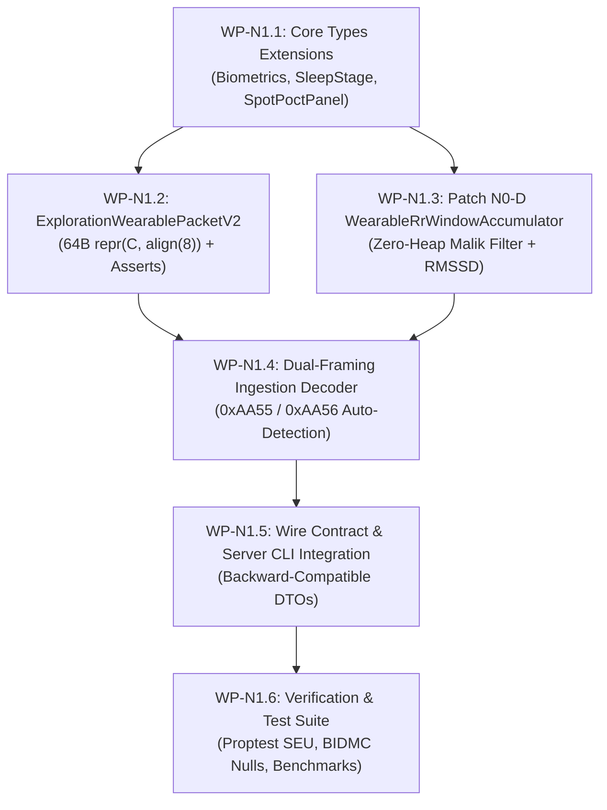

# Phase 38 (`N1`): Exploration Wearable Suite V2 (`64 B`), Continuous SBP/DBP/PTT, `ARCHeR` Sleep/Temperature, Personal `CPAD` Dosimetry & Episodic `POCT` Ingest

- **Phase ID:** `Phase 38 (N1)` — Block N (`Phases 38–41`: Advanced Astronaut Wearable Suite & Multisystem Exploration Medicine)
- **Status:** `[ ] PLANNED (ARCHITECTED & ACADEMICALLY GROUNDED)`
- **Target Crates & Modules:**
  - `crates/ares-core-types`: `telemetry.rs` (expanded `Biometrics`, `SleepStageCode`, `SpotPoctPanel`, `HematologyPanel`, `UrinalysisPanel`, `SalivaryCognitivePanel`), `constants.rs` (`WEARABLE_V2_SYNC_WORD = 0xAA56`, extended channel bitmasks).
  - `crates/ares-telemetry-ingest`: `wearable_packet.rs` (`ExplorationWearablePacketV2`, `WearableRrWindowAccumulator` [Patch N0-D], dual-framing decoder supporting `0xAA55` and `0xAA56`), `bidmc_replayer.rs` (null-honesty invariant enforcement).
  - `crates/ares-server-cli`: `wire_contract.rs` (optional V2 wearable & POCT wire representations), `ws_server.rs` (live telemetry broadcast).
- **Primary Owners:** `ARES-Health Team` & `@MiServeRDC`
- **Parent Architecture:**
  - Block N Architecture: [`BLOCK_N_CLINICAL_MEDICINE_ARCHITECTURE.md`](BLOCK_N_CLINICAL_MEDICINE_ARCHITECTURE.md)
  - Master Plan: [`RUST_ENGINE_PHASED_MASTER_PLAN.md`](RUST_ENGINE_PHASED_MASTER_PLAN.md)
  - Sibling Clinical Plans: [`phase_39_N2_renal_stone_rsr_plasma_volume_hemodynamics.md`](phase_39_N2_renal_stone_rsr_plasma_volume_hemodynamics.md)
  - HRV Validity Contract (`Issue #11`): [`ISSUE_11_HRV_VALIDITY_PLAN.md`](ISSUE_11_HRV_VALIDITY_PLAN.md)
  - Model Evidence Audit (`Issue #12`): [`../architecture/MODEL_EVIDENCE_AUDIT.md`](../architecture/MODEL_EVIDENCE_AUDIT.md)
- **Non-Negotiable Invariants:**
  1. **Strict Zero-Panic & Zero-Warning Execution:** `#![forbid(unsafe_code)]`, zero `.unwrap()` or `.expect()` in non-test code, zero panics, zero warnings under `cargo clippy --all-targets -- -D warnings`.
  2. **Zero Unicode Emojis:** Strictly ASCII characters in code, documentation, and logging.
  3. **Binary Layout Determinism:** `size_of::<ExplorationWearablePacketV2>() == 64` and `align_of::<ExplorationWearablePacketV2>() == 8` enforced at compile-time via `const _: () = assert!(...);`.
  4. **Hot-Path Budget (< 150 us Total 20 Hz Tick):** Frame decoding and `WearableRrWindowAccumulator` step must execute in `< 350 ns` with zero heap allocations.
  5. **Issue #11 Null-Honesty Fidelity:** On replay of `53` PhysioNet BIDMC CSVs, all new wearable and POCT channels (`sbp_mmhg`, `dbp_mmhg`, `core_temp_celsius`, `spot_poct`) remain strictly `Option::None`. Missing channels are recorded transparently in `missing_channels`.
  6. **Separation of Continuous Wearable Stream from Episodic POCT:** High-frequency wearable telemetry (`20 Hz`) is uncoupled from sporadic point-of-care laboratory tests (`SpotPoctPanel`), which carry explicit sample acquisition timestamps (`measured_at_mission_s`) and validity decay limits (`staleness_hours`).

---

## 1. Clinical & Systems Engineering Motivation

### 1.1 Limitations of the Tier C 32-Byte V1 Wearable Packet (`Phase 24 / J4`)
In Phase 24 (`crates/ares-telemetry-ingest/src/wearable_packet.rs`), ARES-Health implemented `WearableSensorPacket` (`32 B`, `sync_word = 0xAA55`), providing `hr_bpm`, `spo2_pct`, `resp_brpm`, `rr_interval_ms_x10`, and `imu_rms_g`. An audit of spaceflight clinical reality revealed four major instrumentation gaps:
1. **Total Absence of Blood Pressure Channels:** Neither `Biometrics` nor `WearableSensorPacket` carried systolic, diastolic, or mean arterial pressure. Gate 2 (anti-syncope LBNP) was forced to rely on a manual scenario slider (`systolic_bp_drop_mmhg`).
2. **Missing Core and Skin Thermometry:** `core_temp_celsius` was hardcoded to `None` across the entire pipeline, preventing detection of infection, heat strain inside EVA suits, and circadian nadir.
3. **Absence of Sleep Architecture and Circadian Photometry:** Sleep monitoring was limited to raw radar breathing patterns without sleep-stage classification or melanopic light dosimetry (`EDI lux` at `480 nm`).
4. **Uncalibrated Environmental vs. Personal Radiation:** A single environmental radiation rate (`radiation_dose_rate_msv_d`) was available, lacking personal active dosimeter integration (`CPAD` / `EAD`) with Linear Energy Transfer (`LET`) quality factor weighting.
5. **HRV Accumulator Dropout (Patch N0-D):** In V1 `to_biometrics()`, `rmssd_ms` was hardcoded to `None` even when `WMASK_RR_INTERVAL` was set, due to the lack of an online R-R window accumulator.

### 1.2 Architectural Solution: V2 Exploration Wearable Suite (`64 B`) + Episodic POCT Ingest
Phase 38 resolves these limitations by:
- Defining **`ExplorationWearablePacketV2`** (`64 B`, `sync_word = 0xAA56`, `#[repr(C, align(8))]`), adding cuffless continuous arterial pressure (`PTT` derived SBP/DBP), dual-sensor thermometry (`core_temp` + `skin_temp`), actigraphy/sleep-stage coding, melanopic illuminance, personal active dosimetry (`CPAD`), and suit metabolic rate.
- Retaining full backward compatibility: the ingestion pipeline automatically detects `0xAA55` (V1 32 B) vs. `0xAA56` (V2 64 B) via 2-byte header inspection.
- Implementing **`WearableRrWindowAccumulator`** (Patch N0-D): a zero-allocation circular buffer (`[u16; 64]`) with Malik ectopic filtering ($\pm 20\%$) calculating legitimate `RMSSD` after $\ge 16$ valid cardiac cycles.
- Introducing **`SpotPoctPanel`**: an episodic clinical diagnostic structure for blood chemistry (`i-STAT` / `rHEALTH ONE`), urinalysis (`Chemstrip`), bioimpedance spectroscopy (`MF-BIA`), and saliva qPCR, complete with staleness hours and timestamp tracking.

---

## 2. Academic & Aerospace Standards Grounding Matrix

| Parameter / Subsystem | Spaceflight Standard / Clinical Device | Reference Literature (DOI / Standard ID) | Implementation in ARES-Health |
| :--- | :--- | :--- | :--- |
| **Continuous Blood Pressure via PTT** | CSA Bio-Monitor (`Astroskin`) / Finapres Nova / CNAP | Mukkamala et al., *IEEE TBME* 2015 (`DOI: 10.1109/TBME.2015.2441950`); Hughson et al., *NPJ Microgravity* 2020 | `sbp_mmhg_x10`, `dbp_mmhg_x10`, `ptt_ms_x10` in V2 packet; maps to `Biometrics.sbp_mmhg`, `dbp_mmhg`, `ptt_ms`. |
| **Circadian Sleep & Melanopic Light** | NASA `ARCHeR` Smart Ring (Artemis II) / Actiwatch Spectrum | Barger et al., *The Lancet Neurology* 2014 (`DOI: 10.1016/S1474-4422(14)70122-X`); Barger, Dinges, Czeisler, *Handbook of Bioastronautics* 2021 (`DOI: 10.1007/978-3-319-12191-8_86`) | `sleep_stage_code: u8` (`Awake`, `N1_N2`, `N3_SlowWave`, `REM`), `melanopic_edi_lux: u16` (`480 nm` equivalent daylight lux). |
| **Dual-Flux Core Thermometry** | Draeger/DLR `ThermoLab` Zero-Heat-Flux / `ARCHeR` Ring | Gunga et al., *Acta Astronautica* 2009 (`DOI: 10.1016/j.actaastro.2008.08.016`) | `core_temp_c_x100: u16`, `skin_temp_c_x100: u16`; maps to `Biometrics.core_temp_celsius`, `skin_temp_celsius`. |
| **Personal Active Radiation Dosimeter** | NASA `CPAD` (Crew Personal Active Dosimeter) / ESA `EAD` | NASA TP-2015-218575; Straube et al., *Rad. Prot. Dosimetry* 2018 (`DOI: 10.1093/rpd/ncy046`); `NASA-STD-3001 [V1 4001]` | `personal_dose_rate_ugy_h: u16`, `let_quality_factor_x100: u16` ($Q(\text{LET})$); computes personal dose equivalent in mSv/d. |
| **Suit Metabolic & Helmet $ppCO_2$** | NASA Exploration Extravehicular Mobility Unit (`xEMU` / `AxEMU`) | `NASA-STD-3001 [V2 6004]`; OCHMO MTB-007; Norcross et al., *NASA TM-2015-218570* | `suit_metabolic_watts: u16`, `helmet_ppco2_mmhg_x100: u16` for EVA suit nodes (`WFLAG_EVA_SUIT_NODE`). |
| **Heart Rate Variability & Ectopic Rejection** | Task Force of ESC & NASPE / Malik Rule | M. Malik et al., *European Heart Journal* 1996 (`DOI: 10.1093/oxfordjournals.eurheartj.a014868`) | `WearableRrWindowAccumulator`: rejects $\Delta RR > 20\%$, computes `RMSSD` on $N \ge 16$ valid successive intervals. |
| **Point-of-Care Testing (`POCT`)** | Abbott `i-STAT Alinity` / `rHEALTH ONE` / MinION Nanopore | Crucian et al., *Frontiers in Immunology* 2018 (`DOI: 10.3389/fimmu.2018.01431`); ExMC Clinical Lab Capabilities | `SpotPoctPanel`: episodic blood chemistry, urinalysis, bioimpedance, saliva qPCR with explicit TTL decay. |

---

## 3. Data Structures & Binary Framing Specification

### 3.1 `ExplorationWearablePacketV2` Memory Layout (`64 Bytes`)
The struct is annotated with `#[repr(C, align(8))]` to ensure identical layout across ARM64 (Apple Silicon) and x86_64 architectures.

```
Byte Offset   Field Name                   Type      Resolution / Encoding
0..2          sync_word                    u16       0xAA56 (Little-Endian)
2..3          node_id                      u8        Node identifier (0=Chest, 1=Ring, 2=Wrist, 3=Suit)
3..4          channel_mask                 u8        Legacy V1 channel mask (HR, SpO2, RESP, RR, IMU)
4..6          channel_mask_ext             u16       Extended V2 channel bitmask
6..8          supervisor_restart_count     u16       SEU supervisor watchdog reboot counter
8..12         sequence_num                 u32       Monotonic packet counter
12..16        uptime_ms                    u32       Node millisecond uptime
16..20        imu_rms_g                    f32       3-axis root-mean-square acceleration (g)
20..22        hr_bpm_x100                  u16       Heart rate (bpm * 100, e.g. 7250 = 72.50 bpm)
22..24        spo2_pct_x100                u16       Pulse oximetry (% * 100, e.g. 9850 = 98.50%)
24..26        resp_brpm_x100               u16       Respiration rate (brpm * 100)
26..28        rr_interval_ms_x10           u16       Beat interval (ms * 10, e.g. 8245 = 824.5 ms)
28..30        sqi_score_x10000             u16       Signal Quality Index (0..10000)
30..32        sbp_mmhg_x10                 u16       Systolic Blood Pressure (mmHg * 10)
32..34        dbp_mmhg_x10                 u16       Diastolic Blood Pressure (mmHg * 10)
34..36        ptt_ms_x10                   u16       Pulse Transit Time (ms * 10)
36..38        core_temp_c_x100             u16       Core body temperature (deg C * 100, e.g. 3715 = 37.15 C)
38..40        skin_temp_c_x100             u16       Skin surface temperature (deg C * 100)
40..41        sleep_stage_code             u8        0=Awake, 1=N1_N2, 2=N3_SlowWave, 3=REM, 255=Unclassified
41..42        reserved_u8                  u8        Zero-initialized padding
42..44        melanopic_edi_lux            u16       Equivalent Daylight Illuminance (lux, 0..65535)
44..46        personal_dose_rate_ugy_h     u16       CPAD absorbed dose rate (uGy/h * 10)
46..48        let_quality_factor_x100      u16       Radiation Quality Factor Q(LET) (* 100, 100..3000)
48..50        suit_metabolic_watts         u16       xEMU Metabolic expenditure (Watts, 0..1500 W)
50..52        helmet_ppco2_mmhg_x100       u16       Helmet in-mask CO2 (mmHg * 100)
52..54        ambient_noise_dba_x10        u16       Ambient acoustic level (dBA * 10)
54..56        flags                        u16       Status flags (SEU recovery, BLE retransmit, EVA suit)
56..60        reserved_future              u32       Zero-initialized future expansion
60..62        flags_ext                    u16       Extended status flags
62..64        crc16_ccitt                  u16       CRC-16-CCITT checksum over bytes 0..62
```

### 3.2 Extended Channel Bitmasks
```rust
// Legacy V1 channel masks (bytes 3..4)
pub const WMASK_RR_INTERVAL: u8 = 1 << 0;
pub const WMASK_HR_BPM: u8 = 1 << 1;
pub const WMASK_SPO2_PCT: u8 = 1 << 2;
pub const WMASK_RESP_BRPM: u8 = 1 << 3;
pub const WMASK_IMU_RMS: u8 = 1 << 4;

// Extended V2 channel masks (bytes 4..6: channel_mask_ext)
pub const WMASK_EXT_SBP: u16 = 1 << 0;
pub const WMASK_EXT_DBP: u16 = 1 << 1;
pub const WMASK_EXT_PTT: u16 = 1 << 2;
pub const WMASK_EXT_CORE_TEMP: u16 = 1 << 3;
pub const WMASK_EXT_SKIN_TEMP: u16 = 1 << 4;
pub const WMASK_EXT_SLEEP_STAGE: u16 = 1 << 5;
pub const WMASK_EXT_MELANOPIC_LUX: u16 = 1 << 6;
pub const WMASK_EXT_PERSONAL_DOSIMETRY: u16 = 1 << 7;
pub const WMASK_EXT_SUIT_METABOLIC: u16 = 1 << 8;
pub const WMASK_EXT_HELMET_PPCO2: u16 = 1 << 9;
pub const WMASK_EXT_AMBIENT_NOISE: u16 = 1 << 10;
```

### 3.3 Compile-Time Alignment and Offset Invariants
```rust
const _: () = assert!(core::mem::size_of::<ExplorationWearablePacketV2>() == 64);
const _: () = assert!(core::mem::align_of::<ExplorationWearablePacketV2>() == 8);
const _: () = assert!(core::mem::offset_of!(ExplorationWearablePacketV2, sync_word) == 0);
const _: () = assert!(core::mem::offset_of!(ExplorationWearablePacketV2, channel_mask_ext) == 4);
const _: () = assert!(core::mem::offset_of!(ExplorationWearablePacketV2, sequence_num) == 8);
const _: () = assert!(core::mem::offset_of!(ExplorationWearablePacketV2, uptime_ms) == 12);
const _: () = assert!(core::mem::offset_of!(ExplorationWearablePacketV2, imu_rms_g) == 16);
const _: () = assert!(core::mem::offset_of!(ExplorationWearablePacketV2, sbp_mmhg_x10) == 30);
const _: () = assert!(core::mem::offset_of!(ExplorationWearablePacketV2, core_temp_c_x100) == 36);
const _: () = assert!(core::mem::offset_of!(ExplorationWearablePacketV2, sleep_stage_code) == 40);
const _: () = assert!(core::mem::offset_of!(ExplorationWearablePacketV2, melanopic_edi_lux) == 42);
const _: () = assert!(core::mem::offset_of!(ExplorationWearablePacketV2, personal_dose_rate_ugy_h) == 44);
const _: () = assert!(core::mem::offset_of!(ExplorationWearablePacketV2, suit_metabolic_watts) == 48);
const _: () = assert!(core::mem::offset_of!(ExplorationWearablePacketV2, crc16_ccitt) == 62);
```

### 3.4 Patch N0-D: Zero-Heap `WearableRrWindowAccumulator`
```rust
/// Online circular window accumulator for raw beat intervals from wearable nodes.
/// Employs Malik ectopic rejection (+/- 20% interval jump) and computes RMSSD on demand.
#[derive(Debug, Clone, Copy)]
pub struct WearableRrWindowAccumulator {
    buffer: [u16; 64],
    head: usize,
    count: usize,
}

impl Default for WearableRrWindowAccumulator {
    fn default() -> Self {
        Self {
            buffer: [0u16; 64],
            head: 0,
            count: 0,
        }
    }
}

impl WearableRrWindowAccumulator {
    pub const MIN_BEATS_FOR_RMSSD: usize = 16;

    /// Pushes a new raw R-R interval (in milliseconds * 10).
    /// Rejects intervals outside physiological human range (300 ms .. 2000 ms)
    /// and applies Malik relative jump filtering (+/- 20% vs. last accepted interval).
    #[inline]
    pub fn push_interval_ms_x10(&mut self, interval_ms_x10: u16) -> bool {
        let ms = interval_ms_x10 as f64 / 10.0;
        if !(300.0..=2000.0).contains(&ms) {
            return false;
        }

        if self.count > 0 {
            let last_idx = if self.head == 0 { 63 } else { self.head - 1 };
            let last_ms = self.buffer[last_idx] as f64 / 10.0;
            let ratio = ms / last_ms;
            // Malik rule: accept only intervals within 20% of previous normal beat
            if !(0.80..=1.20).contains(&ratio) {
                return false;
            }
        }

        self.buffer[self.head] = interval_ms_x10;
        self.head = (self.head + 1) % 64;
        if self.count < 64 {
            self.count += 1;
        }
        true
    }

    /// Calculates root mean square of successive differences (RMSSD) in milliseconds.
    /// Returns None if fewer than 16 valid successive beats have accumulated.
    #[inline]
    pub fn compute_rmssd_ms(&self) -> Option<f64> {
        if self.count < Self::MIN_BEATS_FOR_RMSSD {
            return None;
        }

        let mut sum_squared_diff = 0.0;
        let mut diff_count = 0usize;

        let start_offset = if self.count == 64 { self.head } else { 0 };

        for i in 0..(self.count - 1) {
            let idx_a = (start_offset + i) % 64;
            let idx_b = (start_offset + i + 1) % 64;
            let diff = (self.buffer[idx_b] as f64 - self.buffer[idx_a] as f64) / 10.0;
            sum_squared_diff += diff * diff;
            diff_count += 1;
        }

        if diff_count == 0 {
            return None;
        }

        Some((sum_squared_diff / diff_count as f64).sqrt())
    }
}
```

### 3.5 `SpotPoctPanel` Episodic Laboratory Structure
```rust
/// Episodic Point-of-Care Testing (POCT) laboratory results.
/// Unlike continuous wearable signals, POCT data arrives sporadically (e.g. 1/Sol or weekly).
#[derive(Debug, Clone, PartialEq, Serialize, Deserialize)]
pub struct SpotPoctPanel {
    pub measured_at_mission_s: f64,
    pub staleness_hours: f64,
    pub hematology: Option<HematologyPanel>,
    pub urinalysis: Option<UrinalysisPanel>,
    pub bioimpedance: Option<BioimpedancePanel>,
    pub salivary_cognitive: Option<SalivaryCognitivePanel>,
}

#[derive(Debug, Clone, PartialEq, Serialize, Deserialize)]
pub struct HematologyPanel {
    pub hematocrit_pct: Option<f64>,              // Normal: 41-50% (male), 36-44% (female)
    pub hemoglobin_g_dl: Option<f64>,             // Normal: 13.8-17.2 g/dL
    pub wbc_k_ul: Option<f64>,                    // White Blood Cells (4.5-11.0 k/uL)
    pub neutrophil_lymphocyte_ratio: Option<f64>, // NLR marker of systemic stress/inflammation (< 3.0)
    pub ionized_calcium_mmol_l: Option<f64>,      // Free iCa2+ (1.15-1.33 mmol/L)
    pub creatinine_mg_dl: Option<f64>,            // Renal clearance marker (0.7-1.3 mg/dL)
    pub lactate_mmol_l: Option<f64>,               // Sepsis / hypoxia marker (< 2.0 mmol/L)
}

#[derive(Debug, Clone, PartialEq, Serialize, Deserialize)]
pub struct UrinalysisPanel {
    pub urine_output_l_d: Option<f64>,            // Measured 24h collection volume (L/d)
    pub urine_ph: Option<f64>,                    // Normal: 5.5 - 7.0
    pub urine_specific_gravity: Option<f64>,      // USG: 1.005 - 1.030
    pub urinary_citrate_mg_d: Option<f64>,        // Stone inhibitor (Normal: > 320 mg/d)
    pub urinary_calcium_measured_mg_d: Option<f64>, // Excretion (> 250 mg/d indicates hypercalciuria)
    pub microhematuria_dipstick_pos: bool,        // Flag for occult blood in urine
}

#[derive(Debug, Clone, PartialEq, Serialize, Deserialize)]
pub struct BioimpedancePanel {
    pub bia_plasma_vol_delta_pct: Option<f64>,    // Direct MF-BIA estimate of Delta PV%
    pub bia_thorax_leg_ecw_ratio: Option<f64>,    // Cephalic fluid shift index
    pub total_body_water_l: Option<f64>,
}

#[derive(Debug, Clone, PartialEq, Serialize, Deserialize)]
pub struct SalivaryCognitivePanel {
    pub salivary_cortisol_nmol_l: Option<f64>,    // Circadian arousal/stress peak
    pub viral_reactivation_copies_ml: Option<f64>,// qPCR VZV/EBV DNA load
    pub pvt_lapses_count: Option<u32>,            // Psychomotor vigilance test lapses (> 355 ms)
    pub vo2max_ml_kg_min: Option<f64>,            // Submaximal cycle ergometer estimate
}

impl SpotPoctPanel {
    /// Determines whether the laboratory values have exceeded their valid diagnostic horizon.
    #[inline]
    pub fn is_stale(&self, current_mission_s: f64) -> bool {
        let elapsed_hours = (current_mission_s - self.measured_at_mission_s).max(0.0) / 3600.0;
        elapsed_hours > self.staleness_hours
    }
}
```

---

## 4. Work Packages & Implementation Steps



### WP-N1.1: Core Types Extensions (`crates/ares-core-types`)
- **Files Modified:** `crates/ares-core-types/src/telemetry.rs`, `constants.rs`, `lib.rs`
- **Actions:**
  1. Add `SleepStageCode` enum (`Awake = 0`, `N1N2 = 1`, `N3SlowWave = 2`, `Rem = 3`, `Unclassified = 255`).
  2. Extend `Biometrics` with `#[serde(default)]` fields:
     - `sbp_mmhg: Option<f64>`
     - `dbp_mmhg: Option<f64>`
     - `map_mmhg: Option<f64>`
     - `ptt_ms: Option<f64>`
     - `core_temp_celsius: Option<f64>`
     - `skin_temp_celsius: Option<f64>`
     - `sleep_stage: Option<SleepStageCode>`
     - `melanopic_edi_lux: Option<f64>`
     - `personal_dose_rate_msv_d: Option<f64>`
     - `suit_metabolic_watts: Option<f64>`
     - `ambient_noise_dba: Option<f64>`
     - `spot_poct: Option<SpotPoctPanel>`
  3. Add `SpotPoctPanel`, `HematologyPanel`, `UrinalysisPanel`, `BioimpedancePanel`, and `SalivaryCognitivePanel` structs.
  4. Define constants in `constants.rs`:
     - `WEARABLE_V2_SYNC_WORD = 0xAA56`
     - `WEARABLE_V2_PACKET_BYTES = 64`
     - Extended channel bitmasks (`WMASK_EXT_*`).

### WP-N1.2: V2 64-Byte Wearable Packet Definition (`crates/ares-telemetry-ingest`)
- **Files Modified:** `crates/ares-telemetry-ingest/src/wearable_packet.rs`
- **Actions:**
  1. Declare `ExplorationWearablePacketV2` with `#[repr(C, align(8))]`.
  2. Add compile-time `assert!` statements for total size (`64 bytes`), 8-byte alignment, and every critical field offset.
  3. Implement `to_le_bytes_with_crc(&self) -> [u8; 64]` calculating `compute_crc16_ccitt` over bytes 0..62.
  4. Implement `from_le_bytes(bytes: &[u8]) -> Result<Self, IngestError>` validating sync word `0xAA56` and CRC-16 integrity.

### WP-N1.3: Patch N0-D Wearable R-R Accumulator (`crates/ares-telemetry-ingest`)
- **Files Modified:** `crates/ares-telemetry-ingest/src/wearable_packet.rs`
- **Actions:**
  1. Implement `WearableRrWindowAccumulator` with fixed `[u16; 64]` ring buffer.
  2. Enforce physiological bounds (`300 ms .. 2000 ms`) and Malik ectopic filtering ($\pm 20\%$).
  3. Compute `RMSSD` once $\ge 16$ valid successive intervals are present.
  4. Integrate accumulator into `ValidatedTelemetryFrame` generation so live wearable nodes generate valid `rmssd_ms` without manual simulation.

### WP-N1.4: Dual-Framing Ingestion Decoder (`crates/ares-telemetry-ingest`)
- **Files Modified:** `crates/ares-telemetry-ingest/src/wearable_packet.rs`, `lib.rs`
- **Actions:**
  1. Implement unified entry point:
     ```rust
     pub enum DecodedWearablePacket {
         V1(WearableSensorPacket),
         V2(ExplorationWearablePacketV2),
     }

     pub fn decode_wearable_packet_auto(raw_bytes: &[u8]) -> Result<DecodedWearablePacket, IngestError>;
     ```
  2. If header matches `0xAA55` and length $\ge 32$, parse as V1.
  3. If header matches `0xAA56` and length $\ge 64$, parse as V2.
  4. Provide conversion method `to_biometrics_with_accumulator()` that populates all newly available V2 fields while preserving nullability for inactive channel masks.

### WP-N1.5: Wire Contract & Server CLI Integration (`crates/ares-server-cli`)
- **Files Modified:** `crates/ares-server-cli/src/wire_contract.rs`, `ws_server.rs`, `fastmcp_router.rs`
- **Actions:**
  1. Add optional V2 fields to `WireBiometrics` with `#[serde(default, skip_serializing_if = "Option::is_none")]`.
  2. Add `spot_poct` endpoint `POST /api/poct/ingest` allowing upload of `SpotPoctPanel` JSON payloads.
  3. Ensure `FastMCP` context serialization remains under the strict 600-byte cap by summarizing POCT status into compact tags (e.g. `"poct_hct_42pct,rsr_normal"`).

### WP-N1.6: Verification & Test Suite
- **Files Modified:** `crates/ares-telemetry-ingest/tests/wearable_v2_tests.rs`, `crates/ares-core-types/tests/poct_tests.rs`
- **Actions:**
  1. Compile-time assertions test verifying 64-byte size and 8-byte alignment.
  2. Property-based testing (`proptest`):
     - Single-bit flip SEU injection across all 512 bits of the 64-byte packet: verifies 100% detection rate by `compute_crc16_ccitt`.
     - Monotonic sequence and timestamp validation under random re-ordering.
  3. BIDMC CSV Replay Invariant:
     - Run replayer on all 53 BIDMC records: confirm `sbp_mmhg == None`, `core_temp_celsius == None`, and `spot_poct == None` for 100% of rows.
  4. Benchmark test: verify decode latency of `decode_wearable_packet_auto` is `< 350 ns` on Apple Silicon.

---

## 5. Concrete Code Skeletons

### 5.1 `ExplorationWearablePacketV2` Struct Declaration
```rust
#[repr(C, align(8))]
#[derive(Debug, Clone, Copy, PartialEq)]
pub struct ExplorationWearablePacketV2 {
    pub sync_word: u16,                  // 0..2
    pub node_id: u8,                     // 2..3
    pub channel_mask: u8,                // 3..4
    pub channel_mask_ext: u16,           // 4..6
    pub supervisor_restart_count: u16,   // 6..8
    pub sequence_num: u32,               // 8..12
    pub uptime_ms: u32,                  // 12..16
    pub imu_rms_g: f32,                  // 16..20
    pub hr_bpm_x100: u16,                // 20..22
    pub spo2_pct_x100: u16,              // 22..24
    pub resp_brpm_x100: u16,             // 24..26
    pub rr_interval_ms_x10: u16,         // 26..28
    pub sqi_score_x10000: u16,           // 28..30
    pub sbp_mmhg_x10: u16,               // 30..32
    pub dbp_mmhg_x10: u16,               // 32..34
    pub ptt_ms_x10: u16,                 // 34..36
    pub core_temp_c_x100: u16,           // 36..38
    pub skin_temp_c_x100: u16,           // 38..40
    pub sleep_stage_code: u8,            // 40..41
    pub reserved_u8: u8,                 // 41..42
    pub melanopic_edi_lux: u16,          // 42..44
    pub personal_dose_rate_ugy_h: u16,   // 44..46
    pub let_quality_factor_x100: u16,    // 46..48
    pub suit_metabolic_watts: u16,       // 48..50
    pub helmet_ppco2_mmhg_x100: u16,     // 50..52
    pub ambient_noise_dba_x10: u16,      // 52..54
    pub flags: u16,                      // 54..56
    pub reserved_future: u32,            // 56..60
    pub flags_ext: u16,                  // 60..62
    pub crc16_ccitt: u16,                // 62..64
}
```

### 5.2 Packet Conversion to Biometrics
```rust
impl ExplorationWearablePacketV2 {
    pub fn to_biometrics(
        &self,
        rr_accumulator: &WearableRrWindowAccumulator,
    ) -> Biometrics {
        let mut missing_channels = Vec::new();

        let heart_rate_bpm = if (self.channel_mask & WMASK_HR_BPM) != 0 {
            Some(f64::from(self.hr_bpm_x100) / 100.0)
        } else {
            missing_channels.push("heart_rate_bpm".to_string());
            None
        };

        let spo2_pct = if (self.channel_mask & WMASK_SPO2_PCT) != 0 {
            Some(f64::from(self.spo2_pct_x100) / 100.0)
        } else {
            missing_channels.push("spo2_pct".to_string());
            None
        };

        let resp_rate_brpm = if (self.channel_mask & WMASK_RESP_BRPM) != 0 {
            Some(f64::from(self.resp_brpm_x100) / 100.0)
        } else {
            missing_channels.push("resp_rate_brpm".to_string());
            None
        };

        let sbp_mmhg = if (self.channel_mask_ext & WMASK_EXT_SBP) != 0 {
            Some(f64::from(self.sbp_mmhg_x10) / 10.0)
        } else {
            missing_channels.push("sbp_mmhg".to_string());
            None
        };

        let dbp_mmhg = if (self.channel_mask_ext & WMASK_EXT_DBP) != 0 {
            Some(f64::from(self.dbp_mmhg_x10) / 10.0)
        } else {
            missing_channels.push("dbp_mmhg".to_string());
            None
        };

        let map_mmhg = match (sbp_mmhg, dbp_mmhg) {
            (Some(s), Some(d)) => Some(d + (s - d) / 3.0),
            _ => None,
        };

        let ptt_ms = if (self.channel_mask_ext & WMASK_EXT_PTT) != 0 {
            Some(f64::from(self.ptt_ms_x10) / 10.0)
        } else {
            None
        };

        let core_temp_celsius = if (self.channel_mask_ext & WMASK_EXT_CORE_TEMP) != 0 {
            Some(f64::from(self.core_temp_c_x100) / 100.0)
        } else {
            missing_channels.push("core_temp_celsius".to_string());
            None
        };

        let skin_temp_celsius = if (self.channel_mask_ext & WMASK_EXT_SKIN_TEMP) != 0 {
            Some(f64::from(self.skin_temp_c_x100) / 100.0)
        } else {
            None
        };

        let sleep_stage = if (self.channel_mask_ext & WMASK_EXT_SLEEP_STAGE) != 0 {
            match self.sleep_stage_code {
                0 => Some(SleepStageCode::Awake),
                1 => Some(SleepStageCode::N1N2),
                2 => Some(SleepStageCode::N3SlowWave),
                3 => Some(SleepStageCode::Rem),
                _ => Some(SleepStageCode::Unclassified),
            }
        } else {
            None
        };

        let melanopic_edi_lux = if (self.channel_mask_ext & WMASK_EXT_MELANOPIC_LUX) != 0 {
            Some(f64::from(self.melanopic_edi_lux))
        } else {
            None
        };

        // Compute personal dose equivalent in mSv/d from uGy/h and Q(LET)
        let personal_dose_rate_msv_d = if (self.channel_mask_ext & WMASK_EXT_PERSONAL_DOSIMETRY) != 0 {
            let ugy_h = f64::from(self.personal_dose_rate_ugy_h) / 10.0;
            let q = f64::from(self.let_quality_factor_x100) / 100.0;
            // mSv/d = (uGy/h * 24 h/d / 1000 uGy/mGy) * Q
            Some((ugy_h * 24.0 / 1000.0) * q)
        } else {
            None
        };

        let suit_metabolic_watts = if (self.channel_mask_ext & WMASK_EXT_SUIT_METABOLIC) != 0 {
            Some(f64::from(self.suit_metabolic_watts))
        } else {
            None
        };

        let ambient_noise_dba = if (self.channel_mask_ext & WMASK_EXT_AMBIENT_NOISE) != 0 {
            Some(f64::from(self.ambient_noise_dba_x10) / 10.0)
        } else {
            None
        };

        let rmssd_ms = rr_accumulator.compute_rmssd_ms();
        let hrv_unavailable_reason = if rmssd_ms.is_none() {
            Some(HrvUnavailableReason::BeatIntervalsNotAvailable)
        } else {
            None
        };

        Biometrics {
            heart_rate_bpm,
            pulse_rate_bpm: None,
            resp_rate_brpm,
            spo2_pct,
            rmssd_ms,
            hrv_unavailable_reason,
            sdnn_ms: None,
            pnn50_pct: None,
            lf_hf_ratio: None,
            vocal_f0_hz: None,
            vocal_jitter_pct: None,
            radiation_dose_rate_msv_d: personal_dose_rate_msv_d.unwrap_or(0.0),
            sqi_score: (f64::from(self.sqi_score_x10000) / 10_000.0).clamp(0.0, 1.0),
            missing_channels,
            sbp_mmhg,
            dbp_mmhg,
            map_mmhg,
            ptt_ms,
            core_temp_celsius,
            skin_temp_celsius,
            sleep_stage,
            melanopic_edi_lux,
            personal_dose_rate_msv_d,
            suit_metabolic_watts,
            ambient_noise_dba,
            spot_poct: None,
        }
    }
}
```

---

## 6. Verification Matrix & Acceptance Criteria

| Check / Metric | Target Threshold | Verification Method |
| :--- | :--- | :--- |
| **Compile-Time Memory Layout** | `size_of == 64`, `align_of == 8`, offsets exact | Rust `const _: () = assert!(...);` invariants |
| **SEU Single-Bit Detection** | `100.0%` detection of 1-bit corruption | `proptest` flipping each bit `0..512` |
| **Decoding Throughput** | `< 350 ns` per 64-byte frame | `cargo bench` micro-benchmark |
| **Heap Allocations in Hot-Path** | `0` allocations after startup | Dynamic allocation tracing / static code inspection |
| **PhysioNet BIDMC Null Fidelity** | `0` false positive values for new channels | Automated test running replayer across all 53 records |
| **Malik HRV Accumulator** | Valid RMSSD only after $\ge 16$ unperturbed beats | Unit test with synthetic ectopic beats ($\pm 35\%$) |
| **POCT Staleness Expiration** | `is_stale == true` when `dt > staleness_hours` | Property test over timestamp boundaries |
| **Clippy & Safe Rust** | Zero warnings, zero panics, `#![forbid(unsafe_code)]` | `./scripts/agent_probe.sh --fast` |
