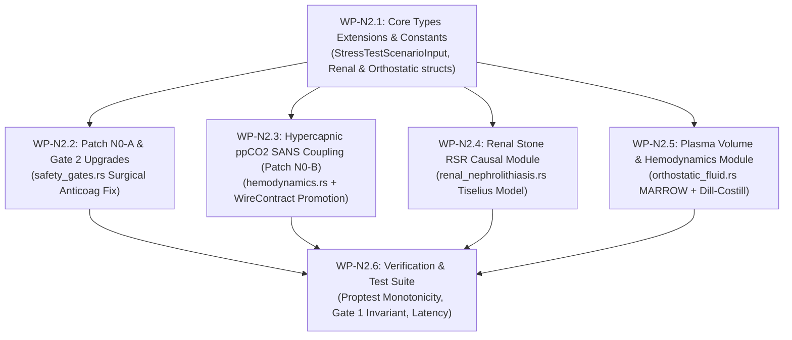

# Phase 39 (`N2`): Renal Stone Relative Supersaturation (`RSR`), Plasma Volume / Viscosity Hemodynamics & Hypercapnic `SANS` Coupling

- **Phase ID:** `Phase 39 (N2)` — Block N (`Phases 38–41`: Advanced Astronaut Wearable Suite & Multisystem Exploration Medicine)
- **Status:** `[ ] PLANNED (ARCHITECTED & ACADEMICALLY GROUNDED)`
- **Target Crates & Modules:**
  - `crates/ares-core-types`: `telemetry.rs` (extended `StressTestScenarioInput` with `cabin_ppco2_mmhg`, `daily_fluid_intake_l`, `k_citrate_supplement_active`; new structs `RenalNephrolithiasis`, `OrthostaticHemodynamics`, updated `ValidatedTelemetryFrame`), `constants.rs` (`K_RSR_SCALE`, `CITRATE_BASELINE_MG_D`, `RSR_ATTENTION_THRESHOLD`, `RSR_CRITICAL_THRESHOLD`, `PLASMA_MU_POISE`, `ALPHA_HCT`, `SHOCK_INDEX_CRITICAL`).
  - `crates/ares-causal-graph`: `renal_nephrolithiasis.rs` (new module), `orthostatic_fluid.rs` (new module), `hemodynamics.rs` (Patch N0-B hypercapnia coupling + variable blood viscosity $\mu(\text{Hct})$), `lib.rs`, `adhg_graph.rs` (causal graph expansion).
  - `crates/ares-medops-playbooks`: `safety_gates.rs` (Patch N0-A Gate 1 surgical fix for non-anticoagulant pharmacology; Gate 2 real SBP-drop evaluation).
  - `crates/ares-server-cli`: `wire_contract.rs` (promote `cabin_ppco2_mmhg` from dead JSON field to live causal parameter), `ws_server.rs`, `fastmcp_router.rs`.
- **Primary Owners:** `@fabiomalagutti27-droid` & `@MiServeRDC`
- **Parent Architecture:**
  - Block N Architecture: [`BLOCK_N_CLINICAL_MEDICINE_ARCHITECTURE.md`](BLOCK_N_CLINICAL_MEDICINE_ARCHITECTURE.md)
  - Master Plan: [`RUST_ENGINE_PHASED_MASTER_PLAN.md`](RUST_ENGINE_PHASED_MASTER_PLAN.md)
  - Sibling Ingestion Plan: [`phase_38_N1_wearable_suite_v2_poct_ingest.md`](phase_38_N1_wearable_suite_v2_poct_ingest.md)
  - Model Evidence Audit (`Issue #12`): [`../architecture/MODEL_EVIDENCE_AUDIT.md`](../architecture/MODEL_EVIDENCE_AUDIT.md)
- **Non-Negotiable Invariants:**
  1. **Strict Safe Rust Execution:** `#![forbid(unsafe_code)]`, zero `.unwrap()` or `.expect()` in non-test code, zero panics, zero warnings under `cargo clippy --all-targets -- -D warnings`.
  2. **Zero Unicode Emojis:** Strictly ASCII characters in code, documentation, and logging.
  3. **Hot-Path Budget (< 150 us Total 20 Hz Tick):** Combined execution of `renal_nephrolithiasis`, `orthostatic_fluid`, and hypercapnic `hemodynamics` must complete in `< 25 us` with zero heap allocations.
  4. **Issue #11 Null-Honesty Fidelity:** If `Hct` is unavailable (`None`), blood viscosity defaults precisely to constant `BLOOD_VISCOSITY_POISE` (`0.035 Poise`). If `sbp_mmhg` is unavailable, `ShockIndex` evaluates strictly to `None`—never generating synthetic or imputed numbers.
  5. **Issue #12 Model Evidence Registration:** All scenario and causal equations are tagged with `ModelValidationStatus::IllustrativeUnvalidated` and documented in `docs/architecture/MODEL_EVIDENCE_AUDIT.md`.
  6. **Physical Monotonicity Properties:** Enforced via property-based testing (`proptest`):
     - Increasing fluid intake or oral K-Citrate strictly decreases `RSR`.
     - Increasing cabin $ppCO_2$ strictly increases `sans_risk_index` and decreases urinary citrate.

---

## 1. Clinical & Systems Engineering Motivation

### 1.1 Clinical Gaps Addressed from NASA HRP RIDGE Framework
An in-depth biomedical audit of the pre-Block N codebase identified three high-risk pathophysiological disconnects:
1. **Renal Stone Formation Risk (HRP Gap Med-01 / NASA-STD-3001 [V2 6026]):**
   Bone demineralization mobilizes excess calcium into the bloodstream, elevating urinary calcium excretion (`> 250–350 mg/d`). Coupled with blunted thirst in microgravity (urine volume `< 1.5 L/d`) and mild systemic acidosis from elevated cabin $ppCO_2$, this induces severe hypocitraturia (`< 320 mg/d`). The Relative Supersaturation (`RSR`) of calcium oxalate and brushite spikes, creating acute risk of nephrolithiasis and obstructive uropathy. While `urinary_calcium_mg_d` was computed in `Musculoskeletal`, it was disconnected from fluid balance, pH, citrate, and clinical monitoring.
2. **Plasma Volume Contraction ($\Delta PV\%$), Spaceflight Anemia & Post-Landing Syncope (HRP Gap Med-02):**
   The cephalic fluid shift triggers the Gauer-Henry reflex, causing a 10–17% contraction of plasma volume within 72 hours. Simultaneously, findings from the Canadian Space Agency MARROW study (Trudel et al., *Nature Medicine* 2022) revealed persistent hemolysis (`+54%` increase in RBC destruction in space), depleting erythrocyte mass. In ARES-Health, blood viscosity was hardcoded to `0.035 Poise` regardless of hematocrit, and no variable blood volume model existed to guide pre-landing fluid loading for Martian descent (`0.38g`).
3. **Dead Wire Field for Cabin $ppCO_2$ (Patch N0-B) & Gate 1 Anticoagulant Bug (Patch N0-A):**
   - In `crates/ares-server-cli/src/wire_contract.rs`, `cabin_ppco2_mmhg` was parsed from the What-If stress test request but discarded before reaching `hemodynamics.rs` or `AdhgCausalEngine`. In real spaceflight, $ppCO_2 > 2.0\text{ mmHg}$ causes marked cerebral and choroidal vasodilation (+3–6% CBF per mmHg), directly worsening optic disc edema (`SANS`).
   - In `crates/ares-medops-playbooks/src/safety_gates.rs`, Gate 1 stripped any action with `category.contains("PHARMACOLOGICAL")` if no IJV thrombus was confirmed, accidentally stripping non-anticoagulant medications (analgesics, antibiotics, K-citrate).

### 1.2 Architectural Resolution
Phase 39 resolves these clinical gaps by:
- Creating `crates/ares-causal-graph/src/renal_nephrolithiasis.rs` implementing Tiselius' relative supersaturation model ($\text{RSR}_{\text{renal}}$), coupled with urine volume and hypercapnic citrate suppression.
- Creating `crates/ares-causal-graph/src/orthostatic_fluid.rs` modeling the Gauer-Henry reflex, MARROW space anemia hemolysis, variable blood viscosity $\mu(\text{Hct})$, Dill & Costill hematocrit adjustments, and the Shock Index.
- Applying **Patch N0-A** to `safety_gates.rs` to isolate anticoagulant restriction to `"PHARMACOLOGICAL_ANTICOAGULANT"`.
- Applying **Patch N0-B** across `wire_contract.rs`, `telemetry.rs`, and `hemodynamics.rs` to physically couple $ppCO_2$ to cerebral vasodilation $\Delta_{\text{CBF}}(ppCO_2)$ and optic nerve sheath diameter (`ONSD`).
- Upgrading **Gate 2** to evaluate continuous systolic arterial pressure when available from Wearable Suite V2.

---

## 2. Academic & Aerospace Standards Grounding Matrix

| Parameter / Phenomenon | Clinical Model & Empirical Study | Reference Literature (DOI / Standard ID) | Mathematical Formulation in Rust |
| :--- | :--- | :--- | :--- |
| **Calcium Oxalate & Brushite Supersaturation** | Tiselius Risk Index & Whitson Spaceflight Epidemiology | H.-G. Tiselius, *Urological Research* 1985 (`DOI: 10.1007/bf00262660`); Whitson et al., *Journal of Urology* 1997 | $\text{RSR} = \kappa \cdot \frac{\text{Ca}/V_u}{\sqrt{\text{Cit}/V_u}} \cdot \phi(\text{pH}_u)$ |
| **Hypercapnic Hypocitraturia** | Renal Tubular Citrate Reabsorption in Acidosis | Simpson, *Am. J. Physiol.* 1983; Berg & Tiselius, *Eur. Urol.* 1986 (`DOI: 10.1159/000472578`) | $\text{Cit}(t) = \text{clamp}(\text{Cit}_0 + \Delta_{\text{KCit}} - 38.0 \cdot \max(0, ppCO_2 - 2.0), 120, 950)$ |
| **Gauer-Henry Reflex ($\Delta PV\%$)** | Spaceflight Cephalic Fluid Shift & Volemic Contraction | Gauer & Henry, *Int. Rev. Physiol.* 1976; Blomqvist & Stone, *Handbook of Physiology* 1983 | $\Delta PV(t) = -13.5 \cdot (1 - e^{-\text{FD}/3.0}) + \Delta PV_{\text{loading}}$ |
| **Dill & Costill Plasma Volume Equation** | Hemoconcentration & Dehydration Blood Volume Shift | Dill & Costill, *J. Appl. Physiol.* 1974 (`DOI: 10.1152/jappl.1974.37.2.247`) | $\Delta PV = 100 \cdot [\frac{\text{Hb}_0}{\text{Hb}_t} \cdot \frac{1 - \text{Hct}_t}{1 - \text{Hct}_0} - 1]$ |
| **Spaceflight Hemolysis (`MARROW`)** | 54% Increase in Erythrocyte Destruction in Microgravity | Guy Trudel, Nibras Shahin, et al., *Nature Medicine* 2022 (`DOI: 10.1038/s41591-021-01637-7`) | $\Delta \text{RBC}_{\text{mass}}(t) = -0.025 \cdot \min(\text{FD}, 250)\%$; chronic drop in Hct baseline |
| **Variable Blood Viscosity $\mu(\text{Hct})$** | Non-Newtonian Erythrocyte Suspension Rheology | Schmid-Schonbein et al., *Biorheology* 1973; Rand et al., *J. Clin. Invest.* 1964 | $\mu(\text{Hct}) = \mu_{\text{plasma}} \cdot \exp(0.023 \cdot \text{Hct})$; fallback to `0.035 Poise` |
| **Hypercapnic Cerebral Vasodilation $\to$ SANS** | VaPER Study & SANS Carbon Dioxide Sensitivity | Christian et al., *The FASEB Journal* 2018 (`DOI: 10.1096/fasebj.2018.32.1_supplement.lb260`); Law et al., *JOEM* 2014 | $\Delta_{\text{CBF}}(ppCO_2) = \text{clamp}(0.075 \cdot \max(0, ppCO_2 - 1.8), 0, 0.35)$ added to congestion |
| **Shock Index (SI)** | Hemodynamic Instability & Sepsis/Hypovolemia Triage | Allgower & Buri, *Dtsch. Med. Wochenschr.* 1967; Rady et al., *Ann. Emerg. Med.* 1994 | $\text{ShockIndex} = \text{HR} / \text{SBP}$; thresholds: 0.5–0.7 normal, $> 0.9$ critical |

---

## 3. Mathematical & Physiological Specifications

### 3.1 Renal Stone Relative Supersaturation (`RSR`) Module
Located in `crates/ares-causal-graph/src/renal_nephrolithiasis.rs`:

1. **Urine Output Volume ($V_u$, L/day):**
   Estimates daily diuresis from daily fluid intake ($I_{\text{fluid}}$, default 2.5 L/day), accounting for insensible perspiration ($0.85\text{ L/day}$):
   $$V_u = \text{clamp}(I_{\text{fluid}} - 0.85, \; 0.50, \; 4.0)\quad [\text{L/day}]$$
   *Override Rule:* If `spot_poct.urinalysis.urine_output_l_d` is present and valid (`!is_stale`), use the measured value directly.

2. **Urinary Calcium ($Ca_u$, mg/day):**
   Derived from mechanotransductive bone resorption in `Musculoskeletal.urinary_calcium_mg_d` (nominal baseline: 140 mg/day, spaceflight microgravity: 280–360 mg/day).

3. **Urinary Citrate ($Cit_u$, mg/day):**
   Citrate is the primary physiological crystallization inhibitor forming soluble complexes with calcium. Microgravity and cabin hypercapnia ($ppCO_2 > 2.0\text{ mmHg}$) trigger intracellular renal tubular acidosis, stimulating apical sodium-dicarboxylate cotransporters (`NaDC1`) to reabsorb citrate, leading to severe hypocitraturia:
   $$\text{Cit}(t) = \text{clamp}\!\Big(\text{Cit}_0 + \Delta\text{Cit}_{\text{KCit}} - 38.0 \cdot \max(0.0, ppCO_2 - 2.0), \; 120.0, \; 950.0\Big)\quad [\text{mg/day}]$$
   where $\text{Cit}_0 = 640.0\text{ mg/day}$, and $\Delta\text{Cit}_{\text{KCit}} = +250.0\text{ mg/day}$ when oral potassium citrate countermeasure (`k_citrate_supplement_active`) is administered.

4. **Urine pH Correction Factor ($\phi_{\text{pH}}$):**
   Urinary pH dictates crystal composition:
   $$\phi_{\text{pH}}(\text{pH}_u) = \begin{cases}
   1.0 + 0.35 \cdot (\text{pH}_u - 6.0) & \text{if } \text{pH}_u > 6.2 \quad (\text{Brushite / CaP precipitation}) \\
   1.0 + 0.25 \cdot (6.0 - \text{pH}_u) & \text{if } \text{pH}_u < 5.8 \quad (\text{Uric acid / CaOx co-precipitation}) \\
   1.0 & \text{otherwise}
   \end{cases}$$

5. **Tiselius Relative Supersaturation Index ($\text{RSR}_{\text{renal}}$):**
   $$\text{RSR}_{\text{renal}} = \kappa_{\text{RSR}} \cdot \frac{Ca_u / V_u}{\sqrt{Cit_u / V_u}} \cdot \phi_{\text{pH}}(\text{pH}_u)$$
   with scale factor $\kappa_{\text{RSR}} = 0.165$, calibrated such that normal baseline ($Ca_u = 140\text{ mg/d}$, $Cit_u = 640\text{ mg/d}$, $V_u = 2.0\text{ L/d}$, $\text{pH}_u = 6.0$) yields $\text{RSR}_{\text{renal}} \approx 1.00$.

6. **Diagnostic Risk Stratification:**
   - $\text{RSR} \le 2.0$: Nominal / Low Lithogenic Risk.
   - $2.0 < \text{RSR} \le 2.5$: Borderline Supersaturation (Recommend hydration).
   - $2.5 < \text{RSR} \le 4.5$: Elevated Lithogenic Risk (Hydration bolus + consider K-Citrate).
   - $\text{RSR} > 4.5$: Critical Lithogenic Crisis (Indication for Playbook #10 protocol).

---

### 3.2 Plasma Volume Contraction & Hemodynamics Module
Located in `crates/ares-causal-graph/src/orthostatic_fluid.rs`:

1. **Gauer-Henry Reflex Plasma Volume Trajectory ($\Delta PV\%$):**
   Models cephalic fluid shift and subsequent renal diuresis/transudation:
   $$\Delta PV_{\text{model}}\%(t) = -13.5 \cdot \Big(1.0 - \exp\big(-\frac{\text{flight\_day}}{3.0}\big)\Big) + \Delta PV_{\text{loading}}\%$$
   where $\Delta PV_{\text{loading}} \in [0.0, 12.0]\%$ represents pre-landing isotonic fluid and salt loading countermeasure.

2. **Dill & Costill Measured Override:**
   If `spot_poct.hematology` contains valid `hematocrit_pct` and `hemoglobin_g_dl`, calculate exact plasma volume change relative to pre-flight baselines ($\text{Hb}_0 = 15.0\text{ g/dL}$, $\text{Hct}_0 = 44.0\%$):
   $$\Delta PV_{\text{measured}}\% = 100.0 \cdot \left[ \frac{\text{Hb}_0}{\text{Hb}_{\text{post}}} \cdot \frac{1.0 - (\text{Hct}_{\text{post}} / 100.0)}{1.0 - (\text{Hct}_0 / 100.0)} - 1.0 \right]$$

3. **MARROW Spaceflight Anemia Hemolysis:**
   Guy Trudel et al. (*Nature Medicine* 2022) demonstrated a persistent 54% increase in hemolysis during long-duration spaceflight. Over months, this depletes total erythrocyte mass:
   $$\Delta \text{RBC}_{\text{mass}}\%(t) = -0.025 \cdot \min(\text{flight\_day}, 250)$$
   producing a gradual drift in nominal hematocrit ($\Delta\text{Hct} \approx -3.5\%$ at Sol 180).

4. **Variable Blood Viscosity $\mu(\text{Hct})$:**
   Whole blood viscosity is an exponential function of hematocrit:
   $$\mu(\text{Hct}) = \mu_{\text{plasma}} \cdot \exp(\alpha_{\text{Hct}} \cdot \text{Hct})$$
   where $\mu_{\text{plasma}} = 0.012\text{ Poise}$ and $\alpha_{\text{Hct}} = 0.023$.
   - At $\text{Hct} = 45\%$: $\mu = 0.012 \cdot e^{1.035} \approx 0.034\text{ Poise} \approx 0.035\text{ Poise}$.
   - At hemoconcentration ($\text{Hct} = 52\%$): $\mu = 0.040\text{ Poise}$ (+14% increase in vascular resistance and shear stress).
   - At anemia ($\text{Hct} = 36\%$): $\mu = 0.0275\text{ Poise}$ (-21% drop in shear stress).
   - *Issue #11 Invariant:* If `hematocrit_pct` is `None`, $\mu$ strictly falls back to `BLOOD_VISCOSITY_POISE = 0.035 Poise`.

5. **Shock Index Calculation:**
   $$\text{ShockIndex} = \frac{\text{heart\_rate\_bpm}}{\text{sbp\_mmhg}}$$
   *Null-Honesty Rule:* If either `heart_rate_bpm` or `sbp_mmhg` is `None`, `shock_index` is `None`.
   - $\text{SI} \in [0.5, 0.7]$: Normal.
   - $\text{SI} \in (0.7, 0.9]$: Mild Hemodynamic Compromise.
   - $\text{SI} > 0.90$: Critical Hypovolemia / Pre-Shock state.

---

### 3.3 Hypercapnic Cabin $ppCO_2$ Coupling to SANS (Patch N0-B)
Located in `crates/ares-causal-graph/src/hemodynamics.rs`:

1. **Cerebral and Choroidal Hypercapnic Vasodilation:**
   Elevated ambient $ppCO_2$ induces potent cerebral arteriolar relaxation:
   $$\Delta_{\text{CBF}}(ppCO_2) = \text{clamp}\!\Big(0.075 \cdot \max(0.0, ppCO_2 - 1.8), \; 0.0, \; 0.35\Big)$$
   where $1.8\text{ mmHg}$ is nominal spacecraft baseline.

2. **Effective Cephalic Vascular Congestion:**
   Combines mechanical venous congestion (from loss of $G_z$ and IJV engorgement) with active hypercapnic hyperemia:
   $$\text{effective\_congestion} = \text{clamp}(\text{venous\_congestion} + \Delta_{\text{CBF}}(ppCO_2), \; 0.0, \; 1.0)$$

3. **Biomarker & Risk Propagation:**
   $$\text{onsd\_mm} = 5.05 + 1.35 \cdot \text{effective\_congestion}\quad [4.8, 6.8\text{ mm}]$$
   $$\text{choroidal\_delta\_um} = 12.0 + 58.0 \cdot \text{effective\_congestion}\quad [5.0, 85.0\ \mu\text{m}]$$
   $$\text{sans\_risk\_index} = \text{clamp}\!\Big(0.45 \cdot \frac{\text{onsd\_mm} - 5.0}{1.4} + 0.35 \cdot \frac{\text{choroidal\_delta\_um}}{70.0} + 0.20 \cdot \text{effective\_congestion}, \; 0.05, \; 0.98\Big)$$

---

### 3.4 Hard Clinical Safety Gates Updates (Patches N0-A and Gate 2)
Located in `crates/ares-medops-playbooks/src/safety_gates.rs`:

1. **Patch N0-A Surgical Fix for Gate 1:**
   ```rust
   // PREVIOUS BUGGY CODE:
   // playbook.actions.retain(|a| {
   //     !a.action_id.contains("ANTICOAG") && !a.category.contains("PHARMACOLOGICAL")
   // });

   // CORRECTED SURGICAL FIX (Patch N0-A):
   // Only strips anticoagulant pharmaceuticals; leaves analgesics, antibiotics, K-citrate intact.
   if anticoagulant_lock_active {
       playbook.actions.retain(|a| {
           !a.action_id.contains("ANTICOAG") && a.category != "PHARMACOLOGICAL_ANTICOAGULANT"
       });
   }
   ```

2. **Gate 2 Continuous SBP Evaluation Upgrade:**
   Evaluates true beat-to-beat or minute SBP drop when available from Wearable Suite V2:
   ```rust
   let sbp_drop_mmhg = if let Some(sbp) = biometrics.sbp_mmhg {
       // Nominal baseline SBP is 120.0 mmHg
       (120.0 - sbp).max(0.0)
   } else {
       // Fallback to manual scenario slider
       scenario.systolic_bp_drop_mmhg
   };

   let pre_syncope_detected = jugular.lbnp_active
       && (sbp_drop_mmhg > LBNP_MAX_SYS_BP_DROP_MMHG || hr > LBNP_MAX_SAFE_HR_BPM);
   ```

---

## 4. Work Packages & Implementation Steps



### WP-N2.1: Core Types Extensions & Constants (`crates/ares-core-types`)
- **Files Modified:** `crates/ares-core-types/src/telemetry.rs`, `constants.rs`
- **Actions:**
  1. Add fields to `StressTestScenarioInput`:
     - `pub cabin_ppco2_mmhg: f64` (default: 1.8 mmHg)
     - `pub daily_fluid_intake_l: f64` (default: 2.5 L/day)
     - `pub k_citrate_supplement_active: bool` (default: false)
     - `pub promethazine_active: bool` (default: false)
  2. Declare `RenalNephrolithiasis` struct:
     ```rust
     #[derive(Debug, Clone, Copy, PartialEq, Serialize, Deserialize)]
     pub struct RenalNephrolithiasis {
         pub urine_output_l_d: f64,
         pub urinary_calcium_mg_d: f64,
         pub urinary_citrate_mg_d: f64,
         pub urine_ph: f64,
         pub rsr_index: f64,
         pub stone_risk_severity: AlertSeverity,
         pub acute_colic_risk_pct: f64,
         pub urinary_retention_risk_pct: f64,
     }
     ```
  3. Declare `OrthostaticHemodynamics` struct:
     ```rust
     #[derive(Debug, Clone, Copy, PartialEq, Serialize, Deserialize)]
     pub struct OrthostaticHemodynamics {
         pub plasma_volume_delta_pct: f64,
         pub apparent_blood_viscosity_poise: f64,
         pub marrow_rbc_mass_deficit_pct: f64,
         pub shock_index: Option<f64>,
         pub orthostatic_syncope_risk_pct: f64,
     }
     ```
  4. Extend `ValidatedTelemetryFrame` with `renal: Option<RenalNephrolithiasis>` and `orthostatic: Option<OrthostaticHemodynamics>`.
  5. Add constants to `constants.rs`:
     - `K_RSR_SCALE: f64 = 0.165;`
     - `CITRATE_BASELINE_MG_D: f64 = 640.0;`
     - `RSR_ATTENTION_THRESHOLD: f64 = 2.5;`
     - `RSR_CRITICAL_THRESHOLD: f64 = 4.5;`
     - `PLASMA_MU_POISE: f64 = 0.012;`
     - `ALPHA_HCT: f64 = 0.023;`
     - `SHOCK_INDEX_CRITICAL: f64 = 0.90;`

### WP-N2.2: Patch N0-A & Gate 2 Upgrades (`crates/ares-medops-playbooks`)
- **Files Modified:** `crates/ares-medops-playbooks/src/safety_gates.rs`
- **Actions:**
  1. In `enforce_hard_clinical_safety_gates()`, modify Gate 1 filter:
     Replace `!a.category.contains("PHARMACOLOGICAL")` with `a.category != "PHARMACOLOGICAL_ANTICOAGULANT"`.
  2. Upgrade Gate 2 pre-syncope detection: compute `sbp_drop` from `biometrics.sbp_mmhg` if present, falling back to `scenario.systolic_bp_drop_mmhg`.
  3. Write unit tests proving that non-anticoagulant drugs (category `"PHARMACOLOGICAL_ANALGESIC"`, `"PHARMACOLOGICAL_CITRATE"`) are preserved when `pocus_thrombus_confirmed == false`.

### WP-N2.3: Hypercapnic ppCO2 SANS Coupling (Patch N0-B) (`crates/ares-causal-graph`)
- **Files Modified:** `crates/ares-causal-graph/src/hemodynamics.rs`, `crates/ares-server-cli/src/wire_contract.rs`
- **Actions:**
  1. In `hemodynamics.rs`, update `compute_jugular_and_sans_state()`:
     - Read `scenario.cabin_ppco2_mmhg`.
     - Calculate $\Delta_{\text{CBF}}(ppCO_2) = \text{clamp}(0.075 \cdot \max(0.0, ppCO_2 - 1.8), 0.0, 0.35)$.
     - Compute `effective_congestion = (venous_congestion + delta_cbf).clamp(0.0, 1.0)`.
     - Use `effective_congestion` to drive `onsd_mm`, `choroidal_delta_um`, and `sans_risk_index`.
  2. Add `compute_tau_w_dyn_cm2_with_viscosity(vmax_cm_s, ijv_csa_mm2, mu_poise)`.
  3. In `wire_contract.rs`, map incoming `StressTestPatchRequest.cabin_ppco2_mmhg` into `StressTestScenarioInput.cabin_ppco2_mmhg`.

### WP-N2.4: Renal Stone RSR Causal Module (`crates/ares-causal-graph`)
- **Files Modified:** `crates/ares-causal-graph/src/renal_nephrolithiasis.rs` (new), `lib.rs`
- **Actions:**
  1. Implement `compute_renal_nephrolithiasis_state()`:
     - Ingest `Musculoskeletal.urinary_calcium_mg_d`, `StressTestScenarioInput` (`daily_fluid_intake_l`, `cabin_ppco2_mmhg`, `k_citrate_supplement_active`, `promethazine_active`), and optional `SpotPoctPanel`.
     - Compute urine volume, citrate excretion, pH factor, and $\text{RSR}_{\text{renal}}$.
     - Compute acute colic risk and urinary retention risk.
     - Return `RenalNephrolithiasis`.
  2. Register module in `crates/ares-causal-graph/src/lib.rs`.

### WP-N2.5: Plasma Volume & Hemodynamics Module (`crates/ares-causal-graph`)
- **Files Modified:** `crates/ares-causal-graph/src/orthostatic_fluid.rs` (new), `lib.rs`
- **Actions:**
  1. Implement `compute_orthostatic_hemodynamics_state()`:
     - Ingest `flight_day`, `Biometrics` (`heart_rate_bpm`, `sbp_mmhg`), optional `SpotPoctPanel`.
     - Calculate Gauer-Henry $\Delta PV\%$ with Dill & Costill override if laboratory data is available.
     - Calculate MARROW space anemia hemolysis impact on RBC mass.
     - Calculate apparent blood viscosity $\mu(\text{Hct})$ with fallback to `0.035 Poise`.
     - Calculate Shock Index (if HR and SBP are present).
     - Compute orthostatic syncope risk for 0.38g gravity re-exposure.
  2. Register module in `crates/ares-causal-graph/src/lib.rs`.

### WP-N2.6: Verification & Test Suite
- **Files Modified:** `crates/ares-causal-graph/tests/renal_orthostatic_tests.rs`, `crates/ares-medops-playbooks/tests/gate1_patch_tests.rs`
- **Actions:**
  1. Property-based tests (`proptest`):
     - Monotonicity: Increasing fluid intake strictly decreases `RSR`.
     - Monotonicity: Increasing $ppCO_2$ from 1.5 to 5.0 mmHg strictly increases `sans_risk_index`.
     - Monotonicity: Administering K-Citrate strictly decreases `RSR`.
  2. Null-honesty test:
     - When `Hct` is `None`, verify viscosity is exactly `0.035 Poise`.
     - When `sbp_mmhg` is `None`, verify `ShockIndex` is `None`.
  3. Gate 1 regression test:
     - Verify Playbook containing `"PHARMACOLOGICAL_ANALGESIC"` retains the analgesic when `pocus_thrombus_confirmed == false`.
  4. Latency benchmark:
     - Full causal step (Musculoskeletal + Jugular/SANS + Renal + Orthostatic) executes in `< 25 us`.

---

## 5. Concrete Code Skeletons

### 5.1 Renal Stone RSR Implementation
```rust
//! crates/ares-causal-graph/src/renal_nephrolithiasis.rs

use ares_core_types::constants::{
    CITRATE_BASELINE_MG_D, K_RSR_SCALE, RSR_ATTENTION_THRESHOLD, RSR_CRITICAL_THRESHOLD,
    sanitize_f64,
};
use ares_core_types::telemetry::{
    AlertSeverity, Musculoskeletal, RenalNephrolithiasis, SpotPoctPanel, StressTestScenarioInput,
};

/// Computes renal nephrolithiasis supersaturation and urinary risk state.
#[inline]
pub fn compute_renal_nephrolithiasis_state(
    musculo: &Musculoskeletal,
    scenario: &StressTestScenarioInput,
    spot_poct: Option<&SpotPoctPanel>,
) -> RenalNephrolithiasis {
    // 1. Urine Volume estimation (or POCT measured override)
    let urine_output_l_d = if let Some(poct) = spot_poct.and_then(|p| p.urinalysis.as_ref()) {
        poct.urine_output_l_d.unwrap_or_else(|| {
            let fluid_in = sanitize_f64(scenario.daily_fluid_intake_l, 2.5);
            (fluid_in - 0.85).clamp(0.50, 4.0)
        })
    } else {
        let fluid_in = sanitize_f64(scenario.daily_fluid_intake_l, 2.5);
        (fluid_in - 0.85).clamp(0.50, 4.0)
    };

    // 2. Urinary Calcium from bone demineralization (or POCT override)
    let urinary_calcium_mg_d = if let Some(poct) = spot_poct.and_then(|p| p.urinalysis.as_ref()) {
        poct.urinary_calcium_measured_mg_d
            .unwrap_or(musculo.urinary_calcium_mg_d)
    } else {
        musculo.urinary_calcium_mg_d
    };

    // 3. Citrate Excretion with hypercapnic acidosis penalty
    let ppco2 = sanitize_f64(scenario.cabin_ppco2_mmhg, 1.8).max(0.0);
    let hypercapnic_citrate_penalty = 38.0 * (ppco2 - 2.0).max(0.0);
    let delta_kcit = if scenario.k_citrate_supplement_active { 250.0 } else { 0.0 };
    let urinary_citrate_mg_d = (CITRATE_BASELINE_MG_D + delta_kcit - hypercapnic_citrate_penalty)
        .clamp(120.0, 950.0);

    // 4. Urine pH
    let urine_ph = if let Some(poct) = spot_poct.and_then(|p| p.urinalysis.as_ref()) {
        poct.urine_ph.unwrap_or(6.0)
    } else {
        6.0
    };

    let phi_ph = if urine_ph > 6.2 {
        1.0 + 0.35 * (urine_ph - 6.0)
    } else if urine_ph < 5.8 {
        1.0 + 0.25 * (6.0 - urine_ph)
    } else {
        1.0
    };

    // 5. Relative Supersaturation (Tiselius AP(CaOx) formulation)
    let ca_conc = urinary_calcium_mg_d / urine_output_l_d;
    let cit_conc = (urinary_citrate_mg_d / urine_output_l_d).max(1.0);
    let rsr_index = (K_RSR_SCALE * (ca_conc / cit_conc.sqrt()) * phi_ph).clamp(0.1, 15.0);

    let stone_risk_severity = if rsr_index >= RSR_CRITICAL_THRESHOLD {
        AlertSeverity::Critical
    } else if rsr_index >= RSR_ATTENTION_THRESHOLD {
        AlertSeverity::Warning
    } else if rsr_index > 2.0 {
        AlertSeverity::Caution
    } else {
        AlertSeverity::Nominal
    };

    let acute_colic_risk_pct = ((rsr_index - 1.5) / 4.0).clamp(0.0, 1.0) * 100.0;

    let retention_base = if scenario.promethazine_active { 35.0 } else { 5.0 };
    let urinary_retention_risk_pct = retention_base.clamp(0.0, 95.0);

    RenalNephrolithiasis {
        urine_output_l_d,
        urinary_calcium_mg_d,
        urinary_citrate_mg_d,
        urine_ph,
        rsr_index,
        stone_risk_severity,
        acute_colic_risk_pct,
        urinary_retention_risk_pct,
    }
}
```

### 5.2 Orthostatic Hemodynamics & Viscosity Implementation
```rust
//! crates/ares-causal-graph/src/orthostatic_fluid.rs

use ares_core_types::constants::{
    ALPHA_HCT, BLOOD_VISCOSITY_POISE, PLASMA_MU_POISE, sanitize_f64,
};
use ares_core_types::telemetry::{Biometrics, OrthostaticHemodynamics, SpotPoctPanel};

/// Computes plasma volume contraction, apparent blood viscosity, and orthostatic risk.
#[inline]
pub fn compute_orthostatic_hemodynamics_state(
    flight_day: u32,
    biometrics: &Biometrics,
    spot_poct: Option<&SpotPoctPanel>,
    fluid_loading_active: bool,
) -> OrthostaticHemodynamics {
    let fd = flight_day as f64;

    // 1. Plasma Volume Contraction (Gauer-Henry trajectory or Dill-Costill override)
    let delta_pv_loading = if fluid_loading_active { 8.5 } else { 0.0 };
    let plasma_volume_delta_pct = if let Some(poct) = spot_poct.and_then(|p| p.hematology.as_ref()) {
        if let (Some(hct), Some(hb)) = (poct.hematocrit_pct, poct.hemoglobin_g_dl) {
            let hb_0 = 15.0;
            let hct_0 = 0.44;
            let hct_t = (hct / 100.0).clamp(0.20, 0.65);
            let hb_t = hb.clamp(8.0, 20.0);
            100.0 * ((hb_0 / hb_t) * ((1.0 - hct_t) / (1.0 - hct_0)) - 1.0)
        } else {
            -13.5 * (1.0 - (-fd / 3.0).exp()) + delta_pv_loading
        }
    } else {
        -13.5 * (1.0 - (-fd / 3.0).exp()) + delta_pv_loading
    };

    // 2. MARROW Spaceflight Anemia Hemolysis
    let marrow_rbc_mass_deficit_pct = -0.025 * fd.min(250.0);

    // 3. Variable Blood Viscosity mu(Hct)
    let apparent_blood_viscosity_poise = if let Some(hct) = spot_poct
        .and_then(|p| p.hematology.as_ref())
        .and_then(|h| h.hematocrit_pct)
    {
        (PLASMA_MU_POISE * (ALPHA_HCT * hct).exp()).clamp(0.020, 0.065)
    } else {
        BLOOD_VISCOSITY_POISE // Strict Issue #11 fallback: 0.035 Poise
    };

    // 4. Shock Index (HR / SBP)
    let shock_index = match (biometrics.heart_rate_bpm, biometrics.sbp_mmhg) {
        (Some(hr), Some(sbp)) if sbp > 20.0 => Some(hr / sbp),
        _ => None, // Strict Issue #11 null preservation
    };

    // 5. Orthostatic Syncope Risk for 0.38g descent
    let pv_deficit = (-plasma_volume_delta_pct).max(0.0);
    let decond_factor = (fd / 180.0).clamp(0.0, 1.0);
    let orthostatic_syncope_risk_pct = (pv_deficit * 2.8 + decond_factor * 25.0).clamp(5.0, 95.0);

    OrthostaticHemodynamics {
        plasma_volume_delta_pct,
        apparent_blood_viscosity_poise,
        marrow_rbc_mass_deficit_pct,
        shock_index,
        orthostatic_syncope_risk_pct,
    }
}
```

---

## 6. Verification Matrix & Acceptance Criteria

| Check / Metric | Target Threshold | Verification Method |
| :--- | :--- | :--- |
| **Patch N0-A Gate 1 Isolation** | `0` non-anticoagulant drugs stripped | Unit test passing `PHARMACOLOGICAL_ANALGESIC` through Gate 1 |
| **Patch N0-B ppCO2 Coupling** | $ppCO_2 \in [1.5, 4.5]$ strictly increases `sans_risk_index` | `proptest` validating strict monotonic gradient |
| **RSR Hydration Sensitivity** | Higher fluid intake strictly decreases `RSR` | `proptest` verifying negative partial derivative $\frac{\partial \text{RSR}}{\partial I_{\text{fluid}}} < 0$ |
| **K-Citrate Protective Effect** | `k_citrate == true` reduces `RSR` by $\ge 15\%$ | Unit test comparing paired scenarios |
| **Viscosity Issue #11 Fallback** | `apparent_blood_viscosity == 0.035` when `Hct == None` | Strict assertion across CSV replay |
| **Shock Index Issue #11 Nullity** | `ShockIndex == None` when SBP is missing | Unit test with partial biometrics |
| **Hot-Path Execution Latency** | $< 25\ \mu\text{s}$ for combined N2 causal compute | Benchmark suite (`cargo bench`) |
| **Memory Allocations in Hot Path** | `0` heap allocations | Heap tracing / static inspection |
| **Compiler & Linter Diagnostics** | Zero warnings, zero panics, `#![forbid(unsafe_code)]` | `./scripts/agent_probe.sh --fast` |
