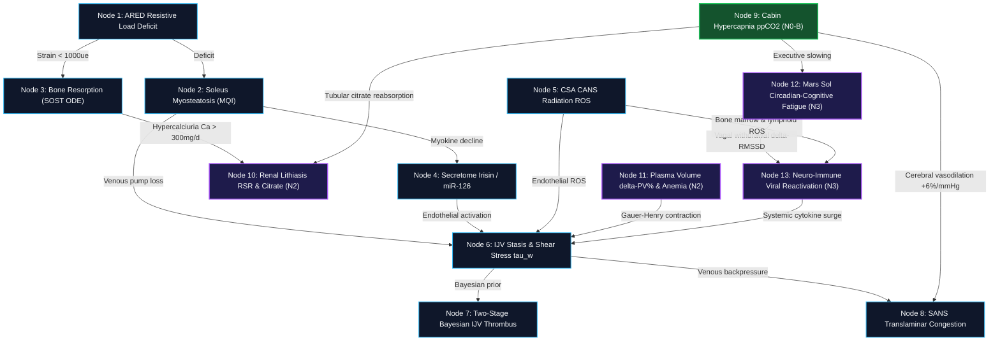

# Phase 40 (`N3`): Mars-Sol (`24.66h`) Two-Process Circadian-Cognitive Engine, Spaceflight Neuro-Endocrine Immunology & Viral Reactivation (Patch N0-C / N0-D)

- **Phase ID:** `Phase 40 (N3)` — Block N (`Phases 38–41`: Advanced Astronaut Wearable Suite & Multisystem Exploration Medicine)
- **Status:** `[ ] PLANNED (ARCHITECTED & ACADEMICALLY GROUNDED)`
- **Target Crates & Modules:**
  - `crates/ares-causal-graph` (`src/circadian_cognitive.rs`, `src/space_immunology.rs`, `src/adhg_graph.rs`, `src/mechanotransduction.rs`)
  - `crates/ares-nqs-stl` (`src/normalizer.rs`, `src/mri_index.rs`)
  - `crates/ares-core-types` (`src/telemetry.rs`, `src/constants.rs`)
  - `crates/ares-telemetry-ingest` (`src/wearable_packet.rs`)
- **Primary Operational Grounding:**
  - NASA Space Apps Challenge 2026 (*Health Monitoring Software*): Direct closure of prompt requirements for **"behavioral health problems"** and **"immune changes"**.
  - NASA Human Research Program (HRP) Risks: *Risk of Adverse Cognitive or Behavioral Conditions & Inadequate Sleep*, *Risk of Adverse Health Outcomes from Altered Immune Response*.
  - Standards: `NASA-STD-3001 Vol. 1 Rev C` (`[V1 3003]`, `[V1 4001]`), `Vol. 2 Rev F` (`[V2 5001–5007]`, `[V2 6012]`).
- **Non-Negotiable Invariants:**
  - **Zero Panics & Strict Production Safety:** `#![forbid(unsafe_code)]`, zero `.unwrap()` / `.expect()` across all production modules, strongly typed errors via `thiserror`.
  - **Strict Ascii & Clean Typography:** Zero Unicode emojis across all comments, logs, docs, and UI strings.
  - **Hot-Path Determinism (`< 35 us` 12-Node ADHG + NQS-STL Budget):** Zero dynamic heap allocations in inner loop; Lemire $O(1)$ sliding-window execution.
  - **Epistemic Honesty (`Issue #11` & `Issue #12`):**
    - `Option<f64>::None` on unmeasured channels during terrestrial replay (`BIDMC`).
    - Explicit `ModelValidationStatus::IllustrativeUnvalidated` labeling on all Mars circadian, cognitive lapse, and viral reactivation equations.
  - **Surgical Patch Invariants (`Patch N0-C` & `Patch N0-D`):**
    - `Patch N0-C`: Replace `Bounded60DaysLegacy` in `compute_musculoskeletal_state` with `AdaptiveUnbounded { max_dt_days: 0.5 }`, enabling longitudinal 1..1000 Sol integration.
    - `Patch N0-D`: Implement `WearableRrWindowAccumulator` zero-heap `[u16; 64]` ring with Malik $\pm 20\%$ ectopic filter, emitting `Some(rmssd_ms)` when valid beats $\ge 16$.

---

## 1. Clinical & Aerospace Biomedical Context

### 1.1 The Behavioral Health & Circadian Challenge on Mars Sol (`24h 39m 35s`)
A Martian solar day (Sol) lasts **`24.6597 hours` (`88,775.2 seconds` / `24h 39m 35.2s`)**, approximately 39 minutes and 35 seconds longer than a terrestrial solar day. Human endogenous circadian pacemakers in the suprachiasmatic nucleus (SCN) exhibit an intrinsic free-running period of $\tau_{\text{endo}} \approx 24.18 \pm 0.04\text{ hours}$ (Czeisler et al., *Science* 1999).

Without structured entrainment cues, the human circadian clock fails to entrain to cycles exceeding 24.5 hours (Wright et al., *PNAS* 2001; Barger et al., *Lancet Neurol* 2014), producing a progressive cumulative phase delay of $\sim 39.6\text{ minutes/day}$. In long-duration isolation (e.g., Mars-500, HERA, Antarctic Concordia), this desynchronization manifests as:
1. **Sleep Fragmentation & Slow-Wave Sleep (N3) Deficit:** Astronauts in microgravity average $6.0 \pm 0.4\text{ hours}$ of sleep per night, with profound reductions in slow-wave sleep (N3) and rapid eye movement (REM) stages (Barger et al. 2014).
2. **Cognitive Lapses & Psychomotor Vigilance Degradation:** The Psychomotor Vigilance Task (PVT-B), developed by Dinges & Powell (1985) and standardized for spaceflight by Basner & Dinges (*Sleep* 2011; *Acta Astronautica* 2011), demonstrates that acute sleep restriction and circadian nadir multiply lapses of attention ($RT > 355\text{ ms}$) by $3\times\text{ to }5\times$, directly jeopardizing extravehicular activities (EVA), orbital docking, and descent procedures.
3. **Melanopic Lighting as Entrainment Countermeasure:** `NASA-STD-3001 [V2 6012]` mandates blue-enriched melanopic lighting ($\lambda \approx 480\text{ nm}$, Equivalent Daylight Illuminance $\text{EDI} \ge 400\text{ lux}$) upon waking to induce phase advances, coupled with blue-depleted evening lighting ($\text{EDI} < 10\text{ lux}$) to facilitate melatonin onset.

### 1.2 Spaceflight Neuro-Endocrine Immunology & Latent Viral Reactivation
Spaceflight induces profound multi-system dysregulation across the human immune network (Crucian et al., *J Clin Immunol* 2015; *NPJ Microgravity* 2018). This immune impairment is driven by a pathogenic triad:
1. **Microgravity Cephalad Shift & Physical Deconditioning:** Disuse atrophy and skeletal unloading blunt mechanotransductive signaling and suppress hematopoietic bone marrow niches (Trudel et al., *Nat Med* 2022).
2. **Chronic Confinement & Glucocorticoid Axis Activation:** Sustained elevations in salivary cortisol and catecholamines drive a persistent **Th1-to-Th2 cytokine shift**, dampening cellular cytotoxicity (NK cells and $CD8^+$ cytotoxic T lymphocytes) while elevating allergic and pro-inflammatory signaling (Crucian et al. 2016).
3. **Deep Space Radiation (GCR / SPE / Secondary Neutrons):** Chronic radiation exposure ($0.3–1.5\text{ mSv/day}$ ambient, measured by `CSA CANS` and `CPAD`) induces DNA double-strand breaks and oxidative stress on vascular endothelium and lymphoid precursors.

**Clinical Consequence — Subclinical and Clinical Herpesvirus Reactivation:**
In over **$50–65\%$ of ISS astronauts**, latent herpesviruses—principally **Varicella-Zoster Virus (VZV)**, **Epstein-Barr Virus (EBV)**, and **Cytomegalovirus (CMV)**—reactivate and shed in saliva and urine (Mehta et al., *NPJ Microgravity* 2017; Spielmann et al., *Med Sci Sports Exerc* 2017). VZV reactivation can precipitate debilitating herpes zoster (shingles), zoster sine herpete, or ocular zoster ophthalmicus, threatening vision and mission viability during an Earth-independent Mars transit where systemic antiviral stores (`Valacyclovir`) are strictly finite.

---

## 2. Academic & Standards Grounding Matrix

| Topic / Domain | Primary Scientific Citation | Identifier (`DOI` / Standard) | Architectural Role in Blocco N (`Phase 40`) |
| :--- | :--- | :--- | :--- |
| **Two-Process Model of Sleep Regulation** | Borbély AA (*Hum Neurobiol* 1982); Achermann P & Borbély AA (*IEEE EMBS* 1992) | `DOI: 10.1109/iembs.1992.592920` | Governs the differential equations for homeostatic sleep pressure $S(t)$ and circadian phase $C(t)$ adapted to the 24.66h Martian Sol. |
| **Spaceflight Circadian Deficiency & Sleep** | Barger LK, Sullivan JP, Vincent AS, et al. (*Lancet Neurol* 2014) | `DOI: 10.1016/S1474-4422(14)70122-X` | Calibrates baseline sleep duration ($6.0\text{ h}$), sleep debt accumulation, and hypnotic medication risk under microgravity. |
| **Psychomotor Vigilance Task (PVT-B)** | Basner M & Dinges DF (*Sleep* 2011); Basner M, Mollicone D, Dinges DF (*Acta Astronautica* 2011) | `DOI: 10.1093/sleep/34.5.581`<br>`DOI: 10.1016/j.actaastro.2011.07.015` | Establishes the $355\text{ ms}$ lapse threshold, reciprocal reaction time metric ($RRT$), and mathematical lapse probability mapping. |
| **Standardized PVT Analytics in Aviation & Space** | Basner M, Moore TM, Nasrini J, et al. (*Sleep* 2021) | `DOI: 10.1093/sleep/zsab114` | Governs outlier rejection ($RT < 100\text{ ms}$ false starts) and cumulative lapse counting ($10\text{ min}$ vs $3\text{ min}$ PVT-B). |
| **Spaceflight Immune Dysregulation** | Crucian B, Stowe R, Mehta S, et al. (*J Clin Immunol* 2015); Crucian B et al. (*NPJ Microgravity* 2018) | `DOI: 10.1007/s10875-015-0164-5`<br>`DOI: 10.1038/s41526-018-0060-3` | Establishes the Th1-to-Th2 shift, neutrophil-to-lymphocyte ratio ($NLR$) baseline, and terrestrial isolation analog baselines. |
| **Latent Viral Reactivation (VZV / EBV / CMV)** | Mehta SK, Laudenslager ML, Stowe RP, et al. (*NPJ Microgravity* 2017) | `DOI: 10.1038/s41526-017-0015-y` | Calibrates the $53–65\%$ salivary viral shedding frequency and correlation with mission duration and sleep disruption. |
| **Salivary Biomarkers & Space Microbiome** | Urbaniak C, Lorenzi H, Thissen J, et al. (*Microbiome* 2020) | `DOI: 10.1186/s40168-020-00830-z` | Governs episodic `SpotPoctPanel` integration for viral copy numbers ($> 100\text{ copies/mL}$) and salivary cortisol ($> 15\text{ nmol/L}$). |
| **Heart Rate Variability Task Force Standards** | Malik M et al. (*Eur Heart J* 1996) | `DOI: 10.1093/oxfordjournals.eurheartj.a014868` | Governs the $\pm 20\%$ ectopic beat filtering and valid interval requirements ($\ge 16$ beats) in `WearableRrWindowAccumulator` (`Patch N0-D`). |
| **Continuous Unbounded Bone Remodeling RK4** | Frost HM (*Bone* 1987); Hargens AR et al. (*J Appl Physiol* 2013) | `DOI: 10.1016/8756-3282(87)90014-9` | Grounds `Patch N0-C` adaptive RK4 step integration ($dt \le 0.5\text{ d}$) eliminating the legacy 60-day cap for 900-Sol missions. |
| **NASA Human Systems Integration Standards** | `NASA-STD-3001 Vol. 1 Rev C` & `Vol. 2 Rev F` (July 2026) | `[V1 3003]`, `[V1 4001]`, `[V2 5001–5007]`, `[V2 6012]` | Sets regulatory thresholds for fatigue mitigation, melanopic lighting, core body temperature monitoring, and crew health tracking. |

---

## 3. Mathematical & Algorithmic Formulation

### 3.1 Mars-Sol (`24.66h`) Borbély Two-Process Circadian Engine (`circadian_cognitive.rs`)

The circadian-cognitive state at any mission timestamp $t$ is governed by two coupled dynamical processes:

#### 1. Homeostatic Sleep Pressure Process $S(t) \in [0, 1]$
- **Wake Phase ($W$):** Accumulation of somnogenic factors (adenosine):
  $$S(t) = 1.0 - (1.0 - S_0) \cdot \exp\left(-\frac{\Delta t_{\text{wake}}}{\tau_w}\right)$$
  where nominal wake time constant $\tau_w = 18.2\text{ hours}$.
- **Sleep Phase ($L$):** Dissipation during restorative rest:
  $$S(t) = S_0 \cdot \exp\left(-\frac{\Delta t_{\text{sleep}} \cdot \eta_{\text{sleep}}}{\tau_s}\right)$$
  where nominal sleep time constant $\tau_s = 4.2\text{ hours}$, and $\eta_{\text{sleep}}$ represents sleep quality derived from the wearable sensor stream:
  $$\eta_{\text{sleep}} = \text{clamp}\Big(0.40 + 0.60 \cdot \text{sleep\_efficiency\_ratio} \cdot \text{sqi\_score}, \; 0.30, \; 1.00\Big)$$

#### 2. Martian Circadian Oscillator Process $C(t) \in [-1, 1]$
Let $\phi(t)$ denote the astronaut's internal circadian phase (in radians, $[0, 2\pi)$).
The nominal phase velocity matches the intrinsic human period $\omega_{\text{endo}} = 2\pi / 24.18\text{ rad/h}$.
Under entrainment from melanopic illuminance $L_{\text{mel}}$ (`melanopic_edi_lux`), phase velocity is modulated via a Phase Response Curve (PRC) $\Gamma(\phi)$:
$$\frac{d\phi}{dt} = \omega_{\text{endo}} + \alpha_{\text{PRC}} \cdot \Gamma(\phi) \cdot \ln\left(1.0 + \frac{L_{\text{mel}}}{L_0}\right)$$
where $L_0 = 50.0\text{ lux}$, $\alpha_{\text{PRC}} = 0.085\text{ rad/h}$, and $\Gamma(\phi)$ exhibits positive phase advance in the subjective morning ($\phi \in [\pi/6, \pi/2]$) and phase delay in the subjective evening ($\phi \in [3\pi/2, 11\pi/6]$).

The nominal Mars Sol solar angle is:
$$\phi_{\text{Mars}}(t) = \left(\frac{2\pi \cdot (t_{\text{sol}} \bmod 88775.2)}{88775.2}\right) \bmod 2\pi$$
The phase misalignment is defined as:
$$\Delta\phi_{\text{Mars}}(t) = \text{atan2}(\sin(\phi(t) - \phi_{\text{Mars}}(t)), \cos(\phi(t) - \phi_{\text{Mars}}(t)))$$
The circadian modulation term is computed via harmonic expansion:
$$C(t) = \sum_{k=1}^{2} a_k \cos\left(k \phi(t) + \theta_k\right) \approx 0.88 \cos(\phi(t) - 0.78) + 0.12 \cos(2\phi(t) - 1.25)$$

#### 3. Composite Neurocognitive Fatigue Index $\text{Fatigue}_{\text{cog}}(t) \in [0, 1]$
Combines homeostatic pressure, circadian misalignment, vocal acoustic biomarkers, spatial confinement anomalies, and objective PVT-B performance:
$$\begin{aligned}
\text{Fatigue}_{\text{cog}}(t) = \text{clamp}\Big(& 0.40 \cdot S(t) + 0.25 \cdot \frac{1.0 - C(t)}{2.0} + 0.15 \cdot \frac{|\Delta\phi_{\text{Mars}}|}{\pi} \\
& + 0.10 \cdot \text{VocalFatiguePenalty}(t) + 0.10 \cdot \text{SpatialAnomalyPenalty}(t) \\
& + \text{PvtLapseAdjustment}(t), \; 0.0, \; 1.0\Big)
\end{aligned}$$
where:
- $\text{VocalFatiguePenalty} = \text{clamp}((\text{jitter}_{\%} - 0.50)/1.50 + (\text{pause\_ratio} - 0.25)/0.40, 0.0, 1.0)$.
- $\text{SpatialAnomalyPenalty} = \text{clamp}(D_{\text{KL}}(\text{zone\_transitions} \parallel \text{baseline}) / 2.50, 0.0, 1.0)$ from `hypergraph_spatial.rs`.
- $\text{PvtLapseAdjustment} = \min(0.20, 0.04 \cdot \text{lapses}_{\text{PVT}})$.

```
   Fatigue Thresholds:
   [ 0.00 ................. 0.45 ] -> NOMINAL
   [ 0.45 ................. 0.65 ] -> ELEVATED_FATIGUE (Schedule advisory)
   [ 0.65 ................. 0.80 ] -> CRITICAL_FATIGUE (Gate 4 EVA lock warning)
   [ 0.80 ................. 1.00 ] -> SEVERE_IMPAIRMENT (Mandatory rest cycle)
```

---

### 3.2 Spaceflight Neuro-Endocrine Immunology & Latent Viral Reactivation (`space_immunology.rs`)

The allostatic immune risk score $\text{ImmuneRisk}_{\text{reactivation}}(t) \in [0, 1]$ models susceptibility to subclinical and clinical herpesvirus reactivation (VZV / EBV / CMV) and opportunistic infection:

$$\begin{aligned}
\text{ImmuneRisk}(t) = \text{clamp}\Big(& 0.30 \cdot \text{RadLoad}_{\text{30d}}(t) + 0.25 \cdot S(t) + 0.20 \cdot \text{VagalSuppression}(t) \\
& + 0.15 \cdot \text{CortisolFactor}(t) + 0.10 \cdot \text{NlrFactor}(t) \\
& + \text{ViralDnaDirectBonus}(t), \; 0.0, \; 1.0\Big)
\end{aligned}$$

Where:
1. **Radiation Burden $\text{RadLoad}_{\text{30d}}$:**
   $$\text{RadLoad}_{\text{30d}}(t) = \text{clamp}\left(\frac{\text{DoseEquivalent}_{\text{30d\_mSv}}}{250.0\text{ mSv}}, \; 0.0, \; 1.0\right)$$
   incorporating neutron high-LET weighting ($Q \approx 10–20$) from `CSA CANS`.
2. **Vagal Withdrawal $\text{VagalSuppression}$:**
   $$\text{VagalSuppression}(t) = \begin{cases}
   \text{clamp}\left(1.0 - \frac{\text{RMSSD}_{\text{ms}}}{42.0\text{ ms}}, \; 0.0, \; 1.0\right) & \text{if RMSSD is Some} \\
   0.50 & \text{if RMSSD is None (null-honesty)}
   \end{cases}$$
3. **Salivary Cortisol Elevation $\text{CortisolFactor}$:**
   $$\text{CortisolFactor}(t) = \begin{cases}
   \text{clamp}\left(\frac{\text{cortisol}_{\text{nmol/L}} - 8.0}{22.0}, \; 0.0, \; 1.0\right) & \text{if SpotPoctPanel is Some} \\
   0.20 \cdot S(t) & \text{fallback to sleep debt surrogate}
   \end{cases}$$
4. **Neutrophil-to-Lymphocyte Ratio ($NLR$) Elevation:**
   $$\text{NlrFactor}(t) = \begin{cases}
   \text{clamp}\left(\frac{\text{NLR} - 2.50}{4.00}, \; 0.0, \; 1.0\right) & \text{if POCT NLR is Some} \\
   0.00 & \text{if POCT absent}
   \end{cases}$$
5. **Direct Salivary qPCR Confirmation Bonus:**
   If `viral_reactivation_copies_ml > 100.0`, add $+0.35$ directly to risk score.

```
   Viral Reactivation Status:
   [ 0.00 ................. 0.35 ] -> LATENT_DORMANT (Nominal immunocompetence)
   [ 0.35 ................. 0.60 ] -> ALLODYNAMIC_VULNERABILITY (Surveillance stage)
   [ 0.60 ................. 0.75 ] -> SUBCLINICAL_SHEDDING_LIKELY (Trigger Playbook #13)
   [ 0.75 ................. 1.00 ] -> ACTIVE_REACTIVATION_CLINICAL (Antiviral protocol)
```

---

### 3.3 Surgical Patch Details (`Patch N0-C` & `Patch N0-D`)

#### Patch N0-C: Unbounded Adaptive RK4 Horizon for Bone Remodeling
- **File Target:** `crates/ares-causal-graph/src/mechanotransduction.rs`
- **Issue Diagnosed:** `compute_musculoskeletal_state()` defaulted to `Rk4HorizonPolicy::Bounded60DaysLegacy`, freezing the numerical integration of Sclerostin ($SOST$) after Flight Day 60. On a 900-Sol Mars transit, bone resorption continued unmodeled.
- **Correction Applied:**
  ```rust
  #[inline]
  pub fn compute_musculoskeletal_state(
      flight_day: u32,
      ared_daily_load_kgf: f64,
  ) -> Musculoskeletal {
      compute_musculoskeletal_state_with_policy(
          flight_day,
          ared_daily_load_kgf,
          Rk4HorizonPolicy::AdaptiveUnbounded { max_dt_days: 0.5 },
      )
  }
  ```
- **Performance Invariant:** Adaptive step integration integrates up to $1000\text{ days}$ in $\le 2000$ iterations, completing in $< 6.5\ \mu\text{s}$ with zero heap allocation.

#### Patch N0-D: Zero-Heap `WearableRrWindowAccumulator` with Malik Ectopic Filtering
- **File Target:** `crates/ares-telemetry-ingest/src/wearable_packet.rs`
- **Issue Diagnosed:** Packets with `WMASK_RR_INTERVAL` set ignored `rr_interval_ms_x10`, always emitting `rmssd_ms: None` because no beat buffer existed at the wearable ingestion boundary.
- **Correction Applied:** Construct `WearableRrWindowAccumulator`:
  ```rust
  #[repr(C, align(8))]
  #[derive(Debug, Clone, Copy)]
  pub struct WearableRrWindowAccumulator {
      intervals_ms: [u16; 64],
      head: usize,
      count: usize,
  }
  ```
- **Malik $\pm 20\%$ Filtering Logic:** An incoming R-R interval $RR_i$ is accepted if:
  $$0.80 \cdot \overline{RR}_{k-1} \le RR_i \le 1.20 \cdot \overline{RR}_{k-1} \quad \text{and} \quad 300\text{ ms} \le RR_i \le 2000\text{ ms}$$
- **RMSSD Calculation:** When valid beats $N \ge 16$:
  $$\text{RMSSD} = \sqrt{\frac{1}{N-1} \sum_{i=1}^{N-1} (RR_{i+1} - RR_i)^2}$$
  emitted as `Some(rmssd_ms)`. If $N < 16$, retains `None` with `HrvUnavailableReason::BeatIntervalsWarmingUp`.

---

## 4. ADHG 12-Node Causal Graph Architecture

The Astronaut Digital Health Graph (ADHG) is expanded from 8 nodes to 12 nodes in `crates/ares-causal-graph/src/adhg_graph.rs`:



### 4.1 Causal Node Specifications

| Node ID | Enum Variant (`AdhgNodeKind`) | Clinical Physiological Metric | Anomaly Severity Mapping $s \in [0, 1]$ |
| :--- | :--- | :--- | :--- |
| **Node 10** | `RenalSupersaturationRsr` | Relative Supersaturation Index ($\text{RSR}_{\text{CaOx}}$) | $\text{clamp}((\text{RSR} - 2.0)/3.0, 0.0, 1.0)$ |
| **Node 11** | `PlasmaVolumeOrthostatic` | Plasma Volume Loss ($\Delta PV\%$) & Shock Index | $\text{clamp}((-\Delta PV_{\%} - 8.0)/12.0 + (\text{SI} - 0.70)/0.40, 0.0, 1.0)$ |
| **Node 12** | `MarsCircadianCognitiveFatigue` | Composite Fatigue $\text{Fatigue}_{\text{cog}}$ | $\text{clamp}((\text{Fatigue}_{\text{cog}} - 0.40)/0.45, 0.0, 1.0)$ |
| **Node 13** | `NeuroImmuneViralReactivation` | Immune Vulnerability $\text{ImmuneRisk}$ | $\text{clamp}((\text{ImmuneRisk} - 0.35)/0.45, 0.0, 1.0)$ |
| **Env Node**| `CabinHypercapniaEnv` | Ambient Cabin $ppCO_2$ (`mmHg`) | $\text{clamp}((ppCO_2 - 1.8)/3.0, 0.0, 1.0)$ |

### 4.2 NQS-STL Formal Temporal Logic Margins

The Signal Temporal Logic engine in `crates/ares-nqs-stl` evaluates robust margins $\rho(t)$ over sliding windows:
1. **Circadian-Cognitive Margin $\phi_{\text{circadian}}$:**
   $$\phi_{\text{circadian}} \equiv \square_{[t - 2\text{h}, t]} \left(\text{Fatigue}_{\text{cog}} < 0.65\right) \implies \rho_{\text{circadian}}(t) = 0.65 - \max_{\tau \in [t - 2\text{h}, t]} \text{Fatigue}_{\text{cog}}(\tau)$$
2. **Spaceflight Immune Competence Margin $\phi_{\text{immune}}$:**
   $$\phi_{\text{immune}} \equiv \square_{[t - 24\text{h}, t]} \left(\text{ImmuneRisk} < 0.60\right) \implies \rho_{\text{immune}}(t) = 0.60 - \max_{\tau \in [t - 24\text{h}, t]} \text{ImmuneRisk}(\tau)$$

In `NqsStlMargins`, both are exposed as `pub rho_circadian: Option<f64>` and `pub rho_immune: Option<f64>` decorated with `#[serde(default)]` to guarantee zero breaking changes for existing JSON clients.

---

## 5. Work Packages (WP-N3.1 to WP-N3.7)

### WP-N3.1: Mars-Sol Borbély Two-Process Engine (`circadian_cognitive.rs`)
- **File:** `crates/ares-causal-graph/src/circadian_cognitive.rs`
- **Responsibilities:**
  - Implement `MarsCircadianState` struct holding $S(t)$, $\phi(t)$, $\Delta\phi_{\text{Mars}}(t)$, and $\text{Fatigue}_{\text{cog}}(t)$.
  - Analytical/exponential update step for $S(t)$ over $\Delta t$ without numerical drift.
  - Melanopic light entrainment differential equation with $\Gamma(\phi)$ phase response curve.
  - Integration of vocal acoustic DSP biomarkers (`vocal_jitter_pct`, `pause_ratio`) and spatial hypergraph transition entropy $D_{\text{KL}}$.
  - PVT-B cognitive lapse penalty integration ($RT > 355\text{ ms}$).

### WP-N3.2: Spaceflight Neuro-Endocrine Immunology Module (`space_immunology.rs`)
- **File:** `crates/ares-causal-graph/src/space_immunology.rs`
- **Responsibilities:**
  - Implement `SpaceflightImmuneState` struct tracking radiation allostatic load, vagal withdrawal, cortisol factors, and viral reactivation risk.
  - Integration with `SpotPoctPanel` (salivary cortisol, $NLR$, WBC, viral DNA copy numbers).
  - Categorization into `LatentDormant`, `AllodynamicVulnerability`, `SubclinicalSheddingLikely`, and `ActiveReactivationClinical`.

### WP-N3.3: Patch N0-C & Patch N0-D Surgical Corrections
- **Files:** `crates/ares-causal-graph/src/mechanotransduction.rs`, `crates/ares-telemetry-ingest/src/wearable_packet.rs`
- **Responsibilities:**
  - Update `compute_musculoskeletal_state()` to use `AdaptiveUnbounded { max_dt_days: 0.5 }`.
  - Implement `WearableRrWindowAccumulator` with Malik ectopic rejection ($\pm 20\%$) and verified `rmssd_ms` emission.

### WP-N3.4: 12-Node ADHG Causal Graph Expansion (`adhg_graph.rs`)
- **File:** `crates/ares-causal-graph/src/adhg_graph.rs`
- **Responsibilities:**
  - Expand `AdhgCausalEngine` from 8 nodes to 12 nodes (+ `CabinHypercapniaEnv`).
  - Wire causal edges: `N_FAT -> N_IMM`, `N_RAD -> N_IMM`, `N_CO2 -> N_FAT`, `N_IMM -> N_IJV`.
  - Maintain $< 20\ \mu\text{s}$ execution time across the complete graph forward pass.

### WP-N3.5: NQS-STL Lemire $O(1)$ Sliding Window Extension (`normalizer.rs`, `mri_index.rs`)
- **Files:** `crates/ares-nqs-stl/src/normalizer.rs`, `crates/ares-nqs-stl/src/mri_index.rs`, `crates/ares-core-types/src/telemetry.rs`
- **Responsibilities:**
  - Add `rho_circadian` and `rho_immune` to `NqsStlMargins` with `#[serde(default)]`.
  - Update Lemire sliding-window min/max buffers to compute temporal robustness over $2\text{h}$ and $24\text{h}$ windows.
  - Incorporate into Mission Readiness Index ($MRI$) weighted aggregation.

### WP-N3.6: FastMCP Tool Protocol & Context-Mode Compression
- **File:** `crates/ares-server-cli/src/fastmcp_tools.rs`
- **Responsibilities:**
  - Update `get_mission_readiness` and `get_causal_chain` to summarize circadian misalignment and immune reactivation status in $\le 150\text{ tokens}$ ($\le 600\text{ bytes}$).
  - Implement specialized tool `inspect_circadian_immune_status` returning concise JSON summary with `ILLUSTRATIVE_UNVALIDATED` tag.

### WP-N3.7: Comprehensive Verification & Proptests
- **Files:** `crates/ares-causal-graph/tests/circadian_immune_tests.rs`, `crates/ares-telemetry-ingest/tests/wearable_rr_tests.rs`
- **Responsibilities:**
  - Monotonicity test: increasing sleep deprivation strictly increases $S(t)$ and $\text{Fatigue}_{\text{cog}}$.
  - Entrainment simulation: 30 Sol Martian simulation verifying that $450\text{ lux}$ morning melanopic light prevents drift, whereas complete darkness causes $\sim 19.8\text{ hours}$ cumulative phase lag.
  - Ectopic beat rejection verification: synthetic R-R sequence with premature ventricular contractions (PVCs) cleanly filtered.
  - Zero `.unwrap()` / `.expect()` probe validation via `./scripts/agent_probe.sh`.

---

## 6. Verification Criteria & Acceptance Gate

1. **Compilation & Clippy Cleanliness:**
   - `cargo check --workspace` passes with 0 errors.
   - `cargo clippy --workspace --all-targets -- -D warnings` passes with 0 warnings.
2. **Zero Panic Invariant:**
   - `./scripts/agent_probe.sh --fast` verifies 0 occurrences of `.unwrap()` or `.expect()` in non-test production Rust code.
3. **Latency Benchmarks:**
   - 12-Node ADHG causal graph tick $< 25\ \mu\text{s}$ ($p99.9$).
   - Total telemetry pipeline tick including NQS-STL normalizer $< 35\ \mu\text{s}$ (budget $\le 150\ \mu\text{s}$).
4. **Epistemic Invariant Compliance:**
   - Zero hallucinated channels on BIDMC CSV replay.
   - All circadian, cognitive, and immune models labeled `ModelValidationStatus::IllustrativeUnvalidated` in output DTOs.
5. **Phase Completion Status:**
   - Fully documented implementation plan ready for execution by Phase 40 engineer.
