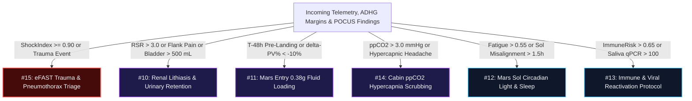

# Phase 41 (`N4`): Multi-Organ Guided POCUS (`eFAST`/Renal/Ocular), Playbooks `#10–#15`, Hard Safety Gate 4 Interlock & Cockpit Clinical Upgrade

- **Phase ID:** `Phase 41 (N4)` — Block N (`Phases 38–41`: Advanced Astronaut Wearable Suite & Multisystem Exploration Medicine)
- **Status:** `[ ] PLANNED (ARCHITECTED & ACADEMICALLY GROUNDED)`
- **Target Crates & Modules:**
  - `crates/ares-medops-playbooks` (`src/playbooks.rs`, `src/safety_gates.rs`, `src/grounding.rs`, `src/pocus_multiorgan.rs`)
  - `crates/ares-storage-lsah` (`src/schema.rs`, `src/warm_backend.rs`)
  - `crates/ares-server-cli` (`src/wire_contract.rs`, `src/fastmcp_tools.rs`)
  - `crates/ares-core-types` (`src/telemetry.rs`, `src/security.rs`)
  - `ares-cockpit` (`src/modules/analysis-imaging/Imaging.tsx`, `src/modules/analysis-imaging/PocusLongitudinalHistory.tsx`, `src/modules/playbook-runner/PlaybookRunner.tsx`, `src/modules/body-3d-heatmap/WhatIfConsole.tsx`)
- **Primary Operational Grounding:**
  - NASA Space Apps Challenge 2026 (*Health Monitoring Software*): Final closure of the **`3. ACT`** phase for all 4 prompt syndromes (*immune changes, bone loss, cardiovascular events, behavioral health problems*) plus acute ExMC emergencies.
  - NASA Exploration Medical Capability (ExMC) Level of Care IV–V (Autonomous Medical Operations with Earth-Independent Telemedicine).
  - Standards: `NASA-STD-3001 Vol. 1 Rev C` (`[V1 3006]`), `Vol. 2 Rev F` (`[V2 7043]`, `[V2 10001]`, `[V2 10164]`).
- **Non-Negotiable Invariants:**
  - **Zero Panics & Strict Production Safety:** `#![forbid(unsafe_code)]`, zero `.unwrap()` / `.expect()` in all production code, strongly typed error handling via `thiserror`.
  - **Strict Ascii & Clean Typography:** Zero Unicode emojis across all comments, logs, docs, and UI strings.
  - **Ultra-Low Latency Hot Path:** Playbook candidate selection + 4 Hard Safety Gates evaluation in $< 25\ \mu\text{s}$; total 1-tick engine budget $p99.9 < 150\ \mu\text{s}$.
  - **Hard Gate 4 Deterministic Interlocks:**
    1. *Invasive Thoracic Decompression Lock:* Strictly blocks needle thoracostomy / tube placement unless M-mode POCUS verifies the pneumothorax barcode sign (`pocus_pneumothorax_barcode_confirmed == true`).
    2. *EVA Fitness-for-Duty Lock:* Automatically injects `ACT_EVA_NO_GO_COGNITIVE_OR_HEMODYNAMIC_LOCK` into active playbook when cognitive fatigue $> 0.75$, PVT lapses $\ge 5$, or Shock Index $\ge 0.90$.
  - **Epistemic Honesty (`Issue #11` & `Issue #12`):**
    - High cosine similarity to baseline or simulated ultrasound in `ares-storage-lsah` can **never** clear safety locks automatically.
    - All new diagnostic metrics and playbooks tagged with `ModelValidationStatus::IllustrativeUnvalidated`.
  - **Patch N0-A Hardening:** Gate 1 retain filter strictly preserves non-anticoagulant pharmacological countermeasures (`category != "PHARMACOLOGICAL_ANTICOAGULANT"`).

---

## 1. Clinical & Aerospace Biomedical Context

### 1.1 The Imperative for Autonomous Multi-Organ POCUS in Deep Space (ExMC Levels IV–V)
During a 900-Sol Mars mission, round-trip light travel time (OWLT) ranges between **`8 and 48 minutes`**, with total communications blackouts of up to 14 days during solar conjunction. Under these conditions, real-time telemedicine guidance from ground flight surgeons is physically impossible (`NASA-STD-3001 [V1 3006]`).

Ultrasound is the only diagnostic imaging modality viable aboard exploration spacecraft due to strict launch mass, volume, power, and radiation shielding constraints:
- On the ISS, ultrasound proved invaluable for detecting vascular stasi/thrombosis (Marshall-Goebel et al. 2019; Auñón-Chancellor et al. 2020), spaceflight-associated neuro-ocular syndrome (SANS; Stenger et al. 2017), and musculoskeletal atrophy.
- However, as demonstrated by the groundbreaking work of Sargsyan et al. (*FAST at MACH 20*, 2005), Kirkpatrick et al. (*eFAST in Microgravity*, 2007), and Urquieta et al. (2020), **deep space medical autonomy requires expanding beyond isolated vascular scans to an integrated, multi-organ ultrasound capability**:
  1. **Vascular (Internal Jugular Vein - IJV):** Thrombosis vs stasis differentiation.
  2. **Ocular & Optic Nerve Sheath (SANS / ICP):** Optic nerve sheath diameter (ONSD), optic disc edema, and choroidal folds.
  3. **Renal & Urinary Bladder:** Nephrolithiasis detection, ureteral jet evaluation, hydronephrosis grading, and acute urinary retention quantification.
  4. **Extended Focused Assessment with Sonography for Trauma (eFAST):** 5-window protocol for acute post-EVA barotrauma, tension pneumothorax, and blunt abdominal hemoperitoneum.

### 1.2 The Hard Safety Gate 4 Rationale: Preventing Iatrogenic Disaster in Deep Space
In terrestrial emergency medicine, needle decompression for suspected tension pneumothorax carries significant iatrogenic risk (lung laceration, intercostal artery hemorrhage, cardiac puncture). In deep space, where thoracic surgeons and blood banks do not exist, an erroneous needle thoracostomy performed on a dyspneic astronaut without true pneumothorax is almost certainly fatal.

Similarly, deploying an astronaut on an EVA while impaired by acute sleep debt or hemodynamic hypovolemia creates catastrophic mission failure risk (loss of crew, suit breach, spatial disorientation).

**Hard Safety Gate 4** provides two unbypassable deterministic interlocks:
1. **Invasive Procedure Lock:** Disables needle thoracostomy unless M-mode ultrasound explicitly demonstrates loss of lung sliding (the "barcode" or "stratosphere" sign) paired with identification of a lung point.
2. **EVA Fitness-for-Duty Lock:** Disables EVA authorization if neurocognitive fatigue or hemodynamic collapse exceeds safe limits.

---

## 2. Academic & Standards Grounding Matrix

| Topic / Domain | Primary Scientific Citation | Identifier (`DOI` / Standard) | Architectural Role in Blocco N (`Phase 41`) |
| :--- | :--- | :--- | :--- |
| **Point-of-Care Ultrasound Aboard ISS** | Sargsyan AE, Hamilton DR, Nicolaou S, et al. (*Ultrasound Med Biol* 2001); Sargsyan AE et al. (*J Trauma* 2005) | `DOI: 10.1097/01.ta.0000145083.47034.b0` | Grounds the primary protocols for microgravity ultrasound acquisition, transducer ergonomics, and anatomical orientation. |
| **Microgravity Thoracic eFAST & Pneumothorax** | Kirkpatrick AW, Sargsyan AE, Laupland KB, et al. (*J Trauma* 2007) | `DOI: 10.1097/01.ta.0000133565.88871.e2` | Establishes the 5-window eFAST protocol, M-mode "barcode sign" vs "seashore sign", and absence of lung sliding in microgravity. |
| **Autonomous Deep Space Medical Capability** | Urquieta E, Wu J, Hury J, et al. (*Aerosp Med Hum Perform* 2020) | `DOI: 10.3357/AMHP.5583.2020` | Establishes the clinical requirements for Earth-independent autonomous decision-support algorithms under delayed communications. |
| **Autonomy Enabling Solutions in Analogs** | Cherry J, Sargsyan AE, Ebert D, et al. (*IAF Space Life Sci* 2025) | `DOI: 10.52202/083074-0101` | Validates handheld ultrasound guidance by non-physician crew members in extreme spaceflight analogs (Antarctica / Concordia). |
| **Spaceflight Renal Stone Pathophysiology** | Tiselius HG (*Contrib Nephrol* 1997); Whitson PA, Pietrzyk RA, Sams CF (*J Gravit Physiol* 1999) | `DOI: 10.1159/000060010` | Calibrates renal ultrasound twinkling artifacts, hydronephrosis grading, and bladder residual volume thresholds ($> 500\text{ mL}$). |
| **Spaceflight Ophthalmic & SANS Ultrasound** | Stenger MB, Tarver WJ, Brunstetter T, et al. (*NASA HRP Evidence Report* 2017) | NASA Technical Reports Server | Grounds optic nerve sheath diameter ($ONSD > 5.8\text{ mm}$), choroidal thickening, and intraocular pressure ($IOP > 21\text{ mmHg}$). |
| **Pre-Landing Fluid-and-Salt Loading Protocol** | Bungo MW, Charles JB, Johnson PC (*Aviat Space Environ Med* 1985); Waters WW et al. (2002) | PubMed ID: 3977322 | Governs the calibrated $15\text{ mL/kg}$ isotonic fluid loading protocol and anti-G compression countermeasure for $0.38g$ landing. |
| **NASA Human Systems Integration Standards** | `NASA-STD-3001 Vol. 1 Rev C` & `Vol. 2 Rev F` (July 2026) | `[V1 3006]`, `[V2 7043]`, `[V2 10001]`, `[V2 10164]` | Mandates ExMC Level IV-V care, human-automation allocation, and medical capability hardware integration. |

---

## 3. Multi-Organ POCUS Architecture & UBERON Schemas

In `crates/ares-medops-playbooks/src/pocus_multiorgan.rs` and `crates/ares-storage-lsah/src/schema.rs`, POCUS imaging is structured across 4 anatomical domains mapped to the **Uber-anatomy ontology (`UBERON:`)**:

```
                              ┌──────────────────────────────────────────────┐
                              │          MULTI-ORGAN POCUS SUITE            │
                              └──────────────────────┬───────────────────────┘
                                                     │
         ┌───────────────────┬───────────────────────┴───────────────────────┬───────────────────┐
         │                   │                                               │                   │
         ▼                   ▼                                               ▼                   ▼
  VASCULAR (IJV)          OCULAR                                       RENAL / BLADDER         eFAST TRAUMA
 UBERON:0001496       UBERON:0001793                                   UBERON:0002113        UBERON:0002048 / 0000160
 ──────────────       ──────────────                                   UBERON:0001255        ───────────────────────
 • Compressibility    • ONSD (mm)                                      ──────────────        • RUQ Morison Pouch
 • Intraluminal Clot  • Choroidal Delta (um)                           • Hydronephrosis Gr.  • LUQ Splenorenal
 • CSA (cm^2)         • Optic Disc Elevation                           • Twinkling Artifact  • Suprapubic Pelvic
 • tau_w (dyn/cm^2)   • Tonometry IOP (mmHg)                           • Ureteral Jets       • Subxiphoid Pericardial
                      • Papilledema Frisén                             • Post-Void Res. (mL) • Pleural M-Mode Barcode
```

### 3.1 Rust Data Structures (`pocus_multiorgan.rs`)

```rust
use ares_core_types::ModelValidationStatus;
use serde::{Deserialize, Serialize};

/// Target anatomico Point-of-Care Ultrasound indicizzato nel database LSAH.
#[derive(Debug, Clone, Copy, PartialEq, Eq, Hash, Serialize, Deserialize)]
#[repr(u8)]
pub enum PocusAnatomicalTarget {
    IjvVascular = 1,
    OcularOpticNerve = 2,
    RenalBladder = 3,
    ThoracicAbdominalEfast = 4,
}

impl PocusAnatomicalTarget {
    #[inline]
    pub fn uberon_curie(&self) -> &'static str {
        match self {
            Self::IjvVascular => "UBERON:0001496",
            Self::OcularOpticNerve => "UBERON:0001793",
            Self::RenalBladder => "UBERON:0002113",
            Self::ThoracicAbdominalEfast => "UBERON:0002048",
        }
    }
}

/// Risultato di scansione POCUS Renale e Vescicale per la prevenzione e diagnosi di colica/ritenzione.
#[derive(Debug, Clone, Copy, PartialEq, Serialize, Deserialize)]
pub struct PocusRenalBladderScan {
    pub hydronephrosis_grade: u8, // 0 = None, 1 = Mild, 2 = Moderate, 3 = Severe
    pub calculus_detected: bool,
    pub acoustic_shadowing_present: bool,
    pub twinkling_artifact_present: bool,
    pub ureteral_jet_symmetry_ratio: f64, // 1.0 = symmetric, < 0.30 = severe obstruction
    pub post_void_bladder_volume_ml: f64, // Acute urinary retention if > 500.0 mL
    pub validation_status: ModelValidationStatus,
}

/// Risultato di scansione eFAST toraco-addominale a 5 finestre.
#[derive(Debug, Clone, Copy, PartialEq, Serialize, Deserialize)]
pub struct PocusEfastScan {
    pub morison_pouch_free_fluid: bool,
    pub splenorenal_free_fluid: bool,
    pub suprapubic_pelvic_free_fluid: bool,
    pub subxiphoid_pericardial_effusion: bool,
    pub lung_sliding_absent: bool,
    pub lung_point_confirmed: bool,
    pub m_mode_barcode_sign_confirmed: bool, // Required to unlock Gate 4 decompression
    pub validation_status: ModelValidationStatus,
}
```

---

## 4. The 6 Type-1 Crystallized MedOps Playbooks (`#10–#15`)

Each playbook is deterministically evaluated in $< 25\ \mu\text{s}$ inside `select_candidate_playbook()` in `crates/ares-medops-playbooks/src/playbooks.rs`:



### 4.1 Playbook Specifications

#### 1. `PLAYBOOK_10_RENAL_STONE_AND_BLADDER_POCUS`
- **Clinical Trigger:** $\text{RSR}_{\text{CaOx}} > 3.0$, acute flank colic pain, or post-void bladder volume $> 500\text{ mL}$.
- **Causal Summary:** Hypercalciuria from skeletal unloading + tubular citrate reabsorption from $ppCO_2$ + low fluid intake drives supersaturation; urinary retention secondary to microgravity bladder sensation loss.
- **Actions:**
  1. `ACT_POCUS_RENAL_BLADDER_SCAN`: Execute guided renal and bladder ultrasound (assess hydronephrosis and bladder volume).
  2. `ACT_ORAL_HYDRATION_BOLUS_1000ML`: Administer $1.0\text{ L}$ balanced oral electrolyte solution over 60 minutes.
  3. `ACT_PHARMACOLOGICAL_POTASSIUM_CITRATE_30MEQ`: Initiate Potassium Citrate $30\text{ mEq}$ PO daily to alkalinize urine and chelate calcium.
  4. `ACT_ANALGESIA_KETOROLAC_AND_TAMSULOSIN`: Administer Ketorolac $10\text{ mg}$ IM/IV + Tamsulosin $0.4\text{ mg}$ PO for ureteral smooth muscle relaxation.
  5. `ACT_BLADDER_CATHETERIZATION_RESERVE`: Prepare clean intermittent catheterization tray if residual volume $> 500\text{ mL}$.
  6. `ACT_UROSEPSIS_LAB_SCREEN`: Order POCT panel for leukocytes, nitrites, and serum lactate.

#### 2. `PLAYBOOK_11_MARS_ENTRY_FLUID_LOADING_ORTHOSTATIC`
- **Clinical Trigger:** Mission phase entry $T - 48\text{ hours}$ before descent into $0.38g$ Martian gravity, or plasma volume deficit $\Delta PV\% < -10.0\%$.
- **Causal Summary:** Gauer-Henry cephalad fluid contraction + MARROW hemolysis leads to absolute hypovolemia and orthostatic intolerance during gravity re-exposure.
- **Actions:**
  1. `ACT_ISOTONIC_SALT_WATER_LOADING_15ML_KG`: Ingest $15\text{ mL/kg}$ body mass of isotonic fluid ($0.9\%\text{ NaCl}$ equivalent via electrolyte tablets) within 2 hours of entry burn.
  2. `ACT_DON_ANTI_G_COMPRESSION_GARMENT`: Don inflatable abdominal-thigh compression garment set to $35–45\text{ mmHg}$ gradient.
  3. `ACT_SEATED_BAROREFLEX_CHALLENGE`: Perform active 3-minute seated orthostatic baroreflex test with continuous BP monitoring.
  4. `ACT_POST_LANDING_AMBULATION_RESTRAINT`: Restrict autonomous EVA walking for 24 hours post-touchdown; mandatory wheelchair/rover assistance.

#### 3. `PLAYBOOK_12_MARS_SOL_CIRCADIAN_LIGHT_AND_SLEEP`
- **Clinical Trigger:** $\text{Fatigue}_{\text{cog}} > 0.55$, internal phase delay $|\Delta\phi_{\text{Mars}}| > 1.5\text{ hours}$, or wearable sleep efficiency $< 75\%$.
- **Causal Summary:** Desynchronization between human $24.18\text{h}$ pacemaker and Martian $24.66\text{h}$ Sol impairs neurocognitive vigilance and slow-wave sleep.
- **Actions:**
  1. `ACT_MELANOPIC_LIGHT_480NM_450LUX`: Deliver $45\text{ minutes}$ of $480\text{ nm}$ blue-enriched light ($> 450\text{ EDI lux}$) immediately upon waking.
  2. `ACT_BLUE_DEPLETION_EVENING_FILTER`: Enforce optical blue-blocking eyewear ($< 10\text{ lux}$ melanopic) starting 2 hours prior to scheduled sleep epoch.
  3. `ACT_ECLSS_BERTH_ACOUSTIC_MITIGATION`: Deploy active noise cancellation and verify sleeping berth acoustic levels $< 48\text{ dBA}$.
  4. `ACT_RESCHEDULE_HIGH_RISK_OPERATIONS`: Re-schedule planned EVA, docking, or robotic arm teleoperation to mid-Sol circadian alertness peak.

#### 4. `PLAYBOOK_13_IMMUNE_VIRAL_REACTIVATION_CONTAINMENT`
- **Clinical Trigger:** $\text{ImmuneRisk} > 0.65$, visual zosteriform dermatomic rash, or saliva qPCR $> 100\text{ copies/mL}$.
- **Causal Summary:** Radiation + sleep debt + glucocorticoid axis activation induces Th1-to-Th2 shift, permitting latent VZV / EBV replication.
- **Actions:**
  1. `ACT_CLINICAL_DERMATOMIC_INSPECTION`: Perform targeted examination of cranial nerves (V1 ophthalmic branch) and thoracic dermatomes.
  2. `ACT_VALACYCLOVIR_ANTIVIRAL_THERAPY`: Initiate Oral Valacyclovir $1000\text{ mg}$ TID for 7 days (cleared by Gate 1 non-anticoagulant filter).
  3. `ACT_HABITAT_AIR_SURFACE_SANITIZATION`: Boost photocatalytic oxidation and HEPA filtration cycle in crew living quarters.
  4. `ACT_SERIAL_QSOFA_IMMUNE_MONITORING`: Record serial blood pressure, respiratory rate, and mental status to detect systemic bacteremia/viremia.

#### 5. `PLAYBOOK_14_CABIN_HYPERCAPNIA_SCRUBBER_RESPONSE`
- **Clinical Trigger:** Environmental $ppCO_2 > 3.0\text{ mmHg}$, or persistent frontal headache accompanied by visual blur.
- **Causal Summary:** Impaired cabin mixing and ECLSS desiccant saturation elevate ambient $CO_2$, inducing cerebral/choroidal vasodilation and worsening SANS.
- **Actions:**
  1. `ACT_INSPECT_CDRA_DESICCANT_BEDS`: Verify Carbon Dioxide Removal Assembly cycle timing and inspect backup Lithium Hydroxide (LiOH) canisters.
  2. `ACT_DEPLOY_PORTABLE_CABIN_FANS`: Install supplementary duct fans in crew sleeping quarters to eliminate uncirculated microgravity $CO_2$ pockets.
  3. `ACT_SERIAL_SANS_OCULAR_MONITORING`: Acquire repeat optic nerve sheath ultrasound (ONSD) and tonometry intraocular pressure.
  4. `ACT_OXYGEN_ENRICHMENT_PROTOCOL`: Administer 100% normobaric oxygen via mask for 30 minutes if $ppCO_2$ exceeds $4.5\text{ mmHg}$.

#### 6. `PLAYBOOK_15_EFAST_TRAUMA_BAROTRAUMA_TRIAGE`
- **Clinical Trigger:** Traumatic deceleration, suit rapid decompression event, or Shock Index ($\text{HR}/\text{SBP}$) $\ge 0.90$.
- **Causal Summary:** Blunt kinetic trauma or lung overexpansion barotrauma precipitating hemoperitoneum, hemothorax, or tension pneumothorax.
- **Actions:**
  1. `ACT_RAPID_5_WINDOW_EFAST_SCAN`: Execute systematic eFAST ultrasound protocol (RUQ, LUQ, pelvic, subxiphoid, bilateral thoracic).
  2. `ACT_PLEURAL_M_MODE_BARCODE_VERIFY`: Obtain thoracic M-mode clips over 2nd intercostal mid-clavicular line to assess seashore vs barcode sign.
  3. `ACT_PERICARDIAL_TAMPONADE_CHECK`: Evaluate subxiphoid window for diastolic right ventricular collapse.
  4. `ACT_INTRAVENOUS_ACCESS_AND_AUTOTRANSFUSION`: Establish bilateral large-bore peripheral access and prepare closed autotransfusion set.
  5. `ACT_HANDOFF_TO_GATE4_DECOMPRESSION`: Stage needle thoracostomy tray; defer insertion to Hard Safety Gate 4 verification.

---

## 5. Hard Clinical Safety Gate 4 Architecture (`safety_gates.rs`)

### 5.1 Deterministic State Machine Specifications

The `SafetyGates` struct in `crates/ares-core-types/src/telemetry.rs` is extended with two deterministic flags:

```rust
#[derive(Debug, Clone, Copy, PartialEq, Eq, Serialize, Deserialize)]
pub struct SafetyGates {
    pub anticoagulant_lock_active: bool,
    pub lbnp_auto_vent_armed: bool,
    pub eva_suit_damping_active: bool,
    #[serde(default = "default_true")]
    pub invasive_procedure_lock_active: bool, // Gate 4A: Thoracic decompression lock
    #[serde(default)]
    pub eva_fitness_lock_active: bool,        // Gate 4B: EVA fitness-for-duty lock
}

#[inline]
fn default_true() -> bool {
    true
}
```

### 5.2 Gate 4 Enforcement Algorithm (`safety_gates.rs`)

```rust
/// Applica in modo inflessibile i 4 Hard Clinical Safety Gates al Playbook candidato.
#[inline]
pub fn enforce_hard_clinical_safety_gates(
    mut playbook: ActivePlaybook,
    biometrics: &Biometrics,
    musculo: &Musculoskeletal,
    jugular: &JugularHemodynamics,
    scenario: &StressTestScenarioInput,
    efast: Option<&PocusEfastScan>,
    fatigue_index: f64,
    shock_index: Option<f64>,
) -> ActivePlaybook {
    // Gate 1: Anticoagulante sbloccato SOLO su evidenza diretta di trombo giugulare
    let anticoagulant_lock_active = !jugular.pocus_thrombus_confirmed;

    // Gate 2: Sfiato automatico LBNP su calo pressorio o tachicardia
    let hr = biometrics.heart_rate_bpm.unwrap_or(72.0);
    let pre_syncope_detected = jugular.lbnp_active
        && (scenario.systolic_bp_drop_mmhg > LBNP_MAX_SYS_BP_DROP_MMHG
            || hr > LBNP_MAX_SAFE_HR_BPM);

    // Gate 3: Smorzamento tuta EVA su asimmetria del passo > 12%
    let eva_suit_damping_active = musculo.gai_pct > GAI_MAX_SAFE_PCT;

    // Gate 4A: Interlock Decompressione Toracica Invasiva
    let pneumothorax_verified = efast.map_or(false, |e| {
        e.lung_sliding_absent && e.m_mode_barcode_sign_confirmed && e.lung_point_confirmed
    });
    let invasive_procedure_lock_active = !pneumothorax_verified;

    // Gate 4B: Interlock Idoneita Operativa EVA (Fitness-for-Duty)
    let si_elevated = shock_index.map_or(false, |si| si >= 0.90);
    let cognitive_fatigued = fatigue_index >= 0.75;
    let eva_fitness_lock_active = si_elevated || cognitive_fatigued;

    playbook.safety_gates = SafetyGates {
        anticoagulant_lock_active,
        lbnp_auto_vent_armed: true,
        eva_suit_damping_active,
        invasive_procedure_lock_active,
        eva_fitness_lock_active,
    };

    // PATCH N0-A: Rimuove SOLO farmaci anticoagulanti; preserva antivirali, analgesici e citrato
    if anticoagulant_lock_active {
        playbook.actions.retain(|a| {
            !a.action_id.contains("ANTICOAG") && a.category != "PHARMACOLOGICAL_ANTICOAGULANT"
        });
    }

    // Gate 2 Override: Sfiato LBNP d'emergenza
    if pre_syncope_detected {
        playbook.actions.insert(0, CountermeasureAction {
            action_id: "ACT_EMERGENCY_LBNP_AUTO_VENT_0_MMHG".to_string(),
            label: format!(
                "SAFETY GATE 2 TRIGGERED: Auto-vent LBNP chamber to 0 mmHg immediately (SBP drop {:.1} mmHg / HR {:.0} bpm)",
                scenario.systolic_bp_drop_mmhg, hr
            ),
            category: "HARD_SAFETY_GATE_OVERRIDE".to_string(),
            delta_rho_per_hour: 0.35,
        });
    }

    // Gate 3 Override: Smorzamento caviglia tuta EVA
    if eva_suit_damping_active {
        playbook.actions.push(CountermeasureAction {
            action_id: "ACT_EVA_SUIT_ANKLE_DAMPING_038G".to_string(),
            label: format!(
                "SAFETY GATE 3 ACTIVE: Lock plyometric impact & set Martian EVA suit ankle damping +25% (GAI = {:.1}% > 12.0%)",
                musculo.gai_pct
            ),
            category: "BIOMECHANICAL_SAFETY_GATE".to_string(),
            delta_rho_per_hour: 0.10,
        });
    }

    // Gate 4A Override: Blocco procedure toraciche invasive senza conferma ecografica
    if invasive_procedure_lock_active {
        playbook.actions.retain(|a| {
            !a.action_id.contains("THORACOSTOMY") && !a.action_id.contains("NEEDLE_DECOMPRESSION")
        });
    }

    // Gate 4B Override: Iniezione blocco categorico EVA per fatica o instabilita emodinamica
    if eva_fitness_lock_active {
        playbook.actions.insert(0, CountermeasureAction {
            action_id: "ACT_EVA_NO_GO_COGNITIVE_OR_HEMODYNAMIC_LOCK".to_string(),
            label: format!(
                "SAFETY GATE 4 TRIGGERED: EVA NO-GO LOCK ACTIVE (Fatigue={:.2}, ShockIndex={})",
                fatigue_index,
                shock_index.map_or("N/A".to_string(), |s| format!("{:.2}", s))
            ),
            category: "CRITICAL_SAFETY_LOCK".to_string(),
            delta_rho_per_hour: 0.0,
        });
    }

    playbook
}
```

---

## 6. LSAH Multi-Organ Vector Storage & Cockpit UI Upgrades

### 6.1 LSAH Multi-Organ Vector Indexing (`crates/ares-storage-lsah`)
- The `lsah_pocus_signatures` Arrow table schema is updated to index multi-organ scans:
  - `anatomical_target_code: u8` (`1 = Ijv`, `2 = Ocular`, `3 = RenalBladder`, `4 = Efast`).
  - `uberon_curie: Utf8` (`UBERON:0001496`, `UBERON:0001793`, `UBERON:0002113`, `UBERON:0002048`).
  - `feature_embedding: FixedSizeList<Float32, 128>` (procedural B-mode feature vector).
  - `gate_lock_enforced: Boolean` (true for all procedural and simulated ultrasound records).
- The pure-Rust air-gapped `HnswVectorIndex` supports fast similarity queries comparing current Sol scans against pre-flight Sol 1 baselines in $< 350\ \mu\text{s}$.

### 6.2 Cockpit OLED UI Upgrades (`ares-cockpit`)
1. **`Imaging.tsx` & `PocusLongitudinalHistory.tsx`:**
   - Tabs for 4 anatomical regions: Vascular IJV, Ocular SANS, Renal/Bladder, and eFAST Trauma.
   - Live M-mode window with dual annotation: Normal Seashore Pattern vs Barcode/Stratosphere Sign.
   - Strict `#000000` OLED background, high-contrast typography, and $48\text{px}$ touch targets.
2. **`PlaybookRunner.tsx`:**
   - Comprehensive tabs for all 15 playbooks.
   - Active step card with `aria-current="step"`, `data-alarm-level`, and unambiguous action checklists.
3. **`WhatIfConsole.tsx`:**
   - Multi-system exploration sliders: cabin $ppCO_2$, fluid intake, Sol time, melanopic light, and synthetic eFAST injection.
   - Persistent mandatory disclaimer banner: `ILLUSTRATIVE SCENARIO MODEL - NOT CLINICALLY VALIDATED`.

---

## 7. Work Packages (WP-N4.1 to WP-N4.7)

### WP-N4.1: Multi-Organ POCUS Modeling & UBERON Schemas
- **Files:** `crates/ares-medops-playbooks/src/pocus_multiorgan.rs`, `crates/ares-core-types/src/telemetry.rs`
- **Deliverables:** `PocusAnatomicalTarget`, `PocusRenalBladderScan`, `PocusEfastScan`, and serialization contracts.

### WP-N4.2: Playbooks #10 to #15 Type-1 DAG Implementation
- **File:** `crates/ares-medops-playbooks/src/playbooks.rs`
- **Deliverables:** Implementation of the 6 new crystallized playbooks with deterministic prioritization and $< 25\ \mu\text{s}$ evaluation latency.

### WP-N4.3: Hard Safety Gate 4 & Patch N0-A Hardening
- **File:** `crates/ares-medops-playbooks/src/safety_gates.rs`
- **Deliverables:** Enforcement of Gate 4A (thoracic decompression) and Gate 4B (EVA fitness lock), alongside Patch N0-A non-anticoagulant retain filter.

### WP-N4.4: LSAH Warm/Cold Multi-Organ Storage Extension
- **Files:** `crates/ares-storage-lsah/src/schema.rs`, `crates/ares-storage-lsah/src/warm_backend.rs`
- **Deliverables:** Arrow table extensions for multi-organ POCUS embeddings, UBERON tag validation, and HNSW longitudinal retrieval.

### WP-N4.5: Wire Contract & FastMCP Tool Protocol Extensions
- **Files:** `crates/ares-server-cli/src/wire_contract.rs`, `crates/ares-server-cli/src/fastmcp_tools.rs`
- **Deliverables:** Wire payload updates, Context-Mode compression ($\le 600\text{ bytes}$ per tool response), and new `trigger_efast_triage` MCP tool.

### WP-N4.6: Cockpit OLED Multi-Organ Interface Updates
- **Files:** `ares-cockpit/src/modules/analysis-imaging/Imaging.tsx`, `ares-cockpit/src/modules/playbook-runner/PlaybookRunner.tsx`
- **Deliverables:** 4-Organ ultrasound tabs, M-mode visualization, and 15-playbook runner integration.

### WP-N4.7: Comprehensive Verification & Acceptance Gate
- **Files:** `crates/ares-medops-playbooks/tests/gate4_tests.rs`, `ares-cockpit/tests/phase41_n4.test.ts`
- **Deliverables:** Proptests for Gate 4 interlocks, Clippy zero-warning validation, latency microbenchmarks, and submission doc integration.

---

## 8. Verification Criteria & Acceptance Gate

1. **Compilation & Clippy Cleanliness:**
   - `cargo check --workspace` passes with 0 errors.
   - `cargo clippy --workspace --all-targets -- -D warnings` passes with 0 warnings.
2. **Zero Panic Invariant:**
   - `./scripts/agent_probe.sh --fast` verifies 0 occurrences of `.unwrap()` or `.expect()` in non-test production Rust code.
3. **Deterministic Safety Gate Guarantees:**
   - 100% test coverage proving needle decompression is blocked whenever `m_mode_barcode_sign_confirmed == false`.
   - 100% test coverage proving EVA egress is blocked whenever `ShockIndex >= 0.90` or `fatigue_index >= 0.75`.
   - Verified preservation of non-anticoagulant drugs (Valacyclovir, Ketorolac, Potassium Citrate) when Gate 1 is active.
4. **Latency Benchmarks:**
   - 15-Playbook candidate selection + 4 Safety Gates $< 25\ \mu\text{s}$ ($p99.9$).
   - Full 1-tick engine loop $< 150\ \mu\text{s}$.
5. **FastMCP Token Footprint:**
   - All 8 FastMCP tools return responses $\le 600\text{ bytes}$ ($< 150\text{ tokens}$).
6. **Frontend Cleanliness:**
   - `cd ares-cockpit && npm run lint && npm run build` completes with 0 errors.
